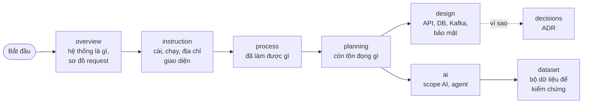

# Tài liệu Mini Marketplace

> Điểm bắt đầu duy nhất. Tài liệu phản ánh **code hiện tại**; khi khác nhau thì code đúng. Tên file theo dạng `NN_TEN_VIET_HOA.md`, mỗi thư mục có `README.md` làm mục lục.

## Lộ trình đọc



## Bạn muốn gì? Đọc đâu?

| Câu hỏi | Đọc |
|---|---|
| Hệ thống này là gì, có service nào, mấy replica, mỗi cái làm gì? | [overview/01_SYSTEM_OVERVIEW.md](overview/01_SYSTEM_OVERVIEW.md) |
| Một request đi qua những đâu? (có sơ đồ) | [overview/02_REQUEST_FLOWS.md](overview/02_REQUEST_FLOWS.md) |
| Cài gì, chạy lệnh gì, mở giao diện ở địa chỉ nào, đăng nhập bằng gì? | [instruction/01_QUICKSTART.md](instruction/01_QUICKSTART.md) |
| Đã làm được những gì? | [process/01_IMPLEMENTATION_STATUS.md](process/01_IMPLEMENTATION_STATUS.md) |
| Còn tồn đọng vấn đề gì? | [planning/01_OPEN_ISSUES.md](planning/01_OPEN_ISSUES.md) |
| Hạ tầng còn thiếu gì để làm dự án AI lớn? | [planning/03_INFRA_GAPS_FOR_LARGE_PROJECT.md](planning/03_INFRA_GAPS_FOR_LARGE_PROJECT.md) |
| Gọi API nào? Event Kafka nào? Bảng DB nào? | [design/](design/README.md) (`04_API_REFERENCE`, `03_EVENTS_KAFKA`, `02_DATA_MODEL`) |
| Sự cố (đơn kẹt, Kafka lag, ClickHouse…) xử lý sao? | [instruction/03_RUNBOOK.md](instruction/03_RUNBOOK.md) |
| Vì sao quyết định như vậy? | [decisions/01_ADR_LOG.md](decisions/01_ADR_LOG.md) |
| Sau này gắn AI / agent thế nào, scope nào làm được, cần LangGraph không? | [ai/README.md](ai/README.md) |
| Dùng bộ dữ liệu nào để kiểm chứng từng chức năng AI? | [dataset/README.md](dataset/README.md) |

## Cấu trúc

```
docs/
├── overview/     Tổng quan: service, replica, sơ đồ, luồng request
├── instruction/  Hướng dẫn: quickstart, deploy, runbook, test
├── process/      Tiến độ: đã làm được gì
├── planning/     Kế hoạch: vấn đề tồn đọng, nợ kỹ thuật / backlog
├── design/       Thiết kế chi tiết: kiến trúc, data model, Kafka, API, bảo mật, protobuf, platform/
├── decisions/    ADR: các quyết định đã chốt
├── ai/           AI: scope, agent / LangGraph / LangSmith, bức tranh các sàn, độ sẵn sàng dữ liệu
└── dataset/      Bộ dữ liệu công khai để validate từng scope AI (mỗi scope một file)
```

Quy ước làm việc cho người và công cụ lập trình: [../CLAUDE.md](../CLAUDE.md). README gốc: [../README.md](../README.md).
