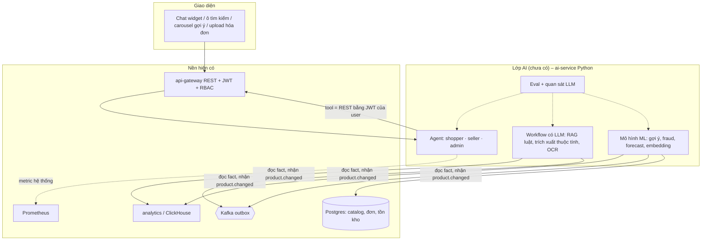
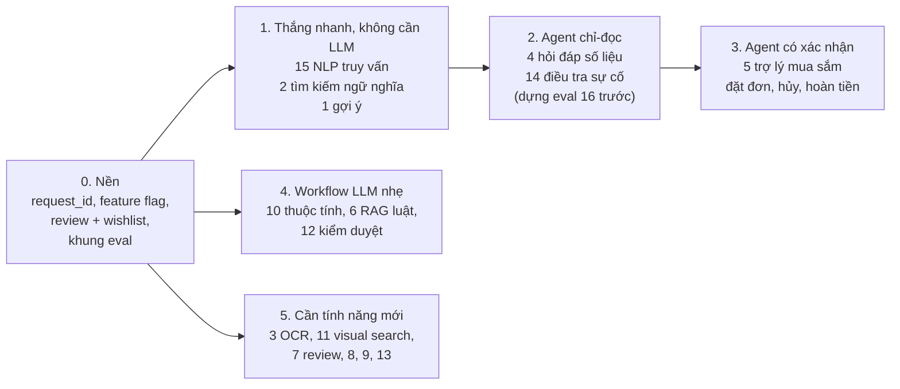

# Các scope AI khả thi trên nền Mini Marketplace

> **Trạng thái: kế hoạch / nghiên cứu. Chưa có `ai-service` và chưa có endpoint AI nào.** Tài liệu trả lời: nền hiện tại có đỡ được một dự án agentic lớn cho admin / buyer / seller không, có những scope AI nào làm được, scope nào cần agent, scope nào chỉ cần ML hoặc pipeline thường, và mỗi scope kiểm chứng bằng bộ dữ liệu nào.

## 1. Câu trả lời ngắn cho "đây là nền để build AI agentic, đúng không?"

**Đúng, với hai điều kiện.**

1. Nền đã có đúng những thứ agent cần: API REST có phân quyền theo vai trò (agent gọi lại bằng JWT của người dùng nên không thể vượt quyền), tracking clickstream (`events_raw`: `impression`, `product_click`, `add_to_cart`, `search`… có `position`, `surface`), bảng fact đơn hàng / thanh toán / tồn kho, báo cáo analytics theo phạm vi store / platform, metric Prometheus. Xem [../overview/01_SYSTEM_OVERVIEW.md](../overview/01_SYSTEM_OVERVIEW.md).
2. Còn thiếu một số mảnh *dữ liệu* và *hạ tầng* trước khi gắn từng scope (review, `request_id` cho gợi ý, upload ảnh, feature flag, eval, quan sát LLM…): xem [04_AI_DATA_READINESS.md](04_AI_DATA_READINESS.md). Dữ liệu demo hiện là dữ liệu giả, nên **chất lượng mô hình phải kiểm bằng bộ dữ liệu công khai** ([../dataset/README.md](../dataset/README.md)), không kết luận từ dữ liệu demo.

Ví dụ trong câu hỏi gốc đều khả thi: "giám sát" (admin hỏi tình hình hệ thống), "giỏ hàng là gì / bao nhiêu tiền" (buyer hỏi qua tool giỏ hàng), "gợi ý theo click", "OCR hóa đơn".

## 2. Ba lớp

Nguyên tắc (kế thừa từ bản nháp ban đầu [05_AI_DRAFT_ORIGINAL.md](05_AI_DRAFT_ORIGINAL.md)):
- Agent **không** có "service account vạn năng", **không** viết SQL, không chạy code, không tự ghi: hành động ghi (thêm giỏ, hủy đơn, đổi giá) trả về `action_proposal` để người dùng bấm xác nhận.
- Tool = endpoint REST sẵn có ở gateway; phân quyền và sở hữu kiểm ở server, không dựa vào prompt.
- Dữ liệu từ tool / RAG / mô tả sản phẩm là **không tin cậy** (prompt injection).
- Mọi tính năng AI tắt được bằng cờ và có fallback không-AI.

## 3. Danh sách scope

Mỗi scope có một file dữ liệu riêng ở [../dataset/](../dataset/README.md) (bộ dữ liệu công khai, cách tự dựng bộ vàng, metric, lộ trình). Cột "Agent?" xem lập luận ở [02_AGENT_ARCHITECTURE.md](02_AGENT_ARCHITECTURE.md); danh sách tính năng agent cụ thể ở [06_AGENT_FEATURES.md](06_AGENT_FEATURES.md).

| # | Scope | Cho ai | Nền cung cấp gì | Agent? | Độ khả thi / ưu tiên đề xuất | File dữ liệu |
|---|---|---|---|---|---|---|
| 1 | Gợi ý theo click / giỏ / mua (home, "sản phẩm tương tự", "mua cùng") | buyer | `events_raw`, `fact_order_items`, `dim_products` | Không (pipeline ML) | Cao, **làm sớm** (baseline trending → co-visitation → embedding) | `01_RECOMMENDATION_CLICK` |
| 2 | Tìm kiếm ngữ nghĩa / theo mô tả (hybrid BM25 + vector) | buyer | catalog đủ trường; `search`, `search_click` | Không (retrieval); LLM chỉ để viết lại truy vấn | Cao, **làm sớm** | `02_PRODUCT_SEARCH_SEMANTIC` |
| 3 | OCR + trích xuất hóa đơn / biên lai | seller, admin (đối soát), buyer | upload ảnh (**chưa có**) | Không (pipeline OCR/VLM → schema → người duyệt) | Trung bình, cần upload ảnh | `03_INVOICE_RECEIPT_OCR` |
| 4 | Hỏi đáp số liệu: doanh thu, tồn kho, traffic, hiệu quả sản phẩm | seller, admin | API analytics theo scope, `/admin/system/health` | **Có** (tool-calling, vòng lặp có giới hạn) | Cao, giá trị lớn, rủi ro quyền cần eval kỹ | `04_ANALYTICS_QA_TEXT2SQL`, `16_AGENT_TOOL_USE_EVAL` |
| 5 | Trợ lý mua sắm / CSKH: giá, giỏ hàng, đơn, đổi trả | buyer | cart / order / payment API | **Có** (+ xác nhận cho hành động ghi) | Cao | `05_SHOPPER_ASSISTANT_CUSTOMER_SUPPORT` |
| 6 | Hỏi đáp luật / chính sách (RAG có trích dẫn, theo phiên bản văn bản) | buyer, seller, admin | không phụ thuộc nhiều; cần kho văn bản (mô phỏng) | Workflow; agentic chỉ khi kết hợp dữ liệu đơn của user | Trung bình | `06_POLICY_LEGAL_RAG` |
| 7 | Phân tích review: sentiment, aspect, review giả, tóm tắt | seller, admin, buyer | **chưa có review** | Không (batch) | Cần làm tính năng review trước | `07_REVIEW_SENTIMENT_SPAM` |
| 8 | Gian lận / bot / bất thường | admin | tracking, `fact_payment_events`, đơn | Không (ML + luật); LLM chỉ để giải thích | Trung bình (thanh toán mô phỏng nên dữ liệu thật ít) | `08_FRAUD_ANOMALY_RISK` |
| 9 | Dự báo nhu cầu, ngày hết hàng, ETA | seller, admin | `fact_inventory`, `fact_order_items` | Không (chuỗi thời gian) | Trung bình, cần lịch sử dài | `09_DEMAND_FORECAST_LOGISTICS` |
| 10 | Phân loại danh mục, trích thuộc tính, trùng lặp, trợ lý viết mô tả | seller | catalog, `product.changed` | Không (workflow LLM + schema) | Cao, nhẹ | `10_PRODUCT_CATEGORIZATION_ATTRIBUTES` |
| 11 | Tìm bằng ảnh, sản phẩm giống ảnh | buyer | ảnh sản phẩm (hiện chỉ URL) | Không (embedding ảnh) | Trung bình | `11_VISUAL_SEARCH_MULTIMODAL` |
| 12 | Kiểm duyệt listing / bình luận + an toàn agent (prompt injection, rò rỉ) | admin, hệ thống | catalog, review | Không (classifier + LLM-judge); bộ red-team bắt buộc cho agent | Cao về an toàn | `12_CONTENT_MODERATION_AGENT_SAFETY` |
| 13 | Phân khúc khách, CLV, churn, khuyến mãi / giá | admin, seller | đơn, tracking | Không (ML) | Thấp–trung bình (không có mã giảm giá, ADR) | `13_CUSTOMER_ANALYTICS_CLV_CHURN_PRICING` |
| 14 | AIOps: bất thường metric, giải thích cảnh báo, truy nguyên nguyên nhân | admin | Prometheus, Grafana, log | Giải thích = 1 lần gọi LLM; **điều tra nhiều bước = agent chỉ-đọc** | Trung bình (chưa có hệ thống cảnh báo, ADR-12) | `14_AIOPS_ANOMALY_ALERT_EXPLAIN` |
| 15 | NLP tiếng Việt cho truy vấn: tìm không dấu, sửa chính tả, NER, intent | buyer | `search`, `search_term` | Không | Cao, là nền cho 2 và 5 | `15_VIETNAMESE_NLP_QUERY_UNDERSTANDING` |
| 16 | Đánh giá agent gọi tool (bộ eval cho shopper / seller / admin) | đội dev | log tool-call | – | **Bắt buộc trước khi bật 4 / 5** | `16_AGENT_TOOL_USE_EVAL` |

Các sàn lớn đang làm gì và scope nào còn thiếu so với danh sách này: [03_MARKETPLACE_AI_LANDSCAPE.md](03_MARKETPLACE_AI_LANDSCAPE.md).

## 4. Thứ tự đề xuất

Mục tiêu của thứ tự này: làm trước những scope rẻ, đo được và không rủi ro quyền, rồi mới đến agent có hành động ghi.
