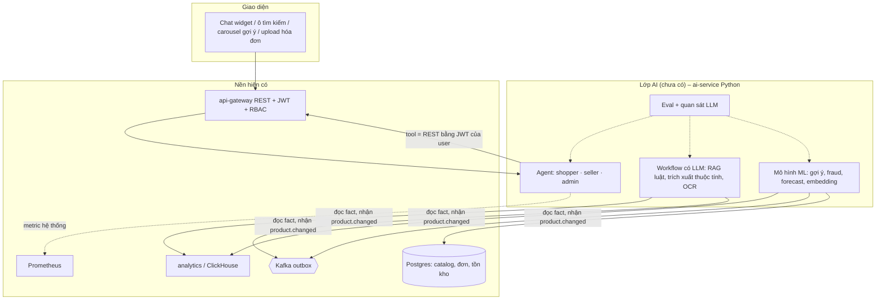
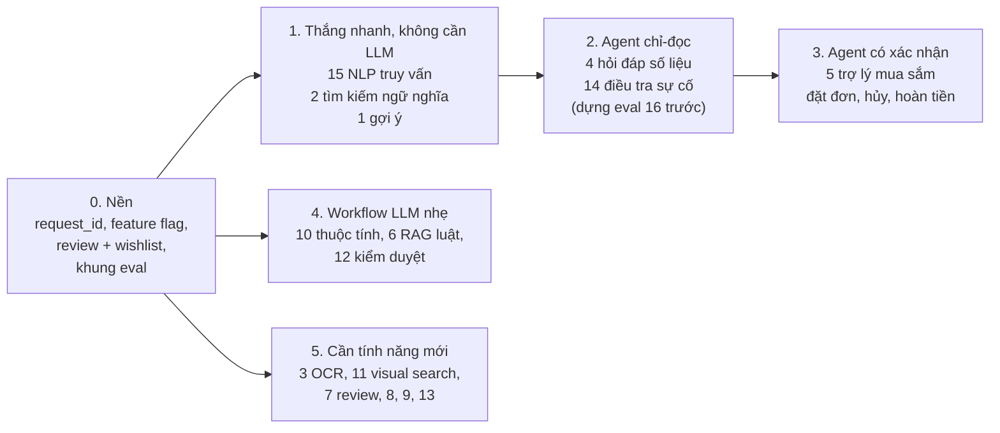

# Các scope AI khả thi trên nền Mini Marketplace

> **Trạng thái: kế hoạch / nghiên cứu. Chưa có `ai-service` và chưa có endpoint AI nào.** Tài liệu trả lời: nền hiện tại có đỡ được một dự án agentic lớn cho admin / buyer / seller không, có những scope AI nào làm được, scope nào cần agent, scope nào chỉ cần ML hoặc pipeline thường, và mỗi scope kiểm chứng bằng bộ dữ liệu nào.

## 1. Câu trả lời ngắn cho "đây là nền để build AI agentic, đúng không?"

**Đúng, với hai điều kiện.**

1. Nền đã có đúng những thứ agent cần: API REST có phân quyền theo vai trò (agent gọi lại bằng JWT của người dùng nên không thể vượt quyền), tracking clickstream (`events_raw`: `impression`, `product_click`, `add_to_cart`, `search`… có `position`, `surface`), bảng fact đơn hàng / thanh toán / tồn kho, báo cáo analytics theo phạm vi store / platform, metric Prometheus. Xem [../overview/01_SYSTEM_OVERVIEW.md](../overview/01_SYSTEM_OVERVIEW.md).
2. Còn thiếu một số mảnh *dữ liệu* và *hạ tầng* trước khi gắn từng scope (review, `request_id` cho gợi ý, upload ảnh, feature flag, eval, quan sát LLM…): xem [04_AI_DATA_READINESS.md](04_AI_DATA_READINESS.md). Dữ liệu demo hiện là dữ liệu giả, nên **chất lượng mô hình phải kiểm bằng bộ dữ liệu công khai** ([../dataset/README.md](../dataset/README.md)), không kết luận từ dữ liệu demo.

Ví dụ trong câu hỏi gốc đều khả thi: "giám sát" (admin hỏi tình hình hệ thống), "giỏ hàng là gì / bao nhiêu tiền" (buyer hỏi qua tool giỏ hàng), "gợi ý theo click", "OCR hóa đơn".

## 2. Ba lớp

Nguyên tắc (kế thừa từ bản nháp ban đầu [05_AI_DRAFT_ORIGINAL.md](05_AI_DRAFT_ORIGINAL.md)):
- Agent **không** có "service account vạn năng", **không** viết SQL, không chạy code, không tự ghi: hành động ghi (thêm giỏ, hủy đơn, đổi giá) trả về `action_proposal` để người dùng bấm xác nhận.
- Tool = endpoint REST sẵn có ở gateway; phân quyền và sở hữu kiểm ở server, không dựa vào prompt.
- Dữ liệu từ tool / RAG / mô tả sản phẩm là **không tin cậy** (prompt injection).
- Mọi tính năng AI tắt được bằng cờ và có fallback không-AI.

## 3. Danh sách scope

Mỗi scope có một file dữ liệu riêng ở [../dataset/](../dataset/README.md) (bộ dữ liệu công khai, cách tự dựng bộ vàng, metric, lộ trình). Cột "Agent?" xem lập luận ở [02_AGENT_ARCHITECTURE.md](02_AGENT_ARCHITECTURE.md); danh sách tính năng agent cụ thể ở [06_AGENT_FEATURES.md](06_AGENT_FEATURES.md).

| # | Scope | Cho ai | Nền cung cấp gì | Agent? | Độ khả thi / ưu tiên đề xuất | File dữ liệu |
|---|---|---|---|---|---|---|
| 1 | Gợi ý theo click / giỏ / mua (home, "sản phẩm tương tự", "mua cùng") | buyer | `events_raw`, `fact_order_items`, `dim_products` | Không (pipeline ML) | Cao, **làm sớm** (baseline trending → co-visitation → embedding) | `01_RECOMMENDATION_CLICK` |
| 2 | Tìm kiếm ngữ nghĩa / theo mô tả (hybrid BM25 + vector) | buyer | catalog đủ trường; `search`, `search_click` | Không (retrieval); LLM chỉ để viết lại truy vấn | Cao, **làm sớm** | `02_PRODUCT_SEARCH_SEMANTIC` |
| 3 | OCR + trích xuất hóa đơn / biên lai | seller, admin (đối soát), buyer | upload ảnh (**chưa có**) | Không (pipeline OCR/VLM → schema → người duyệt) | Trung bình, cần upload ảnh | `03_INVOICE_RECEIPT_OCR` |
| 4 | Hỏi đáp số liệu: doanh thu, tồn kho, traffic, hiệu quả sản phẩm | seller, admin | API analytics theo scope, `/admin/system/health` | **Có** (tool-calling, vòng lặp có giới hạn) | Cao, giá trị lớn, rủi ro quyền cần eval kỹ | `04_ANALYTICS_QA_TEXT2SQL`, `16_AGENT_TOOL_USE_EVAL` |
| 5 | Trợ lý mua sắm / CSKH: giá, giỏ hàng, đơn, đổi trả | buyer | cart / order / payment API | **Có** (+ xác nhận cho hành động ghi) | Cao | `05_SHOPPER_ASSISTANT_CUSTOMER_SUPPORT` |
| 6 | Hỏi đáp luật / chính sách (RAG có trích dẫn, theo phiên bản văn bản) | buyer, seller, admin | không phụ thuộc nhiều; cần kho văn bản (mô phỏng) | Workflow; agentic chỉ khi kết hợp dữ liệu đơn của user | Trung bình | `06_POLICY_LEGAL_RAG` |
| 7 | Phân tích review: sentiment, aspect, review giả, tóm tắt | seller, admin, buyer | **chưa có review** | Không (batch) | Cần làm tính năng review trước | `07_REVIEW_SENTIMENT_SPAM` |
| 8 | Gian lận / bot / bất thường | admin | tracking, `fact_payment_events`, đơn | Không (ML + luật); LLM chỉ để giải thích | Trung bình (thanh toán mô phỏng nên dữ liệu thật ít) | `08_FRAUD_ANOMALY_RISK` |
| 9 | Dự báo nhu cầu, ngày hết hàng, ETA | seller, admin | `fact_inventory`, `fact_order_items` | Không (chuỗi thời gian) | Trung bình, cần lịch sử dài | `09_DEMAND_FORECAST_LOGISTICS` |
| 10 | Phân loại danh mục, trích thuộc tính, trùng lặp, trợ lý viết mô tả | seller | catalog, `product.changed` | Không (workflow LLM + schema) | Cao, nhẹ | `10_PRODUCT_CATEGORIZATION_ATTRIBUTES` |
| 11 | Tìm bằng ảnh, sản phẩm giống ảnh | buyer | ảnh sản phẩm (hiện chỉ URL) | Không (embedding ảnh) | Trung bình | `11_VISUAL_SEARCH_MULTIMODAL` |
| 12 | Kiểm duyệt listing / bình luận + an toàn agent (prompt injection, rò rỉ) | admin, hệ thống | catalog, review | Không (classifier + LLM-judge); bộ red-team bắt buộc cho agent | Cao về an toàn | `12_CONTENT_MODERATION_AGENT_SAFETY` |
| 13 | Phân khúc khách, CLV, churn, khuyến mãi / giá | admin, seller | đơn, tracking | Không (ML) | Thấp–trung bình (không có mã giảm giá, ADR) | `13_CUSTOMER_ANALYTICS_CLV_CHURN_PRICING` |
| 14 | AIOps: bất thường metric, giải thích cảnh báo, truy nguyên nguyên nhân | admin | Prometheus, Grafana, log | Giải thích = 1 lần gọi LLM; **điều tra nhiều bước = agent chỉ-đọc** | Trung bình (chưa có hệ thống cảnh báo, ADR-12) | `14_AIOPS_ANOMALY_ALERT_EXPLAIN` |
| 15 | NLP tiếng Việt cho truy vấn: tìm không dấu, sửa chính tả, NER, intent | buyer | `search`, `search_term` | Không | Cao, là nền cho 2 và 5 | `15_VIETNAMESE_NLP_QUERY_UNDERSTANDING` |
| 16 | Đánh giá agent gọi tool (bộ eval cho shopper / seller / admin) | đội dev | log tool-call | – | **Bắt buộc trước khi bật 4 / 5** | `16_AGENT_TOOL_USE_EVAL` |

Các sàn lớn đang làm gì và scope nào còn thiếu so với danh sách này: [03_MARKETPLACE_AI_LANDSCAPE.md](03_MARKETPLACE_AI_LANDSCAPE.md).

## 4. Thứ tự đề xuất

Mục tiêu của thứ tự này: làm trước những scope rẻ, đo được và không rủi ro quyền, rồi mới đến agent có hành động ghi.

## 5. Lĩnh vực của từng scope, và scope nào làm riêng thành một đề tài được

"Làm riêng thành một đề tài" ở đây **không** nói về độ lớn của tính năng. Ý là: tách được thành một bài toán có (a) bộ dữ liệu công khai để đo, không cần marketplace chạy, (b) ít nhất 3 phương pháp khác nhau để so sánh, (c) metric chuẩn của lĩnh vực, (d) kết luận không phụ thuộc vào repo này. Một đề tài như vậy mới đủ độ sâu để nghiên cứu, so sánh, viết báo cáo; làm mỗi nhánh một chút thì không đạt được điều đó. Phân loại là đánh giá đề xuất, không phải chuẩn.

| # | Scope | Lĩnh vực chính | Lĩnh vực phụ | Kiểu chạy | Làm riêng thành 1 đề tài? |
|---|---|---|---|---|---|
| 1 | Gợi ý click / giỏ / mua | **RecSys** | learning-to-rank, embedding | batch huấn luyện + phục vụ online | **Có.** Bài toán kinh điển có benchmark (OTTO, REES46), nhiều họ phương pháp để so sánh |
| 2 | Tìm kiếm ngữ nghĩa | **Information Retrieval** | NLP, embedding, rerank | index (batch) + truy vấn online | **Có.** BM25 vs dense vs hybrid vs rerank, benchmark WANDS / ESCI |
| 3 | OCR hóa đơn | **Computer Vision / Document AI** | VLM, trích xuất có schema | online theo yêu cầu, có người duyệt | **Có.** Pipeline OCR+KIE vs Donut vs VLM, benchmark SROIE / FATURA / MC-OCR |
| 4 | Hỏi đáp số liệu | **LLM agent** | text-to-SQL, tool use | online, tool = REST gateway | **Có.** Tool calling vs semantic layer vs text-to-SQL, benchmark BIRD / Spider; phần "không rò dữ liệu chéo store" là điều kiện riêng của repo |
| 5 | Trợ lý mua sắm / CSKH | **LLM agent hội thoại** | tool use, an toàn hành động ghi | online, có `action_proposal` | **Có.** Benchmark τ-bench, pass^k; cần user simulator |
| 6 | Hỏi đáp luật / chính sách | **RAG** | NLP tiếng Việt, versioning văn bản | index (batch) + online | **Có.** Benchmark Zalo Legal / ALQAC, đo cả truy hồi lẫn trích dẫn lẫn faithfulness |
| 7 | Phân tích review | **NLP** | phát hiện spam | batch | **Có, nhưng gồm hai bài:** sentiment / ABSA (UIT-ViSFD) và review spam (ViSpamReviews, YelpChi). Mỗi bài tự đứng được |
| 8 | Gian lận / bot | **ML bất thường / tabular** | đồ thị, luật | batch + chấm điểm gần thời gian thực | **Có, nhưng phải làm hoàn toàn trên dữ liệu công khai** (IEEE-CIS, BAF): thanh toán của repo là mô phỏng nên không có nhãn gian lận thật |
| 9 | Dự báo nhu cầu / hết hàng | **Time-series forecasting** | MLOps | batch hàng đêm | **Có.** Benchmark M5; đề tài riêng là nhu cầu bị cắt do hết hàng (censored demand) |
| 10 | Phân loại danh mục, trích thuộc tính, trùng lặp | **NLP / LLM extraction** | dedup, workflow có schema | online khi seller nhập + batch | **Có, nhưng là ba bài:** phân loại danh mục, trích thuộc tính, product matching. Mỗi bài tự đứng được, riêng bài 10 thì quá rộng |
| 11 | Tìm bằng ảnh | **Computer Vision** (embedding ảnh) | multimodal, vector DB | index (batch) + online | **Có.** CLIP/SigLIP zero-shot vs fine-tune metric learning, benchmark Shopee Product Matching / SOP / ABO |
| 12 | Kiểm duyệt + an toàn agent | **Trust & Safety** | red-team | online chặn + batch | **Có, nhưng là hai bài khác nhau:** (a) độc hại / hàng cấm tiếng Việt (ViHSD); (b) an toàn agent / prompt injection (AgentDojo, InjecAgent) |
| 13 | Phân khúc, CLV, churn, giá | **ML tabular / causal** | A/B | batch | **Có, nhưng là ba bài:** CLV + churn, uplift, định giá. Uplift và giá cần thí nghiệm ngẫu nhiên nên khó đo trên dữ liệu demo |
| 14 | AIOps | **Time-series anomaly + RCA** | LLM giải thích | batch + online khi điều tra | **Có.** TSB-AD, RCAEval; LLM làm RCA đầy đủ còn yếu (OpenRCA) nên đề tài thực chất là anomaly detection + RCA |
| 15 | NLP tiếng Việt cho truy vấn | **NLP** (tiếng Việt) | search | thư viện / service nhỏ | **Có, ở mức intrinsic:** khôi phục dấu, sửa chính tả, NER, intent. Đo đến kết quả tìm kiếm thì phải ghép với scope 2 |
| 16 | Đánh giá agent gọi tool | **LLM evaluation** | benchmark | offline, chạy trong CI | **Có,** nhưng đây là bài toán **đo lường** (thiết kế benchmark, pass^k, LLM-judge hiệu chuẩn) chứ không phải huấn luyện mô hình |

### 5.1 Từng scope viết thành một bài toán riêng

Cột phương pháp liệt kê các họ phương pháp cần **so sánh với nhau**, từ baseline đến nâng cao (lấy từ mục 2 / 3 của từng file trong [../dataset/](../dataset/README.md); đọc file đó để biết chi tiết, license và độ tin cậy của nguồn). Dữ liệu là bộ nên thử đầu tiên.

| # | Bài toán | Dữ liệu để làm | Phương pháp so sánh | Metric chính |
|---|---|---|---|---|
| 1 | Dự đoán sản phẩm tiếp theo trong phiên (session-based) | OTTO, REES46, RetailRocket | top bán chạy → co-visitation → item-kNN / GRU4Rec / SASRec → two-tower → retrieval + rerank LightGBM | Recall@K, NDCG@K, MRR@K; counterfactual IPS/SNIPS |
| 2 | Truy hồi sản phẩm theo truy vấn | WANDS, Amazon ESCI, VN-MTEB | BM25 → dense (BGE-M3, e5) → hybrid RRF → cross-encoder rerank → LambdaMART | nDCG@10, Recall@K, MRR@10 |
| 3 | Trích xuất trường từ ảnh hóa đơn | MC-OCR 2021, SROIE, FATURA | OCR + quy tắc → LayoutLMv3 (KIE) → Donut (không OCR) → VLM có kiểm chứng bằng luật | CER/WER, F1 theo trường, line-item F1 |
| 4 | Câu hỏi tiếng Việt → số liệu từ kho phân tích | BIRD, Spider, LiveSQLBench + bộ vàng tự dựng | tool calling → semantic layer → text-to-SQL có ràng buộc → + tự sửa lỗi | Execution Accuracy, tỉ lệ rò dữ liệu chéo store (= 0) |
| 5 | Agent hội thoại hoàn thành tác vụ có chính sách | τ-bench / τ²-bench, ABCD, WebShop | FAQ + luồng cố định → LLM tool-calling → + state machine guard → + user simulator | task success, pass^k, vi phạm chính sách |
| 6 | QA có trích dẫn trên văn bản luật theo hiệu lực thời gian | Zalo Legal 2021, ALQAC, RAGTruth, LegalBench-RAG | BM25 theo Điều → dense / hybrid + rerank → RAG có trích dẫn + kiểm tra NLI → versioning `as_of` | Recall / F2, citation precision-recall, faithfulness |
| 7a | Sentiment / ABSA tiếng Việt | UIT-ViSFD, UIT-VSFC, VLSP 2016 | TF-IDF + LR → PhoBERT / ViSoBERT → PhoBERT-CRF (ABSA) → LLM few-shot | macro-F1, F1 aspect + polarity |
| 7b | Phát hiện review spam / giả | ViSpamReviews, YelpChi | đặc trưng văn bản → + hành vi → đồ thị người dùng–sản phẩm | PR-AUC, recall@precision cố định |
| 8 | Phát hiện gian lận giao dịch / bot | IEEE-CIS, BAF, TalkingData | luật velocity → Isolation Forest / LOF → LightGBM (chia theo thời gian) → GNN | PR-AUC, recall@precision, chi phí kỳ vọng |
| 9 | Dự báo nhu cầu bán lẻ thưa, có hết hàng | M5, Online Retail II, FreshRetailNet-50K | seasonal naive / Croston → ETS-ARIMA → LightGBM global → foundation model (Chronos, TimesFM) | RMSSE / WRMSSE, pinball loss |
| 10a | Phân loại danh mục phân cấp | Rakuten 2018 (SIGIR eCom), Shopee Product Matching (phần tiếng Anh) | TF-IDF ký tự + linear → PhoBERT / embedding + kNN → phân cấp có ngưỡng từ chối | hierarchical F1, Acc@k |
| 10b | Trích xuất thuộc tính sản phẩm | MAVE, OpenTag-style | regex + từ điển → BiLSTM/PhoBERT-CRF → LLM structured output có grounding | P/R/F1 (thuộc tính, giá trị) |
| 10c | Khớp / loại trùng sản phẩm | Shopee Product Matching, WDC Products | blocking + cross-encoder (Ditto-style) → LLM → + ảnh | cluster-F1, recall blocking |
| 11 | Truy hồi ảnh sản phẩm | Shopee Product Matching, SOP, ABO | pHash → CLIP/SigLIP zero-shot → fine-tune metric learning (ArcFace, triplet) → + text hybrid | Recall@K, mAP@R, F1 theo nhóm |
| 12a | Phát hiện nội dung độc hại / hàng cấm tiếng Việt | UIT-ViHSD, ViCTSD, ViHOS | TF-IDF + LR → PhoBERT / ViSoBERT → LLM với rubric | macro-F1, PR-AUC |
| 12b | An toàn agent: prompt injection, vượt quyền | AgentDojo, InjecAgent, WildGuardMix | prompt phòng thủ → tách kênh dữ liệu / chỉ dẫn → classifier phát hiện injection → allowlist tool theo role | Attack Success Rate, utility under attack |
| 13a | CLV + churn / repeat buyer | Online Retail II, Dunnhumby | RFM → BG/NBD + Gamma-Gamma → GBM + survival | AUC, PR-AUC, lift@decile, Spearman |
| 13b | Uplift (khuyến mãi) | Hillstrom → Criteo Uplift | T-learner / X-learner → causal forest | Qini / AUUC |
| 13c | Định giá | Online Retail II | ước lượng độ co giãn → bandit / tối ưu có ràng buộc | doanh thu / lợi nhuận mô phỏng |
| 14 | Phát hiện bất thường metric + xếp hạng nguyên nhân | TSB-AD, SMD, RCAEval, OpenRCA | z-score / EWMA / STL → Isolation Forest / matrix profile → đa biến (autoencoder) → RCA trên đồ thị phụ thuộc → LLM giải thích | VUS-PR, Top-k accuracy RCA, detection delay |
| 15 | Hiểu truy vấn tiếng Việt: dấu, chính tả, NER, intent | VN-MTEB, MASSIVE (vi-VN), Viwiki-Spelling | chuẩn hóa + từ điển → khôi phục dấu / sửa chính tả (seq2seq) → PhoBERT-CRF NER → embedding đa ngữ | CER/WER, F1 thực thể, tỉ lệ sửa sai |
| 16 | Đo độ tin cậy của agent gọi tool | τ²-bench, BFCL, MCP-Bench, GAIA | so khớp tool call → multi-turn có trạng thái DB → pass^k → LLM-judge hiệu chuẩn | tool-selection / argument accuracy, pass^k, unauthorized-call rate |

### 5.2 Có nên gộp không (đề xuất, chưa chốt)

Mặc định **không gộp**: mỗi scope ở §5.1 đã là một bài toán riêng, và gộp quá sớm sẽ làm mỗi phần mỏng đi (đúng điều cần tránh). Gộp chỉ hợp lý khi thỏa cả ba điều kiện: **(a)** dùng chung dữ liệu đầu vào, **(b)** kết quả của bài này là đầu vào trực tiếp của bài kia, **(c)** đo được chung một bộ metric hoặc một bộ eval. Khi gộp, mỗi phần **vẫn phải giữ phần so sánh phương pháp của riêng nó** ở §5.1; gộp chỉ để chia sẻ hạ tầng và đo end-to-end.

| Đề xuất gộp | Logic | Giữ riêng thì sao |
|---|---|---|
| **2 + 15** (tìm kiếm + hiểu truy vấn) | thỏa a, b, c: 15 là tầng tiền xử lý của 2 và chỉ đo được "kết quả tìm kiếm đúng sau khi khôi phục dấu" khi ghép với 2 | 15 đứng riêng ở mức intrinsic (CER, F1 NER); 2 đứng riêng với truy vấn sạch |
| **16 + 12b** (đo độ tin cậy + an toàn agent) | thỏa a, c: cùng log tool-call, cùng bộ eval đối kháng; 12b là một phần của bộ eval 16 | vẫn đứng riêng được: 16 là phương pháp luận benchmark, 12b là phòng thủ injection |
| **4 + 5 + 14b** (các agent) | chỉ thỏa b ở mức khung (tool-calling, vòng lặp có giới hạn, `action_proposal`); bộ tool, dữ liệu và metric khác nhau | **nên giữ riêng:** mỗi agent là một bài toán khác; chỉ dùng chung khung và bộ eval 16 |
| **1 + 13a** (hành vi người dùng) | thỏa a: cùng `events_raw` + đơn hàng, có thể dùng chung biểu diễn người dùng; không thỏa b, c | giữ riêng: câu hỏi nghiên cứu khác (xếp hạng vs dự đoán giá trị / rời bỏ) |
| **7b ⊂ 8** (spam review vào gian lận) | thỏa a: cùng đặc trưng hành vi / đồ thị tài khoản; metric đều là PR-AUC, recall@precision | giữ riêng nếu muốn tập trung NLP cho 7b |
| **10a / 10b / 10c** (ba bài catalog) | thỏa a, b: cùng catalog, 10c cần thuộc tính từ 10b, 10a cho danh mục để blocking | giữ riêng: mỗi bài có benchmark và metric riêng, nên là ba đề tài |

Không đề xuất gộp: **3** (OCR), **6** (RAG luật), **9** (dự báo), **11** (tìm bằng ảnh), **14a** (anomaly metric) hay **8** với **9**: dù cùng là "ML trên bảng / chuỗi thời gian", câu hỏi nghiên cứu, dữ liệu và metric đều khác nhau, nên gộp không thêm gì ngoài việc giảm độ sâu. Thứ tự làm các đề tài (cái nào là nền cho cái nào) vẫn theo §4.

## 6. Bộ dữ liệu nên chọn để tích hợp được vào hệ thống

> Rút từ việc đọc lại cả 16 file [../dataset/](../dataset/README.md) đối chiếu với dữ liệu hệ thống thật lưu ([02_DATA_MODEL](../design/02_DATA_MODEL.md), [07_DATA_PIPELINE](../design/07_DATA_PIPELINE.md)). **Mọi con số, license và nhãn "đã xác minh" lấy nguyên từ các file đó**, mà các file ghi rõ nhiều nguồn chỉ dựa vào kết quả tìm kiếm (không mở được trang Kaggle / HuggingFace / arXiv gốc), nên **phải mở trang gốc kiểm lại license và kích thước trước khi tải**. Cột "hiệu quả nhất" là **suy luận** từ số sao ★ trong file, độ khớp miền và khớp schema; không có số đo hiệu quả nào của các bộ trên dữ liệu của marketplace.

**Quy tắc ngôn ngữ:** chỉ giữ bộ có nội dung tiếng **Anh hoặc Việt** (hoặc không có ngôn ngữ tự nhiên: ID, số, chuỗi thời gian, log). Bộ đa ngôn ngữ chỉ dùng phần Anh / Việt. Đã **bỏ khỏi tài liệu**: Baidu-ULTR, JDsearch, KuaiSearch, Taobao, Ali-CCP (Trung); Shopee Price Match (chủ yếu Indonesia); CORD (Indonesia), XFUND (7 ngôn ngữ khác); Olist (Bồ Đào Nha); Rakuten France Multimodal, BSARD, FiscalQA Pro (Pháp); TaoDescribe, JDPDG, LeCaRD, ACEBench (Trung); ANEEL (Bồ Đào Nha). KuaiSearch bị bỏ theo suy luận (nguồn nói Kuaishou nhưng không nêu ngôn ngữ): nếu bạn muốn giữ thì hoàn nguyên được ở `docs/dataset/02`. Bỏ CORD làm mất bộ biên lai duy nhất có license đã xác minh rõ.

**Về cột dung lượng:** số mẫu lấy từ chính các file; dung lượng tải / đĩa chủ yếu qua search snippet hoặc API công khai (HF, Kaggle, Zenodo, GitHub), nhiều bộ ghi "không tìm thấy" vì trang gốc không mở được. Kích thước repo GitHub có thể gồm cả lịch sử git (cận trên).

Hai điều áp dụng cho **mọi** scope:
1. Không có bộ TMĐT tiếng Việt đủ lớn công khai cho scope nào; dữ liệu demo / datagen chỉ kiểm đường ống. Bộ công khai chọn **phương pháp**, kết luận chất lượng phải dựa trên **bộ vàng tự dựng** từ dữ liệu hệ thống.
2. Nhãn nghiệp vụ phải theo định nghĩa của repo (ví dụ doanh thu = đơn PAID / DELIVERED trừ hoàn, ADR-22; tiền `*_minor`; múi giờ `Asia/Ho_Chi_Minh`), không dùng nhãn nguyên bản của bộ công khai.

### 6.1 Từng scope: dùng bộ nào, vướng gì khi tích hợp

| # | Bộ nên dùng làm chính (license theo file) | Lớn nhất (đã có số liệu) | Hiệu quả nhất (suy luận) | Vướng mắc khi tích hợp vào hệ thống |
|---|---|---|---|---|
| 1 | **OTTO**: 12.899.779 session, 216.716.096 event, 1.855.603 item; dung lượng không tìm thấy; CC BY 4.0 (đã xác minh). **REES46**: ~9 GB (YDB qua search, chưa rõ một hay hai tháng; số dòng chưa xác minh), license chưa xác minh, schema gần `events_raw` nhất. **RetailRocket**: 2.756.101 event, 1.407.580 visitor; đã có trong `datagen`. Open Bandit: ~26M impression (có `position`) | OTTO. (Criteo và Yambda lớn hơn nhưng là quảng cáo / nhạc; Yambda ~135 GB theo nguồn thứ ba chưa xác minh) | OTTO cho co-visitation + LightGBM; REES46 nếu cần brand / price / category | ID băm, không có tên / ảnh Việt, không có impression / `position` (trừ Open Bandit) nên chưa học khử thiên lệch được; thiếu `request_id` + `model_version` để đo CTR gợi ý; ID công khai không chuyển sang `product_id` thật nên embedding theo ID phải huấn luyện lại |
| 2 | **Amazon ESCI, chỉ phần tiếng Anh**: ~97K query, 1.818.825 nhãn, ~1,2M sản phẩm (toàn bộ 130.652 query, ~2,6M nhãn; en / es / ja nên bỏ phần es, ja); Apache-2.0 (đã xác minh); dung lượng không tìm thấy. **WANDS**: 480 query, 42.994 sản phẩm, 233.448 nhãn; MIT; dung lượng không tìm thấy. **VN-MTEB**: 41 bộ, dịch máy; license chưa xác minh; dung lượng không tìm thấy. SQID: >190K sản phẩm, 156.545 URL ảnh | ESCI (phần tiếng Anh); mMARCO (8,8M passage, en + vi, nhưng là passage chứ không phải sản phẩm) | ESCI để chọn kiến trúc (nhãn 4 mức, license rõ); WANDS để chạy nhanh trên laptop | Không có TMĐT tiếng Việt; thiếu giá VND, tên Việt, không dấu, viết tắt ("dưới 200k"); phải tự chấm tay 300–500 query làm bộ vàng. Đã **bỏ** JDsearch, Baidu-ULTR, KuaiSearch (tiếng Trung) và Shopee Price Match (chủ yếu tiếng Indonesia) |
| 3 | **MC-OCR 2021**: 2.436 ảnh biên lai Việt; mirror Kaggle `domixi1989/vietnamese-receipts-mc-ocr-2021` ≈2,30 GB (license ghi Unknown, mirror không chính thức), bản dẫn xuất Viet-Receipt-VQA 2.034 ảnh ~0,46 GB; license gốc chưa xác minh. **SROIE**: 1.000 biên lai (Malaysia, tiếng Anh); license dữ liệu không nêu; dung lượng không tìm thấy. **FATURA**: 10.000 hoá đơn, ~690,7 MB (Zenodo qua search); license chưa xác minh. DocILE: 6.680 có nhãn + 100K tổng hợp + ~932K chưa nhãn (cần đăng ký) | DocILE (~932K ảnh chưa nhãn); trong bộ có nhãn: FATURA (10.000) | MC-OCR đúng miền Việt nếu lấy được; SROIE + FATURA để bắt đầu | Chưa có upload ảnh, chưa có bảng lưu chứng từ; không bộ nào có MST, VAT, số hoá đơn kiểu Việt; số tiền VN dùng '.' ngăn nghìn; PII (Nghị định 13/2023, cần xác nhận pháp lý). Đã **bỏ** CORD (tiếng Indonesia; từng là bộ có license rõ CC BY 4.0) và XFUND (7 ngôn ngữ khác), nên hiện **không còn bộ biên lai nào có license đã xác minh rõ** |
| 4 | **BIRD**: 12.751 cặp, 95 DB, 33,4 GB; CC BY-SA 4.0 (đã xác minh). **Spider 1.0**: 10.181 câu, 200 DB; dung lượng không tìm thấy. **ViText2SQL**: ~10K cặp (6.831 / 954 / 1.908); cấm phân phối lại; dung lượng không tìm thấy. LiveSQLBench: 270 / 600 / 480 task theo bản. **Bộ vàng tự dựng 150–300 câu trên schema ClickHouse** là thước đo chính | Gretel synthetic_text_to_sql (105.851 bản ghi); về dung lượng: BIRD (33,4 GB) | BIRD cho kiến trúc (external knowledge ≈ semantic layer); bộ tự dựng quan trọng hơn mọi bộ công khai | Bộ công khai là SQLite, không phải ClickHouse (`FINAL`, `*_minor`, múi giờ); LLM không được tự đoán định nghĩa doanh thu; `store_id` lấy từ JWT; rò chéo store phải = 0; BIRD / Spider có thể đã nằm trong dữ liệu huấn luyện LLM. Đã **bỏ** Olist (tiếng Bồ Đào Nha) |
| 5 | **τ²-bench retail, chỉ tiếng Anh** (MIT): 50 task cố định mỗi domain (voice-v1: retail 114, telecom 114, airline 50); repo ~452 MB (API GitHub), dung lượng riêng dữ liệu không tìm thấy. **ABCD**: >10K hội thoại, 55 intent, `abcd_v1.1.json.gz` 37,0 MB; MIT. Bitext: 26.872 cặp hỏi–đáp, CSV 19,2 MB; share-alike. ShoppingBench: 3.310 chỉ dẫn, >2,5M sản phẩm, ~1,4 GB nén / 4,8 GB giải nén. WebShop: ~1,18M sản phẩm, 12.087 chỉ dẫn (bản `small` 1.000 sản phẩm) | Twitter CS (~2,8M tweet; license CC BY-NC-SA 4.0 theo API Kaggle); ShoppingBench (>2,5M sản phẩm) | τ²-bench + ABCD (ghép đôi là suy luận) | Chính sách kiểu Mỹ, cần Việt hoá (VND, COD, xưng hô); phải chuyển sang task có `expected_final_state` so với DB seed; chưa có hàng đợi chuyển người thật; bộ công khai không có ca "xem đơn người khác" hay prompt injection nhúng trong tên sản phẩm. Chỉ dùng phần tiếng Anh (hoặc Việt) của τ²-bench, SEATauBench (bản Việt), EcomGPT (bỏ phần Trung) |
| 6 | **Zalo Legal Text Retrieval 2021**: ~2.556 query train, ~61K điều; `corpus.jsonl` 115 MB + `queries.jsonl` 0,55 MB (API HF); MIT. ALQAC (cần đăng ký đội; dung lượng không tìm thấy). VLQA: 3.129 câu hỏi. **RAGTruth**: 2.965 instance, 17.790 phản hồi, ~36,6 MB; MIT | CATI-AI ~144K dòng (chưa xác minh, HF trả 401); corpus điều luật Zalo ~61K | Zalo cho chọn embedding / reranker tiếng Việt + corpus mô phỏng tự soạn | Bảng `policy_documents / versions / chunks` **chưa tồn tại**; bộ công khai không có phiên bản / `as_of`; Zalo thiên về luật dân sự / lao động chứ không phải TMĐT; tham số (`RETURN_WINDOW_DAYS`...) phải lấy từ config, không từ LLM. Đã **bỏ** LeCaRD (tiếng Trung), BSARD (tiếng Pháp / Hà Lan), FiscalQA Pro (Pháp), ANEEL (Bồ Đào Nha) |
| 7 | **UIT-ViSFD**: 11.122 comment, 3,35 MB (API HF). **UIT-ViSD4SA**: 11.122 comment, 35.396 span, ~1,5 MB. **ViSpamReviews**: 19.868 review, 3,76 MB. **UIT-ViOCD**: 5.485 review, ~1,96 MB. License đều chưa rõ / "nghiên cứu". Yelp Open: 6.990.280 review, tar 4,35 GB (8,65 GB giải nén) | Amazon Reviews 2023 (>570M review, 48M item; ~750 GB thô theo API HF) | 4 bộ Việt đều ★5; ViSFD+ViSD4SA cho sentiment / ABSA, ViSpamReviews cho spam, ViOCD cho định tuyến khiếu nại. Bộ Việt chỉ vài MB, nên tải và thử rất nhẹ | Tính năng review **chưa tồn tại**; ViSFD chỉ miền điện thoại; không có `buyer_id` / đồ thị người–sản phẩm trong bộ công khai. Đã **bỏ** Olist (tiếng Bồ Đào Nha); MARC, SemEval-2016 T5, MAiDE-up chỉ dùng phần tiếng Anh |
| 8 | **IEEE-CIS**: 590.540 giao dịch, 3,5% gian lận (dung lượng không tìm thấy, trang cuộc thi cần đăng nhập). **BAF**: ~1M dòng mỗi biến thể, 6 biến thể, 1,36 GB cả 6 (API Kaggle); license mâu thuẫn giữa Kaggle (CC BY-NC-SA 4.0) và paper (CC BY-NC-ND 4.0). **AUTh web robot logs**: ~4,09M request, ~27K IP, ~3,24 GB; CC BY 4.0. TalkingData: ~184,9M dòng (dung lượng không tìm thấy). FDB: 9 bộ, repo ~22 MB | TalkingData; IBM AMLworld (180M giao dịch; CDLA-Sharing-1.0) | không có bộ nào được file nêu là tốt nhất; TalkingData / AUTh ánh xạ trực tiếp nhất vào `events_raw` | **Thanh toán là mô phỏng, không có nhãn gian lận thật**; cột công khai bị che / PCA nên chỉ mượn phương pháp, không mang mô hình hay ngưỡng; mô hình dễ học "dấu vân tay của generator"; PII (`ip_hash`, `user_id`) chỉ dùng khi có consent. Đã **bỏ** Olist (Bồ Đào Nha) |
| 9 | **M5**: 42.840 chuỗi (~59M điểm, ước tính); dung lượng không tìm thấy; license chưa xác minh. **Online Retail II**: 1.067.371 dòng, 43,5 MB (xlsx); CC BY 4.0. **FreshRetailNet-50K**: 50.000 chuỗi, ~4,85M dòng; CC BY 4.0 theo thẻ HF của bản sao (bản gốc chưa xác minh). **Favorita**: ~125,5M dòng, `train.csv` ~4,65 GB. GIFT-Eval: 23 bộ, >144K chuỗi, 177M điểm. ETA: DataCo (~180K dòng, CC BY 4.0) | Favorita (125,5M dòng) | M5 (khung), FreshRetailNet (hết hàng), Online Retail II (license rõ nhất) | M5 / Online Retail II không có tồn kho; `StockCode` là chuỗi còn `product_id` là bigint; chỉ đơn PAID / DELIVERED mới là cầu thật; `delivered_at` bị nhiễu do tự giao sau 7 ngày. Đã **bỏ** Olist (tiếng Bồ Đào Nha) |
| 10 | **MAVE**: 2,2M sản phẩm, 3M cặp thuộc tính–giá trị; CC BY-NC; dung lượng không tìm thấy. **WDC Products**: ~16M offer tiếng Anh trong 26M; license chưa xác minh. **Shopee Product Matching**: ~34.251 ảnh train, 11.014 nhóm (nguồn khác ghi 32,4K); luật cuộc thi. **Amazon Reviews 2023** (metadata): 48M item, ~571M review; dung lượng không tìm thấy. ESCI: 97K query tiếng Anh | Amazon Reviews 2023 (48M item) | MAVE (thuộc tính), WDC / Shopee (khớp), Amazon (danh mục) | Không bộ nào tiếng Việt; taxonomy lệch hoàn toàn với 7 danh mục gốc của sàn; MAVE phi thương mại; **`dim_products` ở ClickHouse không có description / attributes / ảnh, phải đọc Postgres**. Đã **bỏ** Rakuten France Multimodal (tiếng Pháp) và TaoDescribe / JDPDG (tiếng Trung) |
| 11 | **Shopee Product Matching**: ~34.251 ảnh, 11.014 nhóm; dung lượng không tìm thấy. **ABO**: 147.702 sản phẩm, 398.212 ảnh; metadata 83 MB, ảnh nhỏ 3 GB, ảnh gốc 110 GB; CC BY 4.0. **Stanford Online Products**: 120.053 ảnh, 22.634 sản phẩm; 2,87 GiB. Marqo-GS-10M: ~10M cặp (dung lượng không tìm thấy). Products-10K: 10.000 SKU, ~150K ảnh | LAION-2B-en (~2,32 tỷ cặp, chỉ để tham chiếu, ★2); trong bộ dùng được: Marqo-GS-10M (~10M cặp) | Shopee (gần bài toán sàn Việt nhất); ABO nếu cần license rõ | Chưa có upload ảnh (MinIO) và chưa có vector store; ảnh công khai là ảnh studio, ảnh seller Việt nền lộn xộn; PII (mặt, biển số); ảnh thuộc quyền seller. Đã **bỏ** Rakuten France Multimodal (tiếng Pháp) |
| 12 | **UIT-ViHSD**: ~33.400 comment; dung lượng không tìm thấy; license mâu thuẫn giữa HF và GitHub. **ViSpamReviews**: 19.868 review; không tìm thấy dung lượng. **AgentDojo**: 97 task, 629 test bảo mật; MIT. **InjecAgent**: 1.054 case; MIT. BIPIA (5 kịch bản, 250 mục tiêu tấn công), Agent Security Bench | Civil Comments (~1,8M comment; 427 MiB tải, ~1,54 GiB giải nén); HackAPrompt (600K+ prompt; parquet ~150 MB) | ViHSD + ViSpamReviews rồi tinh chỉnh bằng bộ vàng nội bộ; AgentDojo làm khung | Không có bộ công khai cho hàng cấm / quảng cáo sai tiếng Việt; `reviews` và `audit_log` chưa tồn tại; ViHSD nhãn nhiễu (kappa 0,52), miền Facebook / YouTube; teencode dễ bị phạt oan |
| 13 | **Online Retail II**: 1.067.371 dòng, 43,5 MB (xlsx); CC BY 4.0. **Hillstrom**: 64.000 dòng, 433 KB nén. **Criteo Uplift**: 25.309.483 dòng, 459 MB CSV nén. Dunnhumby: ~2.500 hộ. REES46: ~9 GB (hành vi) | Acquire Valued Shoppers (~350M dòng, ~22 GB, ★3); trong bộ gọn hơn: Criteo Uplift | Online Retail II (license rõ); Criteo cho uplift (nhưng đặc trưng ẩn danh, bối cảnh quảng cáo) | **Không có A/B ngẫu nhiên và không có voucher / chiến dịch** nên uplift và định giá không đo được trên dữ liệu hệ thống; Online Retail II có khách B2B / sỉ; phải gán lại nhãn theo ADR-22; UpliftBench 2026 nói chênh lệch giữa các model nằm trong nhiễu. Đã **bỏ** Olist (tiếng Bồ Đào Nha) nên mất bộ gần kiến trúc sàn đa shop nhất |
| 14 | **RCAEval**: 735 ca lỗi, 3 hệ vi dịch vụ; HF parquet ~3,4 GB, Zenodo 5,2 GB nén (~38 GB giải nén); MIT. **OpenRCA**: 335 lỗi; >68 GB, cần ≥80 GB đĩa. **SMD**: 28 máy, 708.405 điểm train + 708.420 test, 38 chiều. **TSB-AD**: 1.070 chuỗi (một bài báo khác đếm 870 chuỗi cho phần đơn biến). NAB: 58 chuỗi, 365.551 điểm. Loghub: 19 bộ, >77 GB (HDFS_1: 11,2M dòng, 1,47 GB) | OpenRCA (>68 GB); Loghub (>77 GB, không có nhãn RCA) | RCAEval RE2 (kiến trúc gần dự án, có metric + log + trace) | Metric `mm_*` của repo khác hẳn benchmark (outbox, DLQ, Kafka lag...) nên chỉ chuyển được **phương pháp**; **không có tracing**; **không có cảnh báo**; chưa có nhãn sự cố có thời gian (xem [07_COROOT_AND_INCIDENT_AGENT.md](07_COROOT_AND_INCIDENT_AGENT.md)) |
| 15 | **VN-MTEB**: 41 bộ; dung lượng không tìm thấy. **MASSIVE, chỉ en-US và vi-VN**: ~20K câu mỗi locale (ước tính; toàn bộ >1M câu, 51 locale). **ESCI (phần tiếng Anh)**: 97.345 query, 1.818.825 nhãn. **VSEC**: test 9.341 câu, train 5M tổng hợp. Webis-QSpell-17: 54.772 query, 2,3 MB. WANDS: 480 query. AmazonQAC: 395M train + 20K test (chưa mở được trang) | AmazonQAC (395M mẫu, tiếng Anh); tiếng Việt: CC100-vi / OSCAR (corpus web thô) | với dấu / chính tả / NER / autocomplete: **dữ liệu tự sinh từ catalog và log của chính hệ thống** hiệu quả hơn mọi bộ công khai (file nói chưa có bộ Việt nào ở miền mua sắm); VN-MTEB + BGE-M3 cho chọn embedding | Chưa có query log thật (chỉ synthetic); query của người không đồng ý consent không dùng để huấn luyện được; teencode (`k`, `dc`, `ko`) ít có trong bộ công khai |
| 16 | **τ²-bench, chỉ tiếng Anh**: 50 task cố định mỗi domain (retail 114, telecom 114, airline 50 theo một nguồn qua search); MIT. **BFCL**: 5.106 mẫu bản V4 (qua search). **AgentDojo**: 97 task, 629 test; InjecAgent: 1.054 case. WebShop: ~1,18M sản phẩm, 12.087 chỉ dẫn. MCPMark: 127 task. ShoppingBench: >2,5M sản phẩm. Dung lượng các bộ này đều không tìm thấy; bộ vàng nội bộ 40–60 case / persona | ToolBench (126K instance, chỉ nghiên cứu, ★2); môi trường: ShoppingBench (>2,5M sản phẩm) | không có bộ nào đủ một mình: τ²-bench (persona shopper), BFCL (chọn model), AgentDojo (vượt quyền, injection) | Log "sự thật" để chấm (`audit_log` / `ai_audit`) chưa có; nhiều tool admin / seller chưa có REST (`system_metrics`, `outbox_status`, `kafka_lag`, `log_search`); không có tiếng Việt; benchmark công khai có thể đã bị lẫn vào dữ liệu huấn luyện. Đã **bỏ** ACEBench (Trung–Anh) |

**Lớn nhất, tính trên bộ có số liệu và dùng được cho bài toán:** OTTO (216,7M event), TalkingData (~185M dòng, nhưng cho bot / click), AmazonQAC (395M, autocomplete tiếng Anh), Amazon Reviews 2023 (>570M review, dùng cho 05, 07, 10). **Hiệu quả nhất** thì không có số đo; theo số sao của file và độ khớp miền, các bộ được chọn nhiều nhất là OTTO, ESCI, CORD / MC-OCR, BIRD + bộ tự dựng, τ²-bench, Zalo Legal, 4 bộ review tiếng Việt, RCAEval, VN-MTEB.

### 6.2 Cụm bộ dữ liệu nào tích hợp chung với nhau tốt nhất

Tiêu chí: cùng **định dạng dữ liệu nguồn** trong hệ thống (cùng bảng / cùng luồng), nên một đường ống chuyển đổi và một nơi lưu dùng được cho cả cụm; và cùng **một điểm nối** để cắm vào nền.

| Cụm | Bộ dữ liệu | Scope | Vì sao tích hợp chung tốt | Mức sẵn sàng |
|---|---|---|---|---|
| **A. Hành vi mua sắm** (event + đơn hàng) | OTTO, REES46, RetailRocket, Online Retail II; Open Bandit (position) | 1, 13a, 9 (+ lọc bot cho 8) | cùng khớp `events_raw` + `fact_order_items`; `scripts/datagen` và `scripts/export` (profile `otto`, `rees46`, `orders`, `raw`) **đã có** | **cao nhất**: đường ống nạp dữ liệu đã chạy; thiếu `request_id` + `model_version` |
| **B. Catalog + truy vấn** (văn bản và ảnh sản phẩm) | ESCI, WANDS, MAVE, WDC Products, Shopee Product Matching, ABO, SQID, VN-MTEB | 2, 10, 11, 15 | cùng một định dạng sản phẩm (`title, brand, category, attributes, images`), cùng chỉ mục / vector store; ESCI query dùng cho cả 2 và 15, Shopee + ABO dùng cho cả 10 và 11 | trung bình: cần xuất catalog **có description / attributes / ảnh** (hiện `dim_products` không có), chưa có vector store và upload ảnh |
| **C. Văn bản tiếng Việt do người dùng viết** | ViSFD, ViSD4SA, ViOCD, ViSpamReviews, ViHSD, ViRE / CSConDa | 7, 12a, 15 (+ spam cho 8) | cùng cần bước chuẩn hoá teencode / không dấu (scope 15) và cùng là mô hình PhoBERT-ViSoBERT; ViSpamReviews dùng cho 7, 8, 12 | thấp: **tính năng review chưa có** nên chỉ huấn luyện và chạy shadow |
| **D. Agent, tool-use và an toàn** | τ²-bench, ABCD, BFCL, AgentDojo, InjecAgent, WildGuardMix, ShoppingBench | 5, 16, 12b (+ phần agent của 4, 14) | cùng đi qua **một khung eval** (scope 16), cùng gọi tool = REST gateway bằng JWT người dùng, cùng chấm bằng trạng thái DB cuối + log gateway | trung bình: tool REST đã có cho shopper; thiếu `audit_log` / `ai_audit` và khung eval |
| **E. Telemetry vận hành** | RCAEval, SMD, TSB-AD, (OpenRCA) | 14 (+ bất thường cho 8, 9) | cùng đọc Prometheus + Loki; nhãn lấy từ `resilience.sh` | thấp–trung bình: thiếu nhãn sự cố có thời gian, không có tracing / cảnh báo |
| **Đứng riêng** | MC-OCR / SROIE / FATURA (3); Zalo Legal + RAGTruth (6); BIRD + bộ vàng (4) | 3, 6, 4 | mỗi cái cần **một thành phần mới** (kho chứng từ + upload ảnh; bảng `policy_*` + corpus luật; bộ vàng ClickHouse), không dùng chung dữ liệu với cụm nào | thấp (cần xây thành phần mới) |

Bộ **dùng lại giữa nhiều scope** (giá trị cao khi chuẩn bị một lần): ESCI (2, 10, 15), WANDS (2, 10), Shopee Product Matching (10, 11), Online Retail II (4, 9, 13), RetailRocket / REES46 (1, 9, 13), ViSpamReviews (7, 8, 12), VN-MTEB (2, 6, 15), τ²-bench (5, 16), AgentDojo + InjecAgent (5, 12, 16).

**License:** rõ và cho dùng rộng nhất theo file: OTTO (CC BY 4.0), ESCI (Apache-2.0), WANDS (MIT), Online Retail II (CC BY 4.0), ABO (CC BY 4.0), τ²-bench / AgentDojo / InjecAgent / RCAEval (MIT). **Phi thương mại hoặc hạn chế:** MAVE (CC BY-NC), BAF (license mâu thuẫn: CC BY-NC-SA 4.0 theo Kaggle, CC BY-NC-ND 4.0 theo paper), Twitter CS (CC BY-NC-SA 4.0), ViText2SQL (cấm phân phối lại), VinText (chỉ nghiên cứu), UIT-ViSFD / ViOCD ("chỉ nghiên cứu"). Phần lớn bộ tiếng Việt ghi license **chưa xác minh**. Lưu ý một mâu thuẫn tài liệu: `docs/design/07_DATA_PIPELINE.md` ghi "dự án cá nhân nên không xét license", còn README dataset dặn phải kiểm license trước khi đưa vào sản phẩm; nên coi license là chưa được bỏ qua.

**Số liệu lệch giữa các file, cần kiểm lại ở nguồn:** ESCI judgement (2.621.738 hay 2.621.288); số ảnh Shopee Product Matching (~32,4K ở file 10, ~34,3K ở file 11); corpus Zalo Legal (61.060 hay 61.425 điều).

## 7. Làm riêng rồi tích hợp vào repo này như thế nào

Nguyên tắc: mỗi đề tài (§5) phát triển và đo **bằng bộ dữ liệu công khai, ngoài repo này** (chất lượng không kết luận từ dữ liệu demo), rồi cắm vào nền qua các điểm nối dưới đây. Repo này chỉ cần giữ **hợp đồng** ổn định; mô hình thay đổi bên trong không làm gãy nền.

| Điểm nối | Dùng cho | Hiện trạng trong repo |
|---|---|---|
| **Snapshot dữ liệu** `scripts/export` (CSV / Parquet) và `scripts/datagen` | scope 1, 2, 7, 8, 9, 13 lấy dữ liệu để huấn luyện / kiểm trên miền thật | ✅ có (chưa có lịch, chưa có kho đối tượng) |
| **Kafka** (`product.changed`, `inventory.changed`, `order.status_changed`, `payment.*`) | cập nhật index tìm kiếm, vector, đặc trưng gần thời gian thực | ✅ có |
| **REST gateway + JWT của người dùng** (tool của agent, API gợi ý / tìm kiếm) | scope 4, 5, 14 (agent) gọi lại API sẵn có, **không** có quyền vượt người dùng | ✅ có |
| **`ai-service` (Python) sau gateway**: route mới `/ai/...` hoặc gateway gọi gRPC | điểm vào duy nhất cho mọi tính năng AI online; gateway giữ auth, rate limit, request-id | ❌ chưa có |
| **`request_id` + `model_version` trong event tracking** | đo CTR / chất lượng của từng phiên bản mô hình (scope 1, 2) | ❌ chưa có |
| **Feature flag** `GET /config/features` + fallback không-AI | bật / tắt từng tính năng, chạy A/B | ❌ chưa có |
| **Review, upload ảnh, consent** | scope 7 (review), 3 (OCR), 11 (tìm bằng ảnh) | ❌ chưa có (xem [04_AI_DATA_READINESS.md](04_AI_DATA_READINESS.md)) |

Cách tích hợp theo kiểu chạy (cột "Kiểu chạy" ở §5):
- **Batch** (scope 1, 7, 8, 9, 13; phần index của 2, 6, 11): đề tài riêng huấn luyện và ghi kết quả (bảng điểm, vector, bảng dự báo) vào kho mà nền đọc được (Postgres / ClickHouse / vector index), hoặc `ai-service` nạp artifact mô hình. Nền không gọi Python trực tiếp trong đường đặt hàng.
- **Online** (scope 4, 5, 14b; truy vấn của 2, 11; OCR 3; kiểm duyệt 12): `ai-service` phục vụ sau gateway; nếu `ai-service` chậm / chết thì gateway rơi về hành vi không-AI (tìm kiếm theo từ khóa, danh sách mặc định). Agent trả `action_proposal`, người dùng xác nhận mới ghi.
- Mỗi đề tài khi tích hợp bàn giao: (1) hợp đồng API / schema, (2) bộ eval chạy được trong CI, (3) cờ bật / tắt, (4) metric `mm_ai_*` (độ trễ, lỗi, chi phí) đưa vào Grafana.

Thứ tự tích hợp vẫn theo §4: làm nền (request_id, feature flag, review, khung eval) trước, rồi 15 → 2 → 1 → agent chỉ-đọc (4, 14) → agent có xác nhận (5) → các scope còn lại.
