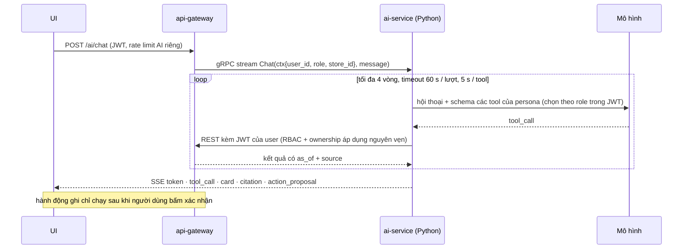

# Agent, LangGraph, LangSmith: có cần không, dùng khi nào

> **Lưu ý về độ tin cậy:** phần này viết theo hiểu biết sẵn có về LangGraph / LangSmith và các lựa chọn thay thế. Trong lần soạn này hạn mức WebSearch đã hết nên **chưa xác minh được số phiên bản, giá và tính năng hiện hành**. Trước khi chọn, hãy đọc lại tài liệu chính thức của từng công cụ.

## 1. Kết luận trước

- **Đa số scope AI của dự án KHÔNG cần agent.** Gợi ý, tìm kiếm, OCR, phân loại, fraud, dự báo, kiểm duyệt là pipeline / mô hình / workflow: kết quả ổn định, rẻ, dễ đo hơn.
- **Cần agent ở đúng hai nhóm**: (a) trợ lý hỏi đáp có gọi tool nhiều bước cho **buyer, seller, admin** (scope 4, 5), (b) điều tra sự cố chỉ-đọc cho admin (scope 14, nâng cao). RAG luật chỉ cần agentic khi phải kết hợp dữ liệu đơn hàng của người dùng với điều khoản.
- **LangGraph không bắt buộc.** Với 3 persona đầu tiên, một vòng lặp tool-calling tự viết (tối đa 4 vòng, timeout rõ ràng) là đủ và dễ gỡ lỗi. LangGraph đáng dùng khi bạn cần **trạng thái bền vững + dừng chờ người duyệt + chạy tiếp** (human-in-the-loop) hoặc đồ thị nhiều bước có rẽ nhánh / thử lại.
- **Quan sát và đánh giá (tracing + dataset + eval) mới là thứ bắt buộc**, không phải framework. LangSmith là một lựa chọn; Langfuse (mã nguồn mở, tự host) là lựa chọn thay thế hợp với dự án đang chạy trên Swarm và không muốn đẩy dữ liệu người dùng ra ngoài.

## 2. Thang tự chủ: dùng bậc thấp nhất giải quyết được vấn đề

| Bậc | Mô tả | Ví dụ trong dự án |
|---|---|---|
| 0 | Mã thường / luật | giới hạn quyền, lọc hết hàng |
| 1 | Mô hình ML / retrieval | gợi ý, embedding, fraud, forecast |
| 2 | 1 lần gọi LLM với đầu ra có schema | trích thuộc tính, phân loại danh mục, tóm tắt review, giải thích cảnh báo |
| 3 | Workflow cố định có bước LLM (đồ thị do **bạn** định) | RAG luật: retrieve → chấm điểm đoạn → trả lời có trích dẫn; OCR: ảnh → text → JSON → kiểm → người duyệt |
| 4 | **Agent**: LLM tự chọn tool trong vòng lặp có giới hạn | trợ lý shopper / seller / admin |
| 5 | Nhiều agent phối hợp | **không** cần ở giai đoạn này |

## 3. Scope nào cần agent?

| Scope | Bậc đề xuất | Lý do |
|---|---|---|
| 1 Gợi ý, 2 Tìm kiếm, 11 Visual search, 15 NLP truy vấn | 1 (+2 cho viết lại truy vấn) | không có bước "quyết định làm gì tiếp" |
| 3 OCR hóa đơn | 3 | luồng cố định; thất bại thì chuyển người duyệt, không cần LLM tự quyết |
| 4 Hỏi đáp số liệu seller / admin | **4** | câu hỏi tự do ("so với tuần trước", "sản phẩm nào sắp hết hàng và bán chạy?") cần gọi nhiều tool rồi ghép kết quả |
| 5 Trợ lý mua sắm / CSKH | **4** + xác nhận | hội thoại nhiều lượt, tra giỏ / đơn / chính sách, đề xuất hành động ghi |
| 6 RAG luật / chính sách | 3 (4 khi kết hợp đơn của user) | quy trình truy hồi cố định; chỉ cần agent khi phải "tra đơn rồi áp điều khoản" |
| 7 Review, 10 Phân loại / thuộc tính, 12 Kiểm duyệt | 2–3 | xử lý hàng loạt / theo sự kiện, không cần hội thoại |
| 8 Fraud, 9 Forecast, 13 CLV / giá | 1 | mô hình số; LLM nhiều lắm để giải thích kết quả (bậc 2) |
| 14 AIOps | 2 (giải thích cảnh báo) / **4 chỉ-đọc** (điều tra) | điều tra: metric → log → giả thuyết là chuỗi quyết định thật sự; phải chỉ-đọc |

## 4. Khi nào nên dùng LangGraph

Dùng khi **có ít nhất hai** trong các nhu cầu sau:
- Trạng thái hội thoại / tác vụ cần **lưu bền (checkpoint)** và **tiếp tục** sau khi người dùng bấm xác nhận (ví dụ `action_proposal` thêm vào giỏ, hủy đơn).
- Cần **dừng chờ người** rồi chạy tiếp (human-in-the-loop) hoặc duyệt trước khi gọi tool nhạy cảm.
- Đồ thị có **rẽ nhánh, vòng thử lại, bước song song** (ví dụ RAG: truy hồi lại khi đoạn kém điểm).
- Cần **stream** từng bước (token, tool_call, card) ra UI qua SSE như hợp đồng trong [05_AI_DRAFT_ORIGINAL.md](05_AI_DRAFT_ORIGINAL.md).
- Muốn dùng chung hạ tầng tracing / eval của hệ sinh thái LangChain.

Không cần khi: chỉ là vòng lặp "gọi LLM → chạy tool → gọi lại" ngắn, không cần chờ người, không cần checkpoint. Khi đó dùng trực tiếp SDK của nhà cung cấp mô hình (tool use) cộng một vòng lặp nhỏ tự viết — ít phụ thuộc, ít lớp trừu tượng khi gỡ lỗi.

**Đề xuất thực tế:** bắt đầu persona seller / admin (chỉ-đọc) bằng vòng lặp tool-calling thường; chuyển persona shopper (có hành động ghi cần xác nhận) sang LangGraph khi làm `action_proposal`, vì lúc đó checkpoint + interrupt thật sự có giá trị.

## 5. LangSmith và các lựa chọn quan sát / đánh giá

LangSmith (của LangChain) cung cấp: tracing từng lần chạy (prompt, tool-call, token, độ trễ, chi phí), **dataset** các ca thử, **evaluator** (so khớp / LLM-as-judge), so sánh phiên bản prompt, giám sát online. Dùng được kể cả khi không dùng LangChain / LangGraph.

| Công cụ | Điểm mạnh | Lưu ý với dự án này |
|---|---|---|
| LangSmith | tích hợp sâu LangGraph, dataset + eval + tracing trong một chỗ | bản dịch vụ đám mây gửi trace (chứa nội dung hội thoại, có thể có PII) ra ngoài; tự host có thể phải trả phí — **chưa xác minh điều kiện hiện hành** |
| Langfuse | mã nguồn mở, tự host (thêm 1 stack vào Swarm), dataset + eval + prompt management | tự vận hành thêm Postgres / ClickHouse của riêng nó |
| Arize Phoenix | mã nguồn mở, dựa OpenTelemetry, mạnh về eval RAG | ít tính năng quản trị hơn |
| OpenTelemetry (GenAI semantic conventions) + Prometheus/Grafana có sẵn | không thêm dịch vụ mới, đồng bộ với `mm_*` metric | phải tự dựng phần dataset / eval |
| promptfoo, DeepEval, Ragas, Inspect AI | chạy eval trong CI | bổ trợ, không thay thế tracing |

**Đề xuất:** ghi trace qua OpenTelemetry để không bị khóa vào một nhà cung cấp; bắt đầu bằng Langfuse tự host (dữ liệu ở lại trong hệ thống) hoặc LangSmith nếu chấp nhận gửi dữ liệu đã ẩn PII. Dù chọn gì, `ai_audit` ở phía gateway vẫn cần có để làm nhật ký độc lập (xem bản nháp).

## 6. Công cụ / giao thức khác đáng biết

- **Tool use trực tiếp của API mô hình** (Anthropic, OpenAI, …): đủ cho vòng lặp đơn giản.
- **MCP (Model Context Protocol):** chuẩn mở để phơi tool / tài nguyên cho nhiều client; hợp khi muốn cùng một bộ tool dùng cho agent trong sản phẩm lẫn công cụ nội bộ của dev. Với dự án, tool vẫn nên là REST của gateway; MCP chỉ là lớp bọc nếu cần.
- **Pydantic AI, OpenAI Agents SDK, Claude Agent SDK, LlamaIndex, DSPy:** các lựa chọn thay thế cho vòng lặp agent / RAG / tối ưu prompt; chọn theo ngôn ngữ và mô hình đang dùng.

## 7. Kiến trúc đề xuất (khi bắt đầu làm)

Hợp đồng chi tiết (tool từng persona, sự kiện SSE, chống prompt injection, ngân sách chi phí): [05_AI_DRAFT_ORIGINAL.md](05_AI_DRAFT_ORIGINAL.md) §2–§9. Bản nháp đó là điểm xuất phát, không phải thiết kế đã duyệt.
