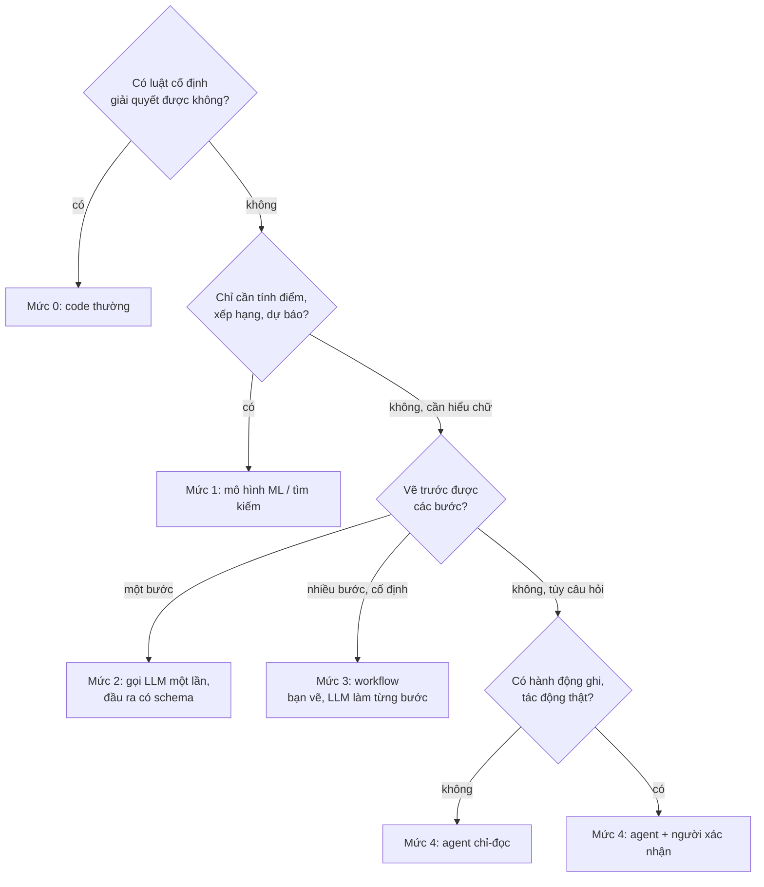
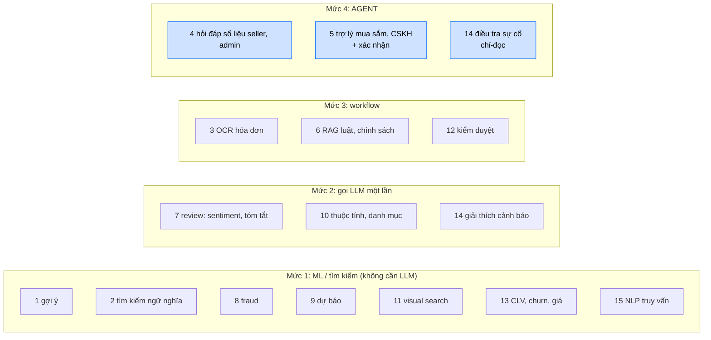
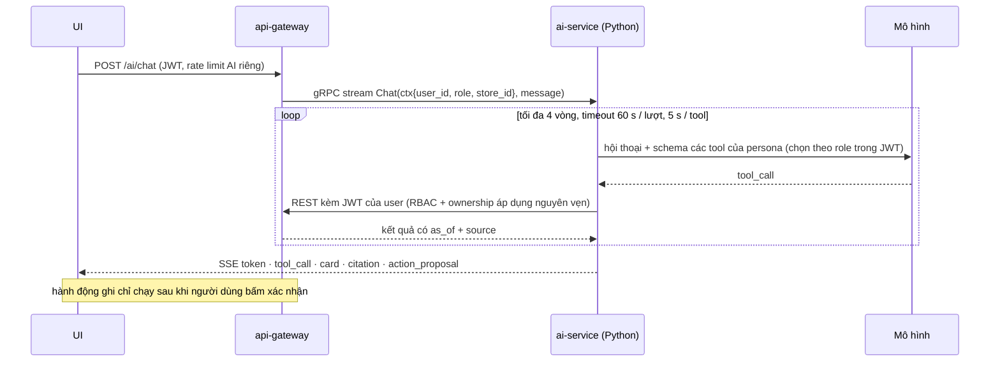

# Agent, LangGraph, LangSmith: có cần không, dùng khi nào

> **Độ tin cậy (tra cứu 2026-10-25, qua kết quả WebSearch, chưa đọc trang chính thức):**
> - LangGraph ra bản **1.0 (GA) vào tháng 10/2025**, với durable execution, checkpointing và hỗ trợ human-in-the-loop (dừng chờ người duyệt rồi chạy tiếp) là các trụ cột của runtime; LangChain 1.0 dựng trên cùng runtime ([changelog LangChain](https://changelog.langchain.com/announcements/ann_lxOZRCoFw2Qn9), [diễn đàn LangChain](https://forum.langchain.com/t/we-launched-1-0-versions-of-langchain-and-langgraph/1904)).
> - LangSmith: gói Developer miễn phí (1 seat, ~5k trace/tháng), Plus ~39 USD/seat/tháng; **tự host / hybrid chỉ có ở gói Enterprise** (giá liên hệ) ([trang giá LangSmith](https://www.langchain.com/langsmith-pricing)). Con số có thể đổi, hãy xem lại trước khi chọn.
> - Langfuse: mã nguồn mở, lõi giấy phép MIT, tự host bằng Docker / Kubernetes; một số module enterprise (SCIM, audit log, retention) dùng giấy phép thương mại riêng; cần Postgres + ClickHouse + Redis + object storage; có telemetry mặc định (tắt bằng `TELEMETRY_ENABLED=false`); tháng 1/2026 ClickHouse mua lại Langfuse, lõi vẫn MIT ([tài liệu self-hosting](https://langfuse.com/self-hosting.md)). Chưa đối chiếu với file LICENSE chính thức.

## 0. Từ khó, giải thích một lần

| Từ | Nghĩa trong tài liệu này |
|---|---|
| **LLM** | mô hình ngôn ngữ lớn (loại như Claude, GPT) |
| **Agent** | LLM được phép *tự chọn* gọi công cụ, nhiều lần, đến khi đủ thông tin để trả lời |
| **Tool / công cụ** | một chức năng agent được phép gọi; ở đây mỗi tool chính là **một API REST có sẵn** của gateway (ví dụ "lấy báo cáo doanh thu") |
| **Human-in-the-loop** | người dùng phải bấm xác nhận trước khi agent làm việc có tác động (đặt đơn, hủy đơn, hoàn tiền) |
| **`action_proposal`** | thay vì tự làm, agent trả về một "đề xuất hành động" để giao diện hiển thị nút Xác nhận |
| **Workflow** | các bước do *bạn* định sẵn, LLM chỉ làm từng bước (khác agent) |
| **RAG** | tìm đoạn tài liệu liên quan rồi bắt LLM trả lời dựa trên đoạn đó, kèm trích dẫn |
| **Checkpoint** | lưu trạng thái giữa chừng để dừng chờ người rồi chạy tiếp |
| **Tracing / eval** | ghi lại từng bước chạy của LLM để xem lại / chấm điểm trên bộ ca thử |

Danh sách tính năng agent cụ thể, từng cái gọi tool nào và người xác nhận ở đâu: [06_AGENT_FEATURES.md](06_AGENT_FEATURES.md).

### Quyết định nhanh: chức năng này cần mức nào?

## 1. Kết luận trước

- **Đa số scope AI của dự án KHÔNG cần agent.** Gợi ý, tìm kiếm, OCR, phân loại, fraud, dự báo, kiểm duyệt là pipeline / mô hình / workflow: kết quả ổn định, rẻ, dễ đo hơn.
- **Cần agent ở đúng hai nhóm**: (a) trợ lý hỏi đáp có gọi tool nhiều bước cho **buyer, seller, admin** (scope 4, 5), (b) điều tra sự cố chỉ-đọc cho admin (scope 14, nâng cao). RAG luật chỉ cần agentic khi phải kết hợp dữ liệu đơn hàng của người dùng với điều khoản.
- **LangGraph không bắt buộc.** Với 3 persona đầu tiên, một vòng lặp tool-calling tự viết (tối đa 4 vòng, timeout rõ ràng) là đủ và dễ gỡ lỗi. LangGraph đáng dùng khi bạn cần **trạng thái bền vững + dừng chờ người duyệt + chạy tiếp** (human-in-the-loop) hoặc đồ thị nhiều bước có rẽ nhánh / thử lại.
- **Quan sát và đánh giá (tracing + dataset + eval) mới là thứ bắt buộc**, không phải framework. LangSmith là một lựa chọn; Langfuse (mã nguồn mở, tự host) là lựa chọn thay thế hợp với dự án đang chạy trên Swarm và không muốn đẩy dữ liệu người dùng ra ngoài.

## 2. "Mức tự chủ" nghĩa là gì (giải thích đơn giản)

Câu hỏi cần trả lời cho mỗi chức năng AI: **ai là người quyết định bước tiếp theo, code của bạn hay mô hình ngôn ngữ (LLM)?** Càng để LLM tự quyết thì càng linh hoạt nhưng càng khó đoán, đắt và khó kiểm thử. Vì vậy dùng **mức thấp nhất mà vẫn giải quyết được bài toán**. Mình chia thành 6 mức, đánh số 0–5 (chỉ để gọi cho gọn, không có ý nghĩa gì khác):

| Mức | Gọi là | Ai quyết định bước tiếp theo? | Ví dụ đời thường trong dự án |
|---|---|---|---|
| 0 | Code thường | code của bạn, luật cố định | "đơn quá 15 phút chưa trả tiền thì hết hạn" |
| 1 | Mô hình ML / tìm kiếm | không có "quyết định", chỉ tính điểm và xếp hạng | gợi ý sản phẩm, tìm theo ngữ nghĩa, phát hiện gian lận, dự báo hàng bán |
| 2 | Gọi LLM **một lần** | code gọi LLM 1 lần rồi dùng kết quả | đọc mô tả sản phẩm rồi trả về JSON {màu, size, thương hiệu}; tóm tắt 50 review |
| 3 | Quy trình cố định có bước LLM (workflow) | **bạn** vẽ sẵn các bước, LLM chỉ làm từng bước | hỏi luật: tìm đoạn luật → chấm xem có liên quan không → viết câu trả lời kèm trích dẫn |
| 4 | **Agent** | **LLM tự chọn** gọi công cụ nào, mấy lần, rồi quyết định khi nào đủ để trả lời | "so sánh doanh thu tuần này với tuần trước và cho biết sản phẩm nào kéo giảm" |
| 5 | Nhiều agent phối hợp | các agent giao việc cho nhau | chưa cần ở giai đoạn này |

Cách nhận biết **agent thật sự (mức 4)**: bạn *không biết trước* cần gọi bao nhiêu công cụ và theo thứ tự nào; câu hỏi của người dùng quyết định. Nếu bạn vẽ được sơ đồ các bước trước, đó là workflow (mức 3), không phải agent.

## 3. Scope nào cần agent?

Ba chức năng ở mức 4 là chỗ agent thật sự có giá trị vì câu hỏi tự do, số bước không biết trước. Riêng scope 6 chỉ lên mức 4 khi phải kết hợp dữ liệu đơn của chính người dùng với điều khoản ("đơn này còn trả được không?"). Chi tiết từng tính năng agent: [06_AGENT_FEATURES.md](06_AGENT_FEATURES.md).

## 4. Khi nào nên dùng LangGraph

Dùng khi **có ít nhất hai** trong các nhu cầu sau:
- Trạng thái hội thoại / tác vụ cần **lưu bền (checkpoint)** và **tiếp tục** sau khi người dùng bấm xác nhận (ví dụ `action_proposal` thêm vào giỏ, hủy đơn).
- Cần **dừng chờ người** rồi chạy tiếp (human-in-the-loop) hoặc duyệt trước khi gọi tool nhạy cảm.
- Đồ thị có **rẽ nhánh, vòng thử lại, bước song song** (ví dụ RAG: truy hồi lại khi đoạn kém điểm).
- Cần **stream** từng bước (token, tool_call, card) ra UI qua SSE như hợp đồng trong [05_AI_DRAFT_ORIGINAL.md](05_AI_DRAFT_ORIGINAL.md).
- Muốn dùng chung hạ tầng tracing / eval của hệ sinh thái LangChain.

Không cần khi: chỉ là vòng lặp "gọi LLM → chạy tool → gọi lại" ngắn, không cần chờ người, không cần checkpoint. Khi đó dùng trực tiếp SDK của nhà cung cấp mô hình (tool use) cộng một vòng lặp nhỏ tự viết — ít phụ thuộc, ít lớp trừu tượng khi gỡ lỗi.

**Đề xuất thực tế:** bắt đầu persona seller / admin (chỉ-đọc) bằng vòng lặp tool-calling thường; chuyển persona shopper (có hành động ghi cần xác nhận) sang LangGraph khi làm `action_proposal`, vì lúc đó checkpoint + interrupt thật sự có giá trị.

## 5. LangSmith và các lựa chọn quan sát / đánh giá

LangSmith (của LangChain) cung cấp: tracing từng lần chạy (prompt, tool-call, token, độ trễ, chi phí), **dataset** các ca thử, **evaluator** (so khớp / LLM-as-judge), so sánh phiên bản prompt, giám sát online. Dùng được kể cả khi không dùng LangChain / LangGraph.

| Công cụ | Điểm mạnh | Lưu ý với dự án này |
|---|---|---|
| LangSmith | tích hợp sâu LangGraph, dataset + eval + tracing trong một chỗ | bản đám mây gửi trace (chứa nội dung hội thoại, có thể có PII) ra ngoài; tự host / hybrid chỉ ở gói Enterprise (xem ghi chú đầu file) |
| Langfuse | mã nguồn mở, tự host (thêm 1 stack vào Swarm), dataset + eval + prompt management | tự vận hành thêm Postgres, ClickHouse, Redis, object storage của riêng nó (dự án đã có Postgres / ClickHouse / Redis nhưng nên tách instance để không ảnh hưởng nghiệp vụ) |
| Arize Phoenix | mã nguồn mở, dựa OpenTelemetry, mạnh về eval RAG | ít tính năng quản trị hơn |
| OpenTelemetry (GenAI semantic conventions) + Prometheus/Grafana có sẵn | không thêm dịch vụ mới, đồng bộ với `mm_*` metric | phải tự dựng phần dataset / eval |
| promptfoo, DeepEval, Ragas, Inspect AI | chạy eval trong CI | bổ trợ, không thay thế tracing |

**Đề xuất:** ghi trace qua OpenTelemetry để không bị khóa vào một nhà cung cấp; bắt đầu bằng Langfuse tự host (dữ liệu ở lại trong hệ thống) hoặc LangSmith nếu chấp nhận gửi dữ liệu đã ẩn PII. Dù chọn gì, `ai_audit` ở phía gateway vẫn cần có để làm nhật ký độc lập (xem bản nháp).

## 6. Công cụ / giao thức khác đáng biết

- **Tool use trực tiếp của API mô hình** (Anthropic, OpenAI, …): đủ cho vòng lặp đơn giản.
- **MCP (Model Context Protocol):** chuẩn mở để phơi tool / tài nguyên cho nhiều client; hợp khi muốn cùng một bộ tool dùng cho agent trong sản phẩm lẫn công cụ nội bộ của dev. Với dự án, tool vẫn nên là REST của gateway; MCP chỉ là lớp bọc nếu cần.
- **Pydantic AI, OpenAI Agents SDK, Claude Agent SDK, LlamaIndex, DSPy:** các lựa chọn thay thế cho vòng lặp agent / RAG / tối ưu prompt; chọn theo ngôn ngữ và mô hình đang dùng.

## 7. Kiến trúc đề xuất (khi bắt đầu làm)

Hợp đồng chi tiết (tool từng persona, sự kiện SSE, chống prompt injection, ngân sách chi phí): [05_AI_DRAFT_ORIGINAL.md](05_AI_DRAFT_ORIGINAL.md) §2–§9. Bản nháp đó là điểm xuất phát, không phải thiết kế đã duyệt.
