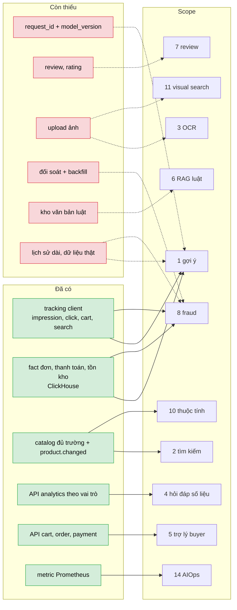

# Nền đã sẵn sàng cho AI đến đâu: dữ liệu và hạ tầng còn thiếu

> Đối chiếu từng scope ([01_AI_SCOPES_OVERVIEW.md](01_AI_SCOPES_OVERVIEW.md)) với những gì **code hiện tại** thật sự thu thập / cung cấp. Kiểm tra ngày 2026-10-25 trên nhánh làm việc; khi khác code thì code đúng.

## Nhìn nhanh: nguồn dữ liệu → scope, và chỗ thiếu

Nét liền: dữ liệu đã có, scope dùng được ngay. Nét đứt: phải làm thêm (ô đỏ) thì scope mới làm đủ hoặc đo được.

## 1. Đã có

| Thứ | Chi tiết | Dùng cho scope |
|---|---|---|
| Tracking client | Whitelist: `page_view`, `impression`, `product_click`, `product_view`, `dwell`, `search`, `search_click`, `filter_apply`, `sort_change`, `add_to_cart`, `remove_from_cart`, `cart_update`, `wishlist_add/remove`, `checkout_start/submit`, `payment_page_view`, `error_client`; có `surface`, `position`, `product_id`, `anonymous_id`, `session_id`; frontend đã bắn `impression` (hiện ≥ 50 % hiển thị ≥ 1 s) | 1, 2, 8, 15 |
| Consent + PII | không consent chỉ giữ `page_view` / `error_client` ẩn danh; che email / SĐT trong truy vấn; hash IP xoay theo ngày | mọi scope dùng hành vi |
| Fact nghiệp vụ | `fact_order_items`, `fact_order_status`, `fact_payment_events`, `fact_refunds`, `fact_inventory`, `dim_products` (ClickHouse, dựng từ Kafka) | 1, 4, 8, 9, 13 |
| Catalog | sku, mô tả, danh mục (cây ≤ 3 cấp), brand, tags, ảnh (URL), trạng thái; event `product.changed` | 2, 10, 11 |
| API theo vai trò | seller: summary, timeseries, top-products, funnel, low-stock; admin: + traffic, payments, search-terms, data-health; `/admin/system/health` | 4, 14 |
| Giỏ hàng / đơn / thanh toán API | có phân quyền, idempotency | 5 |
| Metric | Prometheus `mm_*`, cAdvisor, node-exporter, exporters | 14 |
| Dữ liệu giả để dev | `SEED_DEMO_DATA` (~100 sản phẩm), `scripts/dev/gen_traffic.py` (chỉ event client), **`scripts/datagen`** (đơn, thanh toán, hoàn tiền, tồn kho, `events_raw`; synthetic + RetailRocket) và `scripts/export` (xuất snapshot) | dev pipeline |

## 2. Còn thiếu, theo mức chặn

Danh sách đầy đủ phần hạ tầng (không gồm tầng LLM): [../planning/03_INFRA_GAPS_FOR_LARGE_PROJECT.md](../planning/03_INFRA_GAPS_FOR_LARGE_PROJECT.md).

### Chặn một scope cụ thể

| Thiếu | Chặn | Làm gì |
|---|---|---|
| **`request_id` + `model_version` trong envelope tracking** (hiện không có; `impression` / `product_click` không biết do gợi ý nào sinh ra) | đo CTR / CVR của gợi ý (1), A/B | thêm vào envelope & whitelist, ghi vào `events_raw` (cần migration ClickHouse), frontend gửi lại khi click |
| **Review / rating** (chưa có API, bảng, UI) | 7, một phần 1 (tín hiệu rating) | làm tính năng review: chỉ người đã nhận hàng được review |
| **Upload ảnh** (MinIO chưa có; ảnh chỉ là URL ≤ 8/sản phẩm) | 3 (OCR), 11 (visual search), kiểm duyệt ảnh | MinIO + kiểm MIME / kích thước |
| **Wishlist API** (event đã whitelist, chưa có API) | tín hiệu mạnh cho 1 | làm API |
| **Feature flag** `GET /config/features` | bật / tắt từng tính năng AI, A/B | làm trước khi có `ai-service` |
| **Đối soát Postgres ↔ ClickHouse + backfill** | tin cậy dữ liệu huấn luyện (1, 8, 9, 13) | đã có CLI `backfill` / `reconcile` (analytics-service); còn thiếu lịch đêm, nối `data-health` (hiện vẫn `reconciliation: "not_implemented"`) |
| **Lịch sử đủ dài / lớn** | 1, 8, 9, 13 (mô hình học từ dữ liệu) | dữ liệu demo là giả; dùng bộ công khai ([../dataset/README.md](../dataset/README.md)) để chọn phương pháp, dữ liệu thật để hiệu chỉnh |
| **Kho văn bản luật / chính sách** (mô phỏng) + trang admin tải lên | 6 | tự soạn bộ mô phỏng gắn nhãn "MÔ PHỎNG – không phải luật thật" (xem bản nháp §6) |
| **Hệ thống cảnh báo** (cố ý chưa có, ADR-12) | 14 (giải thích cảnh báo) | chỉ làm khi cần; có thể bắt đầu từ truy vấn metric chủ động |
| Retention `events_raw` 13 tháng; ClickHouse chỉ dựng lại được ≤ 7 ngày từ Kafka | huấn luyện lịch sử | cân nhắc xuất snapshot định kỳ |

### Tầng LLM (chủ dự án tự xây sau; liệt kê để không quên)

| Thiếu | Làm gì |
|---|---|
| `ai-service` (Python: FastAPI + gRPC), proto, route gateway `/ai/*`, rate limit AI riêng | dựng khung với bản mock trước (echo, trending) |
| `ai_audit` ở gateway (nhật ký độc lập: lượt hội thoại, tool-call, token, chi phí) | thiết kế theo bản nháp §8 |
| Khung eval (bộ ca thử theo từng persona; ca "từ chối vượt quyền", injection, "không bịa") | xem [../dataset/16_AGENT_TOOL_USE_EVAL.md](../dataset/16_AGENT_TOOL_USE_EVAL.md) |
| Quan sát LLM (trace, dataset, eval) | xem [02_AGENT_ARCHITECTURE.md](02_AGENT_ARCHITECTURE.md) §5 |
| Ngân sách / hạn mức chi phí (`AI_DAILY_BUDGET_USD`) và tự tắt cờ khi vượt | bản nháp §5 |
| Quyết định nhà cung cấp mô hình LLM + embedding (đám mây hay tự host, dữ liệu tiếng Việt) | chốt trước khi viết mã |

## 3. Quy tắc dữ liệu cho huấn luyện (đã có trong nguyên tắc của dự án)
- Chia dữ liệu **theo thời gian**, không ngẫu nhiên; mỗi người dùng chỉ dùng quá khứ để dự đoán tương lai.
- Doanh thu / nhãn mua lấy từ **fact nghiệp vụ** (nguồn sự thật), không lấy từ event client.
- Không huấn luyện / không đưa vào prompt dữ liệu của người dùng không đồng ý (consent) hoặc PII chưa che.
- Không kết luận chất lượng mô hình từ dữ liệu demo / `gen_traffic.py`.
