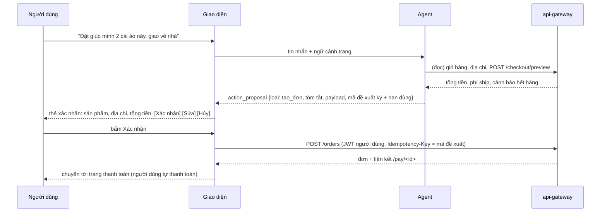
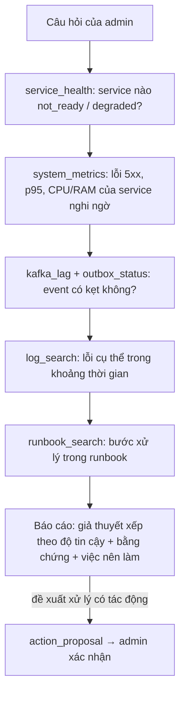

# Các tính năng agent nên thiết kế

> **Trạng thái: thiết kế đề xuất, chưa có code.** Tầng LLM do chủ dự án tự xây; tài liệu này chỉ chốt *làm gì*, *agent gọi công cụ nào*, *người xác nhận ở đâu*, và *nền còn thiếu gì*. Khái niệm (agent, tool, human-in-the-loop, `action_proposal`) giải thích ở [02_AGENT_ARCHITECTURE.md](02_AGENT_ARCHITECTURE.md) §0. Tool nào đã có / chưa có đối chiếu với [../design/04_API_REFERENCE.md](../design/04_API_REFERENCE.md).
> Quy ước cột "Tool": ✅ = đã có REST ở gateway, 🆕 = **chưa có**, cần làm thêm trong nền. Cột "Xác nhận" = chỗ người dùng phải bấm trước khi có tác động thật.

## 1. Nguyên tắc chung cho mọi agent

1. **Ba persona, chọn theo vai trò trong JWT** (không theo lời người dùng): `shopper` (buyer + khách), `seller`, `admin`. Mỗi persona chỉ thấy bộ tool của mình.
2. **Tool = REST của gateway, gọi bằng JWT của chính người dùng.** RBAC, kiểm sở hữu, rate limit hiện có áp dụng nguyên vẹn; agent không có quyền riêng. Hỏi doanh thu shop khác → gateway trả 403.
3. **Agent không tự ghi.** Mọi hành động có tác động (đặt đơn, hủy, hoàn tiền, đổi tồn kho, đăng sản phẩm, cấm sản phẩm) đi theo mẫu **đề xuất → người xem → bấm xác nhận → giao diện (không phải LLM) gọi API thật** (mục 2).
4. **Agent không bao giờ nhập dữ liệu thanh toán.** Trang `/pay/<id>` do người dùng tự thao tác.
5. Dữ liệu từ tool, mô tả sản phẩm, review, văn bản upload là **không tin cậy** (có thể chứa lệnh giả): đưa vào prompt trong khối đánh dấu, agent không có tool tự do (không tải URL, không chạy code).
6. Mọi kết quả số liệu mang `as_of` và `source`; agent nói rõ "số liệu cập nhật đến …". Báo cáo analytics đã trả sẵn `as_of`, `source`, `cached`.
7. Giới hạn cứng ở server: tối đa 4 vòng gọi tool, 5 s / tool, 60 s / lượt, khoảng thời gian ≤ 400 ngày, phân trang.
8. Có công tắc tắt từng tính năng (feature flag) và đường lui không-AI ([../planning/03_INFRA_GAPS_FOR_LARGE_PROJECT.md](../planning/03_INFRA_GAPS_FOR_LARGE_PROJECT.md) I1).

## 2. Mẫu "người xác nhận" (human-in-the-loop) dùng chung

Điểm thiết kế bắt buộc:
- **Mã đề xuất được ký** (gắn user, hash nội dung, hạn ~5 phút). Giao diện gọi API với *đúng* nội dung đã hiển thị; LLM không sửa được sau khi người dùng đã nhìn.
- Dùng luôn `Idempotency-Key` sẵn có của `POST /orders` làm khóa → bấm hai lần không tạo hai đơn.
- Giá, tổng tiền, trạng thái **luôn lấy lại từ server** khi xác nhận, không dùng số LLM đã nói (nguyên tắc dự án: không tin giá từ client).
- Hành động rủi ro cao của admin (hoàn tiền, cấm sản phẩm, requeue outbox) cần **xác nhận rõ lý do** và ghi `audit_log` (chưa có, xem hạ tầng).
- Người dùng có thể **sửa** đề xuất (đổi số lượng, địa chỉ) → agent tạo đề xuất mới, đề xuất cũ hết hiệu lực.

## 3. Admin: các agent có giá trị lớn

### A1. Điều tra sự cố hệ thống (nên làm sớm, chỉ-đọc)
Admin hỏi: "vì sao đơn hàng bị kẹt?", "hệ thống chậm từ lúc nào?", "analytics báo 503 là sao?". Agent đi theo chuỗi *triệu chứng → bằng chứng → giả thuyết → cách xử lý*, mỗi bước phụ thuộc kết quả bước trước (đây là agent thật, không vẽ trước được sơ đồ).

| Tool | Trạng thái | Ghi chú |
|---|---|---|
| `service_health` | ✅ `GET /admin/system/health` | gom `/ready` của 7 service |
| `system_metrics` | 🆕 `GET /admin/system/metrics` | proxy Prometheus **có danh sách PromQL cho phép**, không để LLM viết PromQL tự do |
| `outbox_status` | 🆕 `GET /admin/system/outbox` | `mm_outbox_pending`, tuổi dòng cũ nhất, dòng `FAILED` (nay phải vào DB / metric tay) |
| `kafka_lag` | 🆕 `GET /admin/system/kafka` | lag theo consumer group (kafka-exporter đã có số liệu) |
| `log_search` | 🆕 **chưa có kho log** | hiện chỉ có `docker service logs`; cần Loki hoặc tương đương nếu muốn agent đọc log |
| `runbook_search` | 🆕 RAG trên [../instruction/03_RUNBOOK.md](../instruction/03_RUNBOOK.md) + ADR | tài liệu đã có, cần lập chỉ mục |
| `analytics_data_health` | ✅ `GET /admin/analytics/data-health` | độ trễ pipeline, hàng bị rớt |
| Xử lý (requeue outbox, bật/tắt tính năng) | 🆕 + **Xác nhận** | API requeue chưa có; mọi thao tác ghi cần audit |

Dữ liệu kiểm thử: bộ sự cố tự dựng từ chính các tình huống trong runbook (đơn kẹt `PENDING`, `AWAITING_PAYMENT` không có payment, Kafka lag, ClickHouse down, outbox có dòng độc) + bộ công khai ở [../dataset/14_AIOPS_ANOMALY_ALERT_EXPLAIN.md](../dataset/14_AIOPS_ANOMALY_ALERT_EXPLAIN.md).

### A2. Bản tin vận hành định kỳ / "hôm nay có gì bất thường?"
Chạy theo lịch (không cần hội thoại): gom health, metric, analytics (so với kỳ trước), `data-health` → viết bản tin ngắn, đánh dấu điểm bất thường (phát hiện bất thường là mô hình số, LLM chỉ diễn giải). Tool: ✅ health, ✅ analytics, 🆕 metrics. Không có hành động ghi.

### A3. Phân tích kinh doanh toàn sàn
"Vì sao doanh thu tuần này giảm?" → agent gọi `summary` (đã có `previous` kỳ liền trước), `timeseries`, `top-products` (sort `revenue/units/views/conversion/viewed_unsold`), `funnel`, `traffic`, `payments`, `search-terms` rồi phân rã nguyên nhân (ít truy cập? chuyển đổi thấp? thanh toán lỗi? hết hàng?). Tool: toàn bộ ✅ `/admin/analytics/*`. Kiểm thử: [../dataset/04_ANALYTICS_QA_TEXT2SQL.md](../dataset/04_ANALYTICS_QA_TEXT2SQL.md) (cách dựng bộ câu hỏi vàng trên schema của dự án).

### A4. Hàng đợi kiểm duyệt
Phân loại listing / review bị gắn cờ (hàng cấm, quảng cáo sai sự thật, spam), tóm tắt lý do, **đề xuất** `banned` kèm bằng chứng. Tool: ✅ `PATCH /admin/products/:id/status` (đi qua **Xác nhận**), 🆕 API danh sách bị gắn cờ, 🆕 review. Dữ liệu: [../dataset/12_CONTENT_MODERATION_AGENT_SAFETY.md](../dataset/12_CONTENT_MODERATION_AGENT_SAFETY.md).

### A5. Xử lý khiếu nại / hoàn tiền
Admin đưa mã đơn → agent đọc timeline đơn (`GET /admin/orders/:id` + lịch sử trạng thái), thanh toán, hoàn tiền đã có → kết luận "đã thu bao nhiêu, đã hoàn bao nhiêu, còn lệch gì" (các lỗ hổng đã biết: hoàn tiền thủ công không cập nhật `orders.payment_status`) → **đề xuất** hoàn tiền (`POST /admin/payments/:id/refund`) qua **Xác nhận**. Tool: ✅ đơn / thanh toán / hoàn tiền.

### A6. Kiểm tra chất lượng dữ liệu
So Postgres với ClickHouse khi đối soát (chưa làm xong), giải thích vì sao số liệu lệch. Phụ thuộc: 🆕 đối soát ([../planning/03_INFRA_GAPS_FOR_LARGE_PROJECT.md](../planning/03_INFRA_GAPS_FOR_LARGE_PROJECT.md) D4).

## 4. Seller: các agent nên có

| # | Tính năng | Tool | Xác nhận | Ghi chú |
|---|---|---|---|---|
| S1 | **Hỏi đáp số liệu cửa hàng** (doanh thu, đơn, sản phẩm bán chạy, phễu) | ✅ `/seller/analytics/{summary,timeseries,top-products,funnel,low-stock}`; `store_id` luôn từ JWT | – | giá trị lớn, ít rủi ro; làm trước |
| S2 | **Cố vấn nhập hàng**: sản phẩm nào sắp hết, nên nhập bao nhiêu | ✅ `low-stock`, ledger, analytics; 🆕 dự báo nhu cầu ([../dataset/09_DEMAND_FORECAST_LOGISTICS.md](../dataset/09_DEMAND_FORECAST_LOGISTICS.md)) | **Có**: đề xuất `inventory/adjust` | khoảng cách tồn / tốc độ bán |
| S3 | **Trợ lý đăng sản phẩm**: từ ảnh + vài dòng mô tả → sinh tiêu đề, mô tả, danh mục, thuộc tính, kiểm tra hàng cấm | ✅ `POST /products`, `GET /categories`; 🆕 upload ảnh; 🆕 trích thuộc tính | **Có**: seller xem bản nháp rồi bấm đăng | [../dataset/10_PRODUCT_CATEGORIZATION_ATTRIBUTES.md](../dataset/10_PRODUCT_CATEGORIZATION_ATTRIBUTES.md); kiểm tra quy định bằng RAG ([../dataset/06_POLICY_LEGAL_RAG.md](../dataset/06_POLICY_LEGAL_RAG.md)) |
| S4 | **Xử lý đơn hàng loạt**: "đóng gói và giao hết đơn đã thanh toán hôm nay" | ✅ danh sách đơn của store, `ship` | **Có**, hiển thị danh sách trước khi chạy | tối đa N đơn / lần |
| S5 | **Chẩn đoán sản phẩm**: nhiều lượt xem nhưng không bán → gợi ý giá, ảnh, tiêu đề | ✅ `top-products?sort=viewed_unsold`, funnel; 🆕 review | – | đưa ra đề xuất, seller tự sửa |
| S6 | **Soạn phản hồi review / khiếu nại** | 🆕 review | **Có**: seller duyệt bản nháp | cần tính năng review |
| S7 | **Nhập hóa đơn nhập hàng bằng OCR**: tải hóa đơn → trích dòng hàng → khớp sản phẩm → đề xuất cộng tồn | 🆕 upload, 🆕 OCR; ✅ `inventory/adjust` | **Có**, từng dòng | [../dataset/03_INVOICE_RECEIPT_OCR.md](../dataset/03_INVOICE_RECEIPT_OCR.md); dòng độ tin cậy thấp chuyển người duyệt |

## 5. Buyer / khách: các agent nên có

| # | Tính năng | Tool | Xác nhận | Ghi chú |
|---|---|---|---|---|
| B1 | **Tìm hàng bằng hội thoại**: "áo khoác dưới 500k, màu tối, còn hàng" | ✅ `/search` (lọc danh mục, giá, còn hàng), `/products/:id`, `/products/:id/stock` (chỉ trả mức), `/categories` | – | có thể là workflow (mức 3) nếu chỉ tìm kiếm |
| B2 | **Đặt hàng hộ** (xem sơ đồ mục 2): thêm giỏ → xem trước → xác nhận → sang trang thanh toán | ✅ `/cart*`, `/users/me/addresses`, `/checkout/preview`, `POST /orders` | **Có**, bắt buộc | agent không thanh toán thay |
| B3 | **Hỏi trạng thái đơn / hủy / trả hàng**: "đơn của tôi đến đâu rồi?" | ✅ `GET /orders*`, hủy, `confirm-received`, `return` | **Có** cho hủy / trả hàng | chỉ đơn của chính user |
| B4 | **Hỏi luật và chính sách**: đổi trả, hoàn tiền, giao hàng; kết hợp đơn của user ("đơn này còn trả được không?") | ✅ đơn của user; 🆕 kho văn bản + RAG | – | luôn có trích dẫn; "không tìm thấy" thay vì bịa |
| B5 | **So sánh sản phẩm** và gợi ý lựa chọn theo nhu cầu | ✅ chi tiết sản phẩm; 🆕 gợi ý | – | |
| B6 | **Tìm quà theo ngân sách / dịp** | ✅ search; 🆕 gợi ý | – | |
| B7 | **Trả lời "giỏ hàng của tôi có gì, bao nhiêu tiền, phí ship?"** | ✅ `GET /cart`, `/checkout/preview` | – | ví dụ đúng với câu hỏi gốc của dự án |
| B8 | **Theo dõi giá / báo khi có hàng** | 🆕 thông báo (chưa có), 🆕 wishlist API | **Có** (đăng ký theo dõi) | để sau |
| B9 | **Hỗ trợ khiếu nại** chuyển cho người khi vượt khả năng | 🆕 hàng đợi hỗ trợ | – | |

Dữ liệu kiểm thử: [../dataset/05_SHOPPER_ASSISTANT_CUSTOMER_SUPPORT.md](../dataset/05_SHOPPER_ASSISTANT_CUSTOMER_SUPPORT.md).

## 6. Tính năng xuyên suốt

| Tính năng | Mô tả | Nền cần |
|---|---|---|
| **Bộ định tuyến ý định** | phân loại tin nhắn → persona / workflow phù hợp; từ chối đúng việc ngoài phạm vi | – |
| **Ngữ cảnh trang** | biết người dùng đang xem sản phẩm / đơn nào ("sản phẩm này còn không?") | giao diện gửi `page_context` |
| **Trí nhớ cá nhân hóa** | nhớ sở thích, **tắt mặc định**, chỉ bật khi người dùng đồng ý | 🆕 consent lưu được |
| **Giải thích nguồn** | trích dẫn / thẻ dữ liệu có `as_of` | – |
| **Phản hồi 👍/👎** | đổ về làm ca kiểm thử mới | 🆕 lưu phản hồi |
| **Công tắc khẩn cấp** | tắt agent khi vượt ngân sách chi phí hoặc phát hiện lạm dụng | 🆕 feature flag, 🆕 theo dõi chi phí |
| **Nhật ký độc lập** | gateway ghi mỗi lượt, mỗi tool-call (không do agent tự khai) | 🆕 `ai_audit` |

## 7. Ma trận ưu tiên đề xuất

| Ưu tiên | Tính năng | Lý do |
|---|---|---|
| 1 | S1, B7, A3 (hỏi đáp số liệu & giỏ hàng, chỉ-đọc) | tool đã có sẵn; rủi ro thấp; dựng được khung agent + eval |
| 2 | A1 (điều tra sự cố) | giá trị cao cho admin; cần làm thêm 3–4 API chỉ-đọc ở phần admin/system |
| 3 | B1, B3, B4 | tìm hàng, hỏi đơn, hỏi chính sách |
| 4 | **B2 đặt hàng hộ, S2, S4, A5** (có xác nhận) | khi khung xác nhận (mục 2) và eval "từ chối vượt quyền" đã vững |
| 5 | S3, S7, A4, S6 | cần upload ảnh, OCR, review |
| 6 | A2, B8 và các tính năng cần thông báo | cần lịch chạy nền, thông báo |

## 8. Nền cần làm thêm để mở khóa các tính năng trên (tóm tắt)

Chi tiết và cỡ việc: [../planning/03_INFRA_GAPS_FOR_LARGE_PROJECT.md](../planning/03_INFRA_GAPS_FOR_LARGE_PROJECT.md).
- API admin chỉ-đọc: `/admin/system/metrics` (PromQL có danh sách cho phép), `/admin/system/outbox`, `/admin/system/kafka`; kho log nếu muốn agent đọc log; requeue outbox qua API.
- Cơ chế đề xuất ký + hạn dùng (mục 2), `audit_log`, `ai_audit`, feature flag.
- Review, wishlist API, upload ảnh (kho đối tượng), kho văn bản chính sách, thông báo.
- Một bộ ca kiểm thử cho từng persona, có ca **từ chối vượt quyền** và **prompt injection** ([../dataset/16_AGENT_TOOL_USE_EVAL.md](../dataset/16_AGENT_TOOL_USE_EVAL.md), [../dataset/12_CONTENT_MODERATION_AGENT_SAFETY.md](../dataset/12_CONTENT_MODERATION_AGENT_SAFETY.md)).
