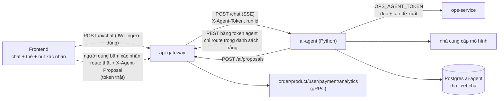
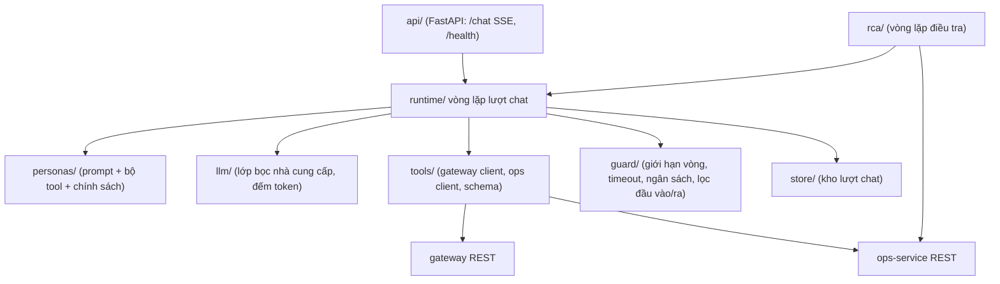
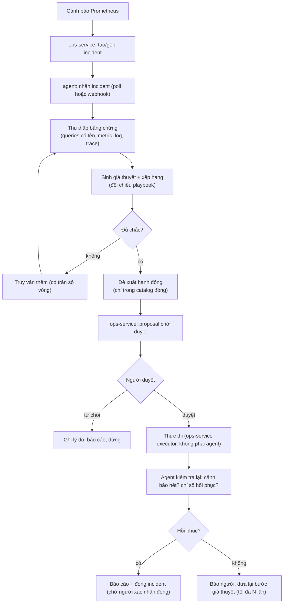

# Lộ trình xây agent (buyer, seller, operator, admin, vòng lặp RCA)

> **Trạng thái: kế hoạch cho phần chủ dự án tự xây (tầng LLM).** Không có dòng code agent nào trong repo. Tài liệu này gom lại: nền đã có, những gì cần **chốt trước khi viết code**, kiến trúc đề xuất, cấu trúc thư mục, thứ tự xây từng bước (mỗi bước có tiêu chí xong), và cách đo. Khái niệm (agent, tool, human-in-the-loop) xem [02_AGENT_ARCHITECTURE.md](02_AGENT_ARCHITECTURE.md) §0; danh mục tính năng theo persona: [06_AGENT_FEATURES.md](06_AGENT_FEATURES.md); điều tra sự cố: [07_COROOT_AND_INCIDENT_AGENT.md](07_COROOT_AND_INCIDENT_AGENT.md); an toàn token và xác nhận hành động: ADR-40, ADR-42 trong [../decisions/01_ADR_LOG.md](../decisions/01_ADR_LOG.md).
> Khi tài liệu này khác file cũ hơn trong `docs/ai/`, tài liệu này đúng **ở các điểm đã ghi rõ** ở §1.3 (chủ yếu: giao thức gateway ↔ agent là HTTP SSE chứ không phải gRPC stream, và token agent riêng chứ không chuyển JWT người dùng).

## 0. Tóm tắt một trang

- **Một dịch vụ `ai-agent`** (Python, FastAPI) với **bốn persona** chọn theo vai trò trong token: `buyer`, `seller`, `admin`, `operator`. Dùng chung một lõi (vòng lặp gọi tool, an toàn, ghi log lượt chat), mỗi persona chỉ khác prompt, bộ tool và chính sách.
- **Tool = REST của gateway** (không MCP trước mắt, không truy cập DB trực tiếp). Quyền nằm ở gateway, không ở prompt. Agent giữ token ngắn hạn do gateway cấp (ADR-42), không giữ JWT người dùng lâu dài.
- **Hành động ghi chỉ là đề xuất.** Người dùng bấm xác nhận, UI gọi route thật bằng token thật kèm gói đã ký; DB ghi `agent_run_id` để phân biệt (đã có hạ tầng).
- **Vòng lặp RCA (operator/admin)** chạy trên nền ops-service đã có: cảnh báo → incident → điều tra (chỉ đọc, truy vấn có tên) → giả thuyết xếp hạng → **đề xuất** hành động (catalog đóng) → người duyệt → thực thi → **kiểm tra lại**. Agent không có quyền duyệt hay thực thi.
- **Thứ tự xây:** lõi + khung kiểm thử (0) → buyer chỉ đọc (1) → seller chỉ đọc (2) → admin chỉ đọc (3) → operator RCA chỉ đọc (4) → hành động ghi có xác nhận (5) → vòng lặp RCA khép kín có duyệt (6) → vận hành (7). Mỗi bước phát hành được độc lập, có cờ tắt.

## 1. Đã có gì, còn thiếu gì

### 1.1 Đã có (chỉ việc dùng)

| Nền | Ở đâu | Agent dùng để |
|---|---|---|
| Luồng chat SSE, cờ `FEATURE_AI_CHAT` / `FEATURE_AI_OPS`, `GET /config/features` | gateway `handler/ai.go`, ADR-40 | UI ↔ agent; gateway chuyển tiếp `POST AI_SERVICE_URL/chat` |
| Token agent ngắn hạn (`X-Agent-Token`, `jti` = run id), khoá xoay `AGENT_TOKEN_KEYS` | gateway `internal/agent`, ADR-42 | Danh tính của agent khi gọi gateway |
| `POST /ai/proposals` + header `X-Agent-Proposal` + cột `agent_run_id` (order, payment, product) | gateway, `shared/reqctx`, migrations | Hành động ghi có người xác nhận, phân biệt nguồn trong DB |
| REST đọc cho buyer/seller/admin (đơn, sản phẩm, tồn kho, báo cáo analytics có `as_of`/`source`) | [../design/04_API_REFERENCE.md](../design/04_API_REFERENCE.md) | Tool đọc |
| ops-service: incident từ cảnh báo, `investigate`, `queries` có tên, `outbox/<svc>/dead`, đề xuất → duyệt → thực thi → xác nhận đã chạy, audit log chỉ ghi thêm, catalog hành động đóng | `services/ops-service`, ADR-38/39/40 | Nền của vòng lặp RCA; agent operator dùng `OPS_AGENT_TOKEN` (đọc + tạo đề xuất, không duyệt/thực thi) |
| Playbook YAML cho 10 nhóm sự cố, có kiểm tra khớp `alerts.yml` | `docs/playbooks/` | Nguồn sự thật (ground truth) và bộ đề kiểm tra RCA |
| Metrics, log (Loki), trace (Tempo), dashboard, `X-Request-ID` xuyên service | `deploy/`, ADR-33/36 | Nguồn bằng chứng cho RCA |
| Bộ dữ liệu giả + backfill/reconcile ClickHouse | `scripts/datagen`, `docs/dataset/` | Dữ liệu cho hỏi đáp số liệu và đánh giá |
| Vai trò `operator`, giao diện console, bong bóng chat (đang là bản xem trước, `NEXT_PUBLIC_AI_UI_PREVIEW`) | frontend | Chỗ gắn UI thật |

### 1.2 Còn thiếu (làm cùng lúc với agent, không phải trước)

| Thiếu | Cần cho | Ghi chú |
|---|---|---|
| Danh sách trắng route đọc cho token agent theo role (ADR-42 mục 3–4) và `GET /ai/tools` | Bước 1–4 | Hiện gateway gửi cả `Authorization` người dùng lẫn `X-Agent-Token`; chỉ khi làm xong mục này mới bỏ `Authorization` |
| Kho lượt chat theo `run_id` (nội dung, tool đã gọi, token, độ trễ) | Mọi bước, bắt buộc để tra lại | Thuộc `ai-agent`; bảng riêng trong Postgres, thời hạn giữ + che dữ liệu nhạy cảm (ADR-42 mục 9) |
| Rate limit theo `sub` (người dùng) thay vì IP cho `/ai/*` | Bước 1 | Hiện theo IP |
| Giao diện thật cho sự kiện SSE (`token`, `tool_call`, `card`, `action_proposal`, `error`, `done`) và nút xác nhận | Bước 1, 5 | Hợp đồng sự kiện: [05_AI_DRAFT_ORIGINAL.md](05_AI_DRAFT_ORIGINAL.md) §3 |
| Tìm kiếm ngữ nghĩa / gợi ý cho buyer (tool `search` hiện chỉ là tìm theo từ khoá) | Buyer nâng cao | Không chặn bước 1 |
| Tool 🆕 trong [06_AGENT_FEATURES.md](06_AGENT_FEATURES.md) (mỗi persona có vài tool chưa có REST) | Từng tính năng | Thêm REST ở gateway rồi mới thêm tool; đừng cho agent đi đường tắt |
| Môi trường đánh giá (bộ câu hỏi vàng, kịch bản sự cố tái hiện được) | Bước 0, 4, 6 | §8 |

### 1.3 Chỗ khác với tài liệu cũ

1. [02_AGENT_ARCHITECTURE.md](02_AGENT_ARCHITECTURE.md) §7 vẽ gateway → agent bằng gRPC stream. Thực tế đã làm (ADR-40) là **HTTP + SSE**: `POST AI_SERVICE_URL/chat`, body JSON ≤ 64 KB, trả `text/event-stream`. Giữ như đã làm.
2. Tài liệu cũ ghi "REST kèm JWT của user". Theo ADR-42 agent dùng **token agent ngắn hạn do gateway cấp**; JWT người dùng không được giao cho agent về lâu dài.
3. 06_AGENT_FEATURES gọi ba persona (`shopper`, `seller`, `admin`). Ở đây tách thêm `operator` vì vai trò `operator` đã có và có quyền khác (chỉ vận hành, không có dữ liệu kinh doanh).

## 2. Những thứ cần chốt TRƯỚC khi viết code

Mỗi mục là một câu hỏi cần một đáp án viết ra (ghi thành ADR khi chốt). Cột "đề xuất" là điểm xuất phát, không phải quyết định.

### 2.1 Phạm vi và rủi ro

| # | Câu hỏi | Đề xuất |
|---|---|---|
| D1 | Phase đầu agent làm được gì? | **Chỉ đọc + giải thích.** Ghi (đặt/huỷ/hoàn tiền) từ bước 5, RCA khép kín từ bước 6 |
| D2 | Hành động ghi nào được đề xuất? | Danh sách đóng `proposable` (hiện 5 route). Thêm từng cái, mỗi cái có test |
| D3 | Dữ liệu nào **không bao giờ** vào prompt? | Mật khẩu/băm, token, số thẻ (không tồn tại, thanh toán mô phỏng), `IP_HASH_SECRET`, secret. Số điện thoại/địa chỉ: che hoặc chỉ khi cần |
| D4 | Agent có được đọc dữ liệu cá nhân của người dùng khác không? | Không. Phạm vi lấy từ `sub` trong token, không từ tham số do mô hình điền |
| D5 | Khi mô hình sai hoặc không chắc? | Nói "không chắc" kèm lý do, đưa nguồn; số liệu luôn có `as_of`. Không bịa; không có tool thì từ chối |
| D6 | Ai chịu trách nhiệm hành động đã xác nhận? | Người xác nhận (ghi `agent_run_id` + user). Agent không bao giờ là bên duyệt |

### 2.2 Mô hình và chi phí

| # | Câu hỏi | Đề xuất |
|---|---|---|
| M1 | Nhà cung cấp/mô hình nào cho từng persona? | Khai báo nhiều **profile LLM** và ánh xạ persona/role → profile trong yaml (§13), nên đổi nhà cung cấp chỉ sửa cấu hình. Bắt đầu với một profile. Buyer/seller: mô hình nhỏ-nhanh; admin/operator RCA: mô hình mạnh hơn. Chốt tên mô hình sau khi chạy bộ đánh giá §8, đừng chốt theo cảm tính |
| M6 | Thư viện | LangChain: `create_agent` + middleware cho buyer/seller/admin, `langchain-core` cho mô hình; **LangGraph** chỉ cho RCA (bước 6); **LangSmith không bật** (§14) |
| M2 | Gọi có cấu trúc (tool calling) hay tự parse? | Tool calling gốc của nhà cung cấp; schema sinh từ một nguồn duy nhất (§4.3) |
| M3 | Ngân sách | Trần token/lượt, trần lượt/người/giờ, trần chi phí/ngày toàn hệ thống; vượt thì dừng và báo, không âm thầm hạ chất lượng |
| M4 | Dữ liệu gửi ra ngoài | Nếu dùng API ngoài: đọc điều khoản về lưu dữ liệu, che dữ liệu nhạy cảm trước khi gửi. Dữ liệu vận hành (log) có thể chứa dữ liệu người dùng: lọc trước khi đưa vào prompt RCA |
| M5 | Có cần bộ nhớ dài hạn không? | Không phase đầu. Chỉ giữ lịch sử trong một cuộc chat (cắt theo token); tóm tắt khi dài |

### 2.3 Giao thức và dữ liệu

| # | Câu hỏi | Đề xuất |
|---|---|---|
| P1 | Hợp đồng gateway ↔ agent | `POST /chat` (SSE) như ADR-40: header `X-Agent-Token`, `X-Agent-Run-ID`, `X-Request-ID`; body `{message, conversation_id?, page_context?}`. Viết thành OpenAPI trong `ai-agent/contracts/` |
| P2 | Sự kiện SSE | `start` (conversation_id, run_id), `token`, `tool_call`, `tool_result` (rút gọn), `card`, `citation`, `action_proposal`, `error`, `done` — mỗi sự kiện có `run_id` |
| P3 | Lưu hội thoại ở đâu | Postgres riêng của `ai-agent`: `conversations` (user_id = `sub`), `chat_runs`, `chat_messages`, `tool_calls`; khoá theo `run_id` = `jti`. `conversation_id` do **`ai-agent` sinh** (UUID) ở tin đầu và trả cho UI trong sự kiện `start`; mỗi lần kiểm `conversation.user_id == sub` (sai → 404); mỗi cuộc chat chỉ chạy một lượt tại một thời điểm (lượt thứ hai → 409); `client_message_id` duy nhất để bỏ tin gửi trùng (mạng lỗi) |
| P4 | Thời hạn giữ + ai xem | Đề xuất 30 ngày, chỉ admin xem, che số điện thoại/địa chỉ trước khi lưu (mở trong ADR-42) |
| P5 | Ngôn ngữ | Tiếng Việt mặc định, trả lời theo ngôn ngữ người hỏi; tên tool/field giữ tiếng Anh |

### 2.4 Đánh giá

| # | Câu hỏi | Đề xuất |
|---|---|---|
| E1 | "Tốt" nghĩa là gì cho từng persona? | Buyer/seller: đúng số liệu và đúng quyền; admin: đúng số liệu; operator: top-3 nguyên nhân chứa nguyên nhân thật, đề xuất đúng catalog (§7.5) |
| E2 | Ngưỡng cho phép phát hành | Viết số cụ thể trước khi chạy (ví dụ "đúng quyền 100%", "đúng số liệu ≥ 95% trên bộ vàng") |
| E3 | Cách chấm | Kiểm tra tự động ở chỗ có đáp án cứng (số, route đã gọi, từ chối đúng); người chấm cho văn bản tự do; **không** dùng chính mô hình để chấm khi chưa kiểm chứng với người |

## 3. Kiến trúc đề xuất

### 3.1 Bức tranh chung



Điểm cần nhớ: agent **không** có đường trực tiếp tới service nghiệp vụ hay DB nghiệp vụ; nó đi qua gateway như một client có quyền hẹp. Riêng ops, nó nói chuyện với ops-service bằng token riêng của ops (`OPS_AGENT_TOKEN`, ADR-40), không qua `/ai`.

### 3.2 Thành phần bên trong `ai-agent`



Nguyên tắc: `runtime` không biết persona nào cụ thể; persona là dữ liệu (prompt, danh sách tool, hằng số giới hạn). Thêm persona = thêm một thư mục, không sửa lõi.

### 3.3 Vòng lặp một lượt chat

1. Gateway xác thực người dùng, cấp token agent, chuyển tới `/chat`.
2. `runtime` chọn persona theo `role` **trong token** (không theo lời người dùng), nạp prompt + schema tool.
3. Lặp tối đa 4 vòng (RCA: tối đa theo §7): gọi mô hình → nếu có `tool_call`, **kiểm tra tool có trong bộ của persona**, kiểm tra tham số theo schema, gọi gateway, cắt kết quả cho vừa ngân sách token, đưa lại mô hình.
4. Câu trả lời cuối: stream `token`, kèm `citation` (tool nào, `as_of`).
5. Nếu cần ghi: gọi `POST /ai/proposals`, gửi `action_proposal` cho UI. **Dừng ở đây**, không tự gọi route ghi.
6. Ghi kho lượt chat; trả `done`.

### 3.4 Dùng framework hay tự viết

Phase 0–3 (một vòng lặp tool tuyến tính, tối đa 4 vòng): dùng `create_agent` của LangChain kèm middleware giới hạn (§14); tự viết chỉ phần chuyển SSE và lưu lịch sử. Cân nhắc LangGraph khi vào bước 6 (RCA có nhánh, quay lại, dừng chờ người duyệt, lưu trạng thái giữa chừng): xem [02_AGENT_ARCHITECTURE.md](02_AGENT_ARCHITECTURE.md) §4. Quan sát/đánh giá: bắt đầu từ chính kho lượt chat; thêm công cụ ngoài (LangSmith, Langfuse…) chỉ khi kho này không đủ.

## 4. Cấu trúc thư mục đề xuất

```
services/ai-agent/                     (Python 3.12, FastAPI; Dockerfile build từ gốc repo như các service khác)
├── pyproject.toml                     (phụ thuộc cố định phiên bản; ruff, mypy, pytest)
├── Dockerfile
├── README.md                          (cách chạy cục bộ, biến môi trường)
├── configs/
│   ├── config.dev.yaml                (profile LLM, role→profile, giới hạn; KHÔNG chứa secret)
│   ├── config.prod.yaml
│   └── .env.example                   (tên biến secret; giá trị thật ở deploy/.env)
├── contracts/
│   ├── chat.openapi.yaml              (POST /chat + sự kiện SSE: nguồn sự thật cho gateway và UI)
│   └── tools/                         (schema tool: sinh từ bảng role→tool của gateway, xem §4.3)
├── src/ai_agent/
│   ├── main.py                        (khởi tạo app, đọc cấu hình, kiểm tra biến bắt buộc)
│   ├── config/
│   │   ├── loader.py                  (nạp .env → configs/config.{APP_ENV}.yaml → thay ${VAR} → Config; che secret; §13)
│   │   └── logging.py                 (log JSON có run_id, query_context)
│   ├── api/
│   │   ├── chat.py                    (SSE, đọc X-Agent-Token / X-Agent-Run-ID)
│   │   ├── health.py                  (/health, /ready, /metrics)
│   │   └── auth.py                    (đọc token agent để biết role/sub; KHÔNG ký, KHÔNG tin header role)
│   ├── runtime/
│   │   ├── agent_factory.py           (dựng create_agent cho từng persona: model + tools + middleware; §14)
│   │   ├── sse_adapter.py             (đổi stream của LangChain → sự kiện SSE của mình)
│   │   ├── events.py                  (kiểu sự kiện SSE)
│   │   └── context.py                 (run_id, user, role, ngân sách còn lại)
│   ├── personas/
│   │   ├── base.py                    (giao diện Persona: prompt, tools, policy)
│   │   ├── buyer/        {prompt.md, tools.py, policy.py}
│   │   ├── seller/       {prompt.md, tools.py, policy.py}
│   │   ├── admin/        {prompt.md, tools.py, policy.py}
│   │   └── operator/          {prompt.md, tools.py, policy.py}
│   ├── tools/
│   │   ├── gateway.py                 (client REST: timeout 5 s, retry chỉ cho GET, ghi lại mọi lời gọi)
│   │   ├── ops.py                     (client ops-service bằng OPS_AGENT_TOKEN)
│   │   ├── registry.py                (tên tool → hàm + schema + persona được phép)
│   │   └── redact.py                  (che dữ liệu nhạy cảm trong kết quả tool)
│   ├── llm/                           (profile + role + factory, §13)
│   │   ├── registry.py                (LLM_PROVIDERS: tên provider → hàm build(profile); @register_llm)
│   │   ├── factory.py                 (get_llm(cfg, profile), get_llm_for_role(cfg, role))
│   │   ├── providers/
│   │   │   ├── __init__.py            (import từng provider để tự đăng ký)
│   │   │   ├── _common.py             (require, model_id: từ chối giá trị mẫu)
│   │   │   ├── openai.py              (OpenAI và API tương thích qua base_url: DeepSeek, proxy)
│   │   │   ├── anthropic.py | google.py | ollama.py
│   │   │   └── fake.py                (mô hình giả có kịch bản, cho test an toàn và CI)
│   │   ├── metrics.py                 (đo E2E, token vào/ra, lỗi mỗi lần gọi → log/JSONL)
│   │   └── budget.py                  (đếm token, trần chi phí theo lượt/ngày)
│   ├── guard/
│   │   ├── middleware.py              (middleware tự viết: ngân sách token, kiểm tool/tham số, che dữ liệu, ghi run)
│   │   ├── limits.py                  (cấu hình ModelCallLimit/ToolCallLimit, 60 s/lượt, 5 s/tool, kích thước kết quả)
│   │   ├── untrusted.py               (đánh dấu dữ liệu không tin cậy trong prompt)
│   │   └── proposals.py               (tạo đề xuất qua /ai/proposals; không có đường gọi route ghi)
│   ├── store/
│   │   ├── models.py                  (chat_runs, chat_messages, tool_calls)
│   │   ├── repo.py
│   │   └── migrations/                (Alembic hoặc SQL thuần theo đúng cách repo hiện làm)
│   ├── rca/                           (bước 6; chỉ operator/admin)
│   │   ├── state.py                   (trạng thái điều tra: bằng chứng, giả thuyết, hành động)
│   │   ├── graph.py                   (các nút và cạnh, §7)
│   │   ├── evidence.py                (gom bằng chứng: queries của ops, Prometheus, Loki, Tempo)
│   │   ├── playbooks.py               (nạp docs/playbooks/*.yml)
│   │   └── verify.py                  (kiểm tra lại sau khi chạy hành động)
│   └── observability/                 (metrics Prometheus, log JSON có run_id, trace OTel)
├── evals/                             (harness kiểm thử, §8A)
│   ├── golden/{buyer,seller,admin,operator}.jsonl   (câu hỏi + đáp án/route kỳ vọng)
│   ├── scenarios/                     (kịch bản sự cố tái hiện: §8.2)
│   ├── run_evals.py                   (chạy bộ vàng, in báo cáo, thoát lỗi nếu dưới ngưỡng)
│   ├── replay.py                      (chạy lại một run_id đã lưu)
│   └── fixtures/                      (dữ liệu giả cố định, sinh từ scripts/datagen với seed)
└── tests/
    ├── unit/                          (guard, redact, registry, budget: không gọi mô hình)
    ├── contract/                      (khớp OpenAPI; tool khớp bảng role→tool của gateway)
    └── safety/                        (prompt injection, vượt quyền, vòng lặp vô hạn)
```

Phía còn lại (đã có hoặc cần thêm, không nằm trong `ai-agent`):

```
services/api-gateway/internal/agent/    (đã có: khoá, token, gói đề xuất)
services/api-gateway/internal/handler/ai.go, proposals.go   (đã có)
services/api-gateway/internal/handler/ai_tools.go            (CẦN THÊM: GET /ai/tools từ bảng role→tool)
services/api-gateway/internal/agent/scopes.go                (CẦN THÊM: danh sách trắng route theo role, một nguồn sự thật)
apps/frontend/components/ai/                                 (đã có ChatWidget; cần: thẻ kết quả, nút xác nhận, hiển thị tool đang chạy)
deploy/services.yml                                          (thêm service ai-agent + Postgres riêng hoặc schema riêng)
docs/ai/ , docs/playbooks/                                   (đã có)
```

### 4.3 Một nguồn sự thật cho tool

Bảng role → tool → (method, route, tham số) nằm **một chỗ** trong gateway (`scopes.go`). Gateway dùng nó để cho phép/chặn route với token agent; `GET /ai/tools` trả cùng bảng cho `ai-agent`; `ai-agent` sinh schema tool từ đó (hoặc kiểm tra khớp trong `tests/contract`). Không viết tay hai bảng. `router_test.go` có test: mọi tool trỏ tới route thật và đúng role.

## 5. Thứ tự xây, từng bước

Mỗi bước: **làm gì**, **xong khi nào**. Không sang bước sau khi bước trước chưa đạt tiêu chí.

### Bước 0. Lõi và khung kiểm thử (1–2 tuần)
- Dựng `ai-agent` rỗng chạy được trong Swarm (`/health`, `/ready`, `/metrics`, log JSON có `run_id`), Postgres riêng + migration, kho lượt chat.
- `runtime/loop.py` với **mô hình giả (fake provider)** trả lời cố định; `guard/limits.py`; `tools/gateway.py`; `registry.py`.
- Gateway: `GET /ai/tools` và `scopes.go` (danh sách trắng), bỏ `Authorization` người dùng khỏi lời gọi tới agent, rate limit theo `sub`.
- `evals/run_evals.py` và `llm/fake.py` (mô hình giả có kịch bản) chạy được; `tests/safety/` có các ca đầu tiên (§8A).
- **Xong khi:** gọi `POST /ai/chat` đi hết đường UI → gateway → agent (mô hình giả) → gateway → trả SSE; kho có bản ghi theo `run_id`; token agent bị 401/403 đúng ở các route cấm (test của ADR-42 mục "Kiểm").

### Bước 1. Buyer, chỉ đọc (2–3 tuần)
- Tool: tìm sản phẩm, chi tiết, danh mục, giỏ hàng (và tổng tiền), đơn của chính mình, trạng thái đơn. Hỏi chính sách (trả/huỷ) từ tài liệu tĩnh trước, RAG sau.
- Prompt buyer; chống prompt injection trong mô tả sản phẩm/review (`untrusted.py`).
- **Xong khi:** bộ vàng buyer ≥ ngưỡng đã chốt (E2); không thấy đơn người khác (test safety); UI hiển thị thẻ sản phẩm/đơn.

### Bước 2. Seller, chỉ đọc
- Tool: sản phẩm của shop, tồn kho/sổ kho, hàng sắp hết, báo cáo analytics của shop, hộp thư đơn của shop.
- Gợi ý nhập hàng chỉ ở dạng **tư vấn bằng chữ** (chưa có đề xuất ghi).
- **Xong khi:** đúng số liệu trên bộ vàng; hỏi dữ liệu shop khác → từ chối/403; mỗi con số có `as_of`.

### Bước 3. Admin, chỉ đọc
- Tool: báo cáo nền tảng, đơn/thanh toán toàn hệ thống, `data-health`, danh mục. **Không** có tool tới `/admin/accounts` (không bao giờ: agent không quản lý tài khoản).
- **Xong khi:** đúng số liệu; không tool nào chạm route quản lý tài khoản (test hợp đồng).

### Bước 4. Operator, chỉ đọc + RCA một lượt
- Persona `operator`: dùng `OPS_AGENT_TOKEN` tới ops-service: `/incidents`, `/incidents/{id}/investigate`, `/queries/{name}`, `/outbox/{svc}/dead`; thêm đọc Prometheus/Loki/Tempo **qua truy vấn có tên** (không cho mô hình tự viết PromQL/LogQL tuỳ ý ở phase này).
- Đầu ra: báo cáo gồm bằng chứng (liên kết/truy vấn), top-3 giả thuyết có độ tin cậy, bước kiểm tra tiếp theo. Chưa đề xuất hành động.
- **Xong khi:** chạy lại bộ kịch bản sự cố (§8.2) đạt ngưỡng E2 cho "top-3 chứa nguyên nhân thật"; mọi bằng chứng truy ngược được tới một lời gọi tool.

### Bước 5. Hành động ghi có xác nhận (buyer, seller, admin)
- Mở dần từng hành động trong danh sách `proposable`: huỷ đơn của chính mình (buyer) trước, rồi seller huỷ đơn shop, admin hoàn tiền. Mỗi hành động: tool đề xuất (gọi `/ai/proposals`) + thẻ xác nhận trên UI + test.
- UI: thẻ hiển thị `summary`, tham số thật (số tiền, mã đơn), nút xác nhận/bỏ; sau xác nhận gọi route thật với `X-Agent-Proposal`; xử lý 401/403/409/503 (§ADR-42).
- **Xong khi:** thử tấn công bộ test safety: sửa tham số sau khi ký, dùng lại gói, gói của người khác, bỏ header (chạy nhưng không có `agent_run_id`) đều cho kết quả đúng; truy vấn `agent_run_id` ra đúng hành động.

### Bước 6. Vòng lặp RCA khép kín (operator, admin)
Chi tiết §7. Thêm: tạo đề xuất vận hành tại ops-service, chờ người duyệt, theo dõi thực thi, kiểm tra lại, đóng incident.
- **Xong khi:** trên kịch bản có hành động an toàn (ví dụ outbox kẹt, `docker service update --force`), vòng lặp đi hết từ cảnh báo đến đóng incident với một người duyệt; agent **không** có đường tự duyệt/tự chạy (test 403); kiểm tra lại phát hiện được trường hợp hành động không hiệu quả và không tự đóng incident.

### Bước 7. Vận hành
- Dashboard Grafana cho agent (số lượt, độ trễ, token, chi phí, tỉ lệ lỗi tool, tỉ lệ bị chặn), cảnh báo (chi phí vượt trần, lỗi nhà cung cấp, kho lượt chat đầy), runbook mục mới, thời hạn xoá kho lượt chat, quy trình xoay khoá (đã có §18).
- Công tắc tắt từng persona, đường lui không-AI.
- **Xong khi:** diễn tập tắt/bật cờ, hết ngân sách, nhà cung cấp lỗi: hệ thống vẫn dùng được không AI.

## 6. Chi tiết từng persona

| | buyer | seller | admin | operator |
|---|---|---|---|---|
| Mục tiêu | tìm hàng, theo dõi đơn, hiểu chính sách | số liệu shop, tồn kho, xử lý đơn | số liệu nền tảng, khiếu nại, kiểm duyệt | điều tra và xử lý sự cố |
| Dữ liệu đọc | sản phẩm công khai, giỏ + đơn của mình | shop của mình (từ `sub`) | toàn nền tảng (không tài khoản) | vận hành (incident, metric, log, trace), **không** dữ liệu kinh doanh |
| Ghi (đề xuất) | huỷ đơn mình, yêu cầu trả hàng | huỷ đơn shop, (sau) điều chỉnh tồn kho | huỷ đơn, hoàn tiền, (sau) khoá sản phẩm | đề xuất vận hành tại ops-service |
| Nguồn token | token agent (ADR-42) | token agent | token agent | `OPS_AGENT_TOKEN` cho ops + token agent cho `system/health` |
| Cấm tuyệt đối | thanh toán, đổi mật khẩu, địa chỉ người khác | dữ liệu shop khác, tiền | quản lý tài khoản, đổi quyền | duyệt/thực thi đề xuất, đọc dữ liệu khách hàng |
| Giới hạn riêng | 4 vòng | 4 vòng | 4 vòng | RCA: §7 |
| Đo chính | đúng số liệu + đúng quyền | đúng số liệu + đúng quyền | đúng số liệu | top-3 nguyên nhân, đúng catalog hành động |

Quy tắc chung đã chốt ở [06_AGENT_FEATURES.md](06_AGENT_FEATURES.md) §1 (persona theo role trong token, dữ liệu ngoài là không tin cậy, không nhập dữ liệu thanh toán, `as_of`/`source`, giới hạn cứng) vẫn đúng và là điều kiện của mọi bước.

## 7. Vòng lặp RCA đề xuất (operator/admin)

### 7.1 Hình dạng



### 7.2 Nút, trạng thái, giới hạn

| Nút | Làm gì | Giới hạn |
|---|---|---|
| `collect` | chạy các truy vấn **có tên** theo playbook của cảnh báo; thêm truy vấn theo gợi ý của mô hình **nếu nằm trong danh mục** | tối đa 12 truy vấn/lượt, 5 s/truy vấn, kết quả cắt theo token |
| `hypothesize` | mô hình xếp hạng nguyên nhân dựa trên bằng chứng + playbook; mỗi giả thuyết **phải trích bằng chứng** | tối đa 3 giả thuyết, mỗi cái có độ tin cậy và "điều gì sẽ bác bỏ nó" |
| `decide` | đủ chắc (ngưỡng viết rõ) thì đề xuất; không thì quay lại `collect` | tối đa 3 vòng `collect` |
| `propose` | tạo proposal tại ops-service với `action` trong catalog, tham số theo schema của catalog | không có `action` ngoài catalog; mô hình không viết lệnh shell/SQL tự do |
| `wait_human` | dừng, lưu trạng thái (cần checkpoint), chờ duyệt | hết hạn `OPS_PROPOSAL_TTL_MIN` thì thành `EXPIRED`, báo người |
| `verify` | sau khi báo đã thực thi, chờ cửa sổ ổn định (ví dụ 2–5 phút), kiểm lại đúng truy vấn đã chứng minh sự cố | không hồi phục thì **không** đóng, tăng bậc rủi ro, báo người |
| `report` | báo cáo cuối: dòng thời gian, bằng chứng, nguyên nhân, hành động, kết quả, việc cần làm tiếp | luôn tạo, kể cả khi thất bại |

### 7.3 Phân quyền trong vòng lặp

- Agent: đọc, tạo đề xuất, ghi chú vào incident, báo cáo. **Không** duyệt, không thực thi (ops-service trả 403 với `OPS_AGENT_TOKEN`).
- Người tạo đề xuất không tự duyệt được (luật đã có); agent cần người duyệt khác vai.
- Bậc rủi ro của hành động lấy từ catalog (`observe`/`low`/`medium`/`high`...), không để mô hình tự gán. Hành động `low` có thể cho tự động duyệt **chỉ khi chủ hệ thống bật rõ ràng** và đã có số liệu chất lượng (§8) cho loại hành động đó.

### 7.4 Điều khiển lặp (tránh tự gây thêm sự cố)

- Mỗi incident có **ngân sách**: tổng số lượt mô hình, số truy vấn, tổng thời gian. Hết thì dừng và báo người.
- Không đề xuất lại hành động đã thất bại cho cùng incident mà không có bằng chứng mới.
- Tối đa 2 đề xuất đang chờ cho một incident; không tạo đề xuất mới khi đang có cái đang thực thi.
- Khi nhiều cảnh báo cùng lúc (xem `docs/playbooks/multiple-faults.yml`): xử lý theo nguyên nhân gốc trước (ví dụ DB chậm trước, rồi mới nhìn lỗi ở gateway), không đề xuất song song nhiều hành động tác động lẫn nhau.
- Nếu chính hệ quan sát hỏng (`observability-down`): báo "không đủ bằng chứng", không suy đoán.

### 7.5 Kiểm chứng đã có thể làm ngay

Playbook YAML là đáp án chuẩn: cảnh báo → nguyên nhân → hành động an toàn. Dùng làm: (1) tập đề, (2) ground truth cho "top-3 chứa nguyên nhân thật", (3) kiểm tra hành động đề xuất nằm trong catalog. Chi tiết metric và dạng một bộ dữ liệu RCA: [07_COROOT_AND_INCIDENT_AGENT.md](07_COROOT_AND_INCIDENT_AGENT.md) §6–§7. Coroot là tuỳ chọn (nguồn tín hiệu thêm), không bắt buộc cho bước 4–6.

## 8. Đánh giá và kiểm thử

### 8.1 Ba tầng

1. **Test thường (không gọi mô hình):** guard, redact, registry khớp bảng của gateway, hợp đồng OpenAPI, giới hạn vòng/thời gian/kích thước. Chạy trong CI.
2. **Test an toàn (mô hình giả cố tình làm sai):** mô hình đòi tool ngoài bộ persona, tham số lạ, vòng vô hạn, tool trả văn bản chứa lệnh giả, đề xuất route ngoài danh sách. Hệ thống phải chặn ở tầng guard/gateway, **không** dựa vào việc mô hình ngoan. Chạy trong CI.
3. **Bộ vàng (gọi mô hình thật, có chi phí):** `evals/golden/*.jsonl` chạy theo yêu cầu/mỗi tuần, có báo cáo so với ngưỡng E2. Cố định dữ liệu bằng `scripts/datagen` với seed để đáp án ổn định.

### 8.2 Kịch bản sự cố tái hiện (cho RCA)

Mỗi kịch bản: cách gây lỗi (ví dụ dừng một service, chặn Kafka, làm đầy outbox, bơm tải), cảnh báo mong đợi, nguyên nhân thật, hành động đúng, cách kiểm tra phục hồi, nguồn: playbook tương ứng. Làm trên **môi trường thử, không phải Swarm đang dùng thật**, và có lệnh dọn dẹp. Bắt đầu từ ba kịch bản rẻ và rõ: dịch vụ chết, outbox kẹt, consumer DLQ tăng.

### 8.3 Số cần theo dõi liên tục

Tỉ lệ đúng quyền (mục tiêu 100%), tỉ lệ số liệu đúng, tỉ lệ từ chối đúng, số tool call/lượt, độ trễ lượt (p50/p95), token và chi phí/lượt, tỉ lệ hành động đề xuất được xác nhận/bị bỏ (đề xuất tệ thì bị bỏ nhiều), tỉ lệ RCA top-3 đúng, thời gian từ cảnh báo đến báo cáo.

## 8A. Harness: cái gì cần dựng, cái gì không

"Harness" ở đây có hai phần. Cả hai đã nằm trong cấu trúc §4; mục này chốt ranh giới và thứ tự.

### 8A.1 Harness chạy agent (runtime), tự viết mỏng
Gồm `runtime/`, `guard/`, `tools/registry.py`, `store/`:
- vòng lặp gọi tool, giới hạn 4 vòng, 60 s/lượt, 5 s/tool, ngân sách token;
- kiểm tra tool có thuộc bộ của persona, kiểm tra tham số theo schema trước khi gọi;
- cắt kết quả tool cho vừa ngân sách, che dữ liệu nhạy cảm (`redact.py`);
- ghi kho lượt chat theo `run_id`, stream sự kiện SSE;
- đường chạy duy nhất: mọi lời gọi mô hình và tool đều đi qua đây, không có đường tắt.

Phase 0–3 chỉ là vòng lặp tuyến tính (vài trăm dòng). Cân nhắc LangGraph chỉ ở bước 6, khi RCA cần nhánh, checkpoint và dừng chờ người duyệt.

### 8A.2 Harness kiểm thử (eval), dựng TRƯỚC khi nối mô hình thật
| Thành phần | Việc | Ở đâu | Chi phí |
|---|---|---|---|
| **Fake provider** | mô hình giả có kịch bản: trả lời cố định, đòi tool ngoài bộ persona, tham số lạ, lặp vô hạn, làm theo lệnh giả trong kết quả tool, đề xuất route ngoài danh sách | `llm/fake.py` | 0, chạy trong CI |
| **Test an toàn** | dùng fake provider, khẳng định guard/gateway chặn đúng (không dựa vào việc mô hình ngoan) | `tests/safety/` | 0 |
| **Bộ vàng** | câu hỏi + đáp án/route kỳ vọng, chạy mô hình thật, báo cáo so với ngưỡng E2, dữ liệu cố định bằng seed | `evals/golden/`, `run_evals.py` | có, chạy theo yêu cầu/hằng tuần |
| **Kịch bản sự cố** | tái hiện lỗi trên môi trường thử, ground truth từ `docs/playbooks/` (§8.2) | `evals/scenarios/` | có, chạy theo yêu cầu |
| **Replay** | chạy lại một `run_id` đã lưu (cùng đầu vào, cùng kết quả tool đã ghi) để gỡ lỗi và so sánh khi đổi prompt/mô hình | `evals/replay.py` | thấp (có thể dùng kết quả tool đã ghi, chỉ gọi lại mô hình) |

Thiếu phần này thì không biết mỗi lần chỉnh prompt hay đổi mô hình là tốt lên hay tệ đi; đây là phần dễ bị bỏ sót nhất.

### 8A.3 Không làm
Harness tổng quát hỗ trợ mọi framework và mọi nhà cung cấp. Chỉ cần registry + factory ở `llm/` (§13) đủ để đổi nhà cung cấp (M1). Công cụ quan sát bên ngoài (LangSmith, Langfuse…) chỉ thêm khi kho lượt chat không đủ.

### 8A.4 Thứ tự
Fake provider + test an toàn + khung `run_evals.py` thuộc **bước 0** (xong trước khi nối mô hình thật). Bộ vàng buyer viết ở bước 0–1. Kịch bản sự cố và replay thuộc **bước 4**. Mỗi bước sau thêm bộ vàng/kịch bản của persona đó rồi mới được coi là xong.

## 9. An toàn (tóm tắt các điều không thương lượng)

1. Quyền nằm ở gateway/ops-service, không ở prompt. Đổi prompt không bao giờ mở thêm quyền.
2. Không có tool nào cho agent: tự thực thi route ghi, duyệt/thực thi đề xuất ops, quản lý tài khoản, đổi mật khẩu, chạy lệnh/SQL tự do, tải URL tuỳ ý.
3. Mọi văn bản từ tool, sản phẩm, review, log, tin nhắn là **không tin cậy**: đánh dấu trong prompt, không bao giờ coi là chỉ thị. Log (Loki) có thể chứa dữ liệu do người dùng điền: coi như nguy cơ injection cho agent operator.
4. Secret không vào prompt, log chat, hay kho lượt chat. `redact.py` chạy cả chiều vào (kết quả tool) lẫn chiều ra (câu trả lời).
5. Đề xuất ghi: gói ký, hạn ngắn, dùng một lần, gắn chặt tham số (đã có). Mô hình không bao giờ thấy hay tạo khoá.
6. Giới hạn cứng ở server cho vòng, thời gian, token, tiền; vượt thì dừng.
7. Dấu vết đầy đủ theo `run_id`: gateway log, bảng sự kiện (`agent_run_id`), kho lượt chat, audit log của ops.
8. Công tắc tắt (từng persona), đường lui không-AI.

## 10. Rủi ro và việc cần quyết sớm

| Rủi ro | Giảm bằng |
|---|---|
| Mô hình bịa số liệu | Tool trả `as_of`/`source`; câu trả lời bắt buộc trích; bộ vàng đo; từ chối khi không có tool |
| Prompt injection qua mô tả/review/log | Khối không tin cậy, không có tool tự do, test safety, đề xuất vẫn phải qua người |
| Chi phí vượt kiểm soát | Trần token/lượt/ngày, rate limit theo người dùng, dừng cứng |
| RCA đề xuất sai, gây thêm sự cố | Catalog đóng, bậc rủi ro từ catalog, người duyệt, `verify`, không đóng khi chưa hồi phục |
| Lộ dữ liệu qua kho lượt chat/nhà cung cấp | Che dữ liệu, thời hạn giữ, chỉ admin xem, đọc điều khoản nhà cung cấp |
| Phụ thuộc một nhà cung cấp | Lớp `llm/provider.py`; đường lui không-AI |
| Phình phạm vi (làm cả bốn persona cùng lúc) | Theo thứ tự §5; mỗi bước có tiêu chí xong |
| Tài khoản `operator` bị chiếm → dùng agent để đọc vận hành | Persona operator chỉ chạm dữ liệu vận hành; đề xuất vẫn cần admin duyệt; khoá/xoá tài khoản operator đã có ở `/admin/accounts` |

## 11. Danh sách việc bước đầu (có thể bắt tay ngay)

- [ ] Chốt D1–D6, M1–M5, P1–P5, E1–E3 và ghi ADR-43 (kiến trúc `ai-agent`) khi đã chốt.
- [ ] Gateway: `scopes.go` (danh sách trắng route đọc theo role) + `GET /ai/tools` + test; bỏ `Authorization` người dùng khi gọi agent; rate limit theo `sub`.
- [ ] Dựng `services/ai-agent` theo §4, mô hình giả, kho lượt chat, deploy vào Swarm (cờ tắt mặc định).
- [ ] Dựng harness kiểm thử (§8A.2): fake provider có kịch bản, `tests/safety/`, khung `run_evals.py`.
- [ ] Viết `evals/golden/buyer.jsonl` (20–30 câu) và `tests/safety/` trước khi nối mô hình thật.
- [ ] Nối mô hình thật cho buyer, chạy bộ vàng, chỉnh prompt/tool tới khi đạt ngưỡng.
- [ ] Lặp lại cho seller, admin, operator theo §5.

## 12. Đầu việc theo service và các bước (bổ sung sau trao đổi 2026-11-14)

### 12.1 Quyết định đã chốt trong trao đổi
1. Stream hai chặng: mô hình → `ai-agent` (`stream: true`) → gateway → trình duyệt (SSE). Tool call cũng stream từng mảnh; ghép theo `index` rồi mới chạy tool. DeepSeek hỗ trợ cả hai (tài liệu chính thức `api-docs.deepseek.com/api/create-chat-completion`); chế độ suy luận không hỗ trợ `tool_choice` kiểu `required`/chỉ định tên; **đọc thêm trang Function Calling trước khi cố định vòng lặp tool**, tên mô hình theo danh sách hiện hành.
2. `run_id` (= `jti` token agent) do **gateway** cấp mỗi lần nhận `POST /ai/chat` (một lượt). `conversation_id` do **`ai-agent`** cấp (cả cuộc chat). `proposal id` do gateway cấp khi ký gói; chống dùng lại bằng Redis `SET NX` lúc xác nhận.
3. Token agent chứa danh tính (`sub`, `username`, `role`, `pwd_version`) do gateway điền và ký; agent đọc được nhưng không sửa được. Gateway truy vấn theo `sub` trong token, bỏ qua mọi id người dùng do mô hình điền.
4. Chat chưa có chống gửi trùng: hai request = hai `run_id` = hai lần gọi mô hình. Xử lý bằng `client_message_id` (P3).
5. **UI không tin `summary`** của đề xuất (do agent viết): phải tự lấy chi tiết (đơn, số tiền) từ `method`/`path` đã ký để hiện cho người dùng xác nhận.
6. Khi agent gọi tool, UI hiện nhãn thân thiện ("Đang tra cứu đơn…") từ sự kiện `tool_call`, không hiện tham số/kết quả thô.

### 12.2 Việc theo service

**api-gateway (hạ tầng, làm trước, không cần LLM)**
- [x] (2026-11-14, chỉ role buyer; seller/admin/operator thêm cùng persona) `internal/agent/scopes.go`: bảng role → tool → (method, route), một nguồn sự thật; middleware nhận token agent ở route đọc theo bảng; từ chối ở `/auth/*`, route ghi, `/ai/chat`.
- [x] `GET /ai/tools` trả cùng bảng cho `ai-agent`.
- [x] (khi có `AGENT_TOKEN_KEYS`) Ngừng gửi `Authorization` của người dùng sang `ai-agent` sau khi route đọc nhận token agent.
- [x] Rate limit `/ai/*` theo `sub` (fail-closed) và thu hồi token agent theo `pwd_version`. Còn: giới hạn đồng thời (2 lượt/người).
- [x] Test: bảng tool trỏ route thật và đúng role (`router_test.go`); token agent 403/401 ở route cấm.

**ai-agent (bạn tự xây, theo §4–§5)**
- [ ] Bước 0: khung, `/health` `/ready` `/metrics`, Postgres riêng, bảng `conversations`, `chat_runs`, `chat_messages`, `tool_calls`.
- [ ] `POST /chat` (SSE): sự kiện `start`, `token`, `tool_call`, `tool_result`, `card`, `citation`, `action_proposal`, `error`, `done`; luôn kết thúc bằng `done`/`error`; dừng khi client ngắt.
- [ ] Sinh `conversation_id`; kiểm quyền sở hữu mỗi lần; một lượt tại một thời điểm; bỏ tin trùng theo `client_message_id`.
- [ ] `config/` + `llm/` theo §13 (profile, role, registry, factory, provider `fake`, `metrics.py`, `budget.py`); ghép tool call stream theo `index`.
- [ ] `tools/redact.py`, `guard/`, chính sách tĩnh trong `policies/buyer/*.md` (B-4).
- [ ] Persona buyer (chỉ đọc), bộ vàng + test an toàn (§8A).

**frontend**
- [ ] Đọc stream bằng `fetch` (không `EventSource`); hiển thị `tool_call` dạng nhãn; thẻ `card`; lưu `conversation_id`, sinh `client_message_id`.
- [ ] Thẻ xác nhận: hiện chi tiết lấy từ `path` đã ký (không từ `summary`), gửi lại request kèm `X-Agent-Proposal`, xử lý 401/403/409/503.

**deploy**
- [ ] `services.yml`: service `ai-agent`, Postgres hoặc schema riêng, `AI_SERVICE_URL`, biến của agent (khoá API mô hình). `AGENT_TOKEN_KEYS` chỉ đặt cho gateway, **không** cho `ai-agent`.
- [ ] Runbook: mục vận hành agent (cờ tắt, ngân sách, xoá kho chat theo hạn giữ).

### 12.3 Thứ tự gợi ý cho buyer
1. Gateway: `scopes.go` + `GET /ai/tools` + bỏ `Authorization` (mình có thể làm, thuộc hạ tầng).
2. Chốt B-1…B-12, viết nội dung chính sách (B-4) và 20–30 câu vàng (B-12).
3. `ai-agent` khung + fake provider + test an toàn.
4. Nối mô hình thật, chạy bộ vàng, chỉnh tới khi đạt ngưỡng.
5. Frontend: tool_call, thẻ, `conversation_id`.
6. Bật `FEATURE_AI_CHAT` cho nhóm nhỏ, theo dõi, rồi mở rộng.

## 13. Cấu hình và LLM profile (mẫu lấy từ dự án `time-aware-agentic-memory`)

Tham chiếu: `src/tam/config/` và `src/tam/llm/` của dự án đó (`/home/tmkhoa-1812/CodingSpace/HUST/DATN/TimeAwareAgenticMemory/time-aware-agentic-memory`, README trong từng thư mục). Mình giữ ý tưởng, bỏ phần chỉ dành cho luận văn (cache SQLite, structured output của TAM).

### 13.1 Cấu hình: yaml cho cấu trúc, env cho secret
Cập nhật điều đã nói ở mục "mỗi service một file config": `ai-agent` dùng **yaml theo môi trường** cho phần không bí mật, **biến môi trường** cho secret.
- `configs/config.{APP_ENV}.yaml` chứa: profile LLM, ánh xạ role → profile, giới hạn (vòng, thời gian, token), cờ tính năng. Chỗ cần secret ghi `${DEEPSEEK_API_KEY:-}`.
- Loader: nạp `.env` → chọn file theo `APP_ENV` → thay `${VAR}` (bắt buộc) / `${VAR:-mặc_định}` → trả `Config` (đọc bằng `cfg.llm.profiles.x`). Thiếu biến bắt buộc thì lỗi nêu rõ khoá.
- **Che secret:** khoá tên chứa `key/secret/token/password` bị che thành `********` khi in hay ghi `config.resolved.yaml`. Không bao giờ log cấu hình chưa che.
- Giá trị thật của secret nằm ở `deploy/.env` / Swarm secret, truyền vào container qua `services.yml` (như các service Go). Yaml được đóng vào image hoặc mount chỉ đọc.
- `AGENT_TOKEN_KEYS` không xuất hiện ở đây (chỉ gateway giữ).

### 13.2 Hai tầng: profile và role
```yaml
llm:
  profiles:                         # tên dễ nhớ → cách kết nối một mô hình cụ thể
    deepseek_flash:
      provider: "openai"            # API tương thích OpenAI, trỏ base_url sang DeepSeek
      model_id: "deepseek-flash"    # chốt theo danh sách hiện hành trên api-docs.deepseek.com
      api_key: "${DEEPSEEK_API_KEY:-}"
      base_url: "https://api.deepseek.com"
      temperature: 0
      timeout: 60
      extra_body: {thinking: {type: "disabled"}}   # tuỳ chọn: tắt suy luận cho rẻ và nhanh
      stream_usage: true            # streaming trả kèm token vào/ra (để đo và áp trần)
      limits: {rpm: 60, tpm: 200000}   # đọc từ tài liệu nhà cung cấp, không suy từ log
    claude_haiku: {provider: "anthropic", model_id: "...", api_key: "${ANTHROPIC_API_KEY:-}"}
    local_ollama: {provider: "ollama", model_id: "<điền>", base_url: "${OLLAMA_URL:-http://localhost:11434}"}
    fake:         {provider: "fake"}               # CI và test an toàn, không gọi mạng
  roles:                            # chỗ dùng → tên profile
    buyer:    "deepseek_flash"
    seller:   "deepseek_flash"
    admin:    "deepseek_flash"
    dev_rca:  "deepseek_flash"      # RCA có thể trỏ sang mô hình mạnh hơn
    summarizer: "deepseek_flash"    # tóm tắt lịch sử chat khi dài
    judge:    "claude_haiku"        # chấm bộ vàng (chỉ chạy eval)
```
- **Profile** = một mô hình đã cấu hình xong (nhà cung cấp, model, khoá, tham số). Nhiều profile có thể cùng nhà cung cấp (ví dụ hai mô hình DeepSeek, hay DeepSeek trực tiếp và qua proxy).
- **Role** = chỗ trong hệ thống cần một LLM (mỗi persona, RCA, tóm tắt, judge). Đổi mô hình của một persona = đổi một dòng trong `roles`, không đụng code.
- Nhờ hai tầng này, **nhiều bên dùng chung một factory** nhưng mỗi bên có profile riêng: persona nào dùng mô hình nào, môi trường nào (dev dùng `fake`/mô hình rẻ, prod dùng mô hình thật), eval dùng judge khác.

### 13.3 Registry + factory (pattern)
- `llm/registry.py`: dict `LLM_PROVIDERS` (tên provider → **hàm** `build(profile)`); decorator `@register_llm("openai")` ghi hàm vào dict lúc file provider được import (chưa tạo mô hình nào). Đăng ký trùng tên thì lỗi.
- `llm/providers/*.py`: mỗi file một hàm `build(profile) -> chat model` gắn `@register_llm("...")`. Thêm nhà cung cấp mới = một file + một dòng import trong `providers/__init__.py` + một profile trong yaml; **factory không phải sửa**.
- `llm/factory.py`: `get_llm(cfg, profile_name)` tra profile, tra provider trong dict, gọi `build`, bọc lỗi cấu hình kèm tên profile; `get_llm_for_role(cfg, role)` tra `llm.roles[role]` rồi gọi `get_llm`.
- **Lỗi cấu hình chỉ báo khi profile thực sự được dùng** (api_key để `${VAR:-}` thì thiếu chỉ lỗi ở profile đó), nên có thể khai báo sẵn nhiều profile mà chưa có khoá.
- `_common.require()` báo thiếu/rỗng khoá; `model_id()` từ chối giá trị mẫu kiểu `<điền model id>` còn sót.
- **Tiêm phụ thuộc:** `runtime/loop.py` và các persona **nhận mô hình qua tham số**, không tự gọi factory. Chỉ chỗ lắp ráp (`main.py`) gọi `get_llm_for_role`. Test truyền `fake`. Đây là nền của harness kiểm thử ở §8A.
- Kết quả `build` là `BaseChatModel` của `langchain-core` (đã chốt, lý do ở §14): có sẵn `bind_tools`, `stream`/`astream`, nên persona không phụ thuộc SDK của nhà cung cấp.

### 13.4 Những chi tiết đáng mang theo từ dự án mẫu
| Chi tiết | Vì sao hữu ích cho `ai-agent` |
|---|---|
| `extra_body` (profile OpenAI-tương thích) | Gửi tham số riêng của nhà cung cấp, ví dụ bật/tắt thinking của DeepSeek |
| `stream_usage: true` | Qua `base_url` tuỳ chỉnh, streaming mặc định không trả `usage`; cần để đếm token và áp trần ngân sách (M3) |
| `default_headers`, `timeout` | Một số nhà cung cấp đòi User-Agent riêng; timeout riêng cho mỗi profile để kết nối treo không treo cả lượt |
| Cờ riêng cho profile (ví dụ `structured_output: false`) | Nhà cung cấp không hỗ trợ tính năng nào thì tắt ở profile, không sửa code |
| Đo mỗi lần gọi (`metrics.py`) | Ghi E2E, token vào/ra, token cache, lỗi kèm mã HTTP, theo `run_id`; cơ sở cho dashboard §5 bước 7 và `evals` |
| Đo streaming: TTFT (thời gian tới mẩu đầu), TPOT, tokens/s | Chỉ số cảm nhận của người dùng với chat stream |
| `limits` theo profile (RPM/TPM) | Lấy từ tài liệu nhà cung cấp, dùng để rate limit và quyết định xếp hàng |
| `profile` → `cache_model` | Chỉ cần khi có cache kết quả; `ai-agent` chat thì **không** cache câu trả lời của người dùng (riêng tư), chỉ cache trong `evals` |

### 13.5 Việc thêm vào checklist
- [ ] `config/loader.py` + `configs/config.dev.yaml`, `config.prod.yaml` (không secret), `.env.example`.
- [ ] `llm/registry.py`, `factory.py`, `providers/{openai,anthropic,fake}.py` (DeepSeek qua provider `openai` + `base_url`).
- [ ] Test: factory báo đúng tên profile khi thiếu khoá; role không tồn tại thì lỗi liệt kê role hiện có; `fake` dùng được trong CI; che secret khi in cấu hình.
- [ ] `metrics.py` ghi mỗi lần gọi mô hình kèm `run_id`; dashboard đọc từ đó.

## 14. Chọn thư viện: langchain-core, LangGraph, LangSmith (đã chốt 2026-11-14)

### 14.1 Mỗi thứ là gì, làm gì
| Thành phần | Làm gì | Không làm gì |
|---|---|---|
| **langchain-core** (+ gói provider như `langchain-openai`, `langchain-anthropic`) | Giao diện chung cho mô hình chat (`BaseChatModel`): `invoke`, **`stream`/`astream`** (trả `AIMessageChunk`, tool call đến từng mảnh, cộng các chunk lại để ghép đủ tên + tham số), `bind_tools` (khai báo tool theo schema), kiểu tin nhắn, callback đo lường. DeepSeek dùng `ChatOpenAI` + `base_url` | Không tự quyết vòng lặp, không giữ trạng thái, không lưu gì |
| **LangGraph** | Điều phối workflow dạng **đồ thị có trạng thái**: nút, cạnh có điều kiện, quay lại, **checkpoint** (lưu trạng thái giữa chừng, chạy tiếp sau), **interrupt** (dừng chờ người rồi tiếp tục), nhiều chế độ stream | Không thay mô hình, không thay quyền/guard; thêm khái niệm phải học |
| **LangSmith** | Nền tảng **quan sát và đánh giá**: ghi trace từng bước (prompt, tool, token, độ trễ), tập dữ liệu, chạy eval, so sánh phiên bản prompt | Không cần cho chạy; là dịch vụ ngoài (SaaS, bản tự host trả phí) nhận nội dung hội thoại |

Câu hỏi "LangChain có stream không?": có. `llm.stream(...)` / `astream(...)` trả từng chunk chữ; tool call cũng là chunk (`tool_call_chunks`) và phải ghép trước khi chạy. Qua `base_url` tuỳ chỉnh cần đặt `stream_usage: true` để streaming trả token (§13.4).

### 14.2 Lựa chọn
1. **Dùng LangChain (`langchain` + `langchain-core` + gói provider) cho lớp mô hình VÀ vòng lặp agent của buyer/seller/admin: dựng bằng `create_agent` + middleware** (đổi quyết định ngày 2026-11-14 theo yêu cầu chủ dự án; trước đó là vòng lặp tự viết). Lý do: đã quen, có sẵn stream, `bind_tools`, giới hạn gọi, tóm tắt, che PII, retry; đổi nhà cung cấp chỉ đổi profile (§13). Ghim phiên bản (API đổi nhanh: tên stream, middleware). **Mọi lời gọi tool vẫn đi qua một hàm bọc của mình** (kiểm quyền, kiểm tham số, che dữ liệu, ghi log), vì quyền thật ở gateway và điều này không phụ thuộc phiên bản thư viện.
2. **Tự viết chỉ những phần LangChain không có:** bộ chuyển sự kiện sang SSE của mình (§14.4), nạp/lưu lịch sử từ Postgres của mình, ngân sách token, kiểm tra sở hữu cuộc chat. Không dùng `HumanInTheLoopMiddleware` cho buyer/seller/admin (bước duyệt nằm ngoài agent, ADR-42).
3. **LangGraph cho RCA (bước 6) và operator (bước 4 nếu RCA nhiều nhánh):** cần nhánh (đủ chắc / cần thêm bằng chứng), quay lại có trần, **dừng chờ người duyệt rồi chạy tiếp, có thể sau nhiều giờ** (checkpoint + interrupt khớp đúng việc này), nên đáng dùng. Checkpoint lưu trong Postgres của `ai-agent`. Quyết định chốt ở đầu bước 6 sau khi thử vẽ đồ thị RCA; nếu hoá ra chỉ là vòng lặp có điều kiện thì không dùng.
   **Vì sao buyer/seller/admin không cần checkpoint dù có "phê duyệt":** với họ, bước duyệt nằm **ngoài agent**: agent phát `action_proposal` rồi kết thúc lượt; người dùng bấm xác nhận trên UI và UI gọi route thật bằng token thật (ADR-42); nói tiếp thì là lượt chat mới, lịch sử lấy từ kho chat. Không có gì để "dừng rồi chạy tiếp". RCA khác: agent phải sống qua lúc chờ admin khác duyệt (có thể nhiều giờ) rồi chạy `verify`, nên cần checkpoint + interrupt (hoặc cách thay thế: mỗi giai đoạn là một lượt chạy riêng, trạng thái điều tra lưu ở incident của ops-service, ops-service gọi agent khi proposal được duyệt/thực thi). Dùng LangGraph cho cả bốn persona vẫn hợp lệ nếu muốn một cách viết thống nhất; đổi lại là code dài hơn vòng lặp tuyến tính, guard vẫn là code của mình, và phải học thêm khái niệm chưa cần. Quyết định hiện tại (tự viết cho ba persona đầu) có thể đổi.
4. **LangSmith: không bật.** Trace chứa nội dung chat, tên, địa chỉ, đơn hàng của khách và gửi ra dịch vụ ngoài (M4, P4). Đã có kho lượt chat (`run_id`), `metrics.py`, `evals/` tự viết và Grafana. Nếu muốn dùng trong lúc phát triển thì chỉ với **dữ liệu giả** (`scripts/datagen`), và bảo đảm tracing tắt ở môi trường thật (kiểm biến `LANGSMITH_TRACING`/`LANGCHAIN_TRACING_V2` không được đặt trong `deploy/.env`; thêm kiểm tra lúc khởi động). Muốn có giao diện xem trace tự host thì cân nhắc công cụ mã nguồn mở khác sau.

### 14.3 Việc thêm vào checklist
- [ ] Ghim phiên bản `langchain`, `langchain-core`, `langchain-openai` (và provider khác nếu dùng) trong `pyproject.toml`.
- [ ] Test: ghép tool call stream theo `index` thành tham số đủ, kể cả tham số bị cắt giữa chunk.
- [ ] Khởi động `ai-agent` báo lỗi nếu biến tracing của LangSmith được đặt ở prod.
- [ ] Đầu bước 6: thử vẽ đồ thị RCA rồi chốt dùng LangGraph hay vòng lặp tay.

### 14.4 Dùng `create_agent` cho buyer/seller/admin: khớp yêu cầu và điểm vướng
Đối chiếu với tài liệu LangChain hiện hành (`docs.langchain.com/oss/python/langchain/agents` và `/middleware/built-in`, đọc 2026-11-14). **Không có điểm chặn**; có vài chỗ cần tự viết hoặc phải thử trước.

| Yêu cầu của mình | Dùng gì trong LangChain | Ghi chú |
|---|---|---|
| Tối đa 4 vòng gọi mô hình | `ModelCallLimitMiddleware(run_limit=4, exit_behavior=...)` | thử `end` vs `error`: người dùng thấy gì khi chạm trần |
| Giới hạn số lần gọi tool | `ToolCallLimitMiddleware(run_limit=..., tool_name=...)` | |
| Mỗi persona một bộ tool đóng | một agent cho mỗi persona (`tools=` cố định khi dựng) | mô hình không gọi được tool ngoài danh sách |
| Truyền token agent, `sub`, `run_id` cho tool | `context_schema` + `runtime.context` | token không vào prompt |
| Che dữ liệu nhạy cảm | `PIIMiddleware` (email, ip, url, thẻ; mẫu tự định nghĩa cho số điện thoại VN, địa chỉ) | **bật `apply_to_tool_results=True`** (mặc định tắt) |
| Lịch sử dài | `SummarizationMiddleware` | |
| Lỗi tạm thời của mô hình/tool | `ModelRetryMiddleware`, `ToolRetryMiddleware`, `ModelFallbackMiddleware` | fallback = profile khác (§13) |
| Tool theo schema, kiểm tham số | công cụ định nghĩa bằng Pydantic | kiểm thêm ở hàm bọc |
| Timeout 5 s/tool, 60 s/lượt | đặt trong hàm bọc (httpx timeout) và `asyncio.timeout` quanh cả lượt | không có sẵn |
| Tắt tracing LangSmith | không đặt biến tracing; kiểm lúc khởi động (§14.3) | |

**Chỗ cần tự viết hoặc thử (spike ở bước 0, làm trước khi nối mô hình thật).** Cột "LangChain có" theo tài liệu đọc ngày 2026-11-14 (trang agents, streaming, middleware tuỳ biến, middleware dựng sẵn); chỗ chưa tài liệu hoá ghi rõ.

| # | Việc | Vì sao phải tự viết | LangChain có | LangChain thiếu |
|---|---|---|---|---|
| 1 | Chuyển stream → SSE của mình (`start`, `token`, `tool_call`, `tool_result`, `card`, `citation`, `action_proposal`, `done`) | Tên và hình dạng sự kiện là hợp đồng giữa mình, gateway và UI, không phải của thư viện | `stream_mode` `messages` (chữ + `tool_call_chunks`), `updates` (tool call hoàn chỉnh, `ToolMessage`), `custom`; `stream_events(version="v3")` có phép chiếu `tool_calls`; `get_stream_writer()` phát sự kiện tuỳ biến từ trong tool | không có định dạng SSE, không có sự kiện `card`/`action_proposal`/`start`; phải ghép và đổi tên; kiểu stream đổi theo phiên bản (`v2`/`v3`) |
| 2 | Lịch sử cuộc chat | Mình cần bảng riêng: kiểm sở hữu theo `sub`, tra theo `run_id`, thời hạn giữ, che dữ liệu | `checkpointer` + `thread_id` nhớ hội thoại | không kiểm "cuộc chat này của ai", không tra theo `run_id`, lưu cấu trúc nội bộ khó truy vấn; dùng cả hai sẽ trùng và lệch → **không dùng checkpointer** |
| 3 | `card` cần dữ liệu đầy đủ, mô hình chỉ thấy bản đã che | Hai bản của cùng một kết quả tool đi hai hướng khác nhau | `wrap_tool_call` (bọc mỗi lần gọi tool, trả `ToolMessage`/`Command`), `get_stream_writer()` để phát `card`; `PIIMiddleware(apply_to_tool_results=True)` che bản đưa cho mô hình | không có sẵn "gửi bản đầy đủ cho UI, bản che cho mô hình"; mẫu số điện thoại/địa chỉ Việt Nam phải tự định nghĩa |
| 4 | **Trần token** (mỗi lượt, mỗi người, mỗi ngày) | Chi phí là rủi ro thật (M3); số lần gọi ≠ số token | `ModelCallLimitMiddleware`/`ToolCallLimitMiddleware` (đếm lần gọi); `max_tokens` của mô hình (trần **một câu trả lời**); `usage_metadata` có trên `AIMessage` sau mỗi lần gọi; hook `after_model` + `jump_to: "end"` để dừng sớm | **không có middleware trần token** (diễn đàn LangChain có đề xuất `TokenBudgetMiddleware`, chưa phải tính năng có sẵn); không có bộ đếm theo người dùng/ngày (cần Redis hoặc Postgres của mình); streaming qua `base_url` cần `stream_usage: true` mới có `usage` |
| 5 | Timeout 5 s mỗi tool, 60 s mỗi lượt | Quy tắc vận hành của mình | `ToolRetryMiddleware`/`ModelRetryMiddleware` (thử lại, backoff) | không có timeout theo tool hay theo lượt; đặt `httpx` timeout trong hàm bọc và `asyncio.timeout` quanh cả lượt |
| 6 | Kiểm tool/tham số/quyền | Quyền thật ở gateway, nhưng cần chặn sớm và ghi log | tool khai báo Pydantic (kiểm tham số); mỗi persona một danh sách tool cố định; `wrap_tool_call` | không biết route nào của gateway cho role nào: bảng đó là `scopes.go` của mình |
| 7 | Ghi kho lượt chat, đo mỗi lần gọi, `run_id` | Kho và `agent_run_id` là của mình | callback, `before_agent`/`after_agent`, `wrap_model_call`; `usage_metadata` | không có lưu trữ; `runtime.context` (truyền `run_id`) có trong `create_agent` nhưng trang middleware tuỳ biến **chưa tài liệu hoá** cách đọc: xem tài liệu tham chiếu API |
| 8 | DeepSeek + tool + chế độ suy luận | Phụ thuộc nhà cung cấp | `ChatOpenAI` + `base_url`, gói `langchain-deepseek` | chưa kiểm chứng việc chuyển lại phần suy luận giữa các vòng tool; thử, hoặc tắt thinking bằng `extra_body` |
| 9 | Mô hình giả có tool call | Test an toàn không gọi mạng (§8A) | lớp mô hình giả có sẵn trong langchain-core | phải xác nhận `bind_tools` và `tool_calls` theo kịch bản chạy được; không thì viết lớp giả |
| 10 | Một lượt tại một thời điểm, `client_message_id`, `conversation_id` | Quy tắc của dịch vụ | không có | ngoài phạm vi của thư viện |

Phiên bản: các tên (`stream_events`, `context_schema`, middleware) còn đổi; ghim phiên bản và đọc changelog khi nâng.

**Không đổi:** quyền ở gateway, token agent, gói đề xuất ký, một lượt tại một thời điểm cho mỗi cuộc chat, `client_message_id`: tất cả vẫn là code của mình ngoài LangChain.

### 14.5 Rate limit nhiều lớp cho `/ai/*` (đã chốt hướng, chưa làm)
Hiện `/ai/*` giới hạn theo IP (`AI_RATE_LIMIT_PER_MINUTE`, khoá Redis theo `ClientIP()`), cùng middleware với route khác và **cho qua khi Redis lỗi**. Không đủ cho AI: nhiều người chung IP bị chặn lẫn nhau, một người đổi IP thì lách được, và đếm request không đếm chi phí.

| Lớp | Giới hạn (số liệu gợi ý, chỉnh khi đo) | Ở đâu |
|---|---|---|
| IP thô | ~60/phút, trước xác thực | gateway (đã có kiểu này) |
| Người dùng (`sub`) | ~10 tin/phút, khoá `rate_limit:ai:user:<id>`, đặt **sau** bước xác thực | gateway |
| Đồng thời | 1 lượt chạy mỗi cuộc chat, 2 lượt mỗi người | gateway (Redis) + `ai-agent` |
| Token theo người dùng/ngày | trần token/ngày | `ai-agent` (có `usage_metadata`) |
| Chi phí toàn hệ thống/ngày | trần cứng; vượt thì tắt tính năng kèm thông báo | `ai-agent` + cờ `FEATURE_AI_CHAT` |
| `POST /ai/proposals` | theo `sub` trong token agent, thấp (~5/lượt) | gateway |

Sửa so với middleware hiện có: tuyến AI **từ chối khi Redis lỗi** (fail closed) vì đây là nơi tiền bị tiêu; khoá theo `sub` thay vì IP ở các lớp người dùng. Việc nằm ở gateway (hạ tầng), làm cùng `scopes.go`.

### 14.6 Tách hai kết quả của một tool: bản đầy đủ cho UI, bản rút gọn cho mô hình (đã chốt)
Mỗi kết quả tool đi hai hướng. Hàm bọc tool (`wrap_tool_call`) gọi gateway bằng token agent, nhận **kết quả gốc**, rồi:
- **`card_view(gốc)`** → sự kiện SSE `card` → UI vẽ thẻ (mã, trạng thái, tổng tiền, tên hàng, ảnh…). **Không đi qua mô hình.**
- **`model_view(gốc)`** → `ToolMessage` đưa vào ngữ cảnh mô hình: bỏ địa chỉ, số điện thoại, tên người nhận, ảnh; che phần còn nhạy cảm; cắt còn N dòng; thêm `as_of`/`source`.

```
mô hình đòi tool → hàm bọc → gateway (token agent) → KẾT QUẢ GỐC
                                  ├─ card_view  → SSE `card` → UI (không qua mô hình)
                                  └─ model_view → ToolMessage → mô hình → SSE `token` → UI
```

**Khi nào che (bốn điểm):** (1) ở hàm bọc, ngay sau khi gateway trả và **trước** khi vào ngữ cảnh mô hình; (2) quét câu trả lời cuối của mô hình (`PIIMiddleware` với `apply_to_output`); (3) trước khi lưu DB (chỉ lưu bản đã che trong `tool_calls`); (4) trước khi ghi log.

| Dữ liệu | Đi tới | Không đi tới |
|---|---|---|
| Kết quả gốc | bộ nhớ hàm bọc trong lượt chạy, rồi `card_view` | DeepSeek, DB chat, log |
| `card_view` | SSE `card` → UI | mô hình |
| `model_view` | ngữ cảnh mô hình, DB chat | UI |

Hỏi trực tiếp thông tin cá nhân ("giao về địa chỉ nào?"): mô hình không thấy địa chỉ nên gọi tool hiển thị, địa chỉ hiện trên **card**, câu trả lời chỉ dẫn người dùng nhìn card.
Lợi ích: (a) dữ liệu cá nhân không rời hệ thống; (b) số tiền/trạng thái trên card lấy thẳng từ server nên mô hình không bịa được (khi chữ khác card thì card đúng); (c) prompt injection không lấy được dữ liệu mà mô hình chưa từng thấy.
**Lưu trữ:** chỉ lưu tham chiếu của card (loại + id), không lưu nội dung đầy đủ; mở lại cuộc chat cũ thì UI gọi API thường bằng token thật để lấy dữ liệu mới.
**Cài đặt:** mỗi tool có hai hàm ánh xạ (`card_view`, `model_view`) ở `tools/views.py`. Cơ chế LangChain có thể dùng: tool `response_format="content_and_artifact"` (`content` cho mô hình, `artifact` đi kèm `ToolMessage` nhưng không gửi cho mô hình; **chưa kiểm chứng trong tài liệu hiện hành**, thử ở spike bước 0). Dự phòng: `get_stream_writer()` phát `card` từ trong tool.

### 14.7 Chốt: ba tầng (LangChain / bọc của mình / ngoài thư viện)
| Tầng | Gồm | Ai viết |
|---|---|---|
| Thư viện | `create_agent` (vòng lặp, chạy trên LangGraph), `langchain-core` + `langchain-openai` (mô hình, stream, `bind_tools`), middleware dựng sẵn (call limit, PII, tóm tắt, retry, fallback) | LangChain |
| Bọc và mở rộng bằng hook của thư viện | middleware tuỳ biến (`before_agent`, `after_model`, `wrap_tool_call`), hàm bọc tool, `tools/views.py`, trần token, timeout, bộ chuyển SSE | mình, **dựa trên** thư viện |
| Ngoài thư viện | lịch sử chat ở Postgres + kiểm sở hữu, `conversation_id`/`client_message_id`, một lượt tại một thời điểm, kho lượt chat, `scopes.go` và quyền ở gateway, rate limit, ADR-42 | mình |

## 15. Hành động ghi mà agent được đề xuất, theo persona (ghi 2026-11-14)

Danh sách đề xuất được (`proposable` trong `services/api-gateway/internal/agent/proposal.go`) là danh sách đóng: route nào không có ở đây thì `/ai/proposals` trả 403. Mỗi route trong danh sách phải gắn middleware `confirm` (test `TestEveryProposableRouteHasTheConfirmGate`). Quyền thật vẫn do route kiểm bằng JWT người dùng lúc xác nhận.

### 15.1 Đã có trong danh sách (8 route)
| Persona | Hành động | Route |
|---|---|---|
| buyer | huỷ đơn của mình | `POST /orders/:id/cancel` |
| buyer | yêu cầu trả hàng | `POST /orders/:id/return` |
| seller | huỷ đơn của shop | `POST /seller/orders/:id/cancel` |
| seller | chấp nhận trả hàng | `POST /seller/orders/:id/return/approve` |
| seller | từ chối trả hàng | `POST /seller/orders/:id/return/reject` |
| seller | điều chỉnh tồn kho (`delta`, `reason`) | `POST /seller/products/:id/inventory/adjust` |
| admin | huỷ đơn | `POST /admin/orders/:id/cancel` |
| admin | hoàn tiền | `POST /admin/payments/:id/refund` |

Chưa có agent nào dùng (agent chưa xây); đây là phần gateway đã sẵn sàng.

### 15.2 Cân nhắc, chưa làm
| Route | Quyết định hiện tại | Lý do / khi nào xem lại |
|---|---|---|
| `PATCH /products/:id/status` (seller ẩn/hiện sản phẩm), `PATCH /admin/products/:id/status` | Để sau | cần thêm method PATCH vào danh sách và thẻ xác nhận hiện đúng trạng thái đích |
| `POST /seller/orders/:id/ship`, `.../deliver` | Không đề xuất; seller bấm tay | thao tác thường ngày, nhiều đơn; bắt xác nhận từng đơn gây phiền. Xem lại nếu muốn "gửi hàng loạt" |
| `POST /admin/orders/:id/return/approve|reject`, `/admin/orders/:id/deliver` | Chưa | thêm khi làm admin ghi (bước 5) |
| `POST/PUT /products` (tạo, sửa sản phẩm) | Không | body lớn nhiều trường, người dùng khó xem hết trước khi xác nhận |
| buyer: đặt hàng, thanh toán, sửa giỏ, địa chỉ, `confirm-received` | Không cho buyer v1 | liên quan tiền hoặc dữ liệu cá nhân; xem lại sau khi buyer đọc ổn |
| `/admin/accounts/*`, `/auth/*`, `/admin/dev/*` | **Không bao giờ** | quản lý tài khoản, mật khẩu, công cụ giả lập |

Mỗi hành động thêm mới cần: một dòng trong `proposable`, `confirm` trên route, dòng trong bảng test, thẻ xác nhận trên UI (hiện chi tiết lấy từ `path` đã ký), và kiểm tra service đó ghi `agent_run_id` vào outbox (order, payment, product đã có).

## 16. Trạng thái xây và nhật ký đo được

Đã tách sang [09_AGENT_BUILD_LOG.md](09_AGENT_BUILD_LOG.md) (mục §16.1 trở đi, giữ nguyên số mục). Mục việc RCA còn lại: §16.25 ở file đó, §16.26 trở đi ở [11_RCA_BUILD_LOG.md](11_RCA_BUILD_LOG.md).
