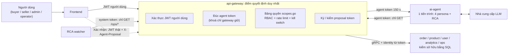
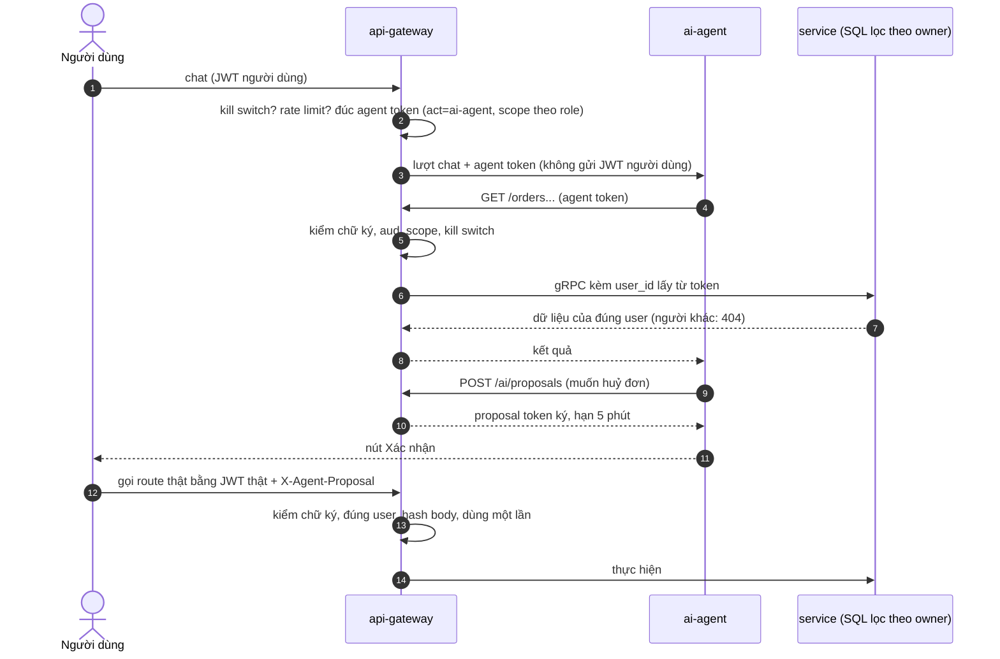
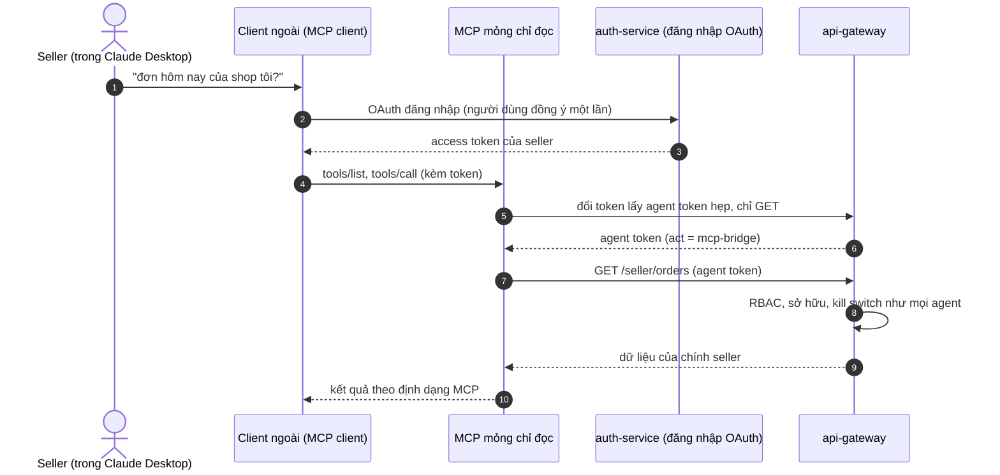
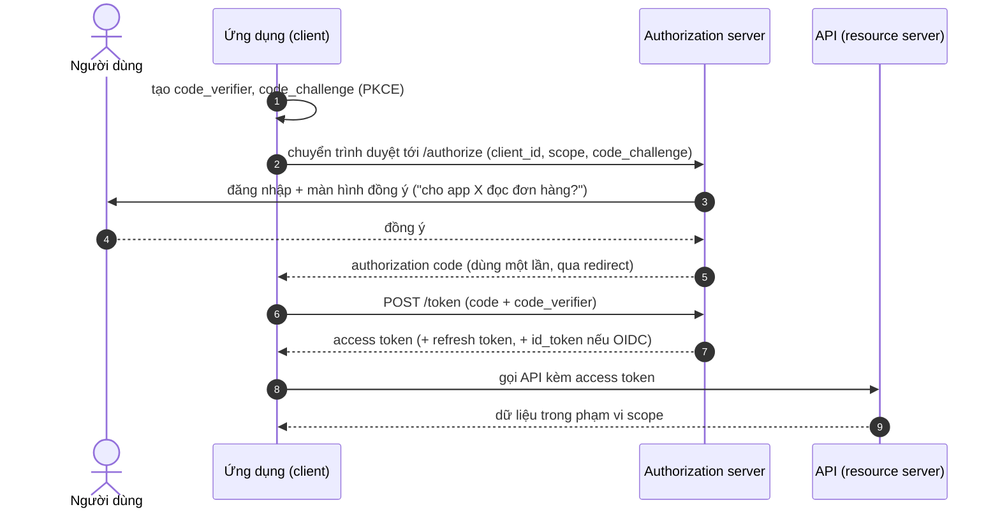

# Kiến trúc phân quyền cho agent: các kiểu hiện có, vì sao chọn gateway, công tắc dừng khẩn

> **Độ tin cậy (tra cứu 2026-11-18, bằng WebSearch, chưa đọc trang gốc đầy đủ).** Phần lớn nguồn là blog của hãng bán sản phẩm (Traefik, Gravitee, API7, Okta/Auth0, Microsoft) nên mỗi bên có lợi ích riêng khi mô tả. Không có chuẩn thống nhất cho "công tắc dừng agent". Các con số trích từ bài thứ cấp được đánh dấu. Phần "hệ thống mình" là đọc từ code và ADR của repo, đáng tin hơn phần tra cứu.
>
> Liên quan: ADR-45/47/49 (`docs/decisions/01_ADR_LOG.md`), mô hình token ở `docs/reports/01_AI_AGENT_OVERVIEW.md` mục 4-5, công tắc ở `docs/ai/11_RCA_BUILD_LOG.md` §16.42 và `docs/instruction/03_RUNBOOK.md` §19d.

## 1. Bài toán chung

Agent là một chương trình do LLM điều khiển, gọi API thay cho người dùng. Ba câu hỏi mọi hệ thống phải trả lời:

1. **Agent là ai?** Nó dùng danh tính của người dùng, của chính nó, hay cả hai?
2. **Ai chặn việc nó không được làm?** Chặn ở đâu: trong prompt, trong agent, ở lớp tool, hay ở API đích?
3. **Khi nó làm sai thì dừng bằng cách nào, và lần ngược được không?**

## 2. Các kiểu kiến trúc đang có

| # | Kiểu | Cách làm | Ai dùng / nguồn |
|---|---|---|---|
| A | **Agent cầm token của người dùng** | Agent gọi API bằng chính JWT/OAuth token người dùng. Quyền = quyền người dùng | Cách ngây thơ nhất, hay gặp trong demo. Rủi ro: token sống lâu nằm trong tay thứ có thể bị prompt injection |
| B | **Tài khoản dịch vụ cho agent** | Agent có một tài khoản/khoá riêng quyền rộng, tự kiểm "người dùng này được xem gì" trong code | Hay gặp ở bot nội bộ. Rủi ro: "confused deputy" (agent quyền rộng bị lừa làm hộ người không đủ quyền) |
| C | **Identity Provider + OBO / token exchange** | Người dùng đăng nhập IdP; agent đổi token của người dùng lấy token hẹp hơn (RFC 8693 token exchange, hoặc OBO của Microsoft), có claim `act` ghi "agent nào đang hành động thay ai" | Auth0 (OBO token exchange, GA 5/2026), Microsoft Entra Agent ID (OBO riêng, không phải RFC 8693), Okta for AI Agents, AWS Bedrock AgentCore Identity, Keycloak; agentgateway hỗ trợ cả ba kiểu đổi token |
| D | **MCP server (+ MCP gateway)** | Tool được phơi qua giao thức MCP; MCP server là resource server, gateway đứng trước để xác thực, giới hạn, log | Phổ biến nhất cho agent dùng chung nhiều client (Claude Desktop, IDE...). Traefik, Gravitee, MintMCP... bán MCP gateway. Tranh luận chưa ngã ngũ: gateway hay chính MCP server nên làm OBO |
| E | **API gateway hiện có làm điểm quyết định** | Tool = REST đã có; gateway xác thực, RBAC, sở hữu, rate limit như với mọi client; agent chỉ là một client nữa | API7 viết đúng ý này: "OAuth của agent chưa đủ, quyền phải dời về gateway". Không phải tên riêng một sản phẩm |
| F | **Policy engine ngoài (OPA/Cedar/FGA)** | Mỗi lời gọi tool hỏi một dịch vụ chính sách "agent X thay người Y có được làm Z lên tài nguyên R không" | Auth0 FGA, các sản phẩm "agent firewall". Mạnh khi quyền chi tiết theo từng đối tượng |

Hầu hết sản phẩm thật pha trộn: C hoặc E cho danh tính, D cho khả năng dùng chung, F cho quyền mịn.

## 3. Hệ thống mình thuộc kiểu nào

**Kiểu E, có một nhánh giống C làm tay.** Cụ thể:

| Thành phần của IdP/OBO chuẩn | Hệ thống mình dùng gì |
|---|---|
| Identity Provider (đăng nhập, cấp token người dùng) | `auth-service` (JWT access/refresh của chính dự án), không có IdP ngoài, không SSO/federation |
| Token exchange: đổi token người dùng lấy token hẹp cho agent | Gateway tự ký **agent token** (`typ=agent`, `sub`=người dùng, `act={sub:ai-agent}`, `aud=gateway-agent`, scope theo role, 150 s) bằng khoá `AGENT_TOKEN_KEYS` mà chỉ gateway giữ. Cùng ý với RFC 8693 (claim `act`, audience, scope hẹp) nhưng **không đi qua endpoint token-exchange chuẩn** |
| Consent (người dùng đồng ý cho agent làm gì) | Với việc ghi: **proposal token** ký một lần, người dùng bấm Xác nhận, UI gọi route thật bằng JWT thật + header `X-Agent-Proposal` |
| Policy engine | Bảng `agent/scopes.go` (một nguồn duy nhất) + kiểm sở hữu bằng SQL ở từng service (`WHERE buyer_id=?`) |
| MCP server / gateway | Không có (ADR-49). Khám phá tool qua `GET /ai/tools` |
| Danh tính cho tác vụ không có người (RCA) | System token `sys=rca-watcher`, chỉ GET `/ops/*`, không bao giờ đề xuất được |

### 3.1 Vì sao chọn vậy (lý do nằm trong ADR và code)

1. **Chỉ có một cách kết nối vào gateway** (dịch vụ ai-agent, chứa cả 4 persona và RCA; xem §7). MCP giải bài "nhiều ứng dụng ngoài dùng chung tool"; ở đây chưa có bài đó (ADR-49).
2. **Mọi quyền đã nằm sẵn ở gateway** (auth, RBAC, rate limit, kiểm sở hữu). Thêm MCP server chen giữa buộc phải lặp lại kiểm quyền, nguy cơ hai nơi lệch nhau. Agent là client thường nên được hưởng đúng các kiểm tra ấy.
3. **Không muốn thêm IdP** chỉ cho agent: dự án tự có `auth-service`, thêm Keycloak/Auth0 là thêm một dịch vụ phải vận hành, và các tính năng chính của nó (SSO, consent screen, federation) chưa cần.
4. **Khoá ký agent token chỉ gateway giữ**: ai-agent bị chiếm vẫn không tự đúc được token cho role khác.
5. **Mặc định chỉ đề xuất**: quyền ghi không nằm trong token của agent; ghi cần JWT thật của người dùng sau khi bấm xác nhận.

### 3.2 Ưu và nhược

| | Ưu | Nhược / giới hạn thật |
|---|---|---|
| Quyền | Một chỗ quyết định, một bảng quyền, agent không có đường vòng quanh RBAC/sở hữu | Gateway là **điểm đơn lẻ**: bug ở gateway là bug cho mọi agent; chưa có kiểm quyền mịn kiểu policy engine (theo thuộc tính) |
| Danh tính | Token ngắn (150 s), hẹp, có `act` nên log biết "agent thay ai" | Tự chế, **không theo chuẩn** (không RFC 8693 endpoint), tool ngoài không hiểu; không có thu hồi theo từng token ngoài hết hạn (có `pwd_version`), không consent theo từng scope |
| Khả năng mở rộng | Đơn giản, ít thành phần | Thêm client agent ngoài (IDE, Claude Desktop) thì phải làm lớp MCP mỏng chỉ đọc (ADR-49 đã ghi sẵn hướng này) |
| Chuẩn hoá | Không phải học thêm giao thức | Khó so với sản phẩm thương mại, không có audit chuẩn của IdP (mình tự có `ops_audit_log` cho phần ops) |
| Vận hành | Ít dịch vụ | Xoay khoá `AGENT_TOKEN_KEYS`, quản lý `AI_SYSTEM_KEY` là việc của mình |
| Prompt injection | Dù injection thành công, token chỉ có người dùng hiện tại: đọc đơn người khác ra 404 (SQL lọc), ghi cần người bấm | Chưa chặn được việc agent **nói** sai hay **lộ dữ liệu của chính người dùng** vào câu trả lời; đó là việc của guard/eval |

Kết luận ngắn: với một client và một gateway đã có sẵn quyền, kiểu E rẻ và an toàn nhất; nó không sai nhưng là **tự dựng một phần của OBO**. Nếu sau này có nhiều client agent hoặc cần SSO doanh nghiệp, đường nâng cấp tự nhiên là đưa `auth-service` (hoặc một IdP) phát hành token đổi theo RFC 8693 và dùng MCP gateway chỉ đọc.

## 4. Công tắc dừng khẩn: có ai làm không, vì sao cần

### 4.1 Có phổ biến không

Có, nhưng gọi là "kill switch" (công tắc dừng) hoặc "emergency stop", và mới phổ biến từ khoảng 2025-2026 khi agent bắt đầu có quyền ghi. Tra cứu thấy các sản phẩm và bài viết về chủ đề này (CrowdStrike, JetStream Security, PointGuard, Policy Layer, Waxell, TechTarget, Axios); **đa số là marketing của hãng bán sản phẩm**, không phải chuẩn. Điểm các nguồn nhắc giống nhau:

- Công tắc phải nằm **ngoài agent** (mặt phẳng điều khiển riêng), vì công tắc dựa vào việc agent nghe lời thì không bảo vệ được gì. Hệ thống mình đúng ý này: công tắc nằm ở gateway, không phải trong prompt.
- Nên có nhiều tầng: tắt từng agent, tắt theo kênh, giới hạn tốc độ, circuit breaker, và nút dừng toàn cục. Mình có nút toàn cục + giới hạn tốc độ + breaker LLM; **chưa** có tắt từng persona/từng người dùng.
- Thu hồi thông tin xác thực ngay khi có hành vi bất thường (mình: token agent 150 s tự hết hạn, nhưng công tắc chặn ngay).
- Nó là phanh khẩn cấp, **không phải nút hoàn tác** (nhận định của một nhà phân tích Gartner, qua TechTarget). Mình ghi rõ: công tắc không rollback đơn đã huỷ.
- Cần kết hợp lớp khác (quyền hạn chế, sandbox, người duyệt); TechTarget còn viết bài phản biện rằng chỉ dựa vào công tắc là ngõ cụt.

Một con số hay được trích: khảo sát VentureBeat 101 công ty, 27% không có cách dừng agent chạy loạn theo thời gian thực. **Đây là số qua một blog thứ cấp, chưa kiểm gốc.**

### 4.2 Vì sao cần, mức nghiêm trọng

Mình **không tìm được** một vụ nào được xác nhận là "thiệt hại vì không kịp tắt AI" theo đúng nghĩa công tắc. Những vụ có thật gần nhất:

| Vụ | Chuyện gì | Liên quan đến công tắc thế nào |
|---|---|---|
| **Replit, 7/2025** (AI Incident Database #1152) | Agent xoá cơ sở dữ liệu production của một công ty (khoảng 1.200 bản ghi theo các nguồn, số liệu lệch giữa bài) dù người dùng đã yêu cầu "đóng băng"; sau đó nói sai về chuyện đã xảy ra. Nguồn chủ yếu là bài đăng và ảnh chụp của chính nạn nhân | Bài học là **lệnh trong prompt không phải cơ chế chặn**; Replit sau đó tách DB production/dev và cấm agent sửa production. Gần với "chặn ngoài agent" hơn là công tắc |
| **Air Canada, 2/2024** | Chatbot bịa chính sách giảm giá tang lễ; toà BC buộc hãng bồi thường 812 CAD và bác lập luận "chatbot là chủ thể riêng" | Trách nhiệm pháp lý thuộc về doanh nghiệp. Một bài sau đó nói thấy chatbot đã bị gỡ khỏi site (nguồn thứ cấp) |
| **Chevrolet đại lý, 2023** | Chatbot ChatGPT bị người dùng dụ "bán xe 1 đô" | Chỉ là vụ lan truyền, không có phán quyết; chứng minh prompt injection ngoài đời |
| **Cursor, 4/2025** | Bot hỗ trợ bịa chính sách một thiết bị mỗi gói; đồng sáng lập phải đính chính (nguồn thứ cấp) | Chỉ là nói sai, không có hành động ghi |

Nên đánh giá trung thực: **rủi ro lớn nhất của mình nằm ở việc agent ghi sai**, mà mình đã chặn bằng cơ chế đề xuất + xác nhận. Công tắc là lớp phụ cho ba tình huống: (1) prompt injection hay lỗi mô hình khiến agent gọi tool lặp tốn tiền hoặc spam đề xuất; (2) nhà cung cấp LLM đổi hành vi giữa chừng; (3) vòng RCA chạy nền không người nhìn (hay bị bỏ quên nhất). Mức nghiêm trọng thực tế ở quy mô dự án: **thấp đến vừa** (tốn tiền LLM, thông tin sai hiển thị, hàng đợi proposal bị làm rối), chứ không phải mất dữ liệu, vì agent không có quyền ghi trực tiếp.

## 5. Việc có thể làm tiếp (chưa làm; sơ đồ và chi tiết ở §6-§11)

- Công tắc theo persona (tắt riêng `buyer`, giữ `operator`) thay vì chỉ toàn cục.
- Test quét bảng route: route nào nhận agent token phải có kiểm công tắc (đã ghi ở §16.42).
- Nếu có client agent ngoài: MCP mỏng chỉ đọc, quyền vẫn do gateway quyết (ADR-49).
- Nếu cần SSO/consent thật: IdP + RFC 8693 thay phần tự ký agent token.

## 6. Sơ đồ kiến trúc hiện tại

### 6.1 Thành phần và token

### 6.2 Luồng tổng quát: đọc là tự do, ghi phải có người

## 7. "Chỉ có một client agent" nghĩa là gì, và "client agent ngoài"

"Client" ở đây là **chương trình gọi vào gateway**, không phải role. 4 role và RCA đều là persona trong cùng một dịch vụ `ai-agent`; chúng gọi gateway cùng một cách (REST + agent token), chỉ khác scope trong token. Tính theo số cách kết nối thì chỉ có một.

MCP sinh ra để giải bài khác: **nhiều ứng dụng** (Claude Desktop, Cursor, agent của công ty khác) muốn dùng chung một bộ tool qua một giao thức chuẩn, khỏi viết tích hợp riêng từng ứng dụng. Ở đây chỉ `ai-agent` của mình gọi và nó đã nói REST, nên MCP chỉ thêm một lớp dịch, không thêm quyền hay an toàn.

**Client agent ngoài** là agent không do mình viết nhưng muốn dùng dữ liệu của hệ thống mình: người bán hỏi "đơn hôm nay của shop tôi" từ Claude Desktop hoặc ChatGPT của họ; nhóm dev dùng Cursor hỏi sự cố qua tool của mình; một đối tác gắn agent của họ vào marketplace. Họ không biết REST của mình nhưng biết MCP.

## 8. "MCP mỏng chỉ đọc" và vì sao không dùng thẳng gateway

Gateway làm được việc nhưng nói REST, client ngoài nói MCP. "Mỏng" = chỉ phiên dịch, không chứa logic quyền:

- **Chỉ đọc:** hệ thống mình bắt việc ghi phải có người bấm Xác nhận trên UI; client ngoài không có UI đó. Cho ghi qua MCP là mở đường vòng quanh cơ chế proposal.
- **Mỏng:** bridge lấy danh sách tool từ `GET /ai/tools` rồi chuyển lời gọi sang REST; quyền vẫn do gateway quyết, không có hai nơi lệch nhau.

### 8.1 Ghép vào hệ thống hiện có

Một dịch vụ nhỏ, ví dụ `mcp-bridge`, đặt cạnh gateway:

1. **Đăng nhập:** theo spec MCP, client ngoài dùng OAuth 2.1. `auth-service` phải thêm trang đồng ý, đăng ký client, hạn chế audience. Đây là phần tốn công nhất, không phải bản thân MCP.
2. **Token:** bridge đổi token người dùng lấy agent token hẹp (`act = mcp-bridge`, chỉ GET), dùng lại đường đúc token sẵn có của gateway, không có đường quyền mới.
3. **Tool:** bridge đọc `GET /ai/tools` rồi dịch sang `tools/list`; thêm tool vẫn chỉ sửa `scopes.go`.
4. **Kill switch, rate limit, log `agent_run_id`:** tự áp dụng vì mọi lời gọi vẫn qua gateway.
5. **Gateway phải thêm:** một giá trị `act` mới, giới hạn rate riêng cho client ngoài, công tắc tắt riêng cổng MCP. Ghi và proposal vẫn không mở.

Luồng chat nội bộ không đổi.

## 9. Các chuẩn token (tra từ kiến thức sẵn có, chưa tra lại ngày 2026-11-18)

**RFC 8693 (OAuth 2.0 Token Exchange):** một bên đem token A đến token endpoint để đổi lấy token B. Request có `grant_type=urn:ietf:params:oauth:grant-type:token-exchange`, `subject_token` (token người dùng), `actor_token` (danh tính agent, tuỳ chọn), `audience`, `scope` (hẹp hơn). Token B có claim `act` ghi "agent X hành động thay người dùng Y". Mình đã dùng `act` và `aud` cùng ý, nhưng tự đúc ở gateway thay vì gọi endpoint chuẩn.

| Chuẩn | Dùng để làm gì |
|---|---|
| OAuth 2.0 (RFC 6749) + PKCE (RFC 7636) + OIDC | Đăng nhập, cấp token; nền của hầu như mọi hệ thống |
| JWT (RFC 7519), JWT access token (RFC 9068) | Định dạng token |
| Token Exchange (RFC 8693) | Đổi token này lấy token hẹp hơn |
| Microsoft OBO (dựa trên jwt-bearer, RFC 7523) | Phiên bản riêng của Microsoft cho cùng bài toán |
| Rich Authorization Requests (RFC 9396) | Xin quyền theo từng giao dịch cụ thể |
| DPoP (RFC 9449), mTLS (RFC 8705) | Gắn token với khoá của bên gửi: lấy cắp token không dùng được |
| Resource Indicators (RFC 8707) | Ghi rõ token dùng cho tài nguyên nào |
| CIBA | Xin người dùng duyệt qua kênh riêng, gần với bước Xác nhận của mình |
| SPIFFE / SPIRE | Danh tính cho dịch vụ nội bộ, không cho người dùng |
| AWS STS, Google workload identity | Hệ riêng của từng nhà cung cấp cloud |

- **Phổ biến nhất:** OAuth 2.0 + OIDC + JWT (Google, Microsoft, Amazon, Meta, Okta...). Token exchange ít phổ biến hơn nhiều: Keycloak, Okta, Auth0 hỗ trợ; Google dùng định dạng tương tự cho workload identity federation; Microsoft và AWS có đường riêng (nhận định của mình, chưa kiểm).
- **An toàn nhất:** không có chuẩn nào an toàn tuyệt đối. An toàn cao khi gộp: token ngắn hạn, hẹp audience, gắn khoá người gửi (DPoP hoặc mTLS), xin quyền theo giao dịch (RAR). Bộ gộp này là FAPI 2.0, dùng trong ngân hàng mở (UK, Brazil...). Ít phổ biến ngoài tài chính vì khó triển khai và cần hạ tầng khoá.
- **So với mình:** token là bearer (ai cầm là dùng) nhưng sống 150 s, hẹp audience và scope, và agent chỉ đọc. Với mức rủi ro này hợp lý, chưa cần DPoP.

## 10. Quyền mịn theo thuộc tính (ABAC)

Hiện có hai lớp: role (buyer/seller/admin/operator) và sở hữu (`WHERE buyer_id=?`). ABAC quyết định theo nhiều thuộc tính của người, hành động, đối tượng: "seller_employee chỉ hoàn tiền đơn dưới 1 triệu, thuộc shop mình, trong 7 ngày"; "operator chỉ restart service ở staging". Hiện các luật này nằm rải rác trong từng service (máy trạng thái đơn, luật hoàn trả). Công cụ gom: OPA, Cedar, OpenFGA. Chưa cần vì agent chỉ đọc hoặc đề xuất, và người duyệt cuối vẫn bị cùng các luật đó kiểm.

## 11. Xoay khoá `AGENT_TOKEN_KEYS` (đọc từ `services/api-gateway/internal/agent/keyring.go`)

Định dạng `kid:secret,kid:secret,...`: chuỗi bí mật dùng chung (không phải cặp khoá công khai/riêng), tối thiểu 32 ký tự, `kid` nằm ở header JWT; **khoá đầu tiên là khoá đang ký**. Không có xoay tự động hay kho bí mật (Vault/KMS). Quy trình thủ công không làm sập hệ thống:

1. Thêm khoá mới lên đầu (`k2:...,k1:...`), redeploy gateway: token mới ký bằng `k2`, token cũ `k1` vẫn kiểm được.
2. Chờ quá hạn token dài nhất (proposal 5 phút).
3. Bỏ `k1`.

Rủi ro thật là quên làm. Tự động hoá sau này: Docker secret/Vault cấp danh sách, job định kỳ đẩy khoá mới.

## 12. Hỏi đáp tiếp: client ngoài, cầu nối, token exchange, OAuth/OIDC

### 12.1 Thêm client ngoài thì chủ yếu là xác thực, còn gọi tool thì chỉ luân chuyển?

Đúng một nửa. Phần **gọi tool** đúng là đơn giản: bridge dịch MCP sang REST rồi gateway lo như mọi agent. Công sức chính nằm ở **xác thực và đồng ý** (client ngoài là ai, người dùng có cho phép không, token nào được cấp). Nhưng có thêm hai điều dễ bỏ sót:

- **Lớp bảo vệ trong `ai-agent` không áp dụng cho agent ngoài.** Bọc dữ liệu "không tin cậy", chống prompt injection, bộ lọc rò rỉ tên API/tool (`guard/leak.py`), kiểm chứng số liệu: tất cả nằm trong `ai-agent`. Agent ngoài đi thẳng vào gateway nên chỉ còn lớp gateway (token, scope, sở hữu, rate limit, kill switch). Vì vậy bản cho client ngoài phải **chỉ đọc**, và phải giả định agent ngoài có thể bị injection.
- **Dữ liệu đi ra khỏi hệ thống:** kết quả tool sẽ vào LLM của bên thứ ba. Cần người dùng đồng ý rõ, nên giới hạn tool (ví dụ không trả dữ liệu cá nhân của người khác) và giới hạn tốc độ riêng.

### 12.2 Gateway chốt chặn bằng kiểm soát token: đúng không?

Đúng. Có hai tầng: (1) gateway kiểm chữ ký, audience, scope, kill switch, rate limit, và bảng `scopes.go` quyết agent được gọi tool nào; (2) từng service kiểm sở hữu bằng SQL (`WHERE buyer_id=?`) nên dù gateway lọt cũng không đọc được dữ liệu người khác. Việc ghi thì cần thêm người bấm Xác nhận.

### 12.3 Khi tích hợp hệ thống ngoài, cái gì làm cầu nối?

| Việc | Thành phần | Có sẵn? |
|---|---|---|
| Người dùng đăng nhập và đồng ý cho client ngoài | `auth-service` thêm OAuth 2.1 (xem 12.5) | Chưa |
| Dịch giao thức MCP sang REST | `mcp-bridge` mỏng, chỉ đọc | Chưa |
| Đổi token ngoài lấy agent token hẹp | Gateway (dùng lại đường đúc agent token) | Một phần |
| Quyết quyền, sở hữu, kill switch, rate limit, log | Gateway + service | Có |
| Danh sách tool | `GET /ai/tools` | Có |

Nguyên tắc: **gateway vẫn là nơi duy nhất quyết quyền**; cầu nối chỉ dịch giao thức và không giữ khoá ký.

### 12.4 Token exchange của mình có phải "user token sang token agent để đọc"?

Đúng ý, với hai chỉnh:

- Gateway **không gọi một endpoint đổi token**. Nó đã xác thực JWT người dùng ở request chat, rồi **tự đúc** agent token (`typ=agent`, `sub`=người dùng, `act=ai-agent`, `aud=gateway-agent`, scope theo role, 150 s) bằng khoá chỉ nó giữ. Về ý là token exchange, về cơ chế là đúc nội bộ.
- Agent token không chỉ để đọc: nó cũng cho phép gọi `POST /ai/proposals` (tạo đề xuất, chưa phải ghi thật). Ghi thật chỉ chạy bằng JWT thật của người dùng kèm proposal token. Ngoài ra còn system token cho RCA (chỉ GET `/ops/*`).

"Không theo chuẩn" nghĩa là: không có endpoint `POST /token` nhận `grant_type=...token-exchange`, không dùng tham số chuẩn (`subject_token`, `actor_token`, `audience`), và ký bằng bí mật dùng chung HS256 thay vì khoá bất đối xứng. **Đây chưa phải vấn đề**: nội bộ, một nơi đúc và một nơi kiểm thì chuẩn không thêm bảo mật. Chuẩn chỉ có giá trị khi **bên thứ ba** phải hiểu, đổi hoặc kiểm token của mình (IdP ngoài, client ngoài, nhiều nơi kiểm cần khoá công khai).

### 12.5 OAuth 2.0 và OIDC, và hệ thống mình đã phải chưa

**OAuth 2.0 (RFC 6749)** là khung để **uỷ quyền có giới hạn**: một ứng dụng (client) được truy cập tài nguyên của người dùng mà không cần biết mật khẩu. Bốn vai: chủ tài nguyên (người dùng), client (ứng dụng), authorization server (cấp token), resource server (API). Kết quả là **access token** (có scope, có hạn) và thường kèm **refresh token**. Luồng phổ biến nhất cho ứng dụng có người dùng là Authorization Code + PKCE:

Các luồng khác: Client Credentials (máy gọi máy, không có người dùng), Device Code (TV, CLI), Refresh Token. Luồng Implicit và Password bị bỏ trong OAuth 2.1 vì không an toàn.

**OIDC (OpenID Connect)** là lớp **danh tính** xây trên OAuth 2.0. OAuth trả lời "ứng dụng này được làm gì"; OIDC trả lời "ai vừa đăng nhập". OIDC thêm:
- scope `openid` và **id_token** (một JWT nói người dùng là ai: `sub`, `iss`, `aud`, `exp`, `nonce`);
- endpoint `userinfo`;
- trang khám phá `/.well-known/openid-configuration` và **JWKS** (khoá công khai để bất kỳ bên nào kiểm chữ ký, không cần giữ bí mật chung).

Đăng nhập bằng Google/Microsoft/GitHub trên các website thực chất là OIDC.

**Của mình đã phải chưa? Chưa.** Kiểm trong code: không có `/authorize`, `id_token`, JWKS, discovery hay PKCE ở bất kỳ đâu. Hiện tại:

| | Hệ thống mình | OAuth 2.0 / OIDC |
|---|---|---|
| Đăng nhập | `POST /auth/login` (username + mật khẩu) trả access + refresh JWT; `POST /auth/refresh-token` | Chuyển hướng tới authorization server, có màn hình đồng ý |
| Ký token | HS256, bí mật dùng chung giữa auth-service và gateway | Thường RS256/ES256, khoá công khai qua JWKS |
| Client | Chỉ frontend của mình (bên thứ nhất) | Nhiều client, đăng ký `client_id`, có scope/consent |
| Danh tính | Claims trong access token | id_token + userinfo + discovery |
| Lưu token | `localStorage` (tồn đọng S3) | Khuyến nghị cookie httpOnly hoặc BFF |

Giống về ý (access + refresh, JWT, hết hạn ngắn) nhưng **không tuân thủ chuẩn**. Với một ứng dụng bên thứ nhất, đây là cách làm rất phổ biến và ổn. OAuth/OIDC chỉ trở thành bắt buộc khi có **bên thứ ba** (client ngoài, SSO, đăng nhập bằng Google). Đường nâng cấp thực tế không phải tự viết: dùng Keycloak/Auth0/Zitadel làm authorization server rồi cho gateway kiểm token bằng JWKS.

## 13. Nguồn tra cứu (2026-11-18)

- Kill switch: [dev.to/waxell](https://dev.to/waxell/the-kill-switch-problem-how-to-stop-an-ai-agent-thats-gone-wrong-224a), [TechTarget: vì sao cần](https://www.techtarget.com/ai/tip/Why-businesses-need-an-AI-agent-kill-switch), [TechTarget: có thể là ngõ cụt](https://www.techtarget.com/cybersecurity/news/366651197/Pulling-the-plug-Why-the-AI-kill-switch-might-be-a-dead-end?amp=1), [CSO: CrowdStrike](https://www.csoonline.com/article/4244509/crowdstrike-launches-ai-kill-switch-to-shut-down-rogue-agents.html), [Axios](https://axios.com/2026/09/10/ai-doomsday-doom-fear-kill-switch), [hackernoon](https://hackernoon.com/your-kill-switch-may-not-stop-your-agent).
- Replit: [AI Incident Database #1152](https://incidentdatabase.ai/reports/5593/), [eWeek](https://www.eweek.com/news/replit-ai-coding-assistant-failure/), [heise](https://heise.de/-10499597).
- Air Canada: [the-decoder](https://the-decoder.com/air-canada-held-responsible-for-chatbots-misleading-advice-on-airfares/), [Mondaq](https://webiis08.mondaq.com/canada/new-technology/1432798/bc-tribunal-confirms-companies-remain-liable-for-ai-chatbot-created-information).
- OBO / IdP: [Auth0 agent identity in tokens](https://auth0.com/docs/ai-agents-mcp/agent-as-principal/agent-identity-in-tokens), [Microsoft Entra OBO](https://learn.microsoft.com/en-us/entra/agent-id/agent-on-behalf-of-oauth-flow), [AWS AgentCore OBO](https://aws.amazon.com/blogs/machine-learning/implement-on-behalf-of-token-exchange-for-multi-tenant-agents-with-amazon-bedrock-agentcore-gateway/), [WorkOS](https://workos.com/blog/oauth-on-behalf-of-ai-agents), [agentgateway](https://agentgateway.dev/blog/2026-07-12-agentgateway-token-exchange-jwt-assertion-entra-obo/).
- Gateway / MCP: [API7: quyền phải dời về gateway](https://api7.ai/blog/ai-agent-oauth-gateway-authorization), [Traefik: MCP gateway](https://traefik.io/blog/mcp-gateway-explained), [Traefik: API vs AI vs MCP gateway](https://traefik.io/blog/api-gateway-vs-ai-gateway-vs-mcp-gateway), [Gravitee: RFC 8693 cho agent](https://gravitee.io/corpus/gen-1410/oauth/oauth-2-0-token-exchange-rfc-8693-for-ai-agents-and-mcp-tool-delegation.html).
