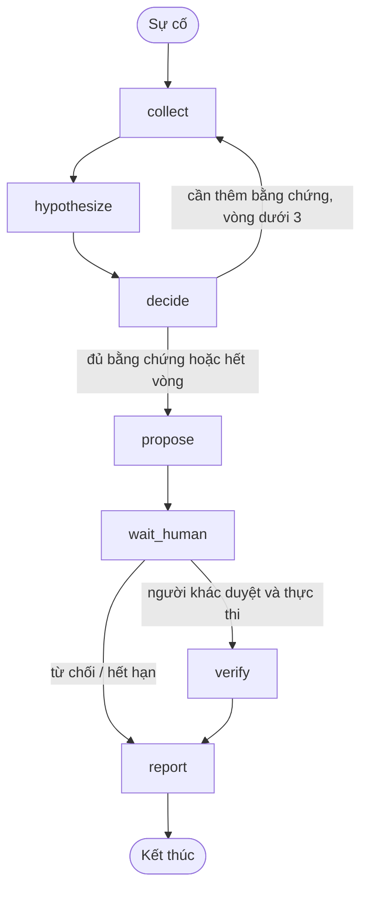

# C

### 16.25 Đường đề xuất vận hành cho operator (ADR-45) và việc RCA còn lại (2026-11-15)

**Đã làm (offline, chưa chạy LLM):**
- Gateway: `DefaultActions["operator"] = [ops_action]` (`POST /ops/proposals`), `readOnlyRoles = {admin}`, `/ops/proposals` vào danh sách `proposable`, `confirm` gắn ở route tạo đề xuất, tool đọc mới `ops_list_actions` (`GET /ops/actions` chuyển sang nhóm agent đọc được). `ToolParam.Nest` + kiểu `string_list`/`integer_list` cho body lồng `params`. Test: operator chỉ ký được `/ops/proposals` (duyệt, quyết định, thực thi, ghi nhận kết quả đều 403; admin không ký được gì), `TestOpsActionShape` (enum `action_id` khớp sổ ops-service).
- ai-agent: `ParamSpec.nest`, `build_action` gom `params`, kiểm danh sách, câu tóm tắt liệt kê tham số lồng (người dùng thấy đúng thứ sẽ chạy), `from_` cho `run_backfill`. Prompt operator đổi rule 2 và thêm mục "Soạn đề xuất vận hành". Eval: `READ_ONLY = (admin,)`; operator có 6 câu propose (restart, scale, requeue, backfill, escalate, restart product) và các yêu cầu duyệt/đóng/silence/rollback/xoá outbox chuyển sang nhóm adversarial (vẫn phải bị từ chối); bộ eval nay 406 câu.
- Chưa đo: chưa chạy LLM cho các câu propose mới của operator; chưa thử xác nhận thật trên UI (cần đăng nhập operator).

**Việc RCA còn lại (bước 6, chưa làm), theo thứ tự đề xuất:**
1. Vẽ đồ thị RCA rồi chốt LangGraph hay vòng lặp tay (§17 mục "Đầu bước 6").
2. Điều phối `rca/`: nhận incident, `collect` (≤12 truy vấn, 5 s/truy vấn), `hypothesize` (≤3 giả thuyết, mỗi cái trích bằng chứng và "điều gì sẽ bác bỏ"), `decide` (≤3 vòng), `propose` (qua ops_action), `wait_human`, `verify`, `report` (xem §7.2).
3. Ngân sách theo sự cố (lượt mô hình, truy vấn, thời gian); không đề xuất lại hành động đã thất bại khi không có bằng chứng mới; tối đa 2 đề xuất chờ cho một sự cố.
4. `verify` sau khi hành động chạy: chờ 2-5 phút, kiểm lại đúng truy vấn đã chứng minh sự cố; không hồi phục thì không đóng sự cố.
5. Màn hình RCA trên UI (dòng thời gian, bằng chứng, giả thuyết, đề xuất).
6. Eval RCA: top-3 giả thuyết có chứa `ground_truth` của playbook không, hành động có đúng sổ không, số lượt gọi.
7. Kịch bản gây lỗi (roadmap §8.2) trên MÔI TRƯỜNG THỬ, có lệnh dọn dẹp, bắt đầu từ 3 kịch bản rẻ (outbox kẹt, một service dừng, DB chậm): cần quyết định dùng stack thử riêng hay gây lỗi ngắn trên Swarm hiện tại, và cần người dùng đồng ý từng kịch bản.
8. Cần từ người dùng: mật khẩu operator (và seller) để smoke thật (`OPERATOR_BOOTSTRAP_*` trong `deploy/.env` đang trống); (role LLM `rca` đã thêm, hiện cùng mô hình với operator; muốn mạnh hơn thì sửa một dòng); đồng ý trước mỗi lần chạy LLM (CLAUDE.md).

### 16.26 Đồ thị RCA và thử LangGraph (ADR-46, 2026-11-15)

Đã thêm `llm.roles.rca` ở cả hai config (cùng profile `opencode_deepseek_flash`). Đã thử LangGraph bằng đồ thị mẫu, LLM giả, không gọi mạng: `interrupt()` dừng đúng ở `wait_human`, `Command(resume=...)` chạy tiếp, hai sự cố (`thread_id`) không lẫn trạng thái, `draw_mermaid()` vẽ được. Khoá bằng `tests/test_langgraph_contract.py` (3 test; toàn bộ ai-agent: 106 passed, 11 skipped).

Quy ước: mỗi node là một hàm riêng (dễ test bằng LLM giả); `collect`/`hypothesize` là chỗ gọi LLM và tool, `decide` đếm vòng và ngân sách; `propose` gọi tool `propose_ops_action` (ADR-45), vẫn cần operator xác nhận rồi một người KHÁC duyệt.

Ngưỡng kích hoạt: 5 alert `critical` trong `deploy/prometheus/alerts.yml` đủ điều kiện cho agent vào xem ngay (khi có danh tính hệ thống, chưa làm); 15 alert `warning` chỉ chạy khi operator bấm "Điều tra".

**Còn mở trước khi viết `rca/`: nơi lưu checkpoint.** `langgraph-checkpoint-postgres` cần thêm gói + `psycopg` (kho chat hiện dùng `asyncpg`, và môi trường này chưa cài được gói mới nếu không có mạng). Hai hướng: (a) thêm hai gói đó, checkpoint vào cùng Postgres với bảng `ai_*`; (b) viết một checkpointer nhỏ lưu JSON vào bảng `ai_rca_runs` bằng `asyncpg`. Đề xuất (a) nếu cài được gói, vì tự viết checkpointer dễ sai khi langgraph đổi.
