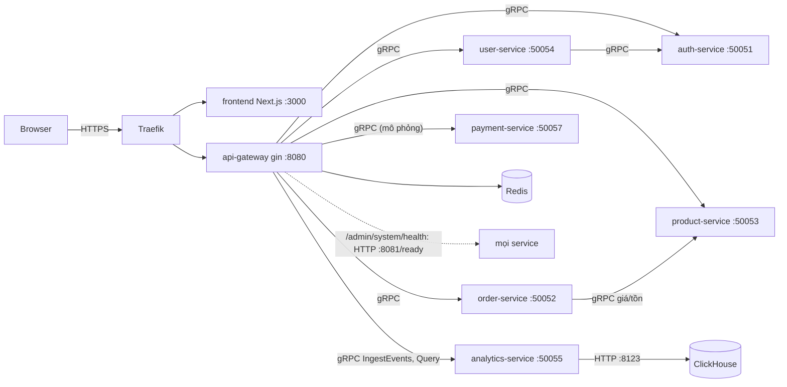
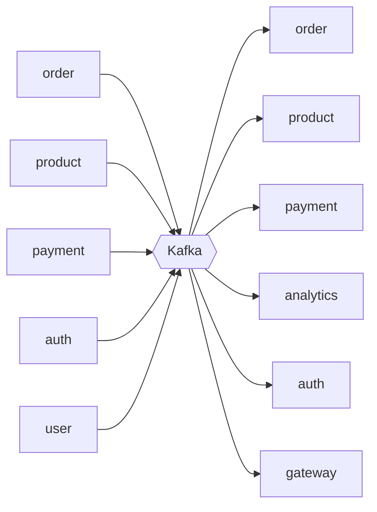
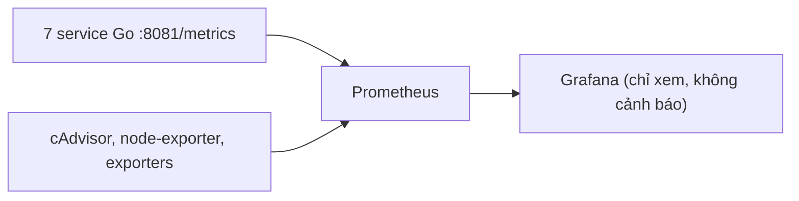
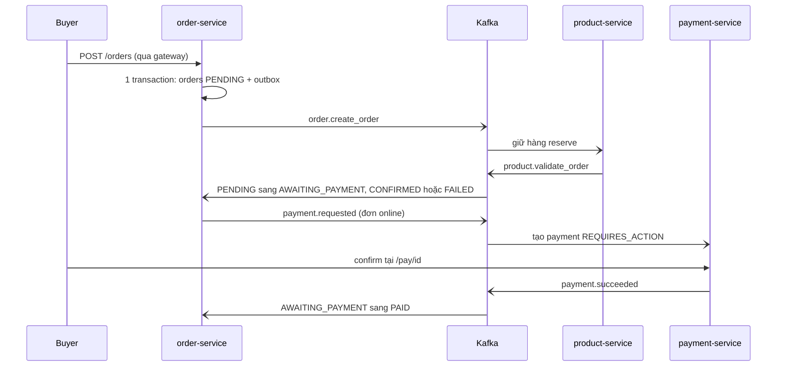

# Kiến trúc

Đường đồng bộ: trình duyệt chỉ nói chuyện với Traefik, gateway là cửa công khai duy nhất và gọi các service bằng gRPC.

Gateway dùng Redis cho rate limit và `pwd_version`; analytics ghi/đọc ClickHouse. order-service chỉ gọi gRPC tới product-service (định giá, tồn), user-service gọi auth-service.

Đường bất đồng bộ: mọi hiệu ứng liên service đi qua outbox rồi Kafka, consumer phải idempotent (chi tiết: [03_EVENTS_KAFKA.md](03_EVENTS_KAFKA.md)).

Cột trái là producer (outbox), cột phải là consumer; order, product, payment vừa phát vừa nhận. Mỗi service Go có thêm cổng admin nội bộ `:8081` (`/health /healthz /ready /readyz /metrics /version`).

## Service

| Service | Trách nhiệm | File chính |
|---|---|---|
| api-gateway | REST, JWT (`Type=="access"`), RBAC, kiểm sở hữu, CORS, rate limit, giới hạn body, **tracking `/events`** → analytics (gRPC), proxy báo cáo analytics, `/admin/system/health`, metrics HTTP | `internal/router` (danh sách route + quyền), `internal/middleware`, `internal/handler` |
| auth-service | đăng ký/ đăng nhập/ refresh/ đổi mật khẩu, role (`buyer`, `seller_admin`, `seller_employee`, `admin`), JWT, tra store của tài khoản, bootstrap admin | `internal/service/*` |
| user-service | hồ sơ buyer, store (seller), **địa chỉ giao hàng**; tạo store phát `user.create_seller` | `internal/service/{buyer,seller,address}_service.go` |
| product-service | catalog (danh mục, tìm kiếm không dấu, trạng thái), **tồn kho available/reserved/sold + sổ cái**, giữ/trả/xuất kho theo Kafka, outbox `product.changed`/`inventory.changed` | `internal/service`, `internal/repository` |
| order-service | **giỏ hàng**, checkout tách theo store (idempotent), định giá phía server, **máy trạng thái đơn mở rộng** + lịch sử, worker hết hạn/ tự giao, yêu cầu thanh toán/ hoàn tiền | `internal/service/{checkout,cart,orders,kafka_service}.go`, `internal/repository/{orders,statemachine,domain_events}.go` |
| payment-service | thanh toán **MÔ PHỎNG** (`mockpay`): thẻ test, ví, chuyển khoản, webhook ký HMAC, hoàn tiền | `internal/service/{service,confirm,queries}.go` |
| analytics-service | nhận tracking (gRPC) + event Kafka → ClickHouse; trả báo cáo theo scope platform/store; cache Redis | `internal/{ingest,store,service,ch}` |

Lớp trong một service: `server` (gRPC, protovalidate, ánh xạ lỗi) → `service` (nghiệp vụ) → `repository` (GORM); `client/*` bọc gRPC gửi đi; `config/messagequeue/kafkaimpl` bọc kafka-go; `pkg/ops` (admin :8081, bản sao giống hệt ở mọi service), `pkg/events` (outbox chung ở product/order/payment).

## Mô hình danh tính
- Tài khoản (`accounts`) có `role` và `store_id` (0 đến khi seller tạo store). Một *store* là một dòng `sellers` của user-service; `store_id` của tài khoản = id seller; `products.seller_id` = id store.
- Gateway tra store của người gọi qua auth-service (`GetStoreIDRoleById`) khi cần kiểm sở hữu; mọi route seller dùng store **từ token**, không từ request.
- Buyer là người duy nhất đặt hàng/ thanh toán; seller (`seller_admin`, `seller_employee`) quản lý catalog/ tồn/ đơn của store; admin quản trị nền tảng (không tự đăng ký được).

## Luồng đặt hàng → thanh toán → giao hàng (tóm tắt, chi tiết: [platform/04](platform/04_ORDERS_PAYMENTS.md))

Mọi bước đổi trạng thái đều phát thêm `order.status_changed` cho analytics; sau `PAID` seller giao hàng (kho `reserved` sang `sold`). Các bước chi tiết:

1. `POST /orders` (header `Idempotency-Key`): gateway lấy buyer từ token, dựng snapshot địa chỉ; order-service định giá từ product-service, **tách đơn theo store**, trong **một transaction** ghi `checkouts`, `orders` (`PENDING`), lịch sử và outbox (`order.create_order`, `order.status_changed`).
2. product-service giữ hàng (`inventory−`, `reserved+`, ledger `reserve`) cho từng đơn, ghi kết quả → `product.validate_order`.
3. order-service: `PENDING → AWAITING_PAYMENT` (online, `expires_at = +ORDER_PAYMENT_TTL_MIN`) / `CONFIRMED` (COD) / `FAILED` (hết hàng). Khi mọi đơn của checkout online rời `PENDING` ⇒ `payment.requested`.
4. payment-service tạo payment (`REQUIRES_ACTION`); buyer xác nhận trên trang `/pay/<id>` (thẻ test/ ví/ chuyển khoản) → `payment.succeeded` → đơn `PAID`. Không trả kịp ⇒ worker `EXPIRED` và nhả kho; tiền về muộn ⇒ hoàn phần dư.
5. Seller `ship` (`PAID|CONFIRMED → SHIPPED`: kho chuyển `reserved → sold`), `deliver` hoặc buyer `confirm-received` hoặc tự giao sau `AUTO_DELIVER_DAYS` (COD: thu tiền = `PAID`). Trong cửa sổ trả hàng buyer `return` → seller/admin duyệt (`REFUNDED` + hoàn tiền online) hoặc từ chối.
6. Huỷ (`AWAITING_PAYMENT/CONFIRMED/PAID`): `CANCELED` + `order.cancel_order` (nhả kho đúng một lần) + hoàn tiền nếu đã trả online.
7. Mọi bước phát `order.status_changed` ⇒ analytics ghi `fact_order_status`.
Đơn `PENDING` không huỷ được (kết quả giữ hàng đang bay) – bỏ race reserve/cancel mà không cần timeout; đơn chưa trả tiền tự hết hạn.

## Tracking & analytics
Trình duyệt `POST /events` → gateway (gắn user/role/store/ip-hash từ JWT/request, giới hạn 50 event/64 KB, rate limit riêng) → **gRPC `IngestEvents`** → analytics-service (whitelist, consent, che PII) → bộ đệm RAM → ClickHouse `events_raw`. Event nghiệp vụ đi Kafka → bảng fact. Báo cáo (`/seller/analytics/*`, `/admin/analytics/*`) gọi gRPC `Query` → SQL trên bảng fact (`FINAL`), cache Redis 30 s, múi giờ cố định `Asia/Ho_Chi_Minh`. ClickHouse down ⇒ báo cáo 503, cửa hàng vẫn chạy.

## Nơi dữ liệu nằm
Một database Postgres chung (bảng thuộc từng service, không join chéo; riêng `domain_events` là bảng outbox dùng chung), Redis (bộ đếm rate limit, `<userId>:pwd_version`, cache báo cáo `analytics:v1:*`), Kafka 3 broker KRaft (3 partition/ topic, RF 3, retention 7 ngày), ClickHouse (dẫn xuất, dựng lại được tối đa ~7 ngày từ Kafka). Chi tiết: [02_DATA_MODEL.md](02_DATA_MODEL.md), [03_EVENTS_KAFKA.md](03_EVENTS_KAFKA.md).
