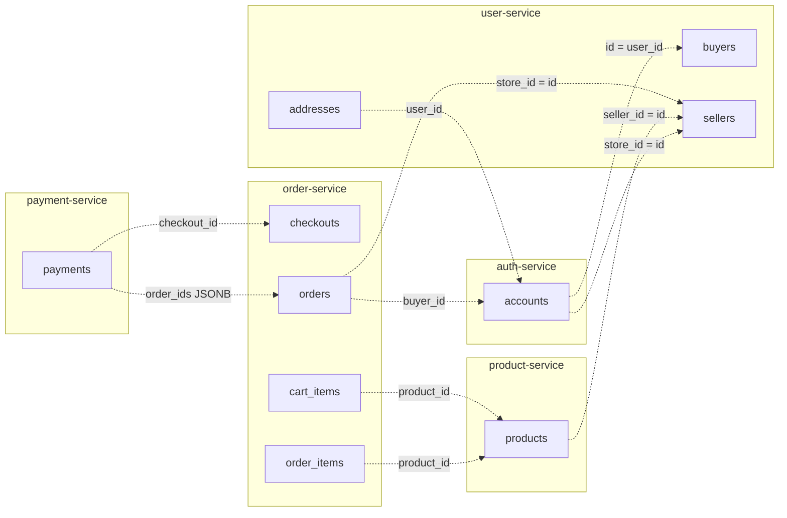
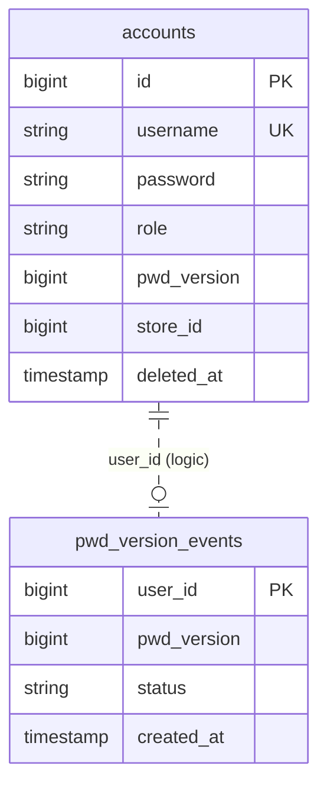
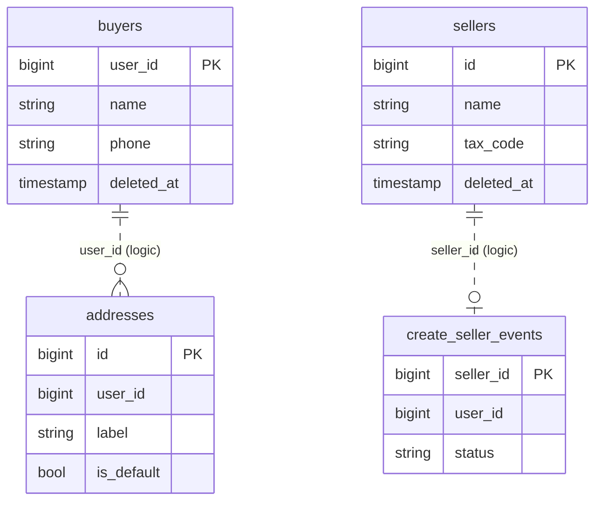
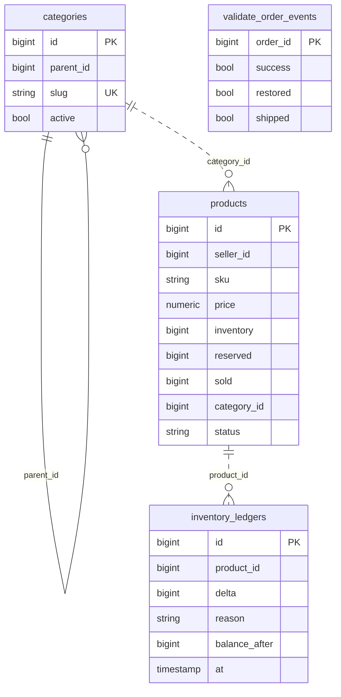
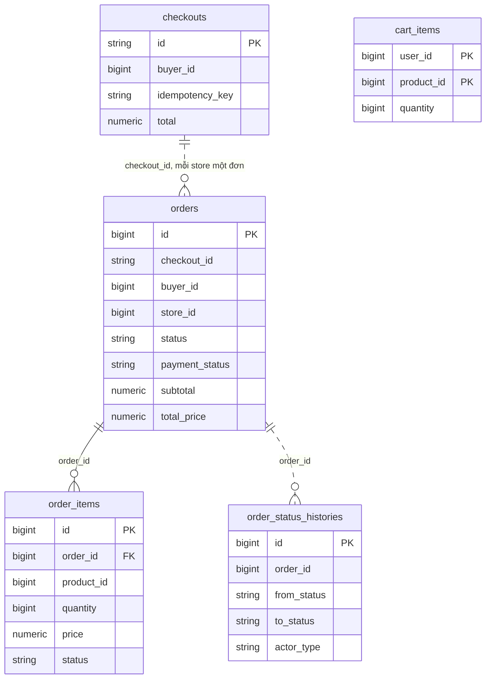
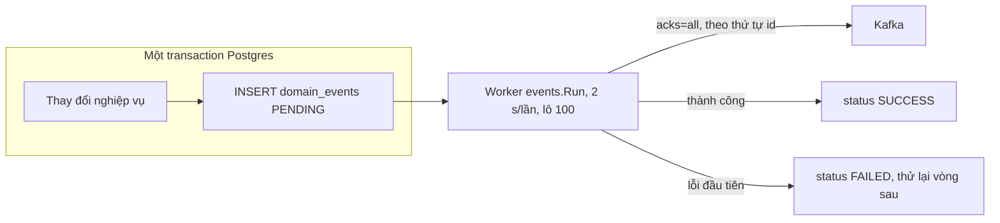
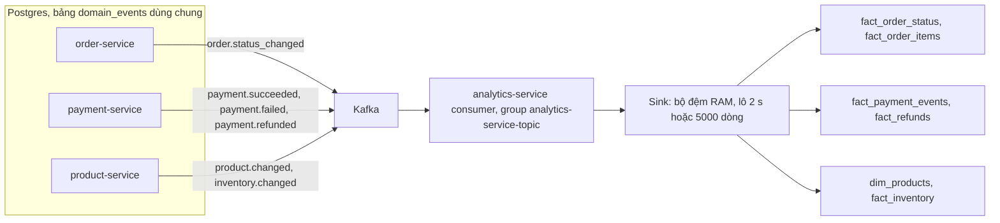
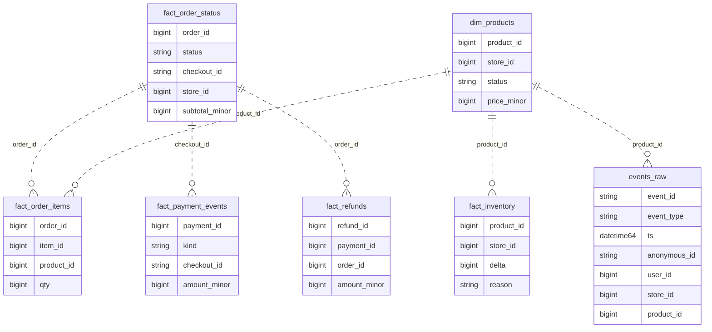

# Mô hình dữ liệu

Nguồn: `services/*/pkg/model`, `services/*/internal/repository/migrate.go`, `services/analytics-service/internal/store/schema.go`. Postgres dùng migration **goose** có version (`services/<svc>/migrations/*.sql`, nhúng `go:embed`, chạy lúc khởi động, bảng `goose_db_version_<svc>`; model GORM chỉ để truy vấn, không còn `AutoMigrate`). ClickHouse có migration có version (`schema_migrations`). Mọi service Go dùng **cùng một database Postgres** (`POSTGRES_DB`), bảng thuộc từng service, không join chéo service. Tên bảng là tên GORM mặc định (số nhiều snake_case).

## 1. Postgres theo service
### 1.0 Ranh giới sở hữu và liên kết logic



Mọi service dùng chung một database Postgres nhưng **không có khoá ngoại và không join chéo service**: các mũi tên đứt nét chỉ là liên kết logic qua id (service gọi nhau bằng gRPC hoặc event Kafka). Khoá ngoại thật chỉ có trong nội bộ order-service (`order_items.order_id`, xoá/ sửa dây chuyền).

### auth-service



`accounts` là bảng gốc của danh tính; `pwd_version_events` là outbox cũ cho sự kiện đổi mật khẩu, nối với tài khoản chỉ qua `user_id`.

| Bảng | Cột chính | Ghi chú |
|---|---|---|
| `accounts` | `id, username UNIQUE, password (bcrypt), role, pwd_version, store_id, deleted_at` | `role` ∈ `buyer, seller_admin, seller_employee, admin`; `store_id` = id store (0 đến khi tạo store, gán qua event `user.create_seller`); `username` UNIQUE toàn cục dù login theo (username, role) |
| `pwd_version_events` | `user_id PK, pwd_version, status, created_at` | outbox cũ cho `auth.change_password` (PENDING/FAILED/SUCCESS) |
*Chưa có*: `status/failed_logins/locked_until`, `email`, `audit_log` (khoá đăng nhập & audit: chưa làm).

### user-service



`buyers.user_id` chính là `accounts.id` bên auth-service; `addresses.user_id` cùng giá trị đó (nên một địa chỉ thuộc về tài khoản, kể cả khi chưa có dòng `buyers`). `sellers.id` đồng thời là id store.

| Bảng | Cột chính | Ghi chú |
|---|---|---|
| `buyers` | `user_id PK, name, gender, date_of_birth, phone, address, deleted_at` | |
| `sellers` | `id PK, name, bank_account, tax_code, description, date_of_birth, phone, address, deleted_at` | một seller = một store |
| `addresses` | `id, user_id (index), label, receiver_name, phone, line1, ward, district, city, is_default, created_at, updated_at` | ≤ 10/user, đúng một mặc định; đơn lưu **bản sao** nên sửa/xoá không ảnh hưởng đơn cũ |
| `create_seller_events` | `seller_id PK, user_id, status, created_at` | outbox cũ cho `user.create_seller` (AutoMigrate còn tạo thêm bảng thừa `create_seller_kafka_events`) |

### product-service



Danh mục là cây ≤ 3 cấp (`parent_id`); sổ cái tồn kho chỉ thêm, mỗi dòng ứng với một lần đổi `inventory/reserved/sold`. `validate_order_events` khoá theo `order_id` của order-service nên đứng riêng (không quan hệ với `products`; không có khoá ngoại ở cả hai phía).

| Bảng | Cột chính | Ghi chú |
|---|---|---|
| `products` | `id, name, price NUMERIC(18,2), seller_id, inventory, reserved, sold, attributes JSONB, sku, description, category_id, brand, tags JSONB, image_urls JSONB, status, low_stock_threshold, weight_g, version, created_at, updated_at, deleted_at` | UNIQUE `(seller_id, sku)` khi `sku<>''`; GIN index full-text `to_tsvector('simple', mm_unaccent(name‖brand‖sku‖description))` |
| `categories` | `id, parent_id, name, slug UNIQUE, sort, active, created_at, updated_at` | cây ≤ 3 cấp; seed mặc định 7 danh mục gốc + con (`SEED_DEFAULT_CATEGORIES!=false`, chỉ khi bảng rỗng) |
| `inventory_ledgers` | `id, product_id, delta, reason, ref_type, ref_id, balance_after, at` | sổ cái **chỉ thêm**; index `(product_id, at)` |
| `validate_order_events` | `order_id PK, success, status, processed, restored, shipped, created_at` | kết quả giữ hàng **và** outbox cũ; `restored` = đã trả hàng (đúng một lần), `shipped` = đã xuất kho (đúng một lần) |
| `domain_events` | xem §1.5 | outbox chung cho `product.changed`, `inventory.changed` |
Hàm SQL `mm_unaccent(text)` (IMMUTABLE, thuần SQL, bỏ dấu tiếng Việt + lower) được tạo khi migrate.

### order-service



Một `checkout` sinh **một đơn cho mỗi store**; mỗi đơn có nhiều dòng hàng (khoá ngoại thật `fk_orders_order_items`, **không** có `ON DELETE CASCADE` trong migration baseline) và một timeline trạng thái. `cart_items` đứng riêng: giỏ hàng gắn với `user_id`, không thuộc đơn nào cho tới khi checkout.

| Bảng | Cột chính | Ghi chú |
|---|---|---|
| `checkouts` | `id (co_<20 hex>) PK, buyer_id, idempotency_key, payment_method, total NUMERIC(18,2), created_at` | UNIQUE `(buyer_id, idempotency_key)` – nền của idempotency `POST /orders` |
| `orders` | `id, checkout_id, buyer_id, store_id, status, payment_method, payment_status, subtotal, shipping_fee, total_price (NUMERIC(18,2)), shipping_address JSONB, note, expires_at, paid_at, shipped_at, delivered_at, canceled_at, cancel_reason, canceled_by, carrier, tracking_code, return_reason, return_rejected, created_at, updated_at` | **mỗi store một đơn** trong một checkout; index `(buyer_id,status)`, `(store_id, …)`, `checkout_id`, `expires_at` |
| `order_items` | `id, order_id, product_id, quantity, price (đơn giá snapshot), line_total, product_name, sku, image_url, store_id, category_id, status ACTIVE\|CANCELED` | snapshot tại thời điểm đặt |
| `order_status_histories` | `id, order_id, from_status, to_status, actor_type, actor_id, reason, at` | mỗi lần chuyển trạng thái (timeline); `actor_type` ∈ `system\|buyer\|seller\|admin\|payment` |
| `cart_items` | `(user_id, product_id) PK, quantity (1–99), added_at, updated_at` | giỏ trên server; ≤ 50 dòng/user; giá/tồn đọc sống từ catalog |
| `domain_events` | §1.5 | outbox chung: `order.create_order`, `order.cancel_order`, `order.status_changed`, `order.refund_requested`, `payment.requested` |
| `create_order_events`, `cancel_order_events` | `order_id PK, items JSON, status` | outbox **cũ** – chỉ còn được *xả* cho dữ liệu của bản cũ khi nâng cấp |
Migrate đổi trạng thái cũ `SUCCESS` → `CONFIRMED`.

### payment-service

```mermaid
erDiagram
  payments {
    bigint id PK
    string checkout_id UK
    bigint buyer_id
    string status
    bigint amount_minor
    bigint refunded_minor
    string card_last4
  }
  attempts {
    bigint id PK
    bigint payment_id
    string scenario
    string status
  }
  refunds {
    bigint id PK
    bigint payment_id
    bigint order_id
    string refund_key UK
    bigint amount_minor
  }
  webhook_deliveries {
    bigint id PK
    bigint payment_id
    string provider_event_id
    string status
    int attempts
  }
  processed_events {
    string provider_event_id PK
    timestamp at
  }
  payments ||..o{ attempts : "payment_id"
  payments ||..o{ refunds : "payment_id"
  payments ||..o{ webhook_deliveries : "payment_id"
  webhook_deliveries }o..o| processed_events : "provider_event_id"
```



Một `payment` cho cả checkout; mọi bảng con trỏ về `payments.id` (không khoá ngoại DB). `processed_events` khử trùng webhook theo `provider_event_id` nên không thuộc payment cụ thể nào.

| Bảng | Cột chính | Ghi chú |
|---|---|---|
| `payments` | `id, checkout_id UNIQUE, buyer_id, method, status, amount_minor, currency, provider ('mockpay'), provider_ref, failure_code, card_last4, failed_count, three_ds_passed, order_ids JSONB, expires_at, paid_at, refunded_minor, created_at, updated_at` | một payment cho **cả checkout** (idempotent theo `checkout_id`); **không** lưu số thẻ/CVV |
| `attempts` | `id, payment_id, scenario, status (PENDING\|SUCCEEDED\|FAILED), failure_code, at` | lịch sử các lần thử |
| `refunds` | `id, payment_id, order_id (0 = cấp checkout), refund_key UNIQUE, amount_minor, reason, status, at` | `refund_key` làm yêu cầu hoàn tiền idempotent |
| `webhook_deliveries` | `id, payment_id, provider_event_id, type, payload, deliver_at, attempts, status (PENDING\|DELIVERED\|GAVE_UP), last_code, delivered_at` | thông báo "nhà cung cấp" giả gửi tới webhook của chính service; retry mũ, bỏ cuộc sau 6 lần |
| `processed_events` | `provider_event_id PK, at` | khử trùng webhook (at-least-once) |
| `domain_events` | §1.5 | outbox: `payment.succeeded`, `payment.failed`, `payment.refunded` |

### api-gateway, analytics-service
Không có bảng Postgres. Gateway dùng Redis (`rate_limit:<scope>:<ip>`, `<userId>:pwd_version`). analytics-service dùng ClickHouse (§3) và Redis (cache báo cáo `analytics:v1:*`).

### 1.5 Outbox chung `domain_events` (product, order, payment)



Ghi nghiệp vụ và dòng outbox cùng transaction nên không mất event; worker xuất bản at-least-once, consumer phải idempotent.

> **Lưu ý**: vì mọi service dùng chung một database Postgres (`POSTGRES_DB`) và bảng có cùng tên, `domain_events` thực tế là **MỘT bảng vật lý dùng chung** của product/order/payment. Worker của bất kỳ service/replica nào cũng có thể xuất bản dòng của service khác (hợp lệ: dòng mang sẵn `topic`, `key`, `payload`), và gauge `mm_outbox_pending` của mỗi service đếm **toàn bộ** backlog chứ không riêng service đó. Muốn biết dòng của ai, nhìn `topic`.
`id, topic, key, payload JSONB, status (PENDING|FAILED|SUCCESS), attempts, created_at, published_at`; index `(status, id)`. Ghi bằng `events.Emit(tx, topic, key, payload)` **trong cùng transaction** với thay đổi nghiệp vụ; worker `events.Run` (2 s/lần, lô 100, `FOR UPDATE SKIP LOCKED`, `acks=all`) xuất bản theo thứ tự `id`, dừng lô ở lỗi đầu tiên (đánh `FAILED`, `attempts+1`, thử lại vòng sau). Xem [03_EVENTS_KAFKA.md](03_EVENTS_KAFKA.md). auth-service và user-service **vẫn dùng bảng outbox riêng** như trước.

## 2. Ngữ nghĩa
### Tồn kho (product-service)

| Đại lượng | Ý nghĩa |
|---|---|
| `inventory` | **số còn bán được (available)** – đã trừ phần giữ chỗ |
| `reserved` | đang giữ cho đơn chưa xuất kho (chưa SHIPPED, chưa huỷ) |
| `sold` | đã xuất kho (đơn SHIPPED) – dùng cho sort `best_selling` |
| tồn vật lý | `inventory + reserved` |
| `stock_level` (suy ra) | `none` nếu `inventory≤0`; `low` nếu `inventory ≤ ngưỡng`; `ok`. Ngưỡng = `low_stock_threshold` (>0) hoặc 5 |
| `status` | `draft \| active \| hidden \| banned` (do seller/admin; `banned` chỉ admin). "Hết hàng" **không** là status |
Mọi thay đổi gọi `applyStock` (một câu `UPDATE … WHERE inventory + Δ >= 0 RETURNING`) rồi ghi `inventory_ledgers` + `inventory.changed` trong cùng transaction.

| Sự kiện | `inventory` | `reserved` | `sold` | ledger `reason` |
|---|---|---|---|---|
| tạo sản phẩm (tồn>0) | +n | – | – | `initial` |
| giữ hàng cho đơn (`order.create_order`) | −q | +q | – | `reserve` (all-or-nothing; thiếu → `validate_order_events.success=false`, đơn `FAILED`) |
| trả hàng (đơn CANCELED/EXPIRED → `order.cancel_order`) | +q | −q | – | `release` (đúng một lần: `restored`; bỏ qua nếu đã `shipped`) |
| xuất kho (`order.status_changed` = SHIPPED) | 0 | −q | +q | `sale` (đúng một lần: `shipped`) |
| seller điều chỉnh | ±Δ | – | – | `restock` (Δ>0) / `adjust` |
| sửa `inventory` qua `PUT /products/:id` | Δ | – | – | `update` |
Đơn `REFUNDED` (trả hàng) **không** tự nhập lại kho; seller dùng `inventory/adjust`.

### Máy trạng thái đơn
```
PENDING ─▶ AWAITING_PAYMENT (online) | CONFIRMED (COD) | FAILED          [system]
AWAITING_PAYMENT ─▶ PAID [payment] | EXPIRED [system] | CANCELED [buyer, seller, admin]
CONFIRMED | PAID ─▶ SHIPPED [seller] | CANCELED [buyer, seller, admin]
SHIPPED ─▶ DELIVERED [seller, buyer, admin, system sau AUTO_DELIVER_DAYS]
DELIVERED ─▶ REFUND_REQUESTED [buyer, trong RETURN_WINDOW_DAYS, một lần]
REFUND_REQUESTED ─▶ REFUNDED | DELIVERED (từ chối) [seller, admin]
```
Terminal: `FAILED, EXPIRED, CANCELED, REFUNDED`. Mỗi chuyển trạng thái chạy trong **một transaction** có khoá hàng (`SELECT … FOR UPDATE`): cập nhật `orders`, ghi `order_status_histories`, phát `order.status_changed` và các event kéo theo (`order.cancel_order` khi CANCELED/EXPIRED; `order.refund_requested` khi huỷ đơn đã trả tiền online hoặc duyệt trả hàng online; `payment.requested` khi đơn cuối cùng của checkout online rời PENDING). Điều kiện chuyển được kiểm bằng bảng `transitions` nên bản sao/ sự kiện đến muộn là no-op. Nhãn `payment_status` của đơn: `UNPAID → PAID → REFUNDED` (COD thành `PAID` khi DELIVERED).
Thời hạn: `expires_at = lúc rời PENDING + ORDER_PAYMENT_TTL_MIN` (mặc định 15); worker 30 s chuyển `AWAITING_PAYMENT` quá hạn → `EXPIRED` (lý do `payment_timeout`) và `SHIPPED` quá `AUTO_DELIVER_DAYS` → `DELIVERED` (`auto_delivered`).

### Máy trạng thái payment
```
REQUIRES_ACTION ─(thẻ/ví/chuyển khoản gửi đi)─▶ PROCESSING ─(webhook)─▶ SUCCEEDED
REQUIRES_ACTION ─▶ SUCCEEDED (thẻ thành công ngay / OTP đúng)
REQUIRES_ACTION | PROCESSING ─(lỗi, <5 lần)─▶ REQUIRES_ACTION ; (lần thứ 5) ─▶ FAILED
REQUIRES_ACTION ─▶ CANCELED (buyer) | EXPIRED (quá expires_at, worker 1 s)
SUCCEEDED ─▶ PARTIALLY_REFUNDED ─▶ REFUNDED   (tổng hoàn ≤ đã thu)
```
`SUCCEEDED` được áp dụng cả khi payment đã `CANCELED/EXPIRED` mà tiền về muộn (thẻ `…0067`): tiền là tiền, order-service hoàn phần không còn đơn nào cần.

### Tiền
Postgres `NUMERIC(18,2)` (orders, items, products); wire gRPC/JSON `double` (VND); mọi phép tính bằng **cent nguyên** (`toMinor/fromMinor` trong `order-service/internal/service/money.go`). Payment lưu thẳng `amount_minor` (BIGINT, 1/100 VND). **Event Kafka của order/payment dùng số nguyên đơn vị nhỏ** (`*_minor`) – xem ADR-18 trong [01_ADR_LOG.md](../decisions/01_ADR_LOG.md) (ngoại lệ: `product.changed` còn mang `price` VND dạng float, analytics đổi sang `price_minor`); ClickHouse lưu `Int64` `*_minor`, API analytics đổi lại thành VND khi trả ra.

## 3. ClickHouse (analytics-service, DB `CLICKHOUSE_DB`=`marketplace`)

### 3.0 Luồng dữ liệu Postgres → outbox → Kafka → ClickHouse



Tracking của trình duyệt (`events_raw`) không đi đường này mà vào thẳng analytics-service qua gRPC (xem [05_ANALYTICS_MONITORING.md](platform/05_ANALYTICS_MONITORING.md)). Bảng fact dùng `ReplacingMergeTree` nên Kafka giao lại cùng một event không tạo dòng trùng.

### 3.1 Sơ đồ bảng



ClickHouse **không có khoá ngoại**: các đường đứt nét là khoá mà báo cáo dùng để `JOIN` lúc truy vấn. Cột khoá sắp xếp và phiên bản của từng bảng ở bảng bên dưới.

### 3.2 Chi tiết bảng
Tạo/migrate bởi analytics-service khi khởi động (chờ ClickHouse tối đa ~2 phút); migration đánh số trong `schema_migrations(version, applied_at)`, **không bao giờ sửa migration đã chạy – thêm migration mới**. Mọi cột thời gian là `DateTime64(3,'UTC')`; `ingested_at DEFAULT now64(3)` (đo độ trễ pipeline). Engine `ReplacingMergeTree(<cột phiên bản>)` + truy vấn dùng `FINAL` ⇒ idempotent khi Kafka giao lại (ADR-14). **Không có materialized view** – báo cáo gom thẳng bảng fact lúc truy vấn.

| Bảng | ORDER BY / phiên bản | Nội dung |
|---|---|---|
| `events_raw` | `(event_type, anonymous_id, ts, event_id)` / `ts_server`; `PARTITION BY toYYYYMM(ts)`; **TTL** `ts + EVENTS_RETENTION_MONTHS` (13) | `event_id, event_type, ts, ts_server, anonymous_id, session_id, user_id, role, store_id, surface, path, referrer, product_id, position, props (JSON chuỗi), device_type, os, country, ua_family, analytics_consent, ip_hash, app_version, ingested_at`. `identify` lưu ở đây với `event_type='identify'` |
| `fact_order_status` | `(order_id, status)` / `at` | **một dòng cho mỗi (đơn, trạng thái)**: `order_id, status, checkout_id, buyer_id, store_id, payment_method, payment_status, subtotal_minor, shipping_fee_minor, total_minor, at` |
| `fact_order_items` | `(order_id, item_id)` / `at` | `order_id, item_id, store_id, product_id, category_id, qty, unit_price_minor, at` |
| `fact_payment_events` | `(payment_id, kind, at)` / `at` | `payment_id, kind (succeeded\|failed), checkout_id, buyer_id, method, amount_minor, failure_code, terminal, at` – cấp **lần thử** |
| `fact_refunds` | `refund_id` / `at` | `refund_id, payment_id, checkout_id, order_id, amount_minor, reason, at` |
| `dim_products` | `product_id` / `updated_at` | bản mới nhất: `store_id, name, sku, category_id, brand, price_minor, status` (`op=delete` → `status='deleted'`) |
| `fact_inventory` | `(product_id, at, reason, ref_type, ref_id)` / `at` | `product_id, store_id, delta, available, reserved, level, reason, ref_type, ref_id, at` |
**Định nghĩa doanh thu** (một nơi duy nhất, `ordersCTE` trong `store/queries.go`): đơn được *ghi nhận* khi có dòng `PAID` (online) hoặc `DELIVERED` (COD) trong `fact_order_status`; doanh thu = `subtotal_minor` (tiền hàng, không ship) tính tại thời điểm đó; hoàn tiền (`fact_refunds`) trừ **theo thời điểm hoàn**; `GMV` = `subtotal` đơn đặt trong kỳ trừ đơn `EXPIRED/FAILED` và `CANCELED` chưa từng `PAID`. Múi giờ nhóm/hiển thị **cố định `Asia/Ho_Chi_Minh`** (dữ liệu lưu UTC, `toTimeZone` khi nhóm).
**Chưa làm**: đối soát đêm Postgres ↔ ClickHouse (`data-health` trả `reconciliation:"not_implemented"`), backfill từ service, `mv_*`, `fact_orders` gộp, `consents`, `identity_links`, `DELETE /users/me/data`.

## 4. Outbox – trạng thái
`PENDING` (mới) → `SUCCESS` (đã xuất bản) / `FAILED` (lỗi, thử lại mỗi vòng). At-least-once; consumer khử trùng. Quan sát: `mm_outbox_pending{table}` và `mm_outbox_oldest_age_seconds` (product/order/payment; auth & user chưa có metric).
