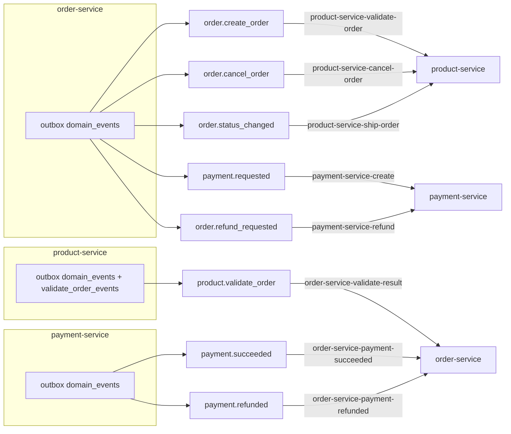
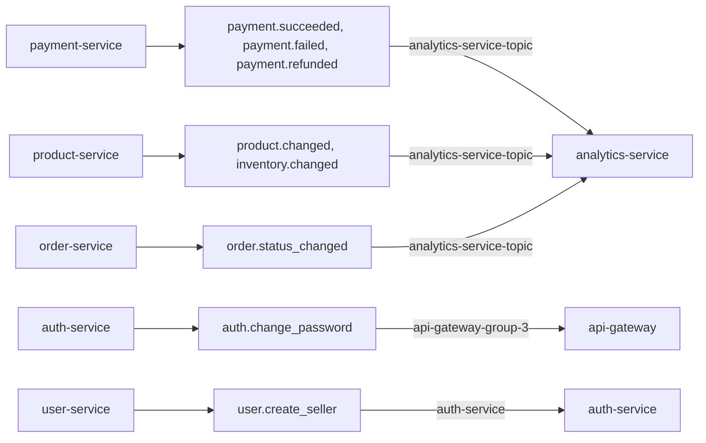
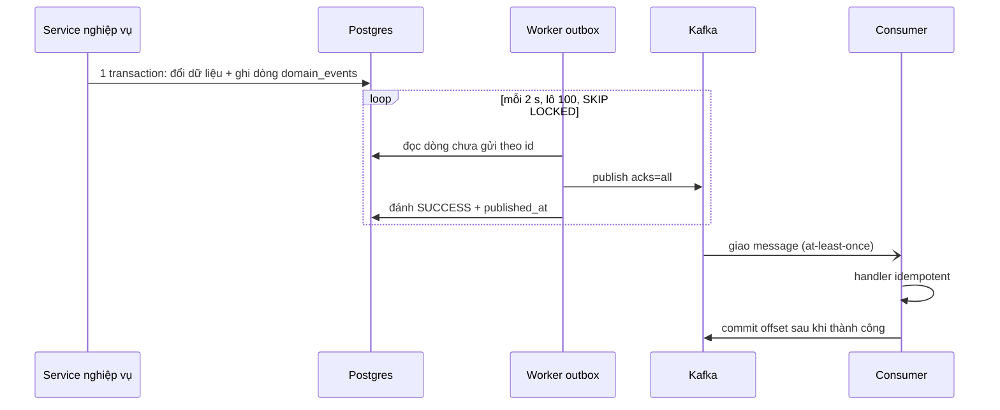
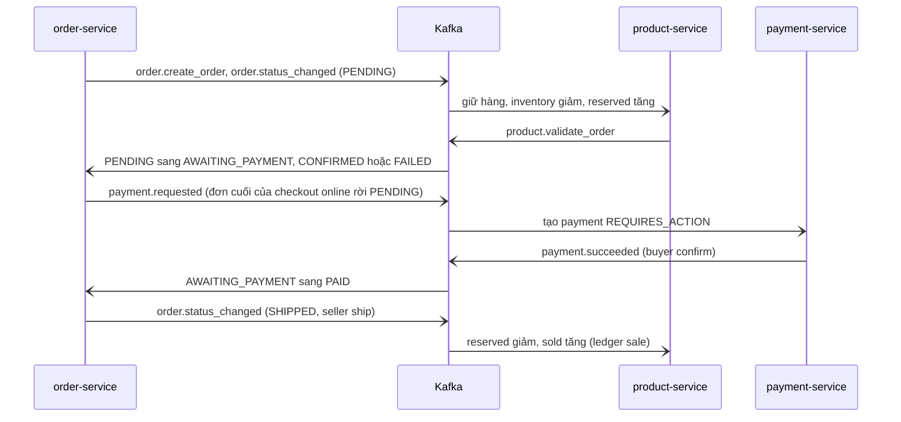
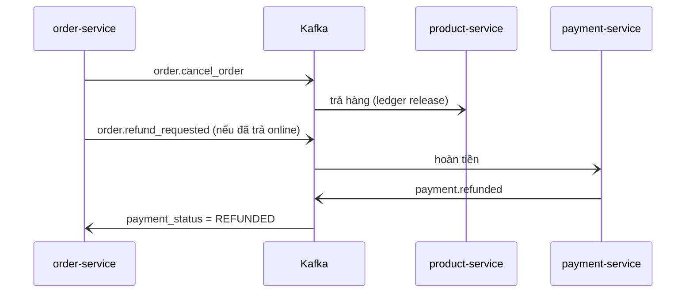

# Sự kiện Kafka

Broker: `broker1:9092` (một node, KRaft; retention log 168 giờ = 7 ngày). Mỗi service tự tạo topic cần dùng lúc khởi động (`KafkaClient.EnsureTopicExist`: **3 partition, RF 1**). Key chọn partition bằng `kafka.Hash` ⇒ cùng key luôn cùng partition. Tracking của trình duyệt **không** đi qua Kafka (gateway gọi gRPC `IngestEvents` của analytics-service – ADR-13). Mọi payload mới có trường `v` (phiên bản schema, hiện `1`); tiền là **số nguyên đơn vị nhỏ** (`*_minor`, 1/100 VND – ADR-18).

## 1. Danh mục topic

Bản đồ topic (mũi tên: producer → topic → consumer; nhãn trong ngoặc là consumer group):

Vòng order ↔ product ↔ payment hoàn toàn qua Kafka (order-service không gọi gRPC payment-service). `order.status_changed` còn có analytics-service là consumer thứ hai.

Các topic còn lại:

analytics-service dùng một group riêng cho mỗi topic (`analytics-service-<topic>`), nên mỗi topic lag độc lập. `payment.failed` chỉ analytics tiêu thụ.

Bảng tra cứu đầy đủ:

| Topic | Producer (nguồn) | Consumer → group | Key |
|---|---|---|---|
| `order.create_order` | order-service (`domain_events`) | product-service → `product-service-validate-order` | `order_id` |
| `product.validate_order` | product-service (`validate_order_events`) | order-service → `order-service-validate-result` | `order_id` |
| `order.cancel_order` | order-service (`domain_events`) | product-service → `product-service-cancel-order` | `order_id` |
| `order.status_changed` | order-service (`domain_events`) | product-service → `product-service-ship-order`; analytics-service → `analytics-service-order.status_changed` | `order_id` |
| `payment.requested` | order-service (`domain_events`) | payment-service → `payment-service-create` | `checkout_id` |
| `order.refund_requested` | order-service (`domain_events`) | payment-service → `payment-service-refund` | `checkout_id` |
| `payment.succeeded` | payment-service (`domain_events`) | order-service → `order-service-payment-succeeded`; analytics → `analytics-service-payment.succeeded` | `payment_id` |
| `payment.failed` | payment-service | analytics → `analytics-service-payment.failed` (order-service **không** tiêu thụ) | `payment_id` |
| `payment.refunded` | payment-service | order-service → `order-service-payment-refunded`; analytics → `analytics-service-payment.refunded` | `payment_id` |
| `product.changed` | product-service (`domain_events`) | analytics → `analytics-service-product.changed` | `product_id` |
| `inventory.changed` | product-service (`domain_events`) | analytics → `analytics-service-inventory.changed` | `product_id` |
| `auth.change_password` | auth-service (`pwd_version_events`) | api-gateway → `api-gateway-group-3` | `user_id` |
| `user.create_seller` | user-service (`create_seller_events`) | auth-service → `auth-service` | `seller_id` |

Group của analytics-service luôn là `analytics-service-<topic>` (mỗi topic một group, nên lag đọc theo `consumergroup=~"analytics-service-.*"` trên Grafana).
Không có topic `tracking.events`, `cart.updated`, `*.dlq` (đều **chưa làm**; quá 5 lần lỗi thì consumer ghi log và bỏ qua – xem §3).

## 2. Payload (từ struct trong code)

| Topic | Trường |
|---|---|
| `order.create_order`, `order.cancel_order` | `{order_id, items:[{product_id, quantity}]}` (không có `v`) |
| `product.validate_order` | `{order_id, success}` |
| `order.status_changed` | `{v, order_id, checkout_id, buyer_id, store_id, status, prev, actor_type, payment_method, payment_status, subtotal_minor, shipping_fee_minor, total_minor, at, items:[{item_id, product_id, category_id, quantity, unit_price_minor}]}` – phát ở **mọi** lần chuyển trạng thái, kể cả lúc tạo (`prev=""`, `status=PENDING`, `actor_type=buyer`) |
| `payment.requested` | `{v, checkout_id, buyer_id, method, amount_minor, expires_at, order_ids[]}` – số tiền chỉ gồm các đơn đang `AWAITING_PAYMENT`; `expires_at` = hạn sớm nhất của các đơn đó |
| `order.refund_requested` | `{v, checkout_id, order_id (0 = cấp checkout), amount_minor, reason, refund_key}`; `reason` ∈ `order_canceled, return_approved, order_not_payable`; `refund_key` ∈ `order:<id>:cancel`, `order:<id>:return`, `checkout:<id>:overpay` |
| `payment.succeeded` | `{v, payment_id, checkout_id, buyer_id, method, amount_minor, at, provider_event_id}` |
| `payment.failed` | `{v, payment_id, checkout_id, buyer_id, method, failure_code, terminal, at}` – **mỗi lần thử thất bại** (không phải mỗi payment); `terminal=true` khi đủ 5 lần |
| `payment.refunded` | `{v, payment_id, refund_id, checkout_id, order_id, amount_minor, reason, at}` |
| `product.changed` | `{v, product_id, op ("upsert"\|"delete"), store_id, name, sku, category_id, brand, price (VND, float), status, updated_at}` – khi tạo/sửa/đổi status |
| `inventory.changed` | `{v, product_id, store_id, delta, available, reserved, level (none\|low\|ok), reason, ref_type, ref_id, at}` – sau **mỗi** thay đổi tồn (cùng transaction với ledger) |
| `auth.change_password` | `{user_id, pwd_version}` |
| `user.create_seller` | `{"SellerID":…, "UserID":…}` (struct không có tag `json` nên khoá viết hoa) |

## 3. Bảo đảm giao hàng
Luồng outbox và consumer:

Worker chết giữa lúc publish và đánh dấu thì gửi lại, nên consumer phải khử trùng (§4). Lỗi publish: dòng `FAILED` (`attempts+1`) và được thử lại vòng sau.

- **Producer = outbox giao dịch.** Dòng outbox được ghi cùng transaction với thay đổi nghiệp vụ. product/order/payment dùng bảng chung `domain_events` (`pkg/events`, bản sao giống hệt nhau – ADR-8/23; cùng database nên là **một bảng vật lý dùng chung**, xem [02_DATA_MODEL.md](02_DATA_MODEL.md) §1.5): worker 2 s/lần, lô 100, `ORDER BY id`, `FOR UPDATE SKIP LOCKED` (nhiều replica chạy song song được), publish `acks=all`, đánh `SUCCESS` + `published_at`; lỗi đầu tiên dừng lô, dòng đó `FAILED` (`attempts+1`) và được thử lại vòng sau. Chết giữa "đã publish" và "đã đánh dấu" ⇒ gửi lại ⇒ **at-least-once**. product còn xả `validate_order_events` (3 s), auth/user giữ bảng outbox riêng của mình (3 s); order-service vẫn xả `create_order_events`/`cancel_order_events` cũ để không mất đơn khi nâng cấp.
- **Consumer** (`kafkaimpl.KafkaConsumer`, bản sao giống hệt ở mọi service): chỉ commit offset **sau khi** handler thành công; lỗi thì thử lại tối đa **5 lần** (backoff `KAFKA_CONSUMER_BACKOFF` ms × số lần thử), rồi ghi log `giving up on message … offset N` và **bỏ qua** để một message độc không chặn partition. JSON hỏng: hầu hết handler `return nil` ngay (bỏ). Ngoại lệ: handler `AddChaPwdVerToRedis` (gateway) và `UpdateStoreIDFromKafka` (auth) trả lỗi nên bị thử đủ 5 lần rồi bỏ.
- **Thứ tự**: cùng key ⇒ cùng partition ⇒ giữ thứ tự (các event của một đơn/ một user). Khác topic không có thứ tự tương đối; thiết kế tránh phụ thuộc vào đó (trạng thái đi qua `UPDATE … WHERE status IN (…)`).

## 4. Quy tắc idempotent theo consumer

| Consumer | Cách khử trùng / xử lý lệch thứ tự |
|---|---|
| product `ValidateProductInventory` | bỏ qua nếu `validate_order_events.processed` đã có; giữ hàng trong **một** transaction, khoá thứ tự theo `product_id` (tránh deadlock), PK `order_id` ⇒ giao trùng đồng thời bị rollback phần trừ kho. Thiếu hàng ⇒ `RecordFailedValidation` (`ON CONFLICT DO NOTHING`), không thử lại |
| product `ReleaseProductInventory` | cờ `restored` (đúng một lần); bỏ qua nếu chưa từng giữ hàng, hoặc đã `shipped` |
| product `MarkShippedFromOrderEvent` | chỉ xử lý `status="SHIPPED"`; cờ `shipped` (đúng một lần) |
| order `UpdateOrderStatusByKafka` | chỉ chuyển từ `PENDING` (online → `AWAITING_PAYMENT` + hạn; COD → `CONFIRMED`; thất bại → `FAILED`); đã khác `PENDING`/không tồn tại ⇒ bỏ qua |
| order `HandlePaymentSucceeded` | chỉ đơn còn `AWAITING_PAYMENT` → `PAID`; sau đó đọc lại, nếu `amount_minor` > tổng đơn đã `paid_at` ⇒ phát `order.refund_requested` (`checkout:<id>:overpay`) cho phần dư (đơn đã huỷ/hết hạn) |
| order `HandlePaymentRefunded` | `UPDATE … WHERE payment_status='PAID'` → `REFUNDED`; `order_id=0` bị bỏ qua |
| payment `HandlePaymentRequested` | `payments.checkout_id UNIQUE` (`ON CONFLICT DO NOTHING`) ⇒ một payment/checkout |
| payment `HandleRefundRequested` | `refunds.refund_key UNIQUE`; không hoàn quá số đã thu (quá ⇒ dòng `FAILED reason=exceeds_paid_amount`); payment chưa `SUCCEEDED` ⇒ bỏ qua |
| analytics (6 handler) | bảng `ReplacingMergeTree` khoá theo id tự nhiên ⇒ ghi lại cùng dòng là vô hại |
| gateway `AddChaPwdVerToRedis` | `SET <userId>:pwd_version` (bản mới nhất thắng), TTL = `JWT_EXPIRE_TIME + 1 phút` |
| auth `UpdateStoreIDFromKafka` | `UPDATE accounts SET store_id` (lặp lại vô hại) |

## 5. Luồng chính

Huỷ hoặc hết hạn thì nhánh bù:

Mọi `order.status_changed` / `payment.*` / `product.changed` / `inventory.changed` cũng được analytics-service ghi vào ClickHouse ([02_DATA_MODEL.md](02_DATA_MODEL.md) §3).

## 6. Thêm một event mới
1. Dùng `events.Emit(tx, topic, key, payload)` trong cùng transaction với thay đổi (service đã có `pkg/events`; payload có `v:1`, tiền là `*_minor`).
2. `EnsureTopicExist` topic mới trong `main.go` của producer **và** consumer.
3. Handler consumer phải idempotent và `return nil` cho dữ liệu không thể xử lý.
4. Thêm test (xem `order-service/internal/service/flow_test.go`, `payment-service/…/service_test.go` → `TestConsumers`) và cập nhật bảng ở trên.
