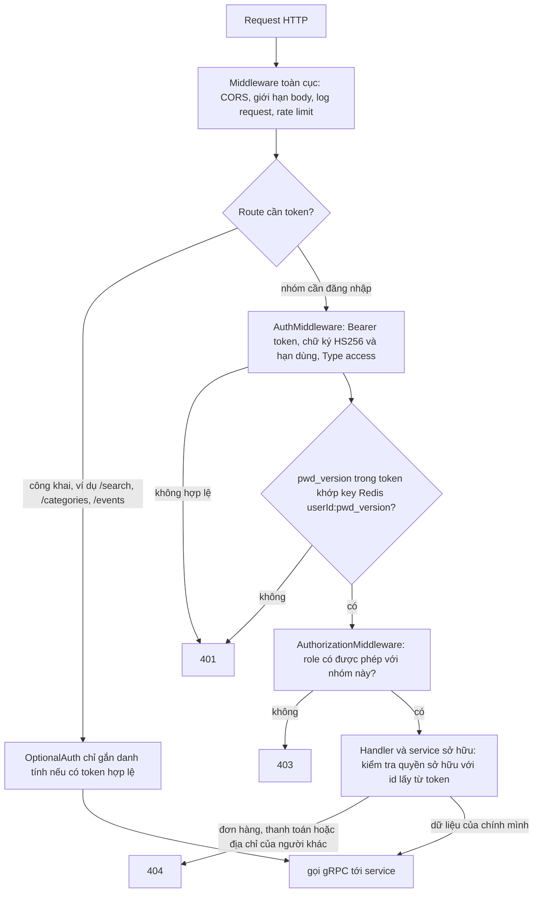
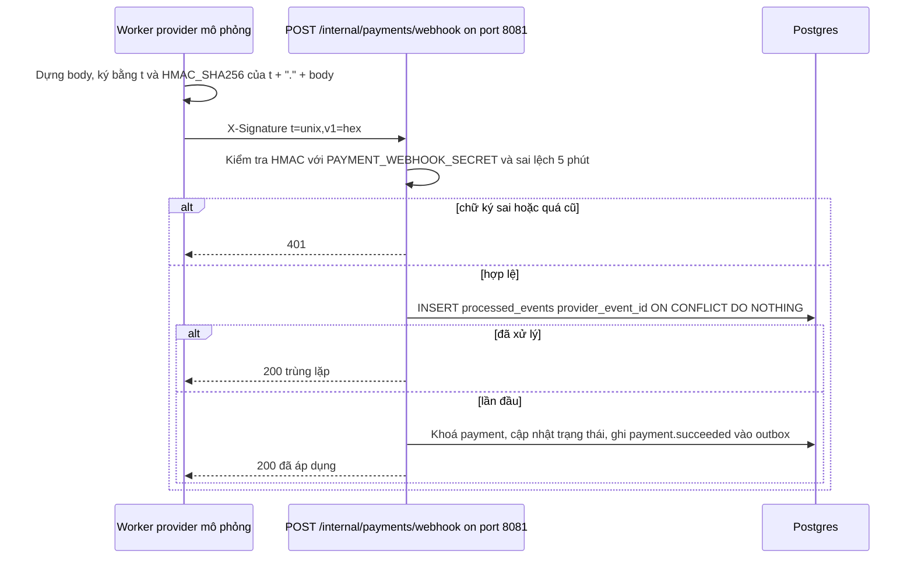
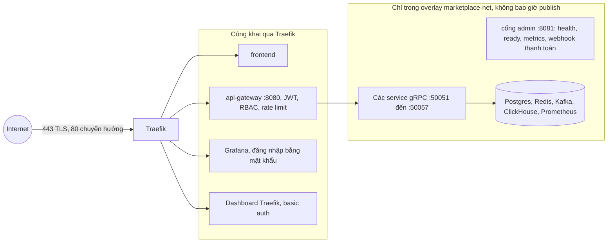

# Bảo mật

## Xác thực
- Mật khẩu băm bằng bcrypt; mật khẩu ≥ 8 ký tự khi đăng ký/đổi mật khẩu.
- JWT HS256 ký bằng `JWT_SECRET` (≥ 16 ký tự, mọi service đều kiểm tra khi khởi động). Xoay khoá bằng cách đổi secret ở mọi nơi (toàn bộ phiên đăng nhập kết thúc).
- Gateway chỉ chấp nhận token có `Type=="access"`. Refresh token chỉ auth-service chấp nhận, và auth-service còn so sánh `PwdVersion` với DB.
- Đổi mật khẩu sẽ tăng `pwd_version`; gateway cache phiên bản mới trong Redis trong `JWT_EXPIRE_TIME + 1 min` (= thời hạn access token) nên các access token cũ bị từ chối ngay. Thiếu key cũng không sao: token cũ hơn TTL vốn đã hết hạn.

### Luồng request: token, middleware theo route, quyền sở hữu

Xác thực và kiểm tra role được gắn theo từng route hoặc nhóm, nên route công khai vẫn công khai. Quyền sở hữu là cổng cuối: user id, role và store id chỉ lấy từ token, không bao giờ lấy từ body request.

## Vai trò quản trị viên
`admin` là role thứ tư và **không bao giờ** được tự đăng ký: `Register` (gateway và auth-service) từ chối, và `RegisterRequest` trong protobuf không cho phép. Cách duy nhất để tạo là `ADMIN_BOOTSTRAP_USERNAME` / `ADMIN_BOOTSTRAP_PASSWORD` do auth-service đọc khi khởi động (idempotent; mật khẩu của admin đã tồn tại không bao giờ bị ghi đè; thông tin đăng nhập phải thoả hợp đồng login: 3–16 ký tự `[a-zA-Z0-9_]`, mật khẩu ≥ 8). Chỉ `Login` và `ChangePassword` chấp nhận `admin`. Các route admin nằm dưới `/admin/*` (`AuthMiddleware` + role `admin`). Hãy đổi mật khẩu bootstrap sau lần đăng nhập đầu và gỡ các biến này khỏi môi trường.

## Quy tắc phân quyền (thực thi trong handler của gateway, có test bao phủ)
- Danh tính (`userID`, username, role và store của seller qua auth-service) chỉ lấy từ token; bảng route nằm ở `internal/router/router.go` và mỗi dòng đều được `router_test.go` bao phủ ([04_TESTING.md](../instruction/04_TESTING.md)). Xác thực được gắn **theo từng route/nhóm**, không bao giờ gắn toàn cục (ADR-19).
- Đơn hàng, giỏ hàng, địa chỉ, thanh toán: role buyer, chỉ trong phạm vi dữ liệu của mình; đơn/thanh toán/địa chỉ của người khác → 404. Seller chỉ xem và thao tác trên đơn của cửa hàng mình (`store_id` từ token); seller không thể `confirm_received`/`return`, buyer không thể `ship`.
- Hồ sơ buyer: id phải bằng user id của chính mình. Quản lý store (seller): store của người gọi phải bằng id trong path. Ghi sản phẩm, trạng thái, điều chỉnh tồn kho và ledger: chủ sở hữu = store của người gọi. Chỉ admin mới được ban sản phẩm.
- Catalog công khai: khách ẩn danh chỉ thấy sản phẩm `active`; tồn kho hiển thị tối đa "20+" và `reserved`/ngưỡng bị ẩn trừ khi bạn quản lý sản phẩm đó.
- Giá, tổng tiền, phí vận chuyển, trạng thái, buyer/store id không bao giờ đọc từ client; checkout yêu cầu `Idempotency-Key`.
- Analytics: phạm vi báo cáo (toàn sàn hay một store) được suy ra từ token ở gateway **và** được analytics-service kiểm tra lại; tham số query không thể mở rộng phạm vi. Các báo cáo chỉ dành cho admin (`traffic`, `payments`, `search_terms`, `data_health`) bị từ chối với phạm vi store.

## Thanh toán (mô phỏng) và quyền riêng tư của tracking
- Thanh toán chỉ là MÔ PHỎNG: không có mạng thẻ thật. Số thẻ chỉ dùng để chọn kết quả mô phỏng; **chỉ lưu 4 số cuối**, không bao giờ lưu đầy đủ số thẻ/CVV, và gateway không bao giờ phản hồi lại body request có thể chứa dữ liệu thẻ.
- Provider mô phỏng gọi `POST /internal/payments/webhook` chỉ trên cổng admin nội bộ (Traefik không route), ký bằng `X-Signature: t=<unix>,v1=HMAC_SHA256(PAYMENT_WEBHOOK_SECRET, t + "." + body)`, sai lệch thời gian cho phép 5 phút, idempotent theo `provider_event_id`. `PAYMENT_WEBHOOK_SECRET` phải ≥ 16 ký tự nếu không service không khởi động. `POST /admin/dev/payments/:id/force` chỉ hoạt động với `ENV=dev`.
- `POST /events` là công khai và có rate limit (`EVENTS_RATE_LIMIT_PER_MINUTE`); trình duyệt không thể đặt `user_id`/`role`/`store_id`/IP (gateway tự gắn). IP không bao giờ được lưu: chỉ lưu `HMAC(IP_HASH_SECRET, UTC date | ip)`, giá trị này đổi mỗi ngày. Khi không có đồng ý analytics, chỉ giữ `page_view`/`error_client` ẩn danh (bỏ các định danh). Email/số điện thoại trong văn bản tự do (truy vấn tìm kiếm) bị che, URL bị bỏ query string. Sự kiện thô hết hạn sau `EVENTS_RETENTION_MONTHS` (13). **Chưa triển khai**: xoá dữ liệu người dùng (`DELETE /users/me/data`), kho `consents`.
- **Log và PII**: log của service đi qua Vector → Loki; Vector che PII **trước khi lưu** (email, số điện thoại VN dạng liền, `Bearer`/JWT, trường `password|authorization|token`, số thẻ 13–16 chữ số). Giới hạn đã biết: số điện thoại có dấu chấm / khoảng trắng và số thẻ có định dạng lạ không bị che — service vẫn không được ghi mật khẩu, token, số thẻ vào log. Loki không publish cổng (chỉ trong overlay); `request_id` không phải dữ liệu nhạy cảm.

### Luồng webhook có chữ ký

Endpoint nằm trên cổng admin nội bộ và Traefik không route. Tính idempotent đến từ `processed_events`, nên việc retry từ `webhook_deliveries` là vô hại.

## Ranh giới tin cậy

Chỉ Traefik publish cổng (80 và 443). Gateway là điểm vào duy nhất của ứng dụng và là nơi duy nhất xác minh token. Mọi thứ bên trong overlay (gRPC, `:8081`, database, Prometheus, ClickHouse) đều là plaintext và không xác thực, nên tuyệt đối không được publish.

## Chống lạm dụng
- Rate limiter bằng Redis (toàn cục `RATE_LIMIT_PER_MINUTE`, mặc định 300; `/auth/*` `AUTH_RATE_LIMIT_PER_MINUTE`, mặc định 20; `/events*` `EVENTS_RATE_LIMIT_PER_MINUTE`, mặc định 120) theo IP client, dùng script Lua atomic, fail open nếu Redis ngừng hoạt động.
- `TRUSTED_PROXIES` (danh sách cách nhau dấu phẩy, mặc định rỗng) quyết định có tin `X-Forwarded-For` hay không; ở production hãy đặt thành CIDR của network Traefik, nếu không mọi client sẽ hiện ra với IP của proxy.
- Danh sách cho phép CORS `ALLOWED_ORIGINS` (mặc định `http://localhost:3000`).

## Secret
Không có gì nhạy cảm được commit. Dùng các template `.env.example`; giá trị thật nằm trong `deploy/.env` (bị ignore) hoặc Docker secrets. Chứng chỉ TLS được sinh cục bộ (`scripts/gen-dev-certs.sh`) và bị ignore. **Mọi thứ đã commit trước đợt dọn dẹp này (JWT secret cũ, mật khẩu DB/Elastic, htpasswd của Traefik, khoá TLS) vẫn còn trong lịch sử git – hãy xoay toàn bộ.**

## Khoảng trống đã biết / việc tiếp theo
- **Định dạng credential bị giới hạn bởi hợp đồng protobuf**: username và mật khẩu phải khớp `^[a-zA-Z0-9_]{3,16}$` (`auth.proto`); gateway/auth còn yêu cầu mật khẩu ≥ 8 ký tự. Tối đa 16 ký tự chữ-số là yếu; nên nới thành ví dụ 8–72 ký tự (giới hạn của bcrypt) bằng cách sửa `services/auth-service/pkg/proto/auth.proto` và chạy lại `buf generate` (cần truy cập buf.build).
- Frontend lưu token trong `localStorage` (nguy cơ XSS); nên dùng cookie httpOnly.
- gRPC giữa các service và kết nối Postgres là plaintext bên trong overlay network (`sslmode=disable`).
- Chưa có khoá tài khoản, `audit_log`, xác minh email, đặt lại mật khẩu hay logout/deny-list (chưa triển khai, xem roadmap). `accounts.username` là duy nhất toàn cục, nên cùng một username ở hai role sẽ gây lỗi DB.
- ClickHouse, Prometheus và cổng admin `:8081` không có xác thực; chỉ truy cập được bên trong overlay network (không bao giờ publish). Grafana dùng mật khẩu (`GRAFANA_ADMIN_PASSWORD`, không cho truy cập ẩn danh).
- Hoàn tiền thủ công của admin (`POST /admin/payments/:id/refund`) không gắn với đơn hàng, nên `orders.payment_status` không được cập nhật bởi thao tác này.
- Body request bị giới hạn bởi `MAX_BODY_BYTES` (mặc định 1 MiB, trả HTTP 413 khi `Content-Length` lớn hơn; body không khai báo/chunked sẽ lỗi khi đọc).
- Dashboard Traefik chỉ được bảo vệ bằng basic auth (`TRAEFIK_DASHBOARD_USERS`).
