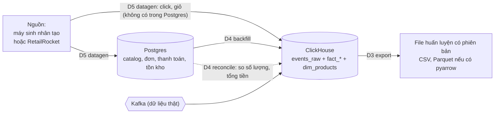

# Đường ống dữ liệu: loader, backfill / đối soát, exporter

> Thiết kế cho D5, D3, D4 trong [../planning/03_INFRA_GAPS_FOR_LARGE_PROJECT.md](../planning/03_INFRA_GAPS_FOR_LARGE_PROJECT.md). Giải thích dễ hiểu và lý do cần: [../planning/04_DATA_PIPELINE_NOTES.md](../planning/04_DATA_PIPELINE_NOTES.md). **Trạng thái: ✅ đã triển khai và đã chạy vòng đầy đủ (datagen → backfill → reconcile → export) trên Postgres 16 + ClickHouse 24.8 trong Docker cục bộ; chưa chạy trên Swarm (xem [../process/02_SESSION_LOG_2026-10-25.md](../process/02_SESSION_LOG_2026-10-25.md)).** Dự án cá nhân nên không xét license bộ dữ liệu.

## 1. Mục tiêu
1. Có dữ liệu lịch sử đủ lớn, có thời gian trong quá khứ, nhất quán giữa Postgres và ClickHouse, để thử các scope AI mà chưa có người dùng thật.
2. Có đường đưa dữ liệu Postgres sang ClickHouse và kiểm hai bên khớp (cũng dùng cho dữ liệu thật về sau).
3. Có đường xuất ClickHouse thành file huấn luyện có phiên bản, đúng định dạng các bộ dữ liệu công khai.

## 2. Ba công cụ (đều là công cụ chạy một lần, không phải service)



| Công cụ | Vị trí | Ngôn ngữ | Vào → ra |
|---|---|---|---|
| **D5 datagen** | `scripts/datagen/` | Python 3 | nguồn dữ liệu + `--seed` → Postgres (SQL trực tiếp) và `events_raw` ở ClickHouse |
| **D4 backfill / reconcile** | `services/analytics-service/cmd/backfill` | Go (dùng lại gói `internal/store`) | Postgres → bảng fact / dim ClickHouse; so khớp hai bên |
| **D3 export** | `scripts/export/` | Python 3 | ClickHouse → file theo khoảng thời gian, kèm manifest |

## 3. Các ràng buộc từ code hiện tại (quyết định thiết kế dựa trên đây)

| Sự thật | Hệ quả |
|---|---|
| Tracking (`events_raw`) chỉ tin `ts` của client trong ±24 giờ quanh bây giờ (`internal/ingest/tracking.go`, `maxSkew`) | Click / giỏ lịch sử **không** đi qua gateway được. Datagen ghi thẳng `events_raw` bằng ClickHouse HTTP. |
| Click, `add_to_cart`… **chỉ có ở ClickHouse**, Postgres không lưu | Backfill **không thể** dựng lại `events_raw` từ Postgres. Backfill chỉ phục hồi bảng dẫn xuất từ nguồn nghiệp vụ: `fact_order_status`, `fact_order_items`, `fact_payment_events`, `fact_refunds`, `fact_inventory`, `dim_products`. |
| Bảng fact ở ClickHouse là `ReplacingMergeTree` với cột phiên bản (`at` / `updated_at`) | Backfill ghi lại cùng khoá là **idempotent**: chạy hai lần không sinh dòng trùng. |
| Đơn tạo qua API luôn mang thời gian hiện tại; tồn kho đi qua sổ cái | Datagen ghi **SQL trực tiếp** cho đơn lịch sử (có thời gian quá khứ). Để giữ chặt schema, test của datagen dựng DB bằng chính các file `services/<svc>/migrations/*.sql` (goose): schema đổi thì test hỏng. |
| Postgres là nguồn sự thật, ClickHouse là dẫn xuất | Datagen ghi nghiệp vụ vào Postgres **trước**, rồi chạy backfill. Chỉ phần hành vi (click, giỏ) ghi thẳng ClickHouse. |
| Định nghĩa doanh thu duy nhất (ADR-22): đơn PAID (online) / DELIVERED (COD), trừ hoàn tiền theo thời điểm hoàn | Dữ liệu sinh ra phải có đủ dòng trạng thái để định nghĩa này cho kết quả đúng; reconcile kiểm doanh thu theo cùng định nghĩa. |

## 4. D5 datagen
- Hai chế độ nguồn: `synthetic` (sinh từ schema của mình, người dùng / store / sản phẩm / phiên / đơn / thanh toán / click / giỏ) và `retailrocket` (đọc `events.csv`: `timestamp, visitorid, event, itemid, transactionid`; `item_properties` / `category_tree` nếu có).
- `--seed N` ⇒ cùng seed cho cùng dữ liệu. `--start/--end` quy định khoảng thời gian lịch sử. Có `--dry-run` và `--reset` (chỉ xoá dữ liệu do datagen tạo, đánh dấu bằng tiền tố, không đụng dữ liệu thật).
- Ánh xạ RetailRocket: `view` → `product_view`; `addtocart` → `add_to_cart`; `transaction` → đơn đã `DELIVERED` / `PAID` (kèm `order_items`, trạng thái, thanh toán); `visitorid` → `anonymous_id` và (với một phần tập con) tài khoản buyer; `itemid` → `products.id` qua bảng ánh xạ do datagen lưu lại.
- Có bộ file mẫu tí hon cùng định dạng RetailRocket để test mà không cần tải dữ liệu thật.
- Không gọi API thật, không cần stack chạy; chỉ cần Postgres + ClickHouse.

## 5. D4 backfill / reconcile
- `backfill --from DATE --to DATE [--tables ...]`: đọc Postgres (DSN dùng chung `POSTGRES_DSN`), dựng các dòng `OrderStatusRow`, `OrderItemRow`, `PaymentEventRow`, `RefundRow`, `ProductRow`, `InventoryRow` đúng như consumer Kafka tạo, ghi qua `internal/store` (sink có sẵn). Idempotent.
- `reconcile --from --to [--json]`: so từng khoảng ngày: số dòng và tổng tiền (`subtotal_minor`, `amount_minor`) giữa Postgres và ClickHouse; doanh thu theo định nghĩa ADR-22. Thoát mã khác 0 nếu lệch quá ngưỡng (`--tolerance`). Xuất số liệu để về sau nối vào `data-health` và metric `mm_reconcile_diff_ratio`.
- Kiểm bằng phép thử vòng tròn: nạp Postgres → backfill → reconcile phải "khớp"; xoá hoặc sửa dòng ở ClickHouse → reconcile phải báo lệch đúng chỗ.

## 6. D3 export
- `export --from --to --format csv|parquet --profile otto|rees46|orders|raw --out DIR`.
- Profile `otto`: `session, aid, ts, type` với `type ∈ {clicks, carts, orders}` (click = `product_click`, giỏ = `add_to_cart`, orders từ `fact_order_items`). Profile `rees46`: `event_time, event_type, product_id, category_id, brand, price, user_id, user_session`, ghép `dim_products`. Profile `orders`: dòng đơn / sản phẩm cho dự báo và CLV.
- Mỗi lần xuất ghi `manifest.json` (phiên bản `snapshot-YYYY-MM-DD`, khoảng thời gian, số dòng, hash file, profile, lược đồ cột). Chạy lại cùng tham số cho file giống hệt.
- Chia train / valid / test **theo thời gian** (`--split-by-time`); chỉ lấy event có `analytics_consent`; không xuất PII (email, SĐT, IP).

## 7. Lệnh chạy và thứ tự mẫu

Đường dẫn tương đối từ gốc repo. Cần Postgres (đã áp migration goose của 5 service) và ClickHouse; datagen ghi Postgres qua lệnh `psql` (đặt bằng `--psql` hoặc env `DATAGEN_PSQL`, ví dụ `docker exec -i <container> psql -U postgres -d postgres`) và ClickHouse qua HTTP.

| Công cụ | Lệnh | Cờ chính |
|---|---|---|
| D5 datagen (README: [../../scripts/datagen/README.md](../../scripts/datagen/README.md)) | `python3 scripts/datagen/datagen.py synthetic\|retailrocket\|reset` | `--seed`, `--start/--end` (giờ Việt Nam, gồm cả hai đầu), `--dry-run`, `--reset`, `--skip-pg`, `--skip-ch`, `--id-base`, `--psql`, `--ch-url`, `--ch-db`, `--ch-ensure-schema`; `synthetic`: `--buyers --sellers --products --sessions-per-day --visitors --consent-rate`; `retailrocket`: `--rr-dir --buyer-share` |
| D4 backfill / reconcile (trong `services/analytics-service`) | `go run ./cmd/backfill backfill\|reconcile` | `--from/--to` (YYYY-MM-DD, Asia/Ho_Chi_Minh), `--tables`, `--batch`, `--json`, `--tolerance`, `--verbose`; kết nối qua env `POSTGRES_DSN`, `CLICKHOUSE_URL/DB/USER/PASSWORD` hoặc cờ |
| D3 export (README: [../../scripts/export/README.md](../../scripts/export/README.md)) | `python3 scripts/export/export.py` | `--from --to --profile otto\|rees46\|orders\|raw --format csv\|parquet --out DIR --split-by-time train=0.8,valid=0.1,test=0.1`; kết nối qua env `CLICKHOUSE_URL/USER/PASSWORD/DB` |

Thứ tự chạy mẫu (đã chạy thật):

```bash
# 1. nạp dữ liệu giả (3 tháng, seed 1) vào Postgres + events_raw
python3 scripts/datagen/datagen.py synthetic --seed 1 --start 2026-07-01 --end 2026-09-30 \
  --psql "docker exec -i <pg> psql -U postgres -d postgres" \
  --ch-url http://127.0.0.1:8123 --ch-db marketplace --ch-ensure-schema
# 2. dựng bảng fact / dim ở ClickHouse từ Postgres
cd services/analytics-service
go run ./cmd/backfill backfill  --from 2026-07-01 --to 2026-09-30
# 3. đối soát hai bên (exit 0 = khớp)
go run ./cmd/backfill reconcile --from 2026-07-01 --to 2026-09-30
# 4. xuất file huấn luyện
python3 ../../scripts/export/export.py --from 2026-07-01 --to 2026-09-30 --profile otto \
  --format csv --out out/otto --split-by-time train=0.8,valid=0.1,test=0.1
```

Kết quả vòng chạy thật (Docker cục bộ, đã dọn container):

| Bước | Kết quả |
|---|---|
| datagen `synthetic --seed 1`, 2026-07-01 … 2026-09-30 | 9.572 dòng Postgres (accounts 206, products 120, orders 827, order_items 860, payments 387, attempts 493, refunds 50, inventory_ledgers 1.835…) + 315.762 `events_raw`, 5,5 giây |
| backfill | `fact_order_status` 3.593 · `fact_order_items` 860 · `fact_payment_events` 493 · `fact_refunds` 50 · `dim_products` 113 · `fact_inventory` 1.715 |
| reconcile | `MATCH`: 1.219 phép so, 0 lệch, exit 0 |
| export (csv, chia 0,8/0,1/0,1) | `otto`: 26.049 clicks, 5.234 carts, 464 orders · `rees46` và `orders` cũng ra đủ file + `manifest.json` |

Số `orders` của `otto` (464) nhỏ hơn số đơn tính doanh thu (~713) vì đơn không gắn được vào phiên có consent bị bỏ khỏi hai profile `otto` / `rees46` (vẫn có ở profile `orders`).

## 8. Giới hạn thật (đã biết khi triển khai)
- **`events_raw` không dựng lại được từ Postgres** (ADR-29); chỉ datagen ghi được dữ liệu lịch sử vào đó.
- **Backfill chồng lên khoảng Kafka đã điền** có thể nhân đôi `fact_payment_events` (loại `failed`) và `fact_inventory` (khoá có `at`, thời gian ở Kafka lệch vài mili giây so với Postgres). Chỉ backfill vào khoảng trống hoặc ClickHouse rỗng; `order_status`, `order_items`, `refunds`, `dim_products` chạy lại an toàn.
- Postgres không giữ lịch sử số tiền, `payment_status` hay số tồn đang giữ: `order_status` backfill mang giá trị **hiện tại** của đơn, `fact_inventory.reserved` ghi 0.
- `dim_products` là bản mới nhất nên chỉ backfill sản phẩm có lần đổi cuối nằm trong khoảng.
- Export gắn đơn vào **phiên cuối của chính buyer trong 24 giờ trước** (bảng fact không có session); không gắn được thì bị bỏ khỏi `otto` / `rees46` (vẫn có ở `orders`). Doanh thu theo ADR-22, chưa trừ hoàn tiền. Phiên đi qua mốc chia train / valid / test nằm ở hai file.
- Reconcile chưa nối `data-health` và chưa có metric `mm_reconcile_diff_ratio`; nó chạy `SELECT` thường (an toàn tuỳ quyền của DSN).
- Datagen: `--id-base` mặc định 5.000.000 (khoá chính tường minh, sẽ va nếu dữ liệu thật vượt ngưỡng); `events_raw` có TTL 13 tháng nên `--start` cũ hơn bị xoá khi merge; **không ghi** outbox / `domain_events`, `cart_items`, `webhook_deliveries`, `processed_events` và các bảng `fact_*` / `dim_products` (việc của backfill). Thử RetailRocket mới trên fixture, **chưa** thử bộ thật (~2,7 triệu dòng).

## 9. Chưa làm
- Chưa có scheduler (D6): các công cụ chạy tay; về sau cron / job Swarm.
- Chưa có kho đối tượng (D1): file xuất ra thư mục trên đĩa.
- Chưa nối danh tính ẩn danh ↔ tài khoản (S5), chưa có `request_id` / `model_version` (S1): xuất chưa gồm hai thứ này.
- Dữ liệu sinh / replay kiểm **đường ống**, không chứng minh chất lượng mô hình.
