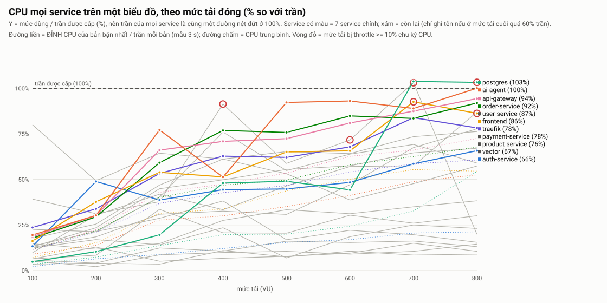
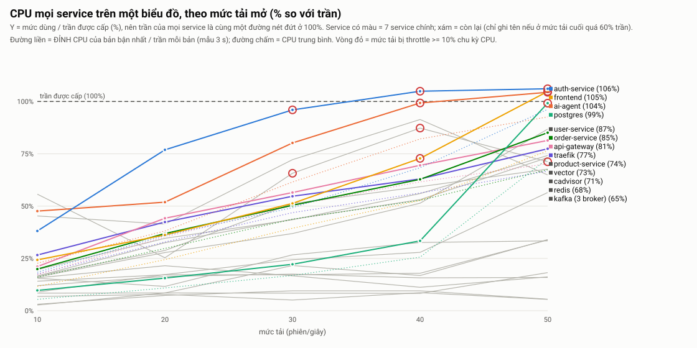
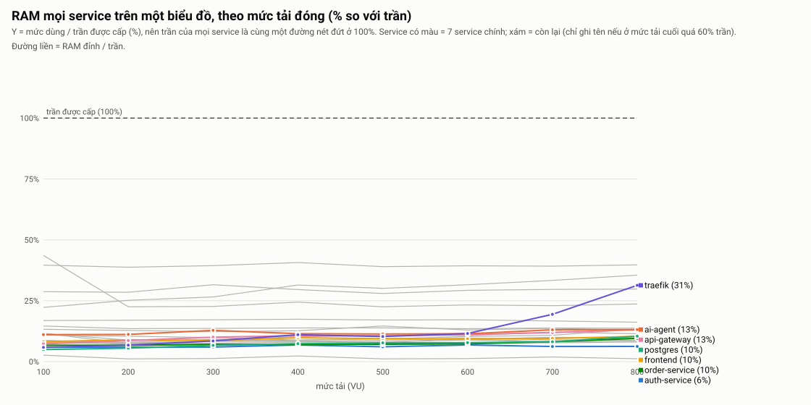
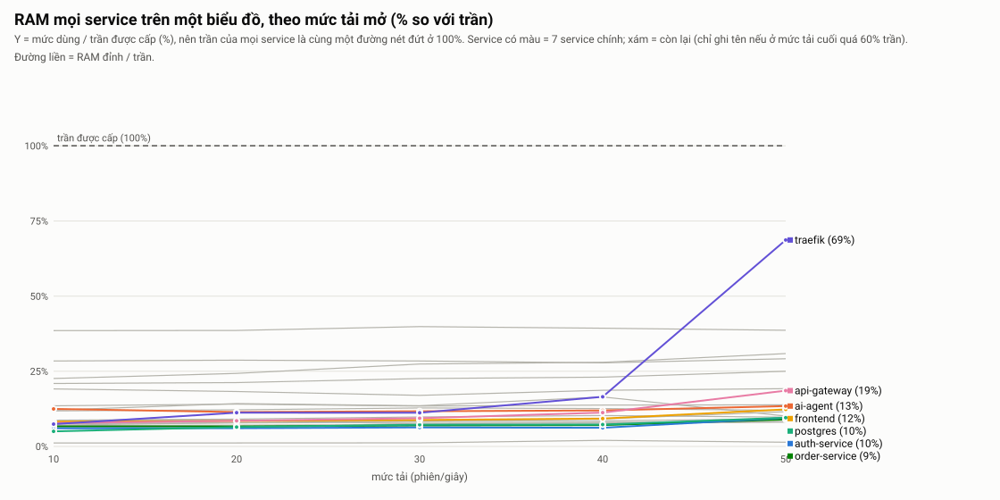
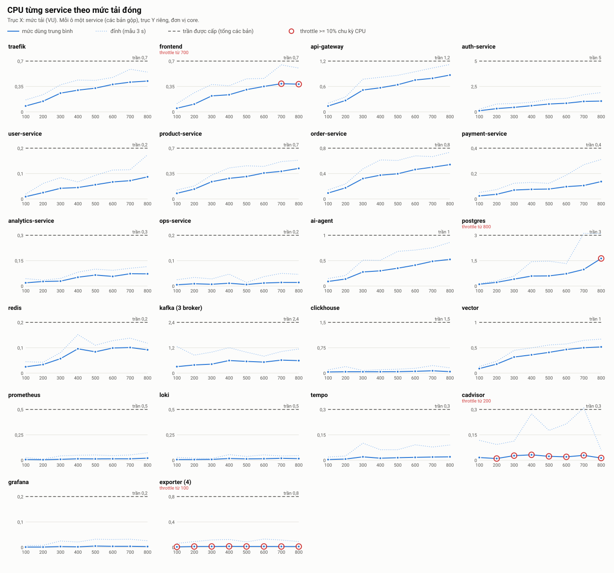
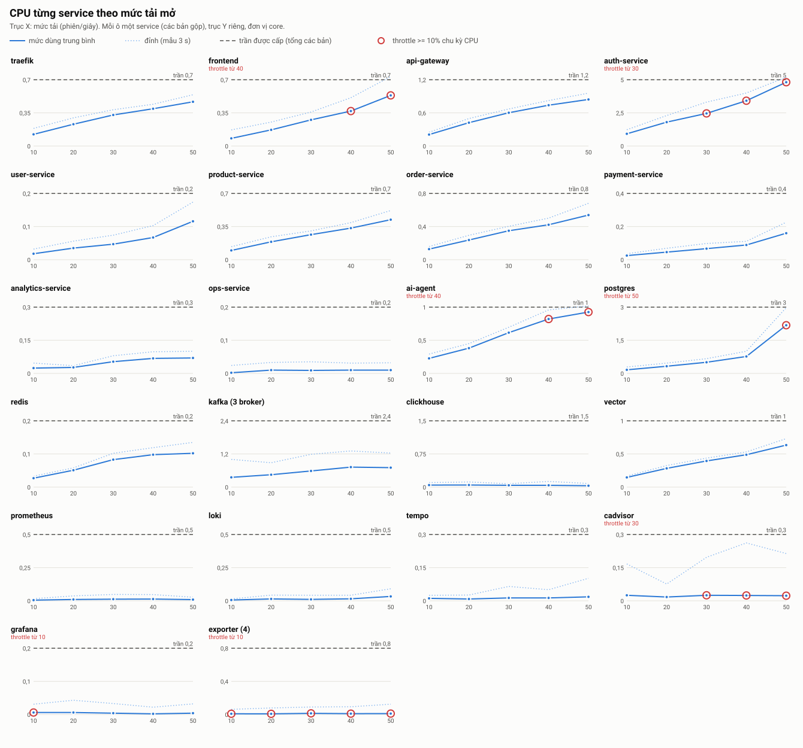
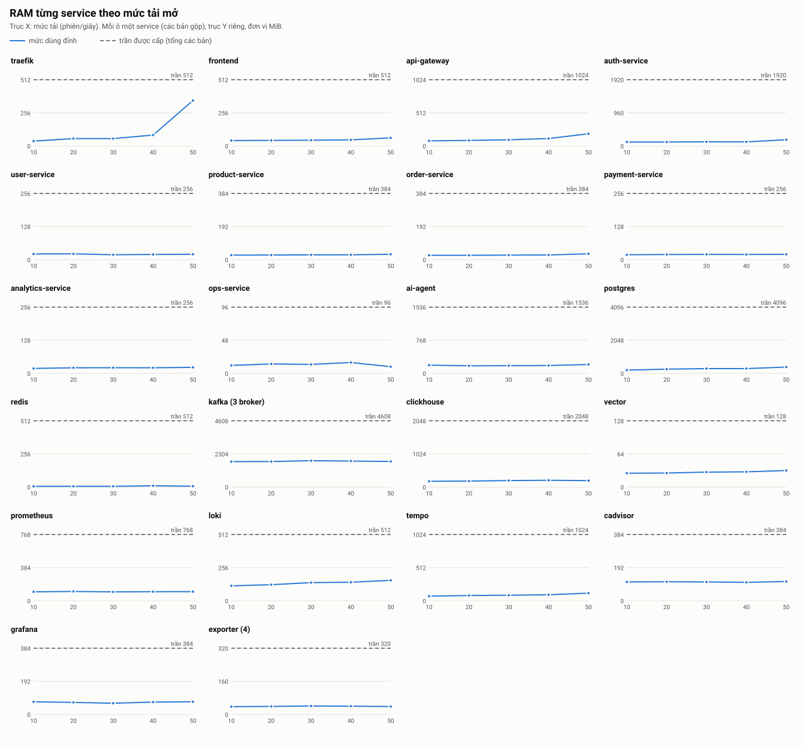
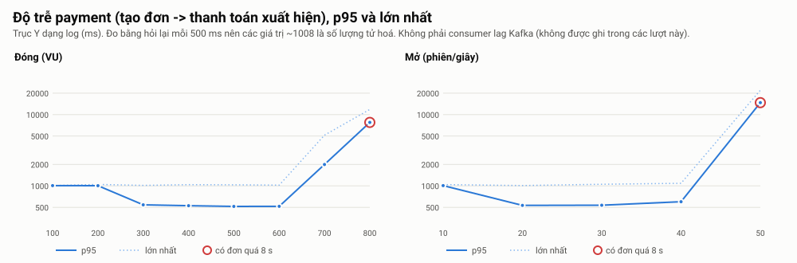

# 09. Phân bổ tài nguyên cho thử tải CCU (cấu hình `.perf`)

Hai file `deploy/services.perf.yml` và `deploy/infra.perf.yml` chỉ dùng để thử tải. **Trạng thái: ĐÃ ÁP DỤNG lên Swarm ngày 2026-11-23** (infra + services, kiểm: mọi service đủ replica, gateway giới hạn 100000/phút, mỗi `X-Forwarded-For` có bộ đếm riêng, Postgres `max_connections=200`, ClickHouse đã bỏ 6 bảng log).

Áp dụng: `./scripts/deploy-perf.sh all` (hoặc `infra` / `services`). Trở lại bình thường: `./scripts/deploy.sh infra && ./scripts/deploy.sh services`. Cần script riêng vì `docker stack deploy` đòi `cpus` là chuỗi. Gọi API từ ngoài phải có header `Host: api.<PUBLIC_HOST>`. IP giả bằng `X-Forwarded-For` xem [08_NETWORK_CLIENT_IP.md](08_NETWORK_CLIENT_IP.md).

## 1. Ngân sách (máy 16 luồng = 10 nhân vật lý i5-13450HX, 31 GB; trừ 3 GB container ngoài dự án, 3 GB OS + k6)
Cho stack: khoảng 25 GB RAM, 13 core (k6 chiếm khoảng 3 core). Giới hạn CPU là trần, không phải mức dùng, nên tổng giới hạn có thể vượt 13.

| Service | Replicas | CPU | RAM |
|---|---|---|---|
| traefik | 1 | 2 | 512 MB |
| api-gateway | 3 | 1.5 mỗi bản | 512 MB |
| ai-agent | 3 (đo với 1 trước) | 1 mỗi bản | 768 MB |
| auth, product, order | 1 | 1 | 384 MB |
| user, payment, analytics, ops | 1 | 0.5 | 256 MB (ops 96 MB) |
| frontend | 1 | 1 | 512 MB |
| postgres | 1 | 3 | 4 GB, `shared_buffers=1GB`, `max_connections=200` |
| redis | 1 | 1 | 512 MB, `maxmemory 400mb`, `noeviction` |
| kafka x3 | 1 mỗi broker | 1 | 1,5 GB, heap 1 GB (gốc 512 MB) |
| clickhouse | 1 | 2 | 2 GB |
| obs | giữ nguyên | không đặt | giữ nguyên |

Giới hạn tốc độ của gateway được nâng lên 100000 mỗi phút (nếu không test chỉ đo ra 429).

## 2. ai-agent và song song
- 1 tiến trình uvicorn = 1 event loop = tối đa 1 core (GIL). Chờ model không tốn CPU, nhưng LangGraph, JSON, SSE và gọi tool thì có.
- Trạng thái nằm ngoài tiến trình (lịch sử chat và checkpoint RCA ở Postgres, slot ở Redis) nên nhân bản được.
- Chỉ nhân bản khi `AI_RCA_ENABLED=false`: watcher RCA không có khoá chọn người dẫn đầu, nhiều bản sẽ điều tra trùng.
- Điểm nghẽn mềm chưa nâng: `GatewayClient` giới hạn 50 kết nối mỗi tiến trình, pool asyncpg tối đa 5 mỗi bản (3 bản = 15 trên 100 kết nối Postgres), cap token mỗi ngày mỗi user (`limits.daily_tokens`, nằm trong yaml, chưa có biến môi trường).
- Số replica cần = `ceil(CCU_mục_tiêu x CPU_mỗi_luồng / 0.7)`. Đo CPU mỗi luồng với 1 replica rồi tính.

## 3. Nguyên nhân các chỗ ăn tài nguyên lúc rảnh
- **clickhouse (CPU 3–39%, nhấp nháy)**: không phải do tải dự án. Truy vấn của analytics rất nhẹ (vài ms, đọc vài nghìn dòng). Nguyên nhân là các bảng log nội bộ của chính ClickHouse: `asynchronous_metric_log` 172 triệu dòng, `trace_log` 9,6 triệu, `text_log` 5,2 triệu, cộng merge nền và luồng AsynchronousMetrics. Đã sửa: `deploy/clickhouse/system-logs.xml` (gắn trong `infra.yml`) tắt `asynchronous_metric_log`, `metric_log`, `trace_log`, `text_log`, `processors_profile_log`, `error_log` và đặt TTL 7 ngày cho `query_log`. Bảng cũ không tự xoá, phải `DROP TABLE system.<tên>` sau khi áp dụng.
- **kafka (khoảng 57% giới hạn 768 MB lúc rảnh)**: phần lớn là heap JVM và page cache, thường không giảm khi rảnh. Heap nâng lên 1 GB và giới hạn lên 1,5 GB để có dư khi tải lên.
- **cadvisor (206/384 MB)**: bộ nhớ tăng theo số container và metric; chấp nhận được.

## 4. Kịch bản CCU và mô hình giả
- `scripts/load/ccu.mjs` (vòng kín, mỗi VU = một người dùng thật với tài khoản, JWT và IP giả riêng). Mỗi lần lặp, VU chọn NGẪU NHIÊN (có trọng số) một hành trình con, nên tải đa dạng. Loại VU theo `MIX` (mặc định từ đợt 4: buyer 62%, seller 14%, admin 3%, operator 2%, ai_buyer 12%, ai_seller 4%, ai_admin 2%, ai_operator 1%; trước đó admin 8%, operator 8%, AI quản trị/vận hành 4% mỗi loại). Báo cáo analytics (admin, seller) mỗi lần chỉ xem 1-3 trang chọn theo trọng số (traffic, data-health, search-terms hiếm), vận hành mỗi lần ghé 2-4 nhóm màn hình:
  - **buyer**: duyệt (+ trang frontend, `/events`, tìm kiếm có lọc/sắp xếp); mua COD / MOCK_CARD / ví / chuyển khoản / thẻ bị từ chối / 3-D Secure (OTP) / huỷ thanh toán, đặt lại cùng `Idempotency-Key`; quản lý giỏ (thêm, merge, sửa, xoá); hồ sơ buyer, địa chỉ (thêm/sửa/xoá), đổi mật khẩu; theo dõi đơn (lọc, tóm tắt, xác nhận đã nhận, trả hàng, huỷ).
  - **seller** (tài khoản chủ shop dùng chung): giao, hoàn tất, huỷ đơn; duyệt/từ chối trả hàng (kéo theo hoàn tiền ở payment-service); tạo/sửa/ẩn sản phẩm, chỉnh tồn, sổ cái tồn; 5 báo cáo analytics; tạo nhân viên rồi đăng nhập bằng nhân viên.
  - **admin** (tài khoản bootstrap, đọc từ `ADMIN_USERNAME`/`ADMIN_PASSWORD`, mặc định `ADMIN_BOOTSTRAP_*`): đơn và thanh toán toàn nền tảng, hoàn tiền, 9 báo cáo analytics, tài khoản, danh mục, đổi trạng thái sản phẩm, và các đọc ops.
  - **operator** (script tạo bằng tài khoản admin lúc setup và xoá lúc kết thúc): sức khoẻ hệ thống, sự cố, audit, sổ hành động, truy vấn Prometheus (lấy tên và tham số từ danh mục thật), playbook, outbox, đề xuất, công tắc AI, phiên RCA.
  - **ai_***: hỏi trợ lý AI qua `/ai/chat` (SSE) với từng persona, tới `event: done`.
  Id sản phẩm, checkout, payment, đơn đều lấy từ phản hồi thật. Mỗi lời gọi có mã mong đợi; mã ngoài dự kiến, 429, VU không vào được, hoặc service nào không được gọi thì phép đo bị báo chưa hợp lệ / thiếu độ phủ. Cuối bài in bảng độ phủ theo container (đếm từ đường dẫn; đã đối chiếu `grpc_request_rate` của Prometheus: gateway gọi đủ Order, Payment, Auth, Product, Analytics, User).
- Mô hình giả có độ trễ: provider `fake` nhận `ttft_ms` và `tokens_per_sec` (chờ bằng `asyncio.sleep`, không chặn event loop); profile `fake_perf_buyer/seller/admin/operator/text` trong `config.prod.yaml` (800 ms, 60 token/s: GIẢ ĐỊNH cho DeepSeek, chưa đo). `deploy/services.perf.yml` chọn chúng bằng `AI_LLM_ROLE_BUYER/SELLER/ADMIN/OPERATOR`; mặc định (không đặt biến) vẫn là mô hình thật. Mô hình giả vẫn gọi tool thật (`list_my_orders`, `count_store_orders`, `admin_list_orders`, `ops_system_health`), nên đo được đường ai-agent → gateway → service.
- Hạn chế: hai tính năng chưa có trong kịch bản (tạo/duyệt đề xuất ops cần hai người và dữ liệu sự cố thật; RCA tắt). Dữ liệu thử tải tích luỹ trong DB (tài khoản `lb...`, `lo...`, `ls...`, shop "LOAD shop ...", đơn, danh mục `CCU ...`); chưa có script dọn.

## 5. Kết quả thử tải 25 / 50 / 100 / 200 CCU (2026-11-23)
**Đính chính quan trọng.** Các số AI trong lần chạy 25 CCU trước đó và lần chạy 50 CCU đầu tiên KHÔNG hợp lệ: ai-agent trên Swarm chạy `APP_ENV=dev` (`AI_AGENT_ENV=dev` trong `deploy/.env`) nên đọc `config.dev.yaml`, trong khi mô hình giả và biến `AI_LLM_ROLE_*` lúc đó chỉ có ở `config.prod.yaml`. Hậu quả: các lượt chat AI trong những lần chạy đó gọi MODEL THẬT (`opencode_deepseek_flash`, hơn 5000 token vào mỗi lượt, có cả 429 và thử lại 18-30 s). Đã sửa: profile `fake_perf_*` và `AI_LLM_ROLE_*` có ở cả hai file cấu hình (test `test_roles_can_switch_to_perf_fakes_by_env` kiểm cả dev và prod), `scripts/deploy-perf.sh` sau khi deploy kiểm mọi replica ai-agent phân giải 4 role sang provider `fake` và thoát 1 nếu không. Lưu ý: image cùng tag thì `docker stack deploy` không tạo lại task, cần `docker service update --force marketplace_ai-agent`. Từ lúc sửa, nhật ký ai-agent chỉ có các profile `fake_perf_*`. Các số bên dưới (trừ dòng 25 CCU) đo sau khi sửa.

Cấu hình: bộ kịch bản đa dạng (mục 4), ramp + 15 s vào + 90 s ổn định, ai-agent 3 replica, mô hình giả 800 ms ttft và 60 token/s. Một lần chạy mỗi mức (chưa có phương sai giữa các lần).

| | 50 | 100 | 200 |
|---|---|---|---|
| Lời gọi/s (tổng lời gọi) | 72 (7464) | 143 (14816) | 288 (30039) |
| Lỗi ngoài dự kiến, 429 | 0, 0 | 0, 0 | 14 (0,05%), 0 |
| Đơn tạo / giao đi / hoàn tiền | 175 / 77 / 22 | 415 / 126 / 66 | 860 / 219 / 143 |
| Lượt chat AI xong, lỗi | 131, 0 | 256, 0 | 529, 0 |
| AI cả lượt p50 / p95 | 2,57 / 2,59 s | 2,41 / 2,59 s | 2,43 / 2,64 s |
| Đặt đơn COD p50 / p95 | ~9 / ~20 ms | ~9 / ~25 ms | 9 / 24 ms |
| CPU đỉnh: auth-service | 39% | 45% | 88% |
| CPU đỉnh: postgres | 19% | 25% | 62% |
| CPU đỉnh: traefik | 9% | 21% | 44% |
| CPU đỉnh: order-service | | | 41% |
| CPU đỉnh: ai-agent (mỗi replica) | 12% | 30% | 38% |
| CPU đỉnh: kafka (mỗi broker) | | 26% | 36% (bản chạy đầu) |

- **API đồng bộ chưa nghẽn tới 200 CCU**: p95 phần lớn ≤ 30 ms; chậm nhất là đổi mật khẩu (p95 ~210 ms) và đăng nhập (p95 ~120 ms), đều là băm mật khẩu. auth-service chạm 88% của 1 core ở 200 CCU: **sắp nghẽn đầu tiên nếu có nhiều đăng nhập/đăng ký đồng thời** (script đăng ký mọi VU lúc vào, nên phần này bị phóng đại so với thực tế).
- **AI**: độ trễ cả lượt không đổi (≈ 2,4 s, toàn bộ là độ trễ giả) từ 50 tới 200 CCU, ai-agent mỗi replica ≤ 38% core, RAM ~100 MB: 3 replica dư sức cho 200 CCU với mô hình giả. Mô hình thật sẽ khác (ttft và token/s thật, 429 của nhà cung cấp).
- **ĐIỂM NGHẼN THẬT: outbox của order-service và product-service** (xem `docs/planning/01_OPEN_ISSUES.md` R11). Thanh toán online được tạo bất đồng bộ qua Kafka; ở 200 CCU từ lúc đặt đơn tới lúc có payment p50 15 s, p95 50 s, max 61 s, trong khi frontend chỉ chờ ~8 s. Độ trễ outbox (`published_at - created_at`): order-service p50 7 s / p95 29 s, product-service p50 10 s / p95 24 s, payment-service ~1 s. CPU các service chỉ vài % nên nghẽn do thiết kế worker (mỗi 2 s tối đa 100 dòng, gửi tuần tự), không do thiếu tài nguyên.
- Hệ quả khác: ở tải cao, đơn "chờ thanh toán" (543 trong lần chạy đầu 200 CCU) lấn át hộp thư seller nên seller gần như không thấy đơn đã sẵn sàng giao nếu chỉ đọc 20 đơn mới nhất (script đã đổi sang lọc theo trạng thái).
- Chưa điều tra: khoảng 0,05% lời gọi buyer trả 401 ở 200 CCU (nghi quanh đổi mật khẩu thu hồi token) và 2 lần 400 ở `checkout/preview`.
- Bước tiếp: sửa outbox rồi đo lại 100/200 CCU và độ trễ payment; thử 300-400 CCU; đo ai-agent 1 replica; đo với ttft và token/s thật (cần duyệt riêng vì tốn tiền).

### 5b. Sau khi sửa outbox (2026-11-23, cùng kịch bản, mô hình giả đã kiểm)
| | 100 CCU trước → sau | 200 CCU trước → sau |
|---|---|---|
| Lời gọi/s | 143 → 144 | 288 → 286 |
| Đơn tạo | 415 → 473 | 860 → 1081 |
| Đơn giao đi / hoàn tiền | 126 / 66 → 174 / 68 | 219 / 143 → 324 / 151 |
| Đặt đơn → payment xuất hiện (p50 / p95) | quá ~8 s (đa số) → 0,5 / 1,0 s | p50 15 s, p95 50 s → 0,5 / 1,0 s |
| Đơn online quá 8 s chưa có payment | gần hết → 0/188 | 294/294 → 0/395 |
| Độ trễ outbox order-service p50 / p95 | 7 / 29 s → 0,10 / 0,23 s (200 CCU) | |
| Độ trễ outbox product-service p50 / p95 | 10 / 24 s → 0,11-0,28 / 0,21-0,43 s (200 CCU) | |
| CPU đỉnh postgres (giới hạn 3 core) | 25% → | 62% → 148% (của 1 core, tức ~49% giới hạn) |
- Sửa: `events.RunMany` + `KafkaProducer.PublishMany` (một lần ghi Kafka mỗi topic cho cả lô, tick 200 ms, lô 500, rút liền cả hàng đợi) và worker trả lời kiểm kho của product-service (16 luồng, tick 200 ms). Chi tiết: `docs/planning/01_OPEN_ISSUES.md` R11, `docs/decisions/01_ADR_LOG.md`.
- Vì luồng mua hàng không còn kẹt, cùng 200 CCU làm được nhiều việc hơn (đơn +26%, giao đi +48%), nên tải dồn xuống postgres (CPU gấp 2,4 lần, nay là thành phần nặng nhất) và auth-service (~80%). **Điểm nghẽn tiếp theo nhiều khả năng là postgres, rồi băm mật khẩu ở auth-service**: nên đo 300-400 CCU và xem truy vấn chậm, kết nối, khoá.
- Vẫn còn ~0,07% lỗi 401 phía buyer chưa giải thích (R12).

### 5c. 300 và 500 CCU (2026-11-23, sau sửa R12, mô hình giả)

| | 200 CCU | 300 CCU | 500 CCU |
|---|---|---|---|
| Lời gọi/s (ổn định) | 286 | 427 | 575 |
| Lỗi ngoài dự kiến | 0,07% | 0,00% | 0,79% (đa số lúc vào) |
| Đơn tạo / VU hỏng | 1081 / 0 | (0 lỗi) | 1677 / 107 |
| Payment tạo bất đồng bộ p50/p95 | 506/1014 ms | 504/1007 ms | 504/515 ms, 0 quá 8 s |
| AI cả lượt p50/p95 (giả) | ~2,4/2,9 s | 2408/2607 ms | 2392/2618 ms |

Tài nguyên đỉnh (CPU % của 1 core mỗi container; % so với giới hạn): 300 CCU: auth-service 105 (105%), postgres 93 (31% của 3 core), order 32, ai-agent 38, traefik 31; 500 CCU: postgres 193 (64%), auth-service 107 (107%), clickhouse 100, order 49, ai-agent 45, product 43, traefik 41. RAM đều thấp (broker ~800MB/1,5GB, mọi service Go < 120MB, tempo chạm 512MB = 100% ở 500 CCU).

**Giới hạn:** auth-service (bcrypt trên 1 CPU) chạm trần từ 300 CCU. Ở 500 CCU, 500 người cùng đăng ký/đăng nhập trong pha vào làm register/login p50 3,6-5,9 s và 504 sau 10 s (107 VU hỏng); sau khi vào xong, login p50 62 ms và không còn 504. Các 401 ở 500 CCU nghi do `change-password` bị 504 ở phía client nhưng auth-service vẫn áp dụng, nên token của VU bị thu hồi (chưa xác nhận bằng log). Cách nới: tăng replica/CPU của auth-service (chạy 2-3 replica), hoặc giảm cost bcrypt khi thử tải.

### 5d. Một cấu hình cố định, 100-800 CCU (2026-11-23, mô hình giả)

Cấu hình cố định cho mọi mức: gateway 3 bản, ai-agent 3 bản, auth-service 2 bản, postgres 3 core, tempo 1 GB; VU vào 5/giây (`ENTRY_RATE`), 15 s ổn định rồi đo 90 s, lượt vào thử lại tối đa 3 lần khi 5xx/timeout.

| CCU | 100 | 200 | 300 | 500 | 800 |
|---|---|---|---|---|---|
| Lời gọi/s | 142.2 | 286.3 | 424.7 | 497.0 | 500.0 |
| Lỗi (%) | 0.00 | 0.00 | 0.00 | 0.00 | 0.94 |
| Payment p50 (ms) | 509 | 504 | 505 | 6656 | 7608 |
| Đơn quá 8 s chưa có payment | 0 | 0 | 0 | 503 | 530 |
| AI cả lượt p50 (ms) | 2431 | 2425 | 2453 | 2945 | 3765 |
| AI p95 (ms) | 2643 | 2600 | 2650 | 3474 | 4722 |
| Đơn tạo | 433 | 971 | 1571 | 2170 | 2411 |
| VU vào hỏng | 0 | 0 | 0 | 0 | 2 |

**CPU đỉnh (% của 1 core, một container; trong ngoặc: % so với giới hạn CPU) / RAM đỉnh MiB (% giới hạn RAM)**

| Service | 100 CCU | 200 CCU | 300 CCU | 500 CCU | 800 CCU |
|---|---|---|---|---|---|
| ai-agent | 34 (34%) / 110M (14%) | 32 (32%) / 119M (15%) | 38 (38%) / 117M (15%) | 43 (43%) / 119M (15%) | 57 (57%) / 121M (16%) |
| analytics-service | 7 (15%) / 28M (11%) | 7 (15%) / 26M (10%) | 10 (21%) / 26M (10%) | 13 (26%) / 26M (10%) | 11 (22%) / 26M (10%) |
| api-gateway | 15 (10%) / 43M (8%) | 14 (9%) / 44M (9%) | 24 (16%) / 44M (9%) | 26 (17%) / 54M (11%) | 24 (16%) / 63M (12%) |
| auth-service | 77 (77%) / 38M (10%) | 73 (73%) / 38M (10%) | 101 (101%) / 38M (10%) | 105 (105%) / 36M (9%) | 106 (106%) / 37M (10%) |
| broker1 | 13 (13%) / 816M (53%) | 15 (15%) / 829M (54%) | 26 (26%) / 848M (55%) | 71 (71%) / 862M (56%) | 71 (71%) / 885M (58%) |
| broker2 | 13 (13%) / 858M (56%) | 14 (14%) / 868M (57%) | 30 (30%) / 886M (58%) | 62 (62%) / 903M (59%) | 66 (66%) / 921M (60%) |
| broker3 | 11 (11%) / 828M (54%) | 12 (12%) / 838M (55%) | 21 (21%) / 853M (56%) | 55 (55%) / 875M (57%) | 38 (38%) / 900M (59%) |
| clickhouse | 42 (21%) / 425M (21%) | 42 (21%) / 458M (22%) | 43 (22%) / 515M (25%) | 59 (29%) / 569M (28%) | 129 (64%) / 561M (27%) |
| frontend | 14 (14%) / 52M (10%) | 19 (19%) / 53M (10%) | 34 (34%) / 51M (10%) | 32 (32%) / 51M (10%) | 37 (37%) / 52M (10%) |
| ops-service | 7 (13%) / 14M (14%) | 5 (10%) / 14M (14%) | 13 (27%) / 13M (14%) | 16 (31%) / 14M (15%) | 15 (30%) / 19M (19%) |
| order-service | 26 (26%) / 34M (9%) | 24 (24%) / 36M (9%) | 49 (49%) / 35M (9%) | 53 (53%) / 41M (11%) | 51 (51%) / 57M (15%) |
| payment-service | 7 (13%) / 28M (11%) | 6 (11%) / 28M (11%) | 12 (25%) / 29M (12%) | 18 (36%) / 25M (10%) | 19 (37%) / 27M (11%) |
| postgres | 60 (20%) / 310M (8%) | 75 (25%) / 324M (8%) | 179 (60%) / 368M (9%) | 318 (106%) / 610M (15%) | 317 (106%) / 672M (16%) |
| product-service | 20 (20%) / 31M (8%) | 19 (19%) / 30M (8%) | 39 (39%) / 39M (10%) | 63 (63%) / 46M (12%) | 63 (63%) / 55M (14%) |
| redis | 10 (10%) / 8M (2%) | 5 (5%) / 8M (2%) | 9 (9%) / 7M (1%) | 10 (10%) / 7M (1%) | 9 (9%) / 12M (2%) |
| traefik | 20 (10%) / 48M (9%) | 26 (13%) / 55M (11%) | 41 (21%) / 88M (17%) | 42 (21%) / 150M (29%) | 35 (18%) / 257M (50%) |
| user-service | 3 (7%) / 26M (10%) | 4 (8%) / 27M (11%) | 9 (17%) / 25M (10%) | 8 (16%) / 23M (9%) | 12 (23%) / 24M (9%) |
| cadvisor | 14 / 253M (66%) | 12 / 254M (66%) | 12 / 254M (66%) | 14 / 253M (66%) | 13 / 253M (66%) |
| grafana | 5 / 66M (17%) | 2 / 66M (17%) | 4 / 67M (17%) | 2 / 68M (18%) | 3 / 69M (18%) |
| kafka-exporter | 4 / 18M (28%) | 3 / 18M (28%) | 3 / 18M (28%) | 4 / 18M (28%) | 3 / 19M (29%) |
| loki | 6 / 206M (40%) | 4 / 246M (48%) | 6 / 250M (49%) | 6 / 272M (53%) | 5 / 317M (62%) |
| node-exporter | 9 / 17M (13%) | 4 / 16M (13%) | 3 / 17M (13%) | 2 / 17M (13%) | 2 / 16M (13%) |
| postgres-exporter | 5 / 17M (27%) | 3 / 19M (30%) | 4 / 17M (27%) | 3 / 18M (28%) | 3 / 17M (27%) |
| prometheus | 10 / 206M (27%) | 11 / 194M (25%) | 18 / 192M (25%) | 16 / 200M (26%) | 13 / 210M (27%) |
| redis-exporter | 1 / 13M (21%) | 1 / 14M (22%) | 3 / 14M (22%) | 1 / 15M (24%) | 1 / 15M (24%) |
| tempo | 7 / 339M (33%) | 5 / 438M (43%) | 5 / 438M (43%) | 4 / 140M (14%) | 4 / 162M (16%) |
| vector | 37 / 60M (47%) | 40 / 62M (48%) | 66 / 63M (50%) | 69 / 70M (54%) | 61 / 75M (58%) |

Nhận xét: Postgres chạm trần 3 core từ 500 CCU (106%): lời gọi/s dừng ở ~500, outbox chậm theo (payment p50 6,6-7,6 s, ~500 đơn hết hạn chờ), từ 800 CCU lỗi ngoài dự kiến 0,94%. Sức chịu thực tế giữa 300 và 500 CCU. auth-service chạm 100% CPU từ 300 CCU dù 2 bản: gateway gọi `auth-service:50051` qua VIP Swarm, gRPC giữ kết nối lâu nên mỗi kết nối dính một bản (nghi một bản chạy trần, bản kia nhàn; chưa đo từng bản). gateway tổng ~71% của một core ở 300-500 CCU nên thừa bản; ai-agent tổng ~85% đỉnh ở 500 CCU. RAM không phải nút thắt (cao nhất broker ~60%, traefik 50% ở 800).

**Đã chỉnh sau lượt đo này, CHƯA đo lại:** postgres 3 -> 5 core, gateway 3 -> 2 bản, ai-agent 3 -> 2 bản (`deploy/*.perf.yml`); auth-service `endpoint_mode: dnsrr` trong `deploy/services.yml` để gRPC round_robin chia đều các bản; cảnh báo `OutboxPublishLag` (`mm_outbox_oldest_pending_seconds > 5` trong 2 phút) trong `deploy/prometheus/alerts.yml`, gắn vào playbook `outbox-stuck` (cần nạp lại Prometheus để có hiệu lực).

### 5e. Dải đo cố định cấu hình, vòng 1: đóng 100-1000 CCU và mở 5-40 phiên/giây (2026-11-23)

Máy: i5-13450HX (10 nhân vật lý, 16 luồng; trước đây ghi "16 core" là 16 luồng), Linux, chế độ nền tảng `balanced`, cắm điện, mô hình AI giả (đã kiểm). Máy tải (node) gắn `taskset -c 14,15`, cùng một máy với hệ thống. Mỗi lượt: khởi động (đóng: vào 5 VU/giây rồi +15 s; mở: 30 s), đo 90 s. Dữ liệu thô: `docs/perf-results/2026-11-23/<nhãn>.{json,resources.json,config.json,txt,stats.txt}` (JSON giữ số trước khi làm tròn: đủ để tính lại %). Mới có vòng 1 (và thêm một lần lặp `closed-100-r2`); vòng 2-3 để dành vì dải đo bị dừng theo yêu cầu. Trước vòng này, DB được xoá sạch (`teardown.sh --volumes`) và build lại toàn bộ image.

| Lượt | Lời gọi/s | Lỗi ngoài dự kiến (số/tổng) | Mã lỗi chính (số lượng) | Payment p50/p95 ms | Đơn quá 8 s | VU/khách vào hỏng | CPU máy tb/đỉnh % | Node p99 ms | Đỉnh người cùng lúc |
|---|---|---|---|---|---|---|---|---|---|
| closed-100-r1 | 142.6 | 0% (0/14490) | - | 508/1014 (n=192) | 0 | 0 | 23.6/37.3 | 11.3 | - |
| closed-100-r2 | 143.5 | 0% (0/14931) | - | 505/1015 (n=176) | 0 | 0 | 19.6/31.8 | 11.1 | - |
| closed-200-r1 | 287.6 | 0% (0/29347) | - | 505/1010 (n=357) | 0 | 0 | 27.6/36 | 11.1 | - |
| closed-300-r1 | 419.2 | 0% (0/43306) | - | 505/1008 (n=568) | 0 | 0 | 39.9/51.1 | 11.8 | - |
| closed-500-r1 | 694.1 | 0% (0/72258) | - | 505/531 (n=911) | 0 | 0 | 54/84 | 15.3 | - |
| closed-800-r1 | 792.5 | 1.597% (1365/85489) | {'400': 22, '500': 1105, '502': 39, '503': 199} | 8070/8094 (n=10) | 842 | 0 | 78.9/94.1 | 26.4 | - |
| closed-1000-r1 | 807.3 | 3.712% (3183/85739) | {'400': 38, '401': 79, '500': 2509, '502': 98, '503': 451, '504': 8} | 0/0 (n=0) | 754 | 2 | 80.6/96.9 | 27.6 | - |
| open-5-r1 | 98.6 | 0.395% (35/8850) | {'403': 15, '404': 20} | 505/1010 (n=133) | 0 | 0 | 21.4/63.3 | 11.1 | 100 |
| open-10-r1 | 199.5 | 0.675% (121/17939) | {'403': 21, '404': 100} | 505/1015 (n=188) | 0 | 0 | 30.9/69.6 | 11.4 | 181 |
| open-20-r1 | 410.8 | 0.414% (153/36953) | {'403': 21, '404': 132} | 504/1012 (n=437) | 0 | 0 | 43.3/49.5 | 12.3 | 351 |
| open-30-r1 | 683.9 | 5.521% (3397/61529) | {'400': 26, '401': 90, '403': 135, '404': 168, '500': 1552, '502': 23, '503': 385, '504': 1022} | 16501/29546 (n=14) | 441 | 27 | 99/100 | 32.7 | 1265 |
| open-40-r1 | 713.8 | 11.563% (7426/64222) | {'401': 3, '403': 37, '404': 156, '503': 3002, '504': 4192} | 507/1011 (n=716) | 0 | 740 | 67.3/78.2 | 20.4 | 1179 |

CPU đỉnh của một container (% của 1 core; trong ngoặc: % giới hạn CPU) / RAM đỉnh (% giới hạn RAM):

| Lượt | postgres | auth | order | product | gateway | traefik | ai-agent | clickhouse | broker1 | Tổng container (core) tb/đỉnh |
|---|---|---|---|---|---|---|---|---|---|---|
| closed-100-r1 | 42 (8%) / 144M (4%) | 15 (15%) / 23M (6%) | 19 (13%) / 24M (6%) | 16 (11%) / 24M (6%) | 20 (20%) / 36M (7%) | 18 (18%) / 31M (6%) | 36 (36%) / 89M (12%) | 29 (14%) / 193M (9%) | 18 (18%) / 649M (42%) | 1.63/2.91 |
| closed-100-r2 | 78 (16%) / 411M (10%) | 13 (13%) / 36M (10%) | 22 (14%) / 31M (8%) | 16 (10%) / 34M (9%) | 16 (16%) / 68M (13%) | 19 (19%) / 50M (10%) | 26 (26%) / 106M (14%) | 68 (34%) / 399M (20%) | 15 (15%) / 799M (52%) | 1.44/2.56 |
| closed-200-r1 | 68 (14%) / 162M (4%) | 38 (38%) / 25M (6%) | 23 (16%) / 25M (6%) | 18 (12%) / 25M (7%) | 20 (20%) / 40M (8%) | 19 (19%) / 37M (7%) | 16 (16%) / 90M (12%) | 28 (14%) / 236M (12%) | 37 (37%) / 662M (43%) | 2.48/3.42 |
| closed-300-r1 | 103 (20%) / 190M (5%) | 29 (29%) / 26M (7%) | 35 (24%) / 25M (7%) | 30 (20%) / 26M (7%) | 25 (25%) / 42M (8%) | 34 (34%) / 42M (8%) | 42 (42%) / 100M (13%) | 18 (9%) / 239M (12%) | 18 (18%) / 667M (43%) | 3.61/4.83 |
| closed-500-r1 | 254 (51%) / 244M (6%) | 45 (45%) / 26M (7%) | 58 (39%) / 27M (7%) | 49 (33%) / 27M (7%) | 39 (39%) / 47M (9%) | 47 (47%) / 55M (11%) | 60 (60%) / 92M (12%) | 84 (42%) / 291M (14%) | 24 (24%) / 688M (45%) | 6.31/9.12 |
| closed-800-r1 | 515 (103%) / 558M (14%) | 40 (40%) / 25M (7%) | 79 (53%) / 45M (12%) | 73 (48%) / 35M (9%) | 44 (44%) / 71M (14%) | 48 (48%) / 147M (29%) | 68 (68%) / 94M (12%) | 44 (22%) / 367M (18%) | 52 (52%) / 696M (45%) | 9.8/11.78 |
| closed-1000-r1 | 517 (103%) / 636M (16%) | 50 (50%) / 26M (7%) | 76 (51%) / 53M (14%) | 72 (48%) / 43M (11%) | 43 (43%) / 81M (16%) | 48 (48%) / 228M (44%) | 67 (67%) / 105M (14%) | 63 (32%) / 377M (18%) | 46 (46%) / 721M (47%) | 10.55/11.63 |
| open-5-r1 | 37 (7%) / 350M (9%) | 33 (33%) / 27M (7%) | 15 (10%) / 30M (8%) | 13 (9%) / 29M (8%) | 10 (10%) / 68M (13%) | 13 (13%) / 132M (26%) | 37 (37%) / 97M (13%) | 58 (29%) / 373M (18%) | 9 (9%) / 725M (47%) | 1.61/2.37 |
| open-10-r1 | 91 (18%) / 352M (9%) | 49 (49%) / 28M (7%) | 16 (11%) / 30M (8%) | 14 (9%) / 29M (8%) | 14 (14%) / 61M (12%) | 18 (18%) / 51M (10%) | 22 (22%) / 98M (13%) | 27 (13%) / 374M (18%) | 12 (12%) / 732M (48%) | 2.71/4.04 |
| open-20-r1 | 125 (25%) / 384M (9%) | 86 (86%) / 28M (7%) | 33 (22%) / 30M (8%) | 26 (17%) / 29M (8%) | 24 (24%) / 62M (12%) | 32 (32%) / 61M (12%) | 50 (50%) / 95M (12%) | 22 (11%) / 361M (18%) | 17 (17%) / 756M (49%) | 5.06/5.74 |
| open-30-r1 | 511 (102%) / 647M (16%) | 103 (103%) / 34M (9%) | 77 (52%) / 54M (14%) | 59 (39%) / 43M (11%) | 41 (41%) / 100M (20%) | 46 (46%) / 316M (62%) | 80 (80%) / 108M (14%) | 68 (34%) / 409M (20%) | 12 (12%) / 759M (49%) | 10.75/13.33 |
| open-40-r1 | 203 (40%) / 476M (12%) | 107 (107%) / 40M (10%) | 52 (35%) / 31M (8%) | 42 (28%) / 30M (8%) | 39 (39%) / 91M (18%) | 50 (50%) / 278M (54%) | 73 (73%) / 98M (13%) | 34 (17%) / 393M (19%) | 16 (16%) / 776M (50%) | 8.96/10.27 |

**Kết luận.**
- Đóng: sạch tới 500 CCU (694 lời gọi/s, 0 lỗi, payment p50 0,5 s). So với cấu hình cũ (§5d: 497 lời gọi/s, payment 6,6 s, 503 đơn quá hạn ở 500 CCU) là cải thiện rõ nhờ Postgres 3 -> 5 core và các chỉnh cấu hình ở §6. Gãy từ 800 CCU: Postgres 103% giới hạn (5 core), lỗi 500/503, payment 8 s. Ở 1000 CCU thông lượng không tăng nữa (807 lời gọi/s).
- Mở: sạch tới 20 phiên/giây (351 người cùng lúc, 411 lời gọi/s); gãy từ 30. Một phiên kéo dài khoảng 20 s khi khoẻ (5 phiên/s cho đỉnh 100 người).
- **Giới hạn gần đúng:** 500-800 CCU kiểu đóng, 20-30 phiên/giây kiểu mở. CPU toàn máy 94-100% ở đóng 800/1000 và mở 30 (vượt ngưỡng 75%): điểm gãy ở các mức này một phần do chính máy (dùng chung với máy tải) chứ không hoàn toàn do ứng dụng. Độ trễ vòng lặp node thấp (p99 11-33 ms) nên máy tải không phải nút thắt.
- **Điểm nghẽn thật của chuỗi bất đồng bộ là consumer Kafka tuần tự của product-service**, không phải outbox: độ trễ phát outbox tối đa 3,1 s (product-service, đóng 1000), nhưng lag consumer lúc đóng 800/1000: `product-service-validate-order` 452/594 tin, `product-service-ship-order` 932/1153 tin (đóng 500: 0). `shared/messagequeue/kafkaimpl/kafka_consumer.go` đọc một tin, xử lý, commit rồi mới đọc tiếp, mỗi nhóm một goroutine; product-service chỉ 1 bản (CPU 73% của 1,5 core, chưa trần), nên thông lượng bị giới hạn bởi độ trễ mỗi giao dịch Postgres. Chuỗi: order phát `create_order` -> product giữ kho -> `validate_order` -> order -> payment. Lag dồn lên thì payment trễ hàng chục giây. Đó là lý do payment p50 ở đóng 1000 "không có mẫu" (n=0): cả 754 đơn không có payment trong 8 s, script chỉ ghi thời gian khi payment xuất hiện. Outbox đã rỗng sau khi dừng tải (mọi dòng `SUCCESS`).
- **Vì sao mở 30 nhiều vấn đề hơn mở 40:** gãy ở hai chỗ khác nhau. Mở 30 gãy ở đường dữ liệu: khách vào được, dồn vào Postgres và consumer, lỗi 500 (1588) và 504 (1030) tập trung ở `GET /checkouts/:id` và giỏ hàng, payment p50 16,5 s, 441 đơn quá hạn. Mở 40 gãy ở cửa vào: auth-service chạm trần (107%) nên `POST /auth/login` (2216 lỗi 503/504) và `/auth/register` (1212) bị từ chối, 740 khách không vào được; khách không vào thì không tạo tải xuống Postgres (chỉ 40% giới hạn) nên payment vẫn 0,5 s và 0 đơn quá hạn. Tức tỉ lệ lỗi ở 40 cao hơn (11,6% so với 5,5%) nhưng phần bên trong lại khoẻ hơn 30; auth đóng vai van tự đóng ở cửa (và khách vào lỗi không trả tài khoản về kho nên phải đăng ký thêm, càng tốn bcrypt).
- Còn lại chưa điều tra: `GET /ops/outbox/:svc/dead` trả 502 khi tải nặng (39 lần ở đóng 800, 23 ở mở 30).

## 6. Nhật ký thay đổi cấu hình và phương pháp (2026-11-23)

Mọi lần chỉnh phải ghi lại, vì kết quả chỉ so sánh được khi biết cấu hình và cách đo lúc đó (mỗi lượt đo cũng chụp `<nhãn>.config.json`: số bản, giới hạn, image, git sha, chế độ nền tảng).

| Thay đổi | Từ -> sang | Lý do / bằng chứng | Ảnh hưởng đo được |
|---|---|---|---|
| Giới hạn tốc độ, tin X-Forwarded-For | mặc định -> 100000/phút, Traefik và gateway tin proxy | giả lập IP riêng cho từng VU (`deploy/services.perf.yml`) | không bị 429 |
| ClickHouse log hệ thống | bật -> tắt 6 bảng, TTL 7 ngày | CPU/RAM lúc rảnh (172M dòng `asynchronous_metric_log`) | hết ngốn CPU lúc rảnh |
| Kafka heap | mặc định -> 1 GB | tránh OOM | – |
| Outbox | `events.Run` -> `RunMany` + `PublishMany` (R11) | payment trễ 15 s ở 200 CCU | payment p50 15 s -> 0,5 s |
| Token sau đổi mật khẩu (R12) | Redis lệch phiên bản -> hỏi DB | token mới bị 401 oan 1,5-2 s | hết 401 oan |
| Image build | `kafkaimpl` import `events` -> kiểu `Message` chuyển sang `kafkaimpl` | commit trước làm gateway/auth/user/analytics không build được (thiếu go.sum gorm) | build lại được |
| tempo | 512 MB -> 1 GB | chạm 100% RAM ở 500 CCU | – |
| auth-service | 1 -> 2 -> 3 bản, `endpoint_mode: dnsrr` | chạm 100% CPU từ 300 CCU; gRPC qua VIP dính một bản | hết nghẽn ở cửa tới mở 20 |
| api-gateway | 3 bản x 1,5 core -> 2 bản x 1 core | đỉnh 26% của một core | không ảnh hưởng |
| ai-agent | 3 -> 2 bản (RCA tắt vì S9) | đỉnh ~85% tổng của một core | – |
| postgres | 3 -> 5 core | chạm 106% giới hạn ở 500 CCU | đóng 500: 497 -> 694 lời gọi/s |
| order-service | 1 -> 1,5 core | còn dự phòng cho đường mua hàng | – |
| product-service (R13, đợt 2, CHƯA ĐO) | 1 reader Kafka mỗi nhóm -> 3 reader cùng nhóm trong một tiến trình (`KAFKA_CONSUMER_WORKERS=3`), vẫn 1 bản x 1,5 core | consumer tuần tự: lag 452/594 tin ở đóng 800/1000 dù CPU product-service chỉ 73%; 3 partition chia đều nên mỗi reader nhận một partition, thứ tự theo đơn giữ nguyên (khóa = mã đơn, Hash) | cần đo lại lag và payment ở đóng 800/1000, mở 30 |
| Mọi service dùng Kafka consumer (R13, đợt 2, CHƯA ĐO) | commit offset từng tin (đồng bộ) -> theo lô mỗi 100 ms (`KAFKA_COMMIT_INTERVAL_MS`, 0 = như cũ) | mỗi tin tốn thêm một vòng gọi broker chỉ để commit; handler idempotent nên giao lại tối đa 100 ms khi sập là chấp nhận được | cần đo lại cùng lag |
| Pool Postgres mỗi service (R15, đợt 2, CHƯA ĐO) | không giới hạn (trừ auth 25, analytics 2) -> order 30, product 30, payment 15, auth 10 (x3 bản), user 10, gateway 5 (x2 bản), ops 5, analytics 2: tổng tối đa ~135 + exporter/quản trị, `max_connections` giữ 200 | Postgres từ chối kết nối ở đóng 800/1000 và mở 30 (~2500+ dòng FATAL mỗi lượt) | cần đo lại: kỳ vọng hết FATAL, yêu cầu thừa xếp hàng trong ứng dụng (tăng độ trễ thay vì 500) |
| Quy trình đo đợt 2 (2026-11-23) | lần chạy đầu thiếu stack `marketplace-obs` (deploy-perf chỉ dựng infra + services) nên bị HỦY (giữ ở `docs/perf-results/2026-11-23-dot2-NO-OBSERVABILITY-invalid/`, không dùng): `/ops/queries` trả 502/503, máy nhẹ hơn (CPU toàn máy đóng 800 đỉnh 63% so với 94-100% ở đợt 1) nên số lời gọi/s tăng giả tạo, không có Prometheus/Loki để điều tra. Chạy lại với `./scripts/deploy.sh observability` trước khi đo; `deploy-perf.sh` nay cảnh báo nếu thiếu stack này | cùng điều kiện với đợt 1 (có quan sát) | các số đợt 2 chỉ hợp lệ từ lần chạy lại |
| Đợt 3 (2026-11-23): hạ trần CPU cho vừa máy và lấy THROTTLE làm số đo chạm trần | ở đợt 2 tổng trần ≈ 25,5 core mà máy chỉ có 16 luồng (≈ 10 core vật lý, máy tải chiếm 2): đóng 800/1000 máy hết CPU TRƯỚC khi service chạm trần của nó, nên mức dùng 46-79% của trần không phải "dư địa" và không chỉ ra được nút cổ chai; throttle cAdvisor cho thấy chỉ auth 9,8% / frontend 6,3% / clickhouse 4,4% / ai-agent 2,4% chu kỳ bị chặn ở đóng 1000. Trần mới (core): postgres 5→3, clickhouse 2→1,5, kafka 3 broker 1→0,4 mỗi bản (SAU đóng 500 lần đầu nâng lại 0,8: 0,4 làm broker3 bị throttle 47%, lag product 262-639, 218/704 đơn quá 8 s chưa có payment), redis 1→0,2, api-gateway 1→0,6 mỗi bản (2 bản), order 1,5→0,8, product 1,5→0,7, traefik 1→0,7, frontend 1→0,7, ai-agent 1→0,5 mỗi bản (2 bản), payment 0,5→0,4, analytics 0,5→0,3, user 0,5→0,2, ops 0,5→0,2, auth GIỮ 3×1 (đóng chỉ dùng ~0,6, mở 40 dùng ~3,1: hai chế độ không chạy cùng lúc nên một cấu hình cho cả hai); stack quan sát thêm trần ở `deploy/observability.perf.yml` (vector 1, prometheus 0,5, loki 0,5, cadvisor 0,3, tempo 0,3, grafana 0,2, bốn exporter 0,1 rồi nâng 0,2 vì bị throttle 37-50%). Tổng trần dịch vụ + hạ tầng ≈ 15, quan sát ≈ 2,8. `deploy-perf.sh` có thêm đích `obs`, `all` dựng cả ba stack; `perf-run.sh` in và lưu `<nhãn>.throttle.json` (% chu kỳ bị chặn theo service) | trần vừa máy thì service chạm trần trước máy, throttle chỉ thẳng nút cổ chai | đợt 3 là một đợt riêng, KHÔNG so lời gọi/s trực tiếp với đợt 1-2 (trần thấp hơn); chỉ đo đóng 500 và mở 20 trước |
| Đợt 4 (2026-11-23): đổi hành vi tải của `ccu.mjs`, chưa đo | ở đợt 3 admin 8% + operator 8% VU, mỗi hành trình analytics gọi đủ 9 trang và operator đọc đủ ~14 điểm: `GET /admin/analytics/traffic` bị gọi ~6,5 lần/giây ở 1000 VU (nhiều hơn thực tế hàng chục lần) và làm ClickHouse chạm trần 1,5 core, 29 lỗi 504 ở đóng 500 (R22). Sửa: `MIX` mặc định admin 3, operator 2, ai_admin 2, ai_operator 1 (buyer 62, seller 14); `adminAnalytics` và `sellerAnalytics` chọn 1-3 trang theo trọng số (traffic 4, data-health 2 trên 100); `opsReads` chia 8 nhóm màn hình, mỗi lần ghé 2-4 nhóm theo trọng số; auth-service 3 → 5 bản x 1 core (đợt 3: throttle 46% ở mở 30, hỏng ở mở 40, R20), KHÔNG giảm trần service khác để bù (máy ở mở 40 chỉ 65%) | tải đa dạng và gần thực tế hơn, bớt đè lên một truy vấn | KHÔNG so lời gọi/s và cơ cấu tải với đợt 1-3 (thành phần người dùng khác); đợt 4 cần đo lại từ đầu |
| Chốt cấu hình ai-agent (2026-11-23, sau đợt 5) | so 2 bản x 0,5 core với 1 bản x 1 core (cùng tổng 1 core), tải AI 400 VU xen kẽ A B A B: độ trễ không khác đo được, 0 lỗi; 2 x 0,5 bị throttle 37-41% nhưng không chậm hơn | giữ `replicas: 2`, `cpus: "0.5"` trong `deploy/services.perf.yml` (đã chốt, không chỉnh thêm); đổi lại RAM gấp đôi và `AI_RCA_ENABLED=false` (S9) | cấu hình service của đợt 4 là bản chốt cho đo tiếp theo |
| Đợt 6 (2026-11-23): dải đo đầy đủ, mỗi mức dựng sạch | cấu hình KHÔNG đổi so với bản chốt; mỗi mức: gỡ stack + xoá volume -> `deploy-perf.sh all` -> chờ mọi service đủ bản + `/health` 200 -> nghỉ 60 s -> đo -> gỡ; dải đóng 100-800 (bước 100) và mở 10-50 (bước 10), 1 vòng mỗi mức; đóng 400 đo lại một lần (r2) vì r1 có CPU máy 71/95% | muốn số đo không dính dữ liệu và trạng thái của lượt trước, và có đường cong đủ mịn quanh điểm gãy | kết quả ở §5g; dữ liệu `docs/perf-results/2026-11-23-dot6/` |
| Kiểm chứng R23 (2026-11-24): `DB_MAX_IDLE_CONNS=30` | trên stack ĐANG CHẠY, chạy `docker service update --env-add DB_MAX_IDLE_CONNS=30` cho order, product, payment, auth, user, api-gateway, ops (7 service dùng `shared/dbpool`; `Limits` ép số nhàn không vượt số mở nên mỗi service giữ nhàn = mở tối đa của nó: order/product 30, payment 15, auth/user 10, gateway/ops 5); KHÔNG sửa file trong repo; sau đó lặp đóng 800 bốn lượt (`closed-800-hf1..4`) | ở cấu hình gốc `MaxIdleConns` < `MaxOpenConns` (order/product 10 nhàn trên 30 mở...) nên khi Postgres chậm thoáng qua, kết nối thừa bị đóng rồi mở lại liên tục (bão kết nối, §5k) | 4/4 lượt không gãy (payment p95 523-535 ms, ~1000 lời gọi/s), kết nối mở mới 1,3-1,5 mỗi giây, CPU Postgres 0,96-1,23 core (đỉnh <= 2,3), 0% throttle; chi tiết §5l. Giá trị này vẫn đang đặt trên stack đang chạy, CHƯA đưa vào repo |
| Sửa R23 trong mã (2026-11-24, CHƯA đo) | `shared/dbpool`: `Apply(db, defOpen)` và `Limits(defOpen)` (bỏ tham số mặc định nhàn): số nhàn = số mở, chỉ nhỏ hơn khi đặt `DB_MAX_IDLE_CONNS` nhỏ hơn; `connIdleTime` 5 -> 30 phút; 7 service đổi lời gọi (order/product 30, payment 15, auth/user 10, gateway/ops 5); test `Limits` đổi theo | `MaxIdle` < `MaxOpen` gây bão kết nối khi Postgres chậm thoáng qua (§5k, §5l); kết nối nhàn rẻ (vài MB), tổng mở ~150 < `max_connections` 200 | ĐÃ ĐO (đợt 7, §5o): 9/9 lượt đóng 700-1000 không gãy. `connIdleTime` 30 phút chưa đo riêng |
| Đợt 7 (2026-11-24): đo lại sau sửa R23 | cấu hình tài nguyên KHÔNG đổi; chỉ mã `dbpool` mới (xem hàng trên); đóng 700 (2 vòng), 800 (3), 900 (2), 1000 (2); mở 40 (2), 50 (2); mỗi lượt dọn sạch + `deploy-perf.sh all`; mở có `perf-capture.py` | kiểm chứng sửa R23 trong mã và tìm trần mới | đóng 9/9 lượt không gãy (payment p95 522-567 ms), trần mới là frontend/api-gateway/order (~100% CPU ở 800-1000), Postgres <= 2 core; mở 40 hợp lệ 2/2, mở 50 gãy 2/2 do auth hết CPU (Postgres chỉ 0,8-0,9 core, hết bão kết nối). Chi tiết §5o |
| traefik | 2 -> 1 core | đỉnh 42% | – |
| analytics flush ClickHouse | 2 s -> 20 s (`ANALYTICS_FLUSH_INTERVAL_MS`) | ghi lẻ tẻ: 8960 lần ghi cho 422 nghìn dòng (~47 dòng/lần), CPU tốn vào gộp part; báo cáo trễ tối đa 20 s | chưa tách riêng được |
| Cảnh báo | thêm `OutboxPublishLag` (`mm_outbox_oldest_pending_seconds > 5` trong 2 phút) | tín hiệu sớm của nghẽn Postgres/Kafka; gắn playbook `outbox-stuck`; cần nạp lại Prometheus | – |
| Dữ liệu | xoá sạch volume Postgres/Kafka/ClickHouse/Redis, dựng lại, build lại mọi image | dữ liệu thử tải cũ (2820/2953 tài khoản) làm lệch | DB bắt đầu 10 MB |

Phương pháp (`scripts/load/ccu.mjs`, `perf-run.sh`, `perf-matrix.sh`, `perf_summary.py`):
- Cách vào của VU cố định cho mọi mức đóng: `ENTRY_RATE` 5 VU/giây (ramp = VUS/5), +15 s; lượt vào bị 5xx/timeout thử lại tối đa 3 lần.
- **Chế độ đóng** (`--vus=N`): số người cố định, mỗi người gửi, chờ trả lời, nghĩ rồi gửi tiếp. Hệ thống chậm thì mỗi người gửi ít hơn nên tải tự giảm (800 người chỉ cho 793 lời gọi/s). **Chế độ mở/nửa mở** (`--arrival-rate=R`): R khách mới mỗi giây đều đặn, mỗi khách chọn loại theo tỉ lệ `MIX` (từ đợt 4: buyer 62, seller 14, admin 3, operator 2, AI 19; trước đó admin 8, operator 8, AI 24) rồi làm khoảng 3 hành trình (`SESSION_JOURNEYS`) và rời đi; hệ thống chậm thì người dồn lại, tải không giảm. CCU ở chế độ mở là kết quả (`đỉnh người cùng lúc` = nhịp x độ dài phiên, ~20 s khi khoẻ), không phải tham số. Khách đến cách đều nhau (chưa Poisson).
- Chế độ mở dùng lại tài khoản cũ (chỉ đăng nhập, không đăng ký mỗi phiên, vì bcrypt của auth-service sẽ thành thứ bị đo); kho tài khoản riêng cho buyer, khách AI (tài khoản AI không có địa chỉ mặc định, dùng chung sẽ gây `POST /orders` 404 "address not found"), seller AI, staff admin, staff operator.
- Sonde máy tải trong pha đo: độ trễ vòng lặp sự kiện node (cảnh báo p99 > 100 ms), CPU toàn máy từ `/proc/stat` (cảnh báo > 75%), RAM trống thấp nhất; node gắn 2 core riêng.
- Báo cáo ghi số thô: từng nhãn lời gọi (n, ok, dự kiến, 429, lỗi, p50/p95/p99/max, từng mã lỗi kèm số lượng), tổng, độ phủ, bộ đếm nghiệp vụ, AI, payment, tài nguyên từng service trong đúng cửa sổ đo (trung bình/đỉnh một container, cộng các bản, % giới hạn, RAM).
- Việc cần nhớ khi so sánh: máy tải và hệ thống dùng chung một máy, DB bắt đầu rất nhỏ, dải đo chỉ mới 1 vòng (độ dao động mới có một cặp: đóng 100, 142,6 và 143,5 lời gọi/s, nhưng CPU Postgres 42% rồi 78%).

**Truy vấn chậm và hết kết nối (điều tra 2026-11-23 trên Loki/Prometheus cũ của đợt 1):**
- Không có truy vấn nào vốn chậm: ở đóng 100/200/300 không có câu nào >= 200 ms. Ở đóng 800 và mở 30 các câu chậm là tra cứu theo khóa chính (`products WHERE id IN`, `checkouts WHERE id = ? AND buyer_id = ?`, `payments WHERE checkout_id = ?`, `accounts WHERE id = ?`), trung bình 400-1000 ms, tức DB bão hòa chứ không thiếu chỉ mục. Postgres lúc đó có 43-59 phiên `active` trên 5 core, 17-30 phiên `idle in transaction`, không có deadlock; bảng khóa (`pg_locks`) lên 450+.
- Nguyên nhân gốc của nhiều lỗi 500/502/503 là R15: Postgres từ chối kết nối (`too many clients already`) ở đóng 800/1000 và mở 30 (0 ở các mức thấp hơn). Chỉ auth-service có giới hạn pool; các service khác mở kết nối không giới hạn. Prometheus quét 15 s chỉ thấy đỉnh 159/200 nên không báo.
- Lỗi handler consumer vì hết kết nối chỉ vài chục lần (15 ở product-service đóng 800), nên lag R13 vẫn chủ yếu do consumer tuần tự, hết kết nối chỉ góp thêm.

**Điều tra sau đợt 1 (2026-11-23, chưa đo lại):**
- R13 xác nhận từ mã và số liệu: `kafkaimpl.Consume` là một goroutine fetch -> xử lý -> commit cho cả nhóm, product-service chỉ 1 bản nên một goroutine phục vụ cả 3 partition. Partition chia đều (order.create_order 6697/6672/6684, order.status_changed 22548/22303/22488) nên 3 bản sẽ chia việc đều. Đã làm: `KAFKA_COMMIT_INTERVAL_MS=100` (commit gộp) và `KAFKA_CONSUMER_WORKERS` (shared/messagequeue/kafkaimpl) chạy N reader cùng nhóm trong một tiến trình, product-service đặt 3 trong `services.perf.yml`; nếu chưa đủ mới tính tăng replica. Chưa làm consumer song song theo khóa trong cùng partition (commit offset phải đúng thứ tự).
- R14: gateway chỉ chuyển tiếp mã của ops-service, nên 502 nằm ở lời gọi ops-service -> cổng admin `:8081` của service đích (khác 503 của gateway khi ops-service không trả lời trong 5 s). Truy vấn không chậm (có chỉ mục riêng cho hàng DEAD) và p50 ~230 ms, max 1,8 s nên không phải timeout 15 s. Nhật ký cũ đã quay vòng, không còn nguyên nhân thật. Đã thêm log nguyên nhân ở ops-service (`outbox dead read failed`) và ở cổng admin dùng chung (`list dead failed`); lần chạy tải sau sẽ thấy.
- `POST /checkout/preview` 400 (22 ở đóng 800, 26 ở mở 30, 0 ở đóng 100/500): không phải lỗi. Chỉ xuất hiện khi `PUT /cart/items/:id` cùng lượt bị 500/503 (66+164 ở đóng 800) nên giỏ rỗng và `from_cart` bị từ chối; hậu quả của quá tải, không phải lỗi riêng.

**Ngân sách kết nối Postgres (R15, 2026-11-23, mã `shared/dbpool`, chưa đo lại):**

| Service | Bản | Trần mỗi bản | Tổng tối đa | Lý do |
|---|---|---|---|---|
| order-service | 1 | 30 | 30 | nhiều việc nhất: giỏ, checkout, đơn, outbox |
| product-service | 1 | 30 | 30 | catalog, giữ tồn, 3 worker Kafka, outbox |
| payment-service | 1 | 15 | 15 | thanh toán giả lập, outbox |
| auth-service | 3 | 10 | 30 | nghẽn ở bcrypt (CPU), không phải DB; trước đây 25 mỗi bản (75) |
| user-service | 1 | 10 | 10 | hồ sơ, địa chỉ |
| api-gateway | 2 | 5 | 10 | dùng DB rất ít |
| ops-service | 1 | 5 | 5 | sự cố, sổ kiểm toán |
| analytics-service | 1 | 2 | 2 | chỉ đối soát |
| **Tổng** | | | **~132** | |

- `max_connections=200` là đủ, không nâng: còn ~68 kết nối cho postgres-exporter, backup, phiên quản trị và cập nhật cuốn chiếu (Swarm bật bản mới trước khi tắt bản cũ, tạm thời cộng thêm pool của đúng một service). Với 5 core, số truy vấn chạy song song hữu ích chỉ khoảng 10-20 (đã thấy 43-59 phiên `active` lúc nghẽn); thêm kết nối chỉ thêm chuyển ngữ cảnh và RAM (vài MB mỗi kết nối).
- Quy tắc: tổng trần của mọi bản mọi service phải nhỏ hơn `max_connections` với dư địa nói trên. Thêm replica hoặc service mới thì tính lại bảng này.
- Hệ quả mong đợi khi đo lại: hết `FATAL: sorry, too many clients already`; yêu cầu thừa xếp hàng trong ứng dụng, bị chặn bởi deadline gRPC của gateway, nên lỗi 500 vì hết kết nối chuyển thành độ trễ cao hơn (hoặc 504 nếu quá hạn). Cần xem lại ngưỡng "chạm giới hạn" sau đo.
- Chỉnh: mặc định theo service nằm trong mã; `DB_MAX_OPEN_CONNS`/`DB_MAX_IDLE_CONNS` (`deploy/.env`) ghi đè cho mọi service; chỉnh riêng một service thì thêm biến vào `environment:` của nó trong `deploy/services.perf.yml`.

**Cách điều tra sau khi tắt Swarm:** volume `deploy_prometheus-data` và `deploy_loki-data` còn nguyên; sao chép sang thư mục tạm rồi chạy Prometheus/Loki tạm trên bản sao (không cần bật lại Swarm) để truy vấn các lượt đo cũ theo cửa sổ `steadyStartMs`/`steadyEndMs` trong JSON. Lưu ý Prometheus quét mỗi 15 s nên bỏ sót đỉnh ngắn (đỉnh kết nối chỉ thấy 159/200 trong khi log Postgres đã báo hết chỗ); log Loki mới là nguồn đáng tin cho lỗi tức thời.

### 5f. Đợt 2 (2026-11-23, sau sửa R13/R14/R15): số liệu tạm, CHƯA phân tích đầy đủ

Điều kiện: image build lại sau mọi sửa mã; Swarm dựng lại từ volume trống; cấu hình `.perf` + stack `marketplace-obs`; mô hình AI giả (đã xác nhận); product-service 1 bản x 1,5 core với `KAFKA_CONSUMER_WORKERS=3`, `KAFKA_COMMIT_INTERVAL_MS=100`; pool Postgres có trần (`shared/dbpool`); một vòng (REPEAT=1), dữ liệu thô ở `docs/perf-results/2026-11-23-dot2/` (lượt đầu thiếu stack quan sát bị hủy, xem §6, thư mục `...-NO-OBSERVABILITY-invalid/` không dùng). Mở 5/10/20 đã xong, mở 30/40 đang chạy lúc ghi.

Đóng (đợt 2, mới có vòng 1 (r1) nên chưa đủ 3 vòng để kết luận độ ổn định; so với đợt 1; "lời gọi/s" ở trạng thái ổn định; 422 là từ chối nghiệp vụ dự kiến):

| VU | Lời gọi/s mới | Vòng 1 | Mã không phải 2xx (mới) | CPU toàn máy tb / đỉnh | Hợp lệ |
|---|---|---|---|---|---|
| 100 | 147,4 | 142,6 | 422: 17 | 21,8% / 32,9% | có |
| 200 | 280,9 | – | 422: 22 | 26% / 39,7% | có |
| 300 | 420,1 | 419,2 | 422: 36 | 36% / 46,5% | có |
| 500 | 698,4 | 694,1 | 422: 92 | 45,6% / 62,9% | có |
| 800 | 1101,5 | 792,5 | 422: 183 | 67,3% / 96,5% (> 75%) | có |
| 1000 | 1303,5 | 807,3 | 401: 79, 422: 348, 504: 1 | 84,5% / 99,3% (> 75%) | có (lỗi 0,06%) |

Quan sát (chưa kết luận): hết các 500/502/503 ở đóng 800/1000 (đợt 1 có hàng nghìn), lời gọi/s ở 800/1000 tăng 39%/61%. 99,3% là CPU TOÀN MÁY (16 luồng, đọc `/proc/stat` mỗi 2 s, 52 mẫu), không phải của một service. Đóng 800/1000 vượt ngưỡng 75% nên đọc là "giới hạn của máy này chạy cả hệ thống", chưa phải giới hạn kiến trúc.

Máy tải khỏe: node gắn 2 luồng (14,15), độ trễ vòng lặp sự kiện p99 11-30 ms (cảnh báo là 100 ms), nên máy tải KHÔNG thiếu CPU; thứ cạn là chính máy (16 luồng = 10 nhân vật lý, hyperthread không bằng nhân thật) vì các container ăn gần hết: tổng container trung bình 9,9 và đỉnh 13 core ở đóng 1000. Tách máy tải không bắt buộc để đo; chỉ cần nếu muốn biết thành phần nào nghẽn khi tài nguyên không tranh nhau, hoặc đẩy lên 1200/1500.

CPU từng service ở đóng 1000 (% của MỘT core, trung bình / đỉnh, giới hạn): postgres 239 / 395 (5 core, đỉnh ~79% trần; đợt 1 từng chạm 103% ở đóng 800 và mở 30); api-gateway 2 bản cộng lại 99 / 135 (1 core mỗi bản); ai-agent 2 bản 84 / 128; vector 72 / 109 (KHÔNG đặt giới hạn: tốn ngang order-service, chi phí quan sát có ở cả đợt 1); clickhouse 69 / 206 (2 core); order 63 / 92 (1,5); auth 3 bản cộng lại 61 / 121; traefik 53 / 73 (1); product 51 / 70 (1,5). Không service nào chạm trần riêng của nó.

RAM không phải điểm nghẽn: RAM trống thấp nhất của máy 11,7 GiB trên 31 GiB; tổng đỉnh các container ~5,7 GB; lớn nhất kafka mỗi broker ~720-820 MiB (trên 1536), clickhouse 802 (trên 2048), postgres 799 (trên 4096); service Go 26-90 MiB; gần trần nhất là loki (66%) và vector (65%).

Mở (đợt 2, vòng 1; phiên/giây → lời gọi/s, đợt 1 trong ngoặc): 5 → 105.9 (98.6), 10 → 209.9 (199.5), 20 → 419.6 (410.8), 30 → 632.0 (683.9, đợt 1 hỏng 5.5% và payment trễ 16 s), 40 → 769.9 (713.8). Lỗi ngoài dự kiến ở 5-30 là 0% (đợt 1: 0.4-5.5%); payment p95 ở mở 30 còn 507 ms (đợt 1: 29.5 s, 441 đơn quá 8 s), nên R13 (consumer tuần tự) có vẻ đã hết ở mức tải này. Mở 40 vẫn KHÔNG hợp lệ (9.66% lỗi, 443 VU hỏng; đợt 1: 11.56%, 740): toàn bộ là 503/504 ở các lời gọi sau đăng nhập và chính `/auth/login`, `/auth/register` (p50 2.4-3.5 s, timeout 10 s). auth-service 3 bản dùng 311% / 300% tổng (mỗi bản ~104% so với trần 1 core), nghẽn CPU do băm mật khẩu; Postgres chỉ 63% của MỘT core, không phải Postgres. Máy 65% CPU (dưới 75%) nên đây là giới hạn thật của auth ở cấu hình hiện tại (3 x 1 core). Đóng 1000 VU không bị vì mỗi VU đăng nhập một lần, mở 40 đăng nhập 40 lần/giây. Số đo từ một vòng, chưa kết luận ổn định.

Đóng 1000 (vòng 1): lag consumer cao nhất 163 ở `order-service-validate-result` (các nhóm khác <= 5); `mm_outbox_oldest_pending_seconds` tối đa 0.34 s; Loki 0 dòng "too many clients"/FATAL; kết nối Postgres tối đa 97/200; `mm_db_pool_wait_seconds_total` cộng dồn 5 phút: order 284 s, product 64 s, ops 12 s, còn lại ~0 (trần pool 30 của order/product bắt đầu chặn nhẹ); payment p50/p95/max 1.6/7.6/9.1 s.

**Đợt 3 (trần hạ cho vừa máy, throttle làm số đo chạm trần; vòng 1; dữ liệu `docs/perf-results/2026-11-23-dot3/` = broker 0,4 core, `2026-11-23-dot3-broker08/` = broker 0,8 core):**

| Mức | Cấu hình | Lời gọi/s | Lỗi | Payment p95 / max | Đơn quá 8 s | CPU máy tb/đỉnh | Throttle đáng kể |
|---|---|---|---|---|---|---|---|
| Đóng 500 | broker 0,4 | 693 | 0% | 1018 ms / 8,1 s | **218/704** | 43/58% | broker3 47%, 3 exporter 37-49% |
| Mở 20 | broker 0,4 | 412 | 0% | 1007 / 1017 ms | 0 | 41/49% | auth 11%, exporter |
| Mở 30 | broker 0,8 | 628 | 0% | 550 / 1012 ms | 0 | 52/60% | **auth 46%**, exporter 15-29%, ai-agent 10% |
| Đóng 500 | broker 0,8 | 695 | 0,04% | 514 ms / 1,0 s | 0 | 46/61% | exporter 16-30%, tempo 13%, clickhouse 9%, ai-agent 6% |

Kết luận: (1) trần broker 0,4 core quá thấp: broker3 bị chặn 47%, lag product-service 262-639, 218/704 đơn quá 8 s chưa có payment; nâng 0,8 thì hết (lag ≤ 0,4 s outbox, 0 đơn quá hạn), đây là ví dụ throttle bắt đúng điểm cấu hình sai. (2) auth-service là chỗ chạm trần thật của chế độ mở: throttle 11% ở mở 20, 46% ở mở 30, hỏng ở mở 40 (R20); đóng 500 chỉ 2,7%. (3) Ở đóng 500 và mở 20-30 không service nghiệp vụ nào khác bị chặn đáng kể. Một vòng, chưa kết luận ổn định.

Đóng 500 (đợt 3, broker 0,8) có nghẽn không: KHÔNG có nghẽn ở các service nghiệp vụ (đỉnh so với trần: gateway 66%, traefik 62%, product 57%, auth 56%, order 56%, frontend 47%, payment 29%, postgres 25% của trần 3 core). Hai điểm đáng chú ý: (a) ClickHouse chạm trần 1,5 core (đỉnh 161% của một core = 108% trần, throttle 8,8%), khớp 29 lỗi 504 (timeout 3 s) duy nhất của lượt, cùng một đường `GET /admin/analytics/traffic` (304/333 thành công); (b) Tempo dùng 95% RAM giới hạn 1 GiB (nguy cơ OOM nếu tải lâu hơn) và bị throttle 12,7% (trần 0,3 core). Các exporter quan sát bị chặn 16-30% vì trần 0,2 core nhưng chỉ ảnh hưởng độ đầy đủ mẫu metric. Một vòng, chưa kết luận.

**Đợt 4 (2026-11-23; tải mới: admin 3 / operator 2, analytics 1-3 trang mỗi lần; auth 5 bản x 1 core; các trần khác như đợt 3 với broker 0,8; vòng 1; dữ liệu `docs/perf-results/2026-11-23-dot4/`):**

| Mốc | Lời gọi/s | Lỗi | Payment p95 / max | Đơn quá 8 s | CPU máy tb / đỉnh | Hợp lệ | Throttle đáng kể (service nghiệp vụ) |
|---|---|---|---|---|---|---|---|
| Đóng 500 | 628 | 0% | 514 ms / 1,0 s | 0/1205 | 46 / 73% | có | ai-agent 6%, frontend 6% |
| Đóng 600 | 717 | 0% | **6341 ms / 7,6 s** | 0/1372 | 64 / **86%** | có, máy > 75% | postgres 19%, frontend 16%, product 12%, ai-agent 11%, gateway 7%, order 5% |
| Mở 20 | 396 | 0% | 1006 ms / 1,0 s | 0/619 | 48,5 / 62% | có | auth 9%, ai-agent 7% |
| Mở 30 | 610 | 0% | 520 ms / 1,0 s | 0/990 | 61 / **85,5%** | có, máy > 75% | auth 21%, frontend 12%, ai-agent 9% |
| Mở 40 | 786 | 0% | 523 ms / 1,0 s | 0/1232 | 74 / **84,6%** | có, máy > 75% | auth 31%, ai-agent 24%, frontend 9% |

CPU trung bình từng service (core, cộng các bản) theo mốc đóng 500 / đóng 600 / mở 20 / mở 30 / mở 40: auth 0,48 / 0,72 / 2,28 / 2,76 / 3,08; postgres 0,70 / 1,83 / 0,60 / 0,68 / 0,84; gateway 0,61 / 0,81 / 0,47 / 0,62 / 0,72; ai-agent 0,32 / 0,54 / 0,49 / 0,66 / 0,81; order 0,41 / 0,58 / 0,30 / 0,37 / 0,44; product 0,38 / 0,52 / 0,26 / 0,36 / 0,41; traefik 0,33 / 0,43 / 0,27 / 0,35 / 0,40; frontend 0,28 / 0,39 / 0,18 / 0,35 / 0,34; kafka (3 broker cộng) 0,53 / 0,71 / 0,42 / 0,53 / 0,58; clickhouse 0,11 / 0,14 / 0,06 / 0,07 / 0,11; payment 0,08 / 0,14 / 0,06 / 0,07 / 0,08; user, analytics, ops, redis mỗi cái <= 0,10.

Kết luận đợt 4: (1) mở 40 hết hỏng (0% lỗi, 0 VU hỏng; đợt 2 là 9,7% và 443 VU hỏng) nhờ auth 3 -> 5 bản: auth dùng 3,08 core, vượt trần cũ 3, nhưng vẫn bị throttle 31% nên 5 core chưa dư nhiều; (2) ClickHouse hết nghẽn (0,11-0,14 core, throttle ~1%, không còn 504 `analytics/traffic`): tải analytics nặng ở đợt 3 là do mô hình tải, không phải thực tế (R22); (3) đóng 500 và mở 20-40 đạt, 0 đơn quá 8 s; mốc giới hạn của máy này là đóng 600 (máy 86%, payment p95 6,3 s, Postgres 0,70 -> 1,83 core khi tải tăng 20%, chưa giải thích được) và mở 40 (máy đỉnh 85%); (4) payment p95 mở 20 = 1006 ms so với 520 ms ở mở 30 là SAI SỐ LƯỢNG TỬ HOÁ: `pollPayment` hỏi lại mỗi 500 ms nên p95 chỉ nhận ~504 hoặc ~1006 ms, tuỳ hơn hay dưới 5% số đơn cần lần hỏi thứ hai; không phải khác biệt hệ thống; (5) một phần throttle ở ai-agent (đợt 2: 2 x 1 core; đợt 3-4: 2 x 0,5), frontend (1 -> 0,7), product (1,5 -> 0,7), Postgres (5 -> 3) là do CHÍNH việc hạ trần ở đợt 3, không hoàn toàn là nhu cầu cao hơn; chưa đo lại với trần cũ. Mốc 800-1000 đóng của đợt 4 chưa đo (máy đã quá tải từ 600). Một vòng, chưa kết luận ổn định (cần 3 vòng).

**Đợt 5: ai-agent, 2 bản x 0,5 core so với 1 bản x 1 core (cùng tổng 1 core; 2026-11-23; dữ liệu `docs/perf-results/2026-11-23-dot5-aiagent/`):** tải chỉ gồm người dùng AI (`MIX=ai_buyer:55,ai_seller:15,ai_admin:15,ai_operator:15`, 400 VU đóng, mô hình giả đã kiểm lại sau mỗi lần đổi cấu hình bằng `docker service update`), chạy xen kẽ A B A B; các cấu hình khác như đợt 4.

| Lượt | Chat xong / lỗi | Byte đầu p50 / p95 | Cả lượt p50 / p95 | ai-agent CPU tb / đỉnh một bản | Throttle | CPU máy tb / đỉnh |
|---|---|---|---|---|---|---|
| 2 x 0,5 (r1) | 5533 / 0 | 10 / 83 ms | 2853 / 3828 ms | 0,81 core / 104% | 37% | 28 / 49% |
| 1 x 1 (r1) | 5480 / 0 | 21 / 132 ms | 2933 / 4418 ms | 0,79 / 99% | 8% | 50 / **90%** (nhiễu) |
| 2 x 0,5 (r2) | 5518 / 0 | 10 / 68 ms | 2831 / 3553 ms | 0,80 / 105% | 41% | 23 / 42% |
| 1 x 1 (r2) | 5568 / 0 | 14 / 62 ms | 2826 / 3175 ms | 0,72 / 95% | 7% | 20 / 28% |

Kết luận: thông lượng như nhau (tải đóng bị think time quyết định), 0 lỗi, CPU ~0,8 core ở cả hai; throttle khác rõ (37-41% so với 7-8%) NHƯNG không làm 2 x 0,5 chậm hơn: byte đầu của 2 x 0,5 thấp hơn hoặc bằng (10 so với 14-21 ms p50), cả lượt p95 3,5-3,8 s so với 3,2 s (r2) và 4,4 s (r1, lượt này máy tải 90% nên nhiễu). Khác biệt độ trễ nằm trong sai số của hai vòng. Vậy chia 2 bản không tốn độ trễ đo được, còn được dự phòng khi một bản chết (đổi lại RAM gấp đôi, ~110 MB mỗi bản, và `AI_RCA_ENABLED` phải tắt: S9). Giữ 2 x 0,5; ở mức tải này mỗi bản dùng ~0,4/0,5 và đỉnh chạm trần nên nếu cần dư địa thì 2 x 0,75 hoặc 2 x 1 (chưa đo). Chỉ đo với mô hình giả: CPU của mô hình thật khác.

Việc còn lại của §5f: chạy thêm vòng 2-3 của đợt 2 (cấu hình đã đổi nên đợt 2 là một đợt mới, mỗi mốc cần 3 vòng); phân tích mở 5/10/20/30/40 và so với đợt 1, đọc lag consumer (`kafka_consumergroup_lag`), `mm_outbox_oldest_pending_seconds`, FATAL của Postgres trong Loki (kỳ vọng 0), payment p50 ở đóng 1000, trần pool đã đủ chưa (`mm_db_pool_wait_seconds_total`), rồi cập nhật R13/R15 (đã đo hay chưa).

**Việc tiếp theo đề xuất (chưa làm, chờ lệnh đo):** triển khai lại services (`./scripts/deploy-perf.sh services`) rồi đo lại đóng 500/800/1000 và mở 20/30/40, thêm đóng 600/700 và mở 25/35; chỉ thêm 1200/1500 và 50/60 nếu vẫn sạch.

### 5g. Đợt 6: dải đo đầy đủ, mỗi mức dựng sạch (2026-11-23, vòng 1; dữ liệu `docs/perf-results/2026-11-23-dot6/`)

Cấu hình là bản chốt (§6 dòng "Chốt cấu hình ai-agent"): auth 5 x 1 core, ai-agent 2 x 0,5, postgres 3, clickhouse 1,5, broker 3 x 0,8, frontend 0,7, mô hình AI giả (đã kiểm). Mỗi mức dựng lại stack từ volume trống (xem §6 dòng Đợt 6). Mỗi mức chỉ 1 vòng nên chưa đo được độ dao động; chỉ đóng 400 có 2 vòng.

| Mức | Lời gọi/s | Lỗi | Payment p95 (ms) | AI cả lượt p95 (ms) | CPU máy tb / đỉnh | VU hỏng | Hợp lệ | Chạm trần (throttle >= 10%, trừ stack quan sát) |
|---|---|---|---|---|---|---|---|---|
| Đóng 100 | 127 | 0 | 1008 | 2644 | 19 / 27% | 0 | có | |
| Đóng 200 | 255 | 0 | 1006 | 2656 | 27 / 33% | 0 | có | |
| Đóng 300 | 379 | 0 | 542 | 2745 | 41 / 48% | 0 | có | |
| Đóng 400 (r1) | 500 | 0 | 534 | 2787 | 71 / 95% (nhiễu) | 0 | có | |
| Đóng 400 (r2) | 497 | 0 | 527 | 2791 | 41 / 53% | 0 | có | |
| Đóng 500 | 623 | 0 | 515 | 2753 | 43 / 54% | 0 | có | |
| Đóng 600 | 752 | 0 | 517 | 2789 | 49 / 62% | 0 | có | |
| Đóng 700 | 861 | 0 | 1994 | 3152 | 55 / 72% | 0 | có | frontend 14% |
| Đóng 800 | 920 | 0 | **7777** | 3429 | 62 / 84% | 0 | có | postgres 14%, frontend 11% |
| Mở 10 | 199 | 0 | 1008 | 2634 | 28 / 36% | 0 | có | |
| Mở 20 | 394 | 0 | 533 | 2711 | 42 / 54% | 0 | có | |
| Mở 30 | 599 | 0 | 536 | 2986 | 56 / 65% | 0 | có | auth 17% |
| Mở 40 | 797 | 0 | 599 | 3511 | 74 / 89% | 1 | **không** | auth 37%, ai-agent 21%, frontend 11% |
| Mở 50 | 1123 | **2,7%** | **14724** | **9663** | 92 / 99% | 83 | **không** | auth 64%, ai-agent 50%, frontend 25%, postgres 13% |

Payment p95 ~1008 ms ở đóng 100/200 và mở 10 là do `ccu.mjs` hỏi lại mỗi 500 ms (số lượng tử hoá), không phải hệ thống chậm.

CPU trung bình từng service (core, cộng các bản; trần trong ngoặc):

| Mốc | Các service dùng nhiều nhất |
|---|---|
| Đóng 600 | auth 0,85 (5), gateway 0,75 (1,2), postgres 0,73 (3), order 0,46 (0,8), ai-agent 0,41 (1), traefik 0,38 (0,7) |
| Đóng 800 | postgres 1,63 (3), auth 1,06 (5), gateway 0,87 (1,2), order 0,54 (0,8), ai-agent 0,53 (1), traefik 0,42 (0,7) |
| Mở 30 | auth 2,46 (5), ai-agent 0,61 (1), gateway 0,60 (1,2), postgres 0,51 (3), order 0,35 (0,8) |
| Mở 40 | auth 3,42 (5), ai-agent 0,82 (1), postgres 0,77 (3), gateway 0,74 (1,2) |
| Mở 50 | auth 4,81 (5), postgres 2,18 (3), ai-agent 0,93 (1), gateway 0,84 (1,2), frontend 0,54 (0,7) |

**Biểu đồ đợt 6** (SVG, `docs/perf-results/2026-11-23-dot6/charts/`, sinh lại bằng `python3 scripts/load/perf-charts.py docs/perf-results/2026-11-23-dot6`). "Trần" là mức CPU/RAM mà `deploy/*.perf.yml` cấp cho service (limit trong Swarm) nhân số bản; service dùng chạm trần thì CPU bị throttle, RAM chạm trần thì bị kill. Các bản của một service gộp thành một đường (3 broker Kafka gộp một, 4 exporter gộp một). Đóng 400 vẽ từ vòng r2 (r1 nhiễu).

**Biểu đồ chung** (một biểu đồ cho cả đóng hoặc cả mở, mọi service cùng một trục): Y là mức dùng chia cho trần (%), nên trần của mọi service là cùng một đường nét đứt ở 100% và thấy ngay service nào chạm trần trước. 7 service chính có màu cố định, các service còn lại màu xám (ghi tên nếu ở mức tải cuối quá 60% trần). Với CPU, đường liền là ĐỈNH của bản bận nhất chia cho trần mỗi bản (mẫu `docker stats` mỗi 3 giây; trần áp cho từng bản nên không lấy tổng các bản), đường chấm là CPU trung bình; vòng đỏ là mức tải bị throttle >= 10% chu kỳ CPU. Đỉnh có thể hơi quá 100% do lấy mẫu. Bản đầu của biểu đồ này vẽ trung bình chia trần nên trông như chưa service nào chạm trần ở đóng 800 (sai lệch đã sửa): trung bình che mất đỉnh, vì tải dồn cục. RAM vẽ đỉnh chia trần.

CPU đóng:

CPU mở:

RAM đóng:

RAM mở:

**Biểu đồ từng service** (lưới ô nhỏ, mỗi ô một service, trục Y riêng theo đơn vị thật vì các service chênh nhau cả trăm lần): đường liền xanh đậm = mức dùng (CPU: trung bình lượt đo; RAM: đỉnh một bản nhân số bản), đường chấm xanh nhạt = đỉnh CPU (mẫu `docker stats` mỗi 3 giây, cao nhất trong lượt đo), nét đứt = trần được cấp, vòng đỏ = mức tải bị throttle >= 10%.

CPU, tải đóng 100-800 VU:

CPU, tải mở 10-50 phiên/giây:

RAM, tải đóng:

RAM, tải mở:

Độ trễ payment (không phải consumer lag Kafka: các lượt này không ghi lag của consumer/outbox theo từng mức, Prometheus đã gỡ sau mỗi lượt; chỉ có thời gian từ lúc tạo đơn đến lúc thấy payment, đo bằng hỏi lại 500 ms):

Đọc từ biểu đồ: (a) mở: auth chạm trần sớm nhất (throttle từ 30; ở 50 dùng 4,8 trên 5 core), kế đến ai-agent (từ 40; ở 50 đạt ~0,93 trên 1 core), frontend (từ 40), Postgres (từ 50, 2,2 trên 3 core); (b) đóng: chỉ frontend (từ 700) và Postgres (800, 1,6 trên 3 core) chạm trần, các service nghiệp vụ còn lại còn dư, và payment lag gãy trước khi service nào cạn (700-800); (c) RAM không phải giới hạn: cao nhất là traefik ~69% mức được cấp ở đóng 800 (tăng từ ~30 MB ở đóng 100 lên ~160 MB ở đóng 800, đáng theo dõi), kế đến broker Kafka ~45% và vector ~44%, còn lại dưới ~40%; (d) cadvisor, grafana và 4 exporter bị throttle >= 10% dù dùng dưới 0,05 core (tải dồn cục ngắn so với trần 0,2-0,3; như đã ghi ở §5f), không ảnh hưởng đường tải chính; (e) Postgres và ai-agent có đỉnh CPU chạm hoặc vượt trần được cấp trên biểu đồ do `docker stats` lấy mẫu mỗi 3 giây, không chính xác tuyệt đối.

**Kết luận (vòng 1):**
1. **Đóng:** ổn đến 600 VU (payment p95 ~515-540 ms, 0 lỗi). Điểm gãy đầu tiên là độ trễ payment: 2,0 s ở 700 và 7,8 s ở 800, dù 0 lỗi và CPU máy tối đa 84%. Ở 800 Postgres tăng lên 1,63 core (0,73 ở 600) và bị throttle 14%. Nguyên nhân độ trễ payment ở 700-800 CHƯA điều tra (nghi Postgres/outbox/Kafka; cần `pg_stat_statements` (R17) và lag outbox theo thời gian).
2. **Mở:** ổn đến 30 phiên/s. Mở 40 không lỗi nhưng 1 VU hỏng nên bị đánh dấu không hợp lệ; auth dùng 3,42/5 core, throttle 37%. Mở 50 hỏng: lỗi 2,7%, 83 VU hỏng, CPU máy 92-99%, auth 4,81 core (throttle 64%), ai-agent 0,93/1 core (50%), Postgres 2,18 core. Tải mở bị auth chặn trước (đúng R20), ai-agent đi theo; nguyên nhân gốc là bcrypt chưa được profile.
3. **Đóng 400 r1 là nhiễu:** CPU máy 71/95% nhưng r2 cùng cấu hình chỉ 41/53% với số lời gọi và payment p95 gần như giống (500 so với 497/s; 534 so với 527 ms). Không dùng CPU máy của r1; số lời gọi/s và payment không bị ảnh hưởng đo được.
4. **Frontend bị throttle nhưng không phải nút cổ chai.** Frontend (Next.js, `output: standalone`) bị throttle 14% ở đóng 700, 11% ở mở 40, 25% ở mở 50, dù CPU trung bình chỉ ~39% của 1 core (đỉnh 65%, trần 0,7). Hai số không mâu thuẫn: `docker stats` lấy mẫu mỗi 3 s, còn throttle đếm theo từng chu kỳ 100 ms (quota 70 ms), nên tải dồn cục vượt quota thoáng qua mà trung bình vẫn thấp. Khi bị chặn, tiến trình chỉ dừng đến chu kỳ sau (thêm tối đa ~30 ms), không sập; trang HTML vẫn p95 ~120 ms ở đóng 700, 0 lỗi. Throttle này có từ đợt 4 (đóng 600: 16%, mở 30: 12%) và chủ yếu do đợt 3 hạ trần frontend từ 1 xuống 0,7 core; ở đợt 6 CPU dùng của frontend bằng đợt 4 ở cùng mức tải. `ccu.mjs` chỉ tải HTML (~9% số lời gọi, ~50 trang/s ở đóng 700), không chạy JS trình duyệt. Chưa đo với trần 1 core và chưa kiểm xem các trang đang render tĩnh hay động; nếu muốn tối ưu thì trang `/products/:id` (chiếm ~50% số lượt trang) là ứng viên cache. Quyết định: giữ nguyên, ghi nhận.
5. **So với đợt 4** (cùng cấu hình, DB không sạch): đóng 600 nay 752 lời gọi/s và payment p95 517 ms (đợt 4: 717 và 6,3 s); mở 30 và 40 cho số gần như giống (599 và 797 lời gọi/s). Khác biệt ở đóng 600 có thể do DB sạch hoặc nhiễu; cần vòng 2-3 mới kết luận.

**Chưa làm:** vòng 2-3 cho các mức; điều tra payment lag ở đóng 700-800; profile bcrypt; kiểm trang frontend tĩnh/động. Tổng trần CPU các service ~18 core trên máy 16 luồng nên các mức cao (đóng 700+, mở 40+) có CPU máy 72-99%, kém tin cậy hơn các mức thấp.

### 5h. Đợt 6 vòng 2 và chẩn đoán payment lag (2026-11-24; dữ liệu `docs/perf-results/2026-11-23-dot6/`, nhãn `*-r2` và `*-diag`)

Cùng cấu hình, mỗi mức dựng sạch (xoá volume) như vòng 1; đóng 400 giữ r2 đã có. Thêm 2 lượt chẩn đoán (`closed-700-diag`, `closed-800-diag`) có lấy mẫu `pg_stat_activity` mỗi 2 giây (`*.pgwait.txt`), vì `pg_stat_statements` chưa bật (R17) và không đổi cấu hình hạ tầng giữa đợt. Sau mỗi lượt, `scripts/load/perf-diag.py` lấy từ Prometheus lag outbox, lag consumer Kafka, kết nối Postgres, chờ pool, commit/s (`*.diag.json`).

| Mức | Lời gọi/s r1 / r2 | Payment p95 r1 / r2 (ms) | Lỗi r1 / r2 | Hợp lệ r1 / r2 |
|---|---|---|---|---|
| Đóng 100 | 127 / 129 | 1008 / 516 | 0 / 0 | có / có |
| Đóng 200 | 255 / 252 | 1006 / 515 | 0 / 0 | có / có |
| Đóng 300 | 379 / 377 | 542 / 1006 | 0 / 0 | có / có |
| Đóng 400 | 500 / 497 | 534 / 527 | 0 / 0 | có / có |
| Đóng 500 | 623 / 627 | 515 / 512 | 0 / 0 | có / có |
| Đóng 600 | 752 / 756 | 516 / 521 | 0 / 0 | có / có |
| Đóng 700 | 861 / 874 (diag 865) | **1994** / 525 (diag 518) | 0 / 0 | có / có |
| Đóng 800 | 920 / 875 (diag **1011**) | **7777 / 7392** (diag 525) | 0 / 0 | có / có |
| Mở 10 | 199 / 198 | 1008 / 1008 | 0 / 0 | có / có |
| Mở 20 | 394 / 397 | 532 / 1008 | 0 / 0 | có / có |
| Mở 30 | 599 / 593 | 536 / 565 | 0 / 0 | có / có |
| Mở 40 | 797 / 807 | 599 / 614 | 0 / 0 | **không** (1 VU hỏng) / có |
| Mở 50 | 1123 / 1054 | 14724 / 8840 | 2,7% / 3,4% | không / không |

**Kết luận từ vòng 2 và chẩn đoán:**
1. **Thông lượng ổn định giữa các vòng** (lệch < 2% ở hầu hết mức đóng, mở 10-40). Mở 50 hỏng ở cả hai vòng (lỗi 3-3,4%, 64-83 VU hỏng, CPU máy 90-99%); mở 40 hợp lệ ở r2 nhưng r1 có 1 VU hỏng nên là ngưỡng biên. Payment p95 ~1006-1008 và ~512-565 là hai giá trị lượng tử hoá của chu kỳ hỏi 500 ms, không phải khác biệt thật.
2. **Payment lag ở đóng 700-800 KHÔNG tất định.** Đóng 700: r1 1,99 s, r2 và diag ~520 ms. Đóng 800: gãy ở r1 (7,8 s) và r2 (7,4 s) nhưng KHÔNG gãy ở lượt diag (525 ms, 1011 lời gọi/s, cao nhất). Tức "gãy từ 700" của §5g là nhiễu một phần; ở 800 gãy 2 trên 3 lượt. Chưa biết biến nào quyết định (lượt diag là lần thứ 3 ở mức đó, có thêm mẫu Postgres mỗi 2 s).
3. **Cơ chế khi gãy (đóng 800 r2, từ Prometheus):** lag consumer `order-service-validate-result` (topic `product.validate_order`) lên đỉnh 930 message (trung bình 131; ở r2 đóng 700 chỉ 2, ở diag 5), thời gian chờ pool DB cộng dồn đỉnh 76 s mỗi giây (trung bình 15; bình thường ~0,006), kết nối "idle in transaction" lên 22. Lag publish outbox tối đa chỉ 0,6 s nên outbox KHÔNG phải nguyên nhân. Đỉnh chờ pool (+70 s kể từ đầu giai đoạn ổn định) và đỉnh lag outbox (+55 s) cùng nằm trong một đoạn ngắn, hình dạng một cú đứng tạm thời chứ không phải quá tải đều. Số kết nối Postgres không chạm 200 (tối đa 80 nhàn + 29 đang chạy), không có deadlock.
4. **Postgres đang chờ gì (mẫu `pg_stat_activity` ở diag, tổng số truy vấn đang chạy theo từng loại chờ):** ở cả 700 và 800 phần lớn thời gian chờ là ghi nhật ký giao dịch khi `commit`: `IO WALSync` (44 và 42 lần) và `LWLock WALWrite` (42 và 32 lần), tức fsync WAL, trong khi Postgres làm 3000-4700 commit/giây. Ở 700 còn thấy `Lock transactionid` trên `UPDATE products SET inventory ...` (khoá dòng sản phẩm nóng). Đây là tín hiệu nghẽn ghi/commit của Postgres, KHÔNG phải truy vấn chậm. NHƯNG lượt diag không gãy nên chưa quan sát được các mẫu của lúc gãy; mối liên hệ giữa WAL sync và cú đứng ở r1/r2 là GIẢ THUYẾT chưa kiểm chứng (cần ghi `pg_stat_bgwriter`/`log_checkpoints` trong lúc gãy: nghi checkpoint hoặc fsync đột ngột chậm).
5. **auth ở tải mở do bcrypt, đã kiểm:** `bcrypt.DefaultCost` (cost 10) trong `auth_service.go`; đo trên máy (một luồng, lúc rảnh) băm 56 ms và so 56 ms mỗi lần (`go run` bằng `golang.org/x/crypto` v0.54.0). Một phiên mở đăng ký rồi đăng nhập = 2 lần bcrypt ≈ 0,11 core; mở 40 phiên/giây ≈ 4,5 core bcrypt so với auth đo được 3,4 core trung bình (đỉnh gần 5). Khớp thứ tự độ lớn, nên bcrypt là nguyên nhân chính của R20; không cần profile thêm. Muốn giảm chỉ có hạ cost (cost 8 ≈ nhanh gấp 4, ước từ phép nhân 2^cost, chưa đo, và yếu đi 4 lần khi bị dò mật khẩu): không khuyên đổi cho môi trường thật; nếu chỉ dùng cho perf thì thêm biến môi trường trong `services.perf.yml` (chưa làm).
6. **Frontend không cache được trang:** `apps/frontend/app/layout.tsx` gọi `cookies()` (cookie giao diện sáng/tối) nên mọi trang render động; header thật qua Traefik (`frontend-headers.txt`) đều là `Cache-Control: private, no-cache, no-store, max-age=0, must-revalidate` cho `/`, `/products`, `/cart`, `/login`. Muốn cache các trang như `/products/:id` phải bỏ `cookies()` khỏi layout (đọc theme ở trình duyệt); chưa làm vì là đổi thiết kế giao diện.

**Chưa làm:** bắt lúc gãy ở đóng 800 (chạy lặp đóng 800 cho đến khi gãy, ghi `pg_stat_bgwriter`, `log_checkpoints` và mẫu chờ của Postgres); bật `pg_stat_statements` (R17); biểu đồ §5g vẽ từ vòng 1, chưa vẽ lại trung bình hai vòng.

### 5i. Chẩn đoán cú đứng của Postgres ở đóng 800 (2026-11-24; dữ liệu `docs/perf-results/2026-11-24-hunt/`)

Chạy lặp đóng 800 (dựng sạch mỗi lượt) với bộ lấy mẫu `scripts/load/perf-pgsample.sh` (mỗi giây: checkpoint, WAL, đĩa `/proc/diskstats`, số truy vấn đang chờ WAL, truy vấn không rảnh kèm sự kiện chờ; mỗi 5 giây: bảng bị quét tuần tự nhiều nhất) và `perf-diag.py` (Prometheus). Bật thêm `log_checkpoints`, `track_io_timing`, `track_wal_io_timing` bằng `ALTER SYSTEM` + `pg_reload_conf()` ngay sau khi dựng (chỉ trong các lượt chẩn đoán; không sửa file cấu hình). Kết quả đóng 800 tính đến nay: gãy 5 trên 8 lượt (đợt 6 r1 7,8 s, r2 7,4 s, hunt3 7,7 s, hb1 5,1 s, hc1 7,8 s; không gãy: diag, hunt1, hunt2, ~530 ms).

**Hiện tượng khi gãy (đã đo):**
- Cú đứng kéo dài khoảng 20-55 giây rồi tự hết: hunt3 từ +56 s đến +91 s, hb1 từ +0 s đến +20 s, hc1 từ +35 s đến +90 s (kể từ đầu giai đoạn ổn định).
- Trong cú đứng CPU của container Postgres ghim ở ~300% (trần 3 core; mẫu 296-313%), trước và sau chỉ ~100-125%; lượt không gãy không bao giờ qua ~210%. Postgres bị throttle 5,6-7,6% chu kỳ ở lượt gãy so với 0,2% ở lượt khỏe.
- Thời gian một lần fsync WAL tính từ Postgres tăng từ ~1,05 ms lên 3-14 ms (gấp 3-14 lần), số fsync mỗi giây giảm từ ~480 xuống 100-290, số kết nối đang chạy tăng từ 2-8 lên 20-43, và số kết nối chờ `LWLock WALWrite` khi `commit` tăng từ ~0,1 lên ~3,8 mỗi giây (hc1). Kết nối `idle in transaction` lên tới 21-22 (khỏe: 4).
- Sau đó pool DB của order/product cạn, lag consumer `order-service-validate-result` lên hàng trăm đến 930 message, và payment lag lên 5-8 s (xem §5h mục 3).

**Đã loại (có số đo):**
- Kế hoạch truy vấn xấu vì thiếu thống kê: số lần quét tuần tự và số dòng đọc của `orders`, `products`, ... giống hệt giữa lượt gãy và lượt khỏe (ví dụ `orders` ~21,7-22,9 triệu dòng đọc cả hai), autoanalyze chạy 4-5 lần mỗi bảng ở cả hai.
- Bão checkpoint: mỗi lượt chỉ 1 checkpoint theo giờ + 1 theo WAL đầy, thời gian ghi/sync checkpoint gần 0, `buffers_full` = 0.
- Khối lượng WAL: chỉ ~1 MB/s (tổng ghi đĩa ~17 MB/s, còn lại là Kafka, ClickHouse, Loki, vector...), trong cú đứng không tăng.
- Đĩa chậm: ở cấp thiết bị, thời gian mỗi yêu cầu flush gần như không đổi (0,94 ms bình thường, 1,15 ms trong cú đứng; hunt3), băng thông ghi đĩa không đổi đáng kể. Cái chậm là fsync nhìn từ Postgres.
- Outbox: lag publish tối đa 0,6 s.
- Ghi đĩa của một service khác tăng đột biến: tốc độ ghi theo service (cAdvisor) ổn định theo từng bước, không có đợt ghi lớn trùng cú đứng (độ phân giải 15 s nên chưa loại hẳn các đợt ngắn).

**Giả thuyết chính (CHƯA kiểm chứng):** hội tụ về "Postgres hết 3 core, bị CFS chặn, đường commit tắc". Khi cgroup hết hạn ngạch CPU trong chu kỳ 100 ms, mọi tiến trình của container bị dừng đến hết chu kỳ, kể cả tiến trình đang giữ khoá WAL (`WALWrite`), nên các kết nối khác phải chờ theo; mỗi lần như vậy cộng thêm vài đến hàng chục ms vào commit, kết nối chất đống, tiêu thêm CPU, càng bị chặn (vòng tự khuếch đại, tự hết khi tải dồn cục qua đi). Khớp với: cú đứng chỉ có khi CPU Postgres ở trần, fsync nhìn từ Postgres chậm trong khi đĩa bình thường, hàng chờ `WALWrite`.
- **Điều khởi phát một cú đứng chưa biết.** Ở hc1, một autovacuum (`VACUUM ANALYZE` trên `orders` lúc +31 s, `cart_items` kèm `VacuumTruncate` lúc +33 s) xảy ra ngay đầu cú đứng (CPU lên 305% ở +29 s), nhưng mỗi lượt autovacuum chỉ thấy trong ~1 giây và có autovacuum khác lúc -29 s mà không gây cú đứng, nên chưa kết luận là nguyên nhân; hunt3 và hb1 không có dữ liệu truy vấn đang chạy để so (bộ lấy mẫu truy vấn mới chỉ có ở hc1).
- **Điều chưa đo được:** tiến trình nào tốn 3 core trong cú đứng (`top` của busybox trong container chỉ cho CPU tích luỹ, không dùng được).

**Việc quyết định, CHƯA làm (đợi lệnh):** (1) nâng trần CPU Postgres từ 3 lên 5-6 core rồi chạy lặp đóng 800: nếu hết gãy qua vài lượt thì giả thuyết CFS đúng, và đây cũng là cách giảm rủi ro trực tiếp; (2) thử `commit_delay`/`commit_siblings` hoặc `synchronous_commit=off` cho bảng outbox (không dùng cho tiền) để giảm số fsync; (3) bật `log_autovacuum_min_duration=0` và `pg_stat_statements` (R17) để xác định truy vấn đốt CPU; (4) đo bằng `perf`/`pidstat` trong container để biết tiến trình tốn CPU. Kết luận thực tế hiện tại: cấu hình này an toàn đến đóng 600 (không gãy ở cả 3 lượt) và đóng 700 gãy 1/3 lượt; ở 800 gãy hơn một nửa số lượt.

### 5j. Đọc log của lượt gãy `closed-800-hd1` (2026-11-24; stack được GIỮ lại để xem log; dữ liệu `docs/perf-results/2026-11-24-hunt/closed-800-hd1.*`, log thô ngoài repo)

Lượt hd1 (đóng 800, DB dựng mới, cấu hình không đổi) gãy: payment p95 4,9 s, max 6,5 s, 971 lời gọi/s, 0 lỗi. Bắt đầu giai đoạn ổn định lúc 04:18:52 UTC. Khác hunt3 và hc1 (một cú đứng dài), hd1 có **hai cú đứng ngắn** (~10 giây): +13 s đến +24 s (04:19:05-04:19:16 UTC) và +77 s đến +86 s (04:20:09-04:20:18 UTC); CPU Postgres 297-311% trong hai đoạn đó, ~105-160% ngoài. Fsync WAL chậm (> 3 ms) ở 14 giây trong lượt.

Log đã đọc (service Go qua `docker service logs --since`, các service còn lại từ bản lưu sau lượt đo): so bốn đoạn thời gian (trước, cú đứng 1, giữa, cú đứng 2).

**Kết quả:**
1. **Không có log lỗi giải thích cú đứng.** Log Postgres chỉ có dòng checkpoint (không có lock timeout, deadlock, hay cảnh báo). Gateway: 0 dòng mức `error`, 0 phản hồi 5xx, 0 deadline exceeded, các dòng `warn` (~1,4-5,9 mỗi giây) toàn là lỗi 422 nghiệp vụ dự kiến (từ chối trả hàng, chuyển trạng thái không hợp lệ). Broker Kafka chỉ cảnh báo ở lúc khởi động (04:13-04:14, `UnknownHostException` và `UNKNOWN_TOPIC_ID` trước khi DNS và topic sẵn sàng), không có gì trong lúc đo.
2. **Truy vấn chậm lúc đứng là truy vấn thường, không phải một truy vấn xấu:** trong hai cú đứng có 8 + 28 truy vấn >= 100 ms ở order, 19 + 34 ở product, 12 + 3 ở payment (tối đa 207-392 ms), ngoài cú đứng gần như không có. Loại: tra theo khoá (`products WHERE id IN`, `payments WHERE checkout_id`, `checkouts WHERE buyer_id AND idempotency_key`, `UPDATE validate_order_events`, `categories`). Mọi truy vấn chậm cùng lúc cho thấy Postgres chậm toàn cục, khớp với §5i; vẫn chưa biết nguyên nhân.
3. **Payment-service gọi nhiều hơn khi trễ:** dòng `record not found` của `payments WHERE checkout_id` tăng từ ~41/giây (bình thường) lên 112-140/giây trong cú đứng, vì client hỏi lại mỗi 500 ms khi payment chưa xuất hiện. Đây là hệ quả, không phải nguyên nhân.
4. **Phát hiện mới (nhiễu log, R24):** GORM ghi `record not found` ở mức lỗi (kèm mã ANSI và câu SQL) cho các tra cứu "không có" là bình thường: order-service ~144-169 dòng/giây (3 vị trí: `repository/cart.go:41` 13.798 lần, `repository/orders.go:86` 3.886 lần trong 2 phút) và payment-service 40-140 dòng/giây (`service/queries.go:89`, 6.330 lần). Không có `IgnoreRecordNotFound` ở service nào (kiểm bằng `grep`). Hậu quả đo được gián tiếp: `vector` (chuyển log) dùng ~0,5 core và ghi ~3,6 MB/s xuống đĩa trong lượt đo. Tỉ lệ thuộc về nhiễu này chưa tách riêng được.
5. **Chưa kết luận được nguyên nhân cú đứng từ log.** Hướng còn lại như §5i: nâng trần CPU Postgres 3 -> 5-6 core rồi lặp đóng 800 (bạn đã bảo KHÔNG nâng), `log_autovacuum_min_duration=0`, `pg_stat_statements`, `perf` trong container.

Ghi chú vận hành: lúc đầu các script chẩn đoán tự gỡ stack và xoá volume sau mỗi lượt nên log service bị mất; lượt hd1 giữ stack. Lệnh `docker service logs` không có `--until`, và treo khoảng 13 phút ở log ai-agent trong script lưu log (đã kill lệnh treo; log ai-agent lưu dở).

### 5k. Nguyên nhân cú đứng của Postgres: bão kết nối (2026-11-24; lượt `closed-800-he1` có thu mọi chỉ số mỗi giây; `docs/perf-results/2026-11-24-hunt/closed-800-he1.capture.jsonl`)

Chạy lại đóng 800 trên stack đang chạy (không dựng lại) với `scripts/load/perf-capture.py` (mỗi giây: CPU và chuyển ngữ cảnh từng tiến trình Postgres tách user/kernel, cgroup CPU/throttle/IO mọi container, PSI, journal ext4, xung nhịp/nhiệt độ CPU, trang bẩn, tiến trình khác trên máy, `pg_stat_wal/bgwriter/io/database`, truy vấn đang chạy theo sự kiện chờ, khoá chưa cấp). Lượt này gãy (payment p95 9,0 s, 925 lời gọi/s, 0 lỗi); cú đứng từ +33 s đến +91 s kể từ đầu giai đoạn ổn định, có một khoảng hồi phục ngắn quanh +61-63 s rồi đứng lại.

**Đo được (đối chiếu bình thường +0..+28 s với cú đứng +36..+58 s):**
| Chỉ số | Bình thường | Cú đứng |
|---|---|---|
| Tiến trình mới sinh (kết nối mới) mỗi giây trong Postgres | 1,2 | **47** (thoát cũng ~47/giây) |
| Số tiến trình Postgres | 67 | 110 (115-130 lúc đỉnh) |
| CPU container Postgres | ~1,0 core (user 0,7 + kernel 0,3) | **3,00 core ghim trần** (user 1,5 + **kernel 1,5**) |
| Chu kỳ CFS bị throttle | 0/10 | **10/10 chu kỳ mỗi giây**, tổng 4,3-7,1 giây chờ mỗi giây |
| `postmaster` (tiến trình fork kết nối) CPU kernel | 0,2 tick/giây | 6,1 tick/giây (30 lần) |
| fsync WAL mỗi giây / mỗi lần (nhìn từ Postgres) | ~450 / 1,0 ms | 54-160 / 5-11 ms |
| Kết nối đang chạy / chờ `LWLock WALWrite` | 1-5 / ~0 | 15-38 / 4-29 |
| CPU toàn máy | 62-73%, iowait 1,4-1,6% | 63-72%, iowait 0,1-0,6% (thấp hơn) |
| PSI CPU (có tác vụ chờ CPU) / Dirty pages | 18% / 117 MB | 76% / 65 MB |
| CPU service ứng dụng (order 0,6, product 0,5, payment 0,1-0,2, gateway 0,4) | không đổi | không đổi (cú đứng bắt đầu ở Postgres, không phải do app tăng tải) |
| Tích luỹ `pg_stat_database.sessions` sau hd1 + he1 | | 12.758 kết nối đã mở trong khi bình thường chỉ vài trăm |

**Chuỗi nhân quả (đo được từng bước):** một đợt kết nối mở/đóng dồn cục (+27,7 s: 14 kết nối trong một giây, CPU Postgres 2,15 core) và các đợt nhỏ sau đó (+29,7, +30,7 s) -> từ +32,7 s số kết nối mới sinh vọt lên 30-51 mỗi giây -> mỗi kết nối mới là một `fork` kèm khởi tạo backend (tốn CPU kernel: kernel từ 0,3 lên 1,5 core, `postmaster` tăng 30 lần) -> Postgres hết hạn ngạch 3 core, bị CFS dừng ở MỌI chu kỳ 100 ms -> tiến trình giữ khoá ghi WAL bị dừng theo, hàng chờ `WALWrite` dài (15-38 kết nối), mỗi fsync đo từ Postgres chậm 5-11 ms (gồm cả thời gian bị dừng) -> pool DB của order/product cạn (order-service: chờ pool tích luỹ 2.133 giây so với product 134 giây, payment 24 giây, auth/user vài giây) -> consumer `order-service-validate-result` lag -> payment lag. Tự hết khi dòng yêu cầu dồn cục đi qua.

**Đã loại bằng số đo:** đĩa (iowait thấp hơn trong cú đứng, trang bẩn giảm, journal ext4 ~4,5-4,9 ms/lần như bình thường, không có đợt ghi lớn), CPU toàn máy hết (chỉ 63-72%), xung nhịp CPU (3,4-3,6 GHz trước và trong), kế hoạch truy vấn xấu, checkpoint, khối lượng WAL, autovacuum (không phải điều kiện cần), lag outbox, lỗi ứng dụng. Nhiệt độ cảm biến cao nhất ~99-105 độ C CẢ trước lẫn trong cú đứng (máy chạy sát ngưỡng nhiệt liên tục; không khác biệt giữa hai trạng thái nên không phải thủ phạm, nhưng làm số đo nhiễu và đáng để ý).

**Nguyên nhân gốc (suy luận có cơ sở; đã kiểm chứng ở §5l):** pool kết nối của các service đặt `MaxIdleConns` thấp hơn `MaxOpenConns` (`shared/dbpool.Apply`: order/product 30 mở/10 nhàn, payment 15/5, auth 10/5 mỗi bản, user 10/3, gateway và ops 5/2). `database/sql` đóng ngay kết nối vừa trả về nếu số kết nối nhàn đã đủ `MaxIdleConns`. Bình thường truy vấn rất nhanh nên đồng thời dưới mức nhàn và không có xáo trộn; khi Postgres chậm thoáng qua (một cú chớp CPU hay fsync), số truy vấn đồng thời vượt mức nhàn, mọi kết nối thừa bị đóng rồi mở lại liên tục: mỗi kết nối mở lại là một fork, làm Postgres chậm thêm, đồng thời càng cao. Đây là hệ hai trạng thái (nhanh/chậm) tự khuếch đại, giải thích vì sao gãy không tất định (5 trên 9 lượt đóng 800), tự hết, chỉ xảy ra khi tải cao (hơn nữa pool cạn tập trung ở order-service). Chưa đo trực tiếp service nào mở các kết nối mới: bản thu này cắt địa chỉ client khỏi tiêu đề tiến trình (cần ghi `client_addr` ở lần sau), nên "order-service là nguồn chính" mới dựa trên chờ pool, không phải đếm kết nối.

**Cách kiểm chứng (ĐÃ làm, kết quả ở §5l) và giảm rủi ro (không phải nâng trần CPU):** đặt `DB_MAX_IDLE_CONNS` bằng `DB_MAX_OPEN_CONNS` cho mọi service (biến đã có sẵn trong `deploy/services.yml`, không cần sửa mã; hoặc đổi mặc định trong `Apply(...)` cho từng service), rồi lặp đóng 800 vài lượt: nếu số tiến trình mới sinh luôn ~1/giây và hết gãy thì kết luận đúng. Cần cân đối: giữ nhiều kết nối nhàn hơn đồng nghĩa dùng nhiều kết nối hơn khi rảnh, trong khi tổng trần kết nối cần dưới `max_connections=200` (xem ngân sách ở §6/R15). Thay đổi này cũng cần ghi lại ở §6. Bản `perf-capture.py` nên bổ sung `client_addr` của kết nối mới sinh trước khi dùng lại.

### 5l. Kiểm chứng: `MaxIdleConns` = `MaxOpenConns` hết bão kết nối (2026-11-24; `closed-800-hf1..4`, `docs/perf-results/2026-11-24-hunt/`)

Thay đổi duy nhất: `DB_MAX_IDLE_CONNS=30` cho 7 service dùng pool (xem §6), áp lên stack đang chạy bằng `docker service update --env-add` (cuộn lại từng bản, 2 phút, nghỉ thêm 60 giây), cùng DB và cùng điều kiện lượt `he1`. Mỗi lượt đóng 800 như cũ, có `perf-capture.py` (bản mới đếm `pg_stat_database.sessions` mỗi giây). Vòng lặp được đặt dừng ngay ở lượt gãy đầu tiên (nếu có thì giả thuyết bị bác) hoặc sau 4 lượt.

| Lượt | Payment p95 | Lời gọi/s | Kết nối mở mới/s (`sessions`) | Tiến trình Postgres mới/s tb (đỉnh) | CPU Postgres tb (đỉnh) | CPU kernel Postgres | Throttle Postgres | Tiến trình Postgres tb | Kết nối client tb (tối đa) |
|---|---|---|---|---|---|---|---|---|---|
| `he1` (TRƯỚC khi đổi, gãy) | 9043 ms | 925 | n/a (bản thu cũ chưa có) | 25,5 (66) | 2,06 (3,19) | 0,97 | 54,7% | 92 (130) | 86 (117) |
| `hf1` (SAU) | 523 ms | 1006 | 1,3 | 0,0 (2) | 0,96 (1,92) | 0,27 | 0,0% | 104 | 99 (100) |
| `hf2` | 535 ms | 996 | 1,5 | 0,2 (14) | 1,07 (2,05) | 0,28 | 0,0% | 116 | 111 (120) |
| `hf3` | 523 ms | 1004 | 1,3 | 0,0 (1) | 1,16 (2,29) | 0,28 | 0,0% | 106 | 101 (114) |
| `hf4` | 524 ms | 998 | 1,4 | 0,2 (6) | 1,23 (2,25) | 0,27 | 0,0% | 101 | 96 (105) |

**Kết quả:** cả 4 lượt không gãy, lag consumer `order-service-validate-result` tối đa 1-3 message, chờ pool DB gần 0 (tối đa ~0,007 giây mỗi giây), 0 lỗi, hợp lệ. Số kết nối mở mới giảm từ 47 mỗi giây khi gãy xuống ~1,4 mỗi giây, CPU Postgres không bao giờ chạm 3 core (đỉnh một giây <= 2,3), throttle 0%, CPU kernel của Postgres 0,27 core (khi gãy 1,5). Thông lượng ~1000 lời gọi/giây, cao hơn các lượt gãy (875-925) và bằng lượt khỏe `hunt1`. Đổi lại Postgres giữ nhiều kết nối nhàn hơn (96-111 so với 67 lúc rảnh trước đó), vẫn thấp hơn `max_connections=200` (tổng trần pool ~150).

**Mức tin cậy:** tỉ lệ gãy ở đóng 800 trước đó là 6 trên 9 lượt; 4 lượt liền không gãy nếu tỉ lệ vẫn như vậy có xác suất ~1%, nên đây là bằng chứng mạnh nhưng chưa phải chắc chắn (n=4). Chưa loại hẳn yếu tố "service vừa khởi động lại": tuy nhiên các lượt gãy trước đó (`hunt3`, `hc1`, `hd1`) cũng xảy ra ngay sau khi dựng mới, nên trạng thái "service mới chạy" không tự tránh được cú đứng. Chưa có lượt đối chứng "khởi động lại nhưng giữ cấu hình cũ" và chưa thử ở đóng 900-1000 hay mở 40-50. Chưa đếm kết nối mới theo từng service (địa chỉ client của một số kết nối trên mạng overlay hiện là địa chỉ endpoint `10.0.1.4` chứ không phải IP của service).

**Việc nên làm tiếp (chưa làm):** (1) đưa vào repo: đổi giá trị mặc định trong `shared/dbpool.Apply`/mỗi `service_config.go` để số nhàn bằng số mở (hoặc đặt `DB_MAX_IDLE_CONNS=30` trong `services.yml`/`services.perf.yml`), thêm test cho `Limits` và cập nhật ngân sách kết nối ở R15; (2) cân nhắc `ConnMaxIdleTime` (đang 5 phút) và `ConnMaxLifetime` (30 phút) để không giữ kết nối nhàn quá lâu khi rảnh; (3) đo lại đóng 900-1000 và mở 40-50 với cấu hình này; (4) lượt đối chứng khởi động lại. Với bản gốc (`MaxIdle` < `MaxOpen`) chỉ nên tin số đo đóng đến 600 VU.

### 5m. Giải thích cơ chế: pool kết nối, fork của Postgres, và các biến liên quan (2026-11-24)

**Postgres: mỗi kết nối là một tiến trình.** Khi service mở kết nối mới, `postmaster` `fork` một tiến trình con (backend): xác thực, dựng vùng nhớ, nạp cache catalog, gắn vào `shared_buffers`; khi kết nối đóng, tiến trình đó phải thoát (giải phóng khoá/bộ nhớ, `postmaster` thu dọn). Tạo và thoát đều tốn CPU, chủ yếu CPU kernel (fork, lỗi trang bộ nhớ, thoát tiến trình). Kết nối đã mở sẵn rồi dùng lại thì gần như không tốn gì. Số đo lượt `he1`: ~47 tiến trình mới sinh và ~47 thoát mỗi giây khi gãy (bình thường 1,2); ~2 core CPU tăng thêm / 47 kết nối mỗi giây ≈ 40 ms CPU cho mỗi kết nối mở rồi đóng (ước tính thô, gồm cả chi phí tranh chấp phát sinh).

**Pool của service Go (`database/sql`, đặt trong `shared/dbpool.Apply`):**
| Biến | Giá trị | Nghĩa và tác động |
|---|---|---|
| `MaxOpenConns` (`DB_MAX_OPEN_CONNS`) | mặc định theo service (bảng dưới) | Số kết nối mở CÙNG LÚC tối đa (gồm đang chạy và đang nhàn). Đủ số này thì yêu cầu xếp hàng chờ pool (`mm_db_pool_wait_seconds_total`; order-service chờ tích luỹ 2.133 giây ở đóng 800). Không giới hạn số lần mở/đóng. |
| `MaxIdleConns` (`DB_MAX_IDLE_CONNS`) | mặc định theo service (bảng dưới) | Số kết nối được GIỮ LẠI nằm chờ sau khi dùng xong. Kết nối trả về khi pool đã đủ số nhàn thì bị ĐÓNG ngay. Nếu thấp hơn số truy vấn đồng thời lúc cao điểm thì mỗi đợt tải sinh ra đóng rồi mở lại kết nối (bão kết nối, R23). Hàm `Limits` ép số nhàn không vượt số mở. |
| `connIdleTime` | 5 phút (hằng trong mã) | Kết nối nhàn quá 5 phút không dùng thì bị đóng (xáo trộn rất chậm, không phải thủ phạm). |
| `connLifetime` | 30 phút (hằng trong mã) | Kết nối sống quá 30 phút thì bị đóng và thay mới (xáo trộn rất chậm). |
| `max_connections` của Postgres | 200 (`deploy/infra.perf.yml`) | Tổng trần toàn cụm; tổng `MaxOpen` các service ~150 phải dưới số này, còn dư cho postgres-exporter, backup, phiên quản trị. |

`DB_MAX_OPEN_CONNS`/`DB_MAX_IDLE_CONNS` trong `deploy/services.yml` là MỘT giá trị chung cho mọi service (rỗng = mặc định riêng từng service trong mã). Mặc định và giá trị sau khi đặt `DB_MAX_IDLE_CONNS=30`:
| Service | Mở tối đa | Nhàn tối đa TRƯỚC (mặc định) | Số bản | Nhàn SAU (`=30`, ép về số mở) |
|---|---|---|---|---|
| order-service | 30 | 10 | 1 | 30 |
| product-service | 30 | 10 | 1 | 30 |
| payment-service | 15 | 5 | 1 | 15 |
| auth-service | 10 | 5 | 5 | 10 mỗi bản |
| user-service | 10 | 3 | 1 | 10 |
| api-gateway | 5 | 2 | 2 | 5 mỗi bản |
| ops-service | 5 | 2 | 1 | 5 |
Tổng nhàn trước ~59 (khớp 54-59 kết nối nhàn đo được lúc bình thường); tổng mở tối đa ~150.

**Vì sao không phải "quá nhiều kết nối song song":** tổng tiến trình Postgres lúc gãy chỉ 110-130 < 200, `MaxOpen` vẫn được tuân thủ. Cái vọt lên là TỐC ĐỘ mở/đóng (1,2 -> 47 mỗi giây). Ví dụ order-service (mở 30, nhàn 10): bình thường truy vấn ~1 ms nên chỉ vài truy vấn chạy cùng lúc, đủ 10 kết nối nhàn để dùng lại; khi Postgres chậm thoáng qua, 25 truy vấn chồng nhau (vẫn dưới 30 nên không bị chặn), xong việc pool chỉ giữ 10 và đóng 15, đợt sau lại phải mở mới 15; lặp mỗi đợt ở nhiều service. Mỗi lần mở là một fork, làm Postgres chậm thêm, truy vấn chồng nhiều hơn: vòng tự khuếch đại cho đến khi Postgres hết 3 core. Đặt nhàn = mở thì pool không đóng kết nối thừa nên vòng lặp không bắt đầu (§5l).

**Cái giá và lựa chọn khác:** (a) giữ nhiều kết nối nhàn hơn = Postgres có nhiều tiến trình nhàn hơn, mỗi cái chiếm bộ nhớ (cỡ vài MB) và một chỗ trong `max_connections` (số kết nối client trung bình từ ~59 lên ~96-111 lúc tải cao). (b) Postgres chạy tốt nhất khi số kết nối đang hoạt động không lớn so với số core; ~150 kết nối trên trần 3 core là nhiều; cách chuẩn trong ngành là thêm lớp gom kết nối như PgBouncer (chưa đo, chưa đề xuất làm). (c) `MaxOpen` vẫn có vai trò riêng: là điểm nghẽn mềm (xếp hàng chờ pool) ở tải rất cao.

**Chưa đo / chưa chắc:** 40 ms CPU mỗi kết nối là ước tính thô; chưa đếm kết nối mới theo từng service (client_addr của một số kết nối là endpoint overlay `10.0.1.4`, không phải IP service) nên "order-service là nguồn chính" suy ra từ chờ pool; mới 4 lượt kiểm chứng.

### 5n. Ghi chú vận hành đợt 6 (để người sau khỏi mắc lại)

- **Trạng thái cuối phiên (2026-11-24):** Swarm đang chạy đủ stack (infra, obs, services) với `DB_MAX_IDLE_CONNS=30` đặt BẰNG `docker service update --env-add` cho order, product, payment, auth, user, api-gateway, ops (KHÔNG có trong repo). Về cấu hình gốc: `docker service update --env-add DB_MAX_IDLE_CONNS= marketplace_<service>` (rỗng = mặc định trong mã), hoặc gỡ stack (`./scripts/teardown.sh -y`, thêm `--volumes` thì xoá cả dữ liệu) rồi `./scripts/deploy-perf.sh all`.
- **Log bị mất khi script tự dọn:** các script chẩn đoán đầu tiên (`hunt*`) gỡ stack và xoá volume sau mỗi lượt nên mất log service (Loki/Prometheus/Postgres); đã sửa bằng cách GIỮ stack ở lượt gãy. Từ nay: trước khi gỡ phải lưu log (`docker service logs --since ...`; lệnh này KHÔNG có `--until`, và có thể treo rất lâu với log lớn như api-gateway/ai-agent, nên đặt `timeout` hoặc dùng `--since` và lọc theo giờ), và hỏi người dùng trước khi xoá volume.
- **Công cụ mới (scripts/load/):** `perf-diag.py` (Prometheus theo cửa sổ lượt đo: lag outbox/consumer, kết nối, chờ pool, ghi đĩa theo container), `perf-pgsample.sh` (mỗi giây checkpoint/WAL/đĩa/truy vấn đang chạy), `perf-capture.py` (mỗi giây: CPU+chuyển ngữ cảnh từng tiến trình Postgres tách user/kernel, cgroup CPU/throttle/IO mọi container, PSI, journal ext4, xung nhịp/nhiệt, tiến trình khác, `pg_stat_wal/bgwriter/io/database`, kết nối theo trạng thái/địa chỉ, `sessions`), `perf-charts.py` (biểu đồ SVG). `perf` không dùng được (`perf_event_paranoid=4`, không có sudo); thu từ `/proc` và cgroup thay thế.
- **Nhiễu trên máy đo:** trong lúc đo có tiến trình PyCharm `chatter observe` (repo khác) chiếm ~1 core, GoLand/WebStorm/PyCharm mỗi cái 7-10% CPU, Chrome; cảm biến nhiệt cao nhất ~99-105 độ C cả lúc rảnh lẫn lúc tải (máy chạy sát ngưỡng nhiệt). Nên tắt các IDE và tiến trình ngoài khi đo nghiêm túc.
- **Quy tắc đã vấp:** không dùng `pkill -f <tên>` từ shell có chứa tên đó trong dòng lệnh (tự kill, đã xảy ra một lần); không dùng `rm` với glob khi chỉ cần đọc log; số đo `docker stats` lấy mẫu 3 giây che các đợt ngắn, dùng throttle (cAdvisor/cgroup) để biết chạm trần.

### 5o. Đợt 7 (2026-11-24): đo lại đóng 700-1000 sau khi sửa R23 trong mã (`docs/perf-results/2026-11-24-dot7/`)

Cấu hình: như đợt 6 (giới hạn tài nguyên không đổi), khác duy nhất là mã `shared/dbpool` (nhàn = mở mặc định, `connIdleTime` 30 phút), image dựng lại, mỗi lượt dọn sạch rồi `deploy-perf.sh all` (không còn bản vá tay `DB_MAX_IDLE_CONNS=30`). Mô hình AI là bản giả.

| mức | vòng | payment p95 (ms) | lỗi | VU hỏng | kết nối nhàn (đỉnh) |
|---|---|---|---|---|---|
| đóng 700 | r1 / r2 | 522 / 525 | 0% / 0% | 0 / 0 | 125 / 128 |
| đóng 800 | r1 / r2 / r3 | 529 / 532 / 536 | 0% | 1* / 0 / 0 | 119 / 139 / 134 |
| đóng 900 | r1 / r2 | 542 / 545 | 0% | 0 / 0 | 144 / 136 |
| đóng 1000 | r1 / r2 | 562 / 567 | 0,03% | 0 / 0 | 144 / 146 |

\* VU 470 đăng ký bị 409 (lỗi của script tải, không phải hệ thống); phép đo ghi "chưa hợp lệ" theo tiêu chí VU hỏng = 0 nhưng p95 và lỗi vẫn sạch.

- **Kết luận:** 9/9 lượt không gãy (trước đây 6/9 lượt đóng 800 gãy với p95 5-9 s). Payment lag tăng đều, nhẹ theo tải (522 -> 567 ms), không có cú đứng nào; không đơn nào quá 8 s; lag outbox đỉnh <= 0,37 s; lag consumer đỉnh <= 11.
- Số kết nối nhàn đỉnh 119-146 xác nhận pool đã giữ kết nối (nhàn = mở); tổng vẫn dưới `max_connections` 200.
- **Trần mới:** ở đóng 1000 đã sát trần ở các lớp phía trước, không phải Postgres: đỉnh CPU của bản bận nhất / trần là frontend 106%, api-gateway 103-104%, order-service 96-100%, traefik 91-96%, ai-agent 93-95%. Throttle (trung bình cửa sổ) cao nhất ở frontend 0,54-0,56. Postgres không còn là điểm nghẽn ở mức này. Chưa đo trên 1000.
- Giới hạn: n = 2-3 mỗi mức; không có lượt đối chứng khởi động lại với cấu hình cũ (đã nêu ở §5l); `connIdleTime` 30 phút không đo riêng; chưa đo mở 40-50 (nghẽn auth/bcrypt, R20, không dính Postgres) nên chưa đo lại.

**Tải mở 40/50 sau sửa R23 (2026-11-24, cùng cấu hình tài nguyên; `open-{40,50}-r{1,2}` trong `2026-11-24-dot7/`, có `*.capture.jsonl`):**

| mức | vòng | payment p95 (ms) | lỗi | VU hỏng | hợp lệ | auth 5 bản (trung bình / đỉnh, core) | Postgres (trung bình / đỉnh, core) |
|---|---|---|---|---|---|---|---|
| mở 40 | r1 / r2 | 609 / 606 | 0% / 0% | 0 / 0 | có / có | 3,42 / 3,89 ; 3,45 / 4,11 | 0,67 / 0,85 ; 0,66 / 0,82 |
| mở 50 | r1 / r2 | 3279 / 2415 | 3,59% / 1,92% | 100 / 72 | không / không | 4,65 / 5,13 ; 4,68 / 5,11 | 0,82 / 1,07 ; 0,89 / 1,20 |

- Mở 40 hợp lệ ở cả hai vòng (đợt 6: một vòng có 1 VU hỏng). Mở 50 vẫn gãy ở cả hai vòng, nhưng nhẹ hơn đợt 6 (đợt 6: lỗi 2,7% và 3,4%, p95 14,7 s và 8,8 s; Postgres 2,2 core trung bình, đỉnh 2,97 sát trần).
- **Đính chính:** trước khi đo, ghi chú "sửa R23 gần như không đổi tải mở" là suy luận SAI một phần. Ở đợt 6 mở 50, Postgres dùng 2,2 core trung bình (đỉnh 2,97) và nay chỉ 0,8-0,9 (đỉnh 1,1-1,2), tiến trình Postgres mới sinh ~0,1-0,2 mỗi giây (bão kết nối là ~47 mỗi giây). Vậy bão kết nối đã hết ở tải mở.
- Phần còn lại của lỗi ở mở 50 là auth hết CPU (4,65-4,68 trên 5 core trung bình, đỉnh >5; R20, bcrypt). `db_pool_wait` đỉnh 650-690 s/s (bình thường ~0) nhưng CHƯA xác định được service nào chờ (kết nối đi qua điểm overlay `10.0.1.4` nên `client_addr` không tách được); chưa kết luận auth là nơi chờ pool.
- Giới hạn: n = 2 mỗi mức; capture chỉ phủ ~3 phút (170-180 mẫu) mỗi lượt.

### 5p. Việc đo còn lại (2026-11-24, sau đợt 7)

Đã đo và có kết luận: đóng 100-1000 (sạch; trần mới là frontend, api-gateway, order-service), mở 10-50 (trần ~40-45 phiên/s do auth/bcrypt), nguyên nhân và bản sửa R23.

| # | Cần đo | Vì sao | Ghi chú |
|---|---|---|---|
| 1 | Đóng 1100-1300 | đóng 1000 chưa gãy, điểm gãy thật chưa biết; frontend (106%), api-gateway (103%), order (100%) đã chạm trần | chỉ biết sau khi đo; nâng trần các service này là việc khác, cấu hình hiện "final" |
| 2 | Tách `db_pool_wait` theo service ở mở 50 | đỉnh 650-690 s/s nhưng chưa biết service nào chờ (kết nối qua `10.0.1.4` che `client_addr`) | cần query Prometheus theo `service`/`job` ngay trong lượt đo hoặc ghi lại endpoint overlay |
| 3 | Mở 50 với bcrypt cost thấp chỉ cho perf (hoặc thêm bản auth) | xác nhận auth/bcrypt là nghẽn duy nhất ở mở 50 | đổi cost qua biến môi trường chỉ cho perf, không đổi production; hiện cấu hình giữ nguyên |
| 4 | `connIdleTime` 30 phút | chưa đo riêng; muốn biết kết nối nhàn có bị đóng rồi mở lại sau khi yên | tải ngắt quãng: chạy, nghỉ, chạy lại, đếm tiến trình Postgres mới |
| 5 | Lượt đối chứng cấu hình cũ (khởi động lại, MaxIdle < MaxOpen) | bằng chứng gãy/không gãy hiện là so sánh giữa các đợt, không phải cùng một lúc | tùy chọn |
| 6 | Tải dài (soak, 30-60 phút) | mọi lượt hiện chỉ có ramp 140 s + 90 s ổn định (ghi trong script); chưa thấy rò RAM, kết nối, lag tích lũy theo thời gian | chưa làm |
| 7 | Tải tăng đột ngột (spike) | tải đóng/mở đều tăng dần; chưa biết phản ứng khi tải nhảy | chưa làm |
| 8 | Biểu đồ đợt 7 (`perf-charts.py`) | đợt 7 chưa vẽ | rẻ, không cần đo lại |

Việc không phải đo: R24 (`IgnoreRecordNotFound`), cập nhật ngân sách kết nối R15 cho khớp idle = open, R17 `pg_stat_statements`, R22 truy vấn ClickHouse, commit. Tự phục hồi của Swarm: đã quyết tạm bỏ.

### 5q. Đợt 8 (2026-11-24): đóng 1100-1200, soak 30 phút (`docs/perf-results/2026-11-24-dot8/`)

Cấu hình tài nguyên không đổi so với đợt 7 (chỉ đo). Mỗi lượt dọn sạch + `deploy-perf.sh all`; có `perf-capture.py` và chuỗi thời gian Prometheus (`perf-series.py`, công cụ mới).

**Điểm gãy của tải đóng (1 vòng mỗi mức, chưa lặp):**

| mức | payment p50/p95/max (ms) | đơn chưa có payment sau 8 s | lỗi | VU hỏng | hợp lệ |
|---|---|---|---|---|---|
| đóng 1100 | 520 / 1084 / 1742 | 0 | 0,03% | 0 | có |
| đóng 1200 | 7702 / 10461 / 11321 | 1624 | 0,03% | 1 | không |

- Đóng 1100 sạch nhưng đã xuống cấp (p95 562 -> 1084 ms); frontend/ai-agent/api-gateway ~105-108% trần, order 98%.
- Đóng 1200 gãy: lag consumer `order-service-validate-result` tăng từ giây ~210 lên 1022 và KHÔNG hồi (khác cú đứng tự hết của R23 ở 800); `db_pool_wait` 30-44 s/s từ giây ~225; 10-19 kết nối "idle in transaction".
- Đã loại trừ ở 1200: bão kết nối (tiến trình Postgres mới 0/giây, Postgres 1,0 core trung bình, đỉnh 1,47); order-service không throttle, CPU đỉnh 68% trần. Chỉ ai-agent chạm 101%. NGUYÊN NHÂN CHƯA BIẾT. Giả thuyết còn mở: pool 30 kết nối hoặc luồng consumer của order-service là giới hạn (chưa xác nhận: order-service chỉ thấy 18 kết nối, thấp hơn trần 30; kết nối qua `10.0.1.4` che nguồn).
- Mới 1 vòng mỗi mức; 800 từng gãy không tất định nên cần lặp 1100 và 1200 để biết gãy chắc chắn hay do may rủi. Không chạy 1300+ vì dò dừng ở mức gãy đầu tiên.

**Soak 30 phút (đóng 800, 1980 s):** thông lượng đều (~137 nghìn lời gọi và ~4.100 đơn mỗi 120 s từ đầu đến cuối), 0 lỗi, RAM service ứng dụng phẳng (ai-agent 177->193, gateway 116->131, auth 109->120 MiB), kết nối Postgres nhàn 127-146 ổn định, goroutine phẳng (1.143-1.402), lag outbox <= 0,4 s, lag consumer <= 8, chờ pool ~0. Không thấy rò rỉ hay xuống cấp dần trong 30 phút.
- 429 từ giây ~600, toàn bộ ở `POST /ai/chat` (~24 nghìn): rất có thể là trần token mỗi ngày mỗi người dùng (`limits.daily_tokens`), chưa kiểm nội dung phản hồi; hệ quả là tải AI của soak giảm sau ~10 phút.
- Tempo không có trần RAM trong `observability.perf.yml` (chỉ CPU 0,3): RAM tăng 34 -> 340 MiB trong ~27 phút rồi nhảy 1-2 GiB ở vài phút cuối (nguyên nhân chưa biết). Rủi ro cho quan sát, không phải ứng dụng.
- Lỗi script tải đã sửa: `ccu.mjs` dùng `Math.max(...mảng)` tràn ngăn xếp khi mảng > ~100 nghìn phần tử, nên lượt soak mất JSON kết quả và dòng payment p95 (chỉ còn log tiến độ, bảng route đến chỗ lỗi, Prometheus, capture). Đã thay bằng `maxOf` (reduce); chưa chạy lại soak.

**Spike (mục 6), 1 vòng mỗi mức (`spike-600-ramp10`, `spike-800-ramp10`):** kịch bản = đóng 600/800 VU vào trong 10 s (`--ramp=10`, thay vì 160 s), giữ 120 s. Đây là đợt vào dồn từ trạng thái trống, KHÔNG phải tải nhảy trên hệ thống đang chạy; thống kê tổng hợp chỉ tính sau ramp nên đoạn spike đọc từ log tiến độ + Prometheus (`*.series.json`).

| mức | lỗi trong ~20 s đầu (toàn 503) | VU không vào được (bước hỏng) | ổn định 134 s (lời gọi/s, lỗi) | payment p95 sau spike | chờ pool DB đỉnh | auth CPU đỉnh (core) |
|---|---|---|---|---|---|---|
| 600 | 82 | 16/600 = 2,7% (15 ở "địa chỉ", 1 tạo operator) | 746,8 /s, 0% | 523 ms | ~43 s/s (giây 30-60) | ~1,7 |
| 800 | 335 | 92/800 = 11,5% (74 "địa chỉ", 9 tạo admin, 4 tạo operator, 5 đăng ký 409 do script) | 889,2 /s, 0% | 533 ms | ~106 s/s (giây 30-60) | ~2,4 |

- Cả hai lượt hồi phục hoàn toàn: sau giây ~20 không còn lỗi, chờ pool về 0 từ giây ~75, lag consumer ~0, payment p95 như tải ổn định (523-533 ms). Lỗi chỉ xảy ra trong 20 s đầu và tăng nhanh theo mức spike (82 -> 335).
- Auth KHÔNG hết CPU trong spike (đỉnh 1,7-2,4 trên 5 core). ĐÍNH CHÍNH: bước hỏng nhiều nhất là "địa chỉ" chỉ vì đó là bước VU đang làm lúc spike; lỗi 503 (và vài 504) nằm RẢI RÁC ở nhiều route (`GET /cart` 20, `/orders/summary` 14, `/seller/orders` 20, `/admin/*`, `/ops/*`, `/seller/analytics/*`), nhiều route có max ~3003 ms (quá hạn gRPC 3 s) và `/seller/*` 4,4-5,7 s kèm 504, không dồn vào một service. Trong ~20 s đầu CPU gateway chỉ 0,07-0,15 core, user-service 0,02-0,05, auth 0,7-1,0 (800 lần bcrypt lẽ ra cần ~4,5 core nếu dồn trong 10 s): chưa hết CPU mà request đã quá hạn, nên nghi một giới hạn song song (bcrypt đồng thời, pool, ngắt mạch ở gateway) nhưng CHƯA XÁC NHẬN. NGUYÊN NHÂN 503 CHƯA BIẾT và không tra lại được: dải đo tự dọn stack sau mỗi lượt và KHÔNG lưu log service/gateway trước khi dọn (lặp lại lỗi đã ghi ở §5n). Lần sau phải dump `docker service logs --since` của api-gateway/user-service/auth/order trước khi `teardown`.
- Giới hạn: n = 1; không có độ trễ trong lúc spike; chưa làm kịch bản "nền rồi nhảy" (xem đề xuất ở hội thoại: nền 200 VU 60 s, nhảy thêm 600 trong 10 s, độ trễ/lỗi theo cửa sổ 10 s, thời gian hồi phục).

**Sự cố hạ tầng khi đo spike:** mạng overlay `marketplace-net` kẹt trong daemon Docker sau lượt soak (`network ls`/`inspect` còn thấy, `network rm` báo not found, `network create` báo already exists; `swarm leave` + `init` không xóa được). Không khởi động lại Docker vì máy còn container khác. Tạm đổi sang `marketplace-net2` (tạo tay, dải `10.0.8.0/24` vì `10.0.1.0/24` trùng dải mạng cũ: task bị từ chối `Pool overlaps with other one on this address space`). Sửa tạm 6 file (chưa commit, PHẢI trả lại): `deploy/infra.yml`, `observability.yml`, `services.yml`, `services.perf.yml` (tên mạng, lệnh Traefik, `TRUSTED_PROXIES` 10.0.1.0/24 -> 10.0.8.0/24), `scripts/wait-ready.sh`, `scripts/teardown.sh`. Trả lại bằng `git checkout -- <6 file>` sau khi xử lý xong mạng cũ.

### 5r. Nguyên nhân lỗi 503 của spike (2026-11-24, `spike-800-r2` + log trong `logs-spike-800-r2/`; stack được giữ lại để phân tích)

`spike-800-r2` lặp lại `spike-800-ramp10`: 363 lỗi trong ~20 s đầu, 107/800 VU không vào được (13,4%; lượt 1: 335 lỗi, 92 VU), sau đó 0 lỗi, 863 lời gọi/s, payment p95 525 ms. Mọi lỗi 503 do cùng một nguyên nhân (đã đọc log gateway và auth):

1. **Gateway chạy ở chế độ "hỏi DB" cho MỌI request có đăng nhập.** `services/api-gateway/internal/middleware/pwdversion.go`: Redis chỉ là đường nhanh; khi khóa canh `pwd_version:safe_after` chưa có (Redis mới dựng hoặc mất dữ liệu), gateway tạo khóa này với giá trị "bây giờ + `JWT_EXPIRE_TIME` (5 phút) + 1 phút" và trong 6 phút đó mỗi request hỏi auth-service (`GetPwdVersion` qua gRPC, rồi Postgres). Mỗi lượt đo dựng Redis mới nên cả lượt (<6 phút) nằm trong cửa sổ này: kiểm trực tiếp trên stack còn sống, `safe_after` = 1795523394, đặt lúc 12:23:54 UTC (đúng lúc bắt đầu đo) và còn hiệu lực đến 12:29:54.
2. **Pool DB của auth-service cạn.** `mm_db_pool_wait_seconds_total` theo service: chỉ auth-service > 0 (5 bản cộng dồn 811 / 1060 / 1051 / 1585 / 1201 s), mọi service khác 0 (order, product, payment, user: 0). Pool của auth là 10 kết nối mỗi bản (tổng 50) và phải phục vụ cùng lúc 800 đăng ký/đăng nhập (bcrypt) và `GetPwdVersion` của mọi request.
3. **Quá hạn 3 giây rồi gateway đóng cửa (fail closed).** `verify` có timeout 3 s; không đọc được từ DB thì trả 503 (cố ý, để client thử lại thay vì coi là bị đăng xuất). Log gateway: 309 dòng "cannot read pwd version from database: DeadlineExceeded" và 311 dòng "cannot verify pwd version (Redis and database both unavailable)" khớp 313 lỗi 503; log auth: 264 "GetPwdVersion error: context canceled" + 7 "deadline exceeded". Các 503 rải khắp route (`/cart`, `/orders`, `/seller/*`, `/admin/*`, `/ops/*`, địa chỉ...) vì tất cả đều đi qua middleware này.
4. Loại trừ: không phải CPU (auth 0,7-2,4 core trên 5 core, gateway 0,07-0,15 core trong 20 s đầu), không phải bão kết nối Postgres, không phải user-service (CPU ~0,05 core, pool wait 0).
5. 503 dừng sau ~12 s (12:24:01-12:24:12 UTC) khi hàng đợi đăng nhập dồn xong; chờ pool còn đến giây ~75.

**Tác động lên MỌI kết quả đã đo:** vì mỗi lượt dựng Redis mới và kéo dài <6 phút, mọi lượt đóng/mở/spike đều đo ở chế độ "hỏi DB mỗi request" (trừ phần sau phút thứ 6 của soak). Soak xác nhận: giây 180-330 (trong cửa sổ) auth CPU 1,33 core và Postgres 3.676 commit/s, sau cửa sổ (420-600 s) auth 0,75 core và 2.894 commit/s (giảm ~44% CPU auth, ~21% commit). Hệ quả: số đo hiện tại là TRƯỜNG HỢP XẤU (như vừa mất dữ liệu Redis); trạng thái ổn định bình thường nhẹ hơn cho auth và Postgres. Nghẽn auth của tải mở (R20, 4,7/5 core) gồm cả `GetPwdVersion`, không chỉ bcrypt, nên trần mở ~40-45 phiên/s có thể thấp hơn thực tế.

**Cũng là rủi ro thật ngoài perf test:** mỗi lần Redis khởi động lại, 6 phút đầu mọi request có đăng nhập đổ vào auth-service + Postgres; gặp tải đăng nhập dồn (như spike) sẽ có 503 hàng loạt.

**Hướng sửa (chưa làm, cần quyết định):** (a) đo ở trạng thái ổn định bằng cách đặt `SET pwd_version:safe_after 0` sau khi Redis lên (Redis được tin ngay), đo cả hai chế độ; (b) tăng pool auth-service (đang 10 mỗi bản; ngân sách R15 tổng 200); (c) cache ngắn (vài giây) phiên bản mật khẩu trong gateway để không hỏi mỗi request; (d) làm ấm khóa canh khi khởi động thay vì đợi request đầu tiên. Kiểm chứng đề xuất: đặt `safe_after` về 0 trên stack đang chạy và lặp spike 800; nếu 503 biến mất là xác nhận chuỗi nhân quả trên.

**Kiểm chứng (2026-11-24, `spike-800-r3-safe0`, cùng stack còn sống, chỉ đổi `SET pwd_version:safe_after 0` để Redis được tin ngay; log trong `logs-spike-800-r3-safe0/`):**

| | spike 800 r1 / r2 (chế độ hỏi DB) | spike 800 r3, `safe_after`=0 |
|---|---|---|
| lỗi trong ~20 s đầu | 335 / 363 | 88 |
| 503 do không xác minh được phiên bản mật khẩu | 313 (r2) | 0 (không còn dòng "cannot verify pwd version") |
| VU không vào được | 92 / 107 (11-13%) | 5 (cả 5 là `register 409` do script tải trùng tên, không phải hệ thống) |
| ổn định (lời gọi/s) | 889 / 863 | 1026 (chú ý: r3 chạy trên stack đã ấm, không so tuyệt đối được) |
| payment p95 | 533 / 525 ms | 520 ms |
| chờ pool DB đỉnh (s/s) | ~106-113 | ~62-74 |
| CPU auth đỉnh (core, cửa sổ 15 s) | 2,3 | 3,1 (làm được nhiều bcrypt hơn) |

- XÁC NHẬN chuỗi nhân quả: bỏ chế độ "hỏi DB mỗi request" thì toàn bộ 503 của middleware pwd_version biến mất; VU hỏng thật giảm từ 92-107 xuống 0.
- Còn 88 lỗi là 504 (quá hạn 3 s ở gateway) ở các route phụ thuộc auth-service: `POST /auth/register` (26, p95 9,5 s, max 10 s), `POST /auth/login` (2, p95 6,2 s), `/auth/change-password` (2), và các route `/seller/*` và `POST /products` (cần `GetStoreIDRoleById` ở auth). Log auth: `Register/GetStoreIDRoleById ... context canceled` và vài `publish to Kafka failure ... deadline exceeded`. Pool DB của auth-service (10 mỗi bản) vẫn cạn trong spike (chỉ auth có chờ pool: tổng cộng dồn ~9.000 s qua 3 lượt, các service khác 0) nên đăng ký/đăng nhập dồn (bcrypt + giao dịch) vẫn xếp hàng. Đây là điểm nghẽn thật thứ hai của spike, độc lập với `safe_after`.
- Giới hạn: n = 1 cho mỗi chế độ; r3 chạy trên stack đã chạy một lượt spike (đã có dữ liệu, tài khoản, cache ấm) nên thông lượng không so tuyệt đối được. Cần lặp trên stack mới dựng + `safe_after`=0 để so sạch.

### 5s. Trạng thái cuối phiên 2026-11-24 và việc còn lại

**Đã xong trong ngày:** sửa R23 trong mã (`shared/dbpool` idle = open, `connIdleTime` 30 phút) và đo lại (§5o: đóng 700-1000 sạch 9/9; mở 40 hợp lệ 2/2, mở 50 gãy do auth); đợt 8 (§5q: đóng 1100 sạch nhưng yếu, đóng 1200 gãy, soak 30 phút sạch, spike 600/800); tìm ra nguyên nhân 503 của spike (§5r, R25: chế độ hỏi DB của `pwd_version` + pool auth cạn) và kiểm chứng bằng `safe_after`=0 (503 pwd_version 313 -> 0).

**Việc đo trong §5p đã làm:** 1 (đóng 1100-1200: điểm gãy ở 1200, 1 vòng), 5 -> soak (§5q), 6 -> spike (§5q-§5r). Còn lại: lặp 1100 và 1200 để biết gãy chắc chắn hay do may rủi và tìm nguyên nhân gãy ở 1200 (lag `order-service-validate-result` không hồi; có thể liên quan pool order 30 hoặc luồng consumer; cần đọc log lượt gãy NGAY khi gãy, theo quy tắc trong CLAUDE.md); mở 50 và spike lặp trên stack mới + `safe_after`=0; mở 40-50 sau khi sửa R25; tách `db_pool_wait` theo service (đã làm được: nhãn `service` có sẵn trong `mm_db_pool_wait_seconds_total`); bcrypt cost thấp chỉ cho perf; `connIdleTime` 30 phút; lượt đối chứng cấu hình cũ; spike chuẩn (nền 200 VU rồi nhảy lên 800, thống kê theo cửa sổ 10 s, đo thời gian hồi phục; cần sửa `ccu.mjs`); đóng 1300+ chỉ sau khi hiểu 1200.

**Việc không phải đo:** R25 (xem `01_OPEN_ISSUES.md`: thiết kế dựng lại Redis từ DB, tăng pool auth, cần xác nhận trước vì code bảo mật; cần đọc xem `pwd_version_events` có xóa dòng sau publish không); R24; ngân sách kết nối R15 (idle = open, tổng mở ~150); Tempo không có trần RAM trong `observability.perf.yml` (tăng 34 -> 340 MiB trong 27 phút rồi 1-2 GiB ở vài phút cuối); lỗi 429 của `POST /ai/chat` từ giây ~600 trong soak (nghi trần token mỗi ngày mỗi người dùng, chưa kiểm nội dung 429); biểu đồ đợt 7-8 (`perf-charts.py` chưa vẽ).

**Công cụ mới trong ngày:** `scripts/load/perf-one.sh` (một lượt đo đúng quy tắc CLAUDE.md: dựng, đo, lưu capture/series/diag/log từng service, KHÔNG dọn); `scripts/load/perf-series.py` (chuỗi thời gian Prometheus); `ccu.mjs` đã sửa `Math.max(...mảng)` tràn ngăn xếp ở lượt dài (mảng > ~100 nghìn phần tử làm mất JSON và báo cáo; thay bằng `maxOf`). Quy tắc mới trong `CLAUDE.md`: sau mỗi lượt đo phân tích hết, lưu log, ghi md, rồi mới dọn.

**Sự cố hạ tầng (ĐÃ XỬ LÝ 2026-11-25: khởi động lại Docker bằng `systemctl restart docker`, xóa `marketplace-net2`, trả 6 file về `marketplace-net`; ghi chú bên dưới là lịch sử):** mạng overlay `marketplace-net` kẹt trong daemon Docker (không `rm` được, không `create` lại được; `swarm leave` + `init` không xóa); chưa khởi động lại Docker vì máy còn container khác (`tam-*`). Đang dùng tạm `marketplace-net2` (dải `10.0.8.0/24`, tạo tay, `external: true`) với 6 file sửa TẠM chưa commit: `deploy/infra.yml`, `observability.yml`, `services.yml`, `services.perf.yml` (tên mạng, lệnh Traefik, `TRUSTED_PROXIES` 10.0.8.0/24), `scripts/wait-ready.sh`, `scripts/teardown.sh`. Khi Docker được khởi động lại: `docker network create` không còn cần, `git checkout -- <6 file>` để trả lại (các file này không có sửa đổi nào khác chưa commit). Nếu tạo lại mạng sau khi trả file thì mạng cũ phải được xóa (không thì lỗi `Pool overlaps`).

**Trạng thái máy khi kết thúc:** Swarm hoạt động, rỗng (0 service, 0 volume `deploy_*`), mạng `marketplace-net2` còn; image `marketplace/*` còn (dựng lại 7 image Go trong ngày). Chưa commit gì; nên commit: `shared/dbpool`, 7 `service_config.go`/`main.go`, `deploy/.env.example`, `CLAUDE.md`, docs, `scripts/load/*` (perf-capture, perf-charts, perf-diag, perf-pgsample, perf-series, perf-one, ccu.mjs), dữ liệu thô nhỏ; KHÔNG commit 6 file sửa tạm cho `net2` và cân nhắc không commit `docs/perf-results/2026-11-24-dot8/logs-*` (~163 MB).

### 5t. Spike thật và sửa R25: đã chuyển sang file riêng

Từ đợt 9 (2026-11-24), kết quả spike (nhảy tải đóng/mở, bậc thang), sửa logic `safe_after` (R25) và các lượt đo kèm nằm ở [`10_PERF_SPIKE.md`](10_PERF_SPIKE.md); file này (09) đã quá dài nên không ghi thêm.

Trạng thái cuối đợt 9, việc còn lại và lệnh commit: xem [`10_PERF_SPIKE.md`](10_PERF_SPIKE.md) mục 8.
