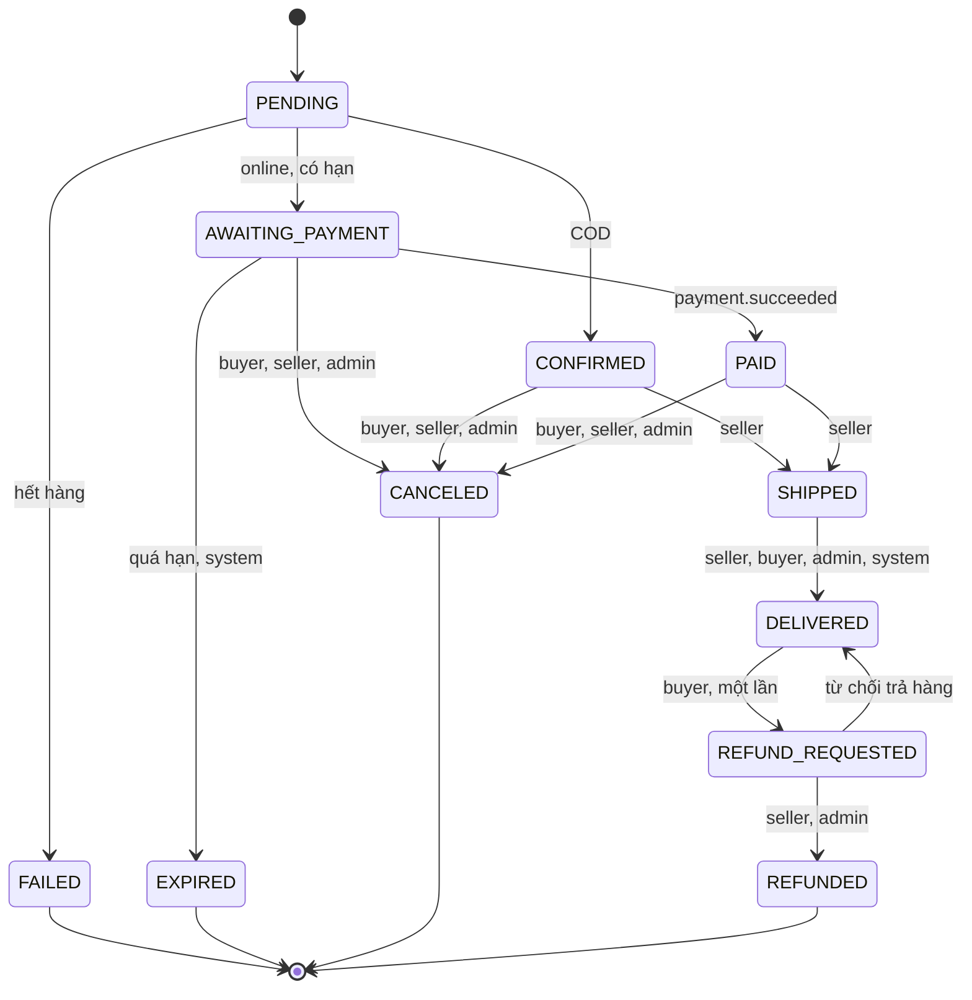
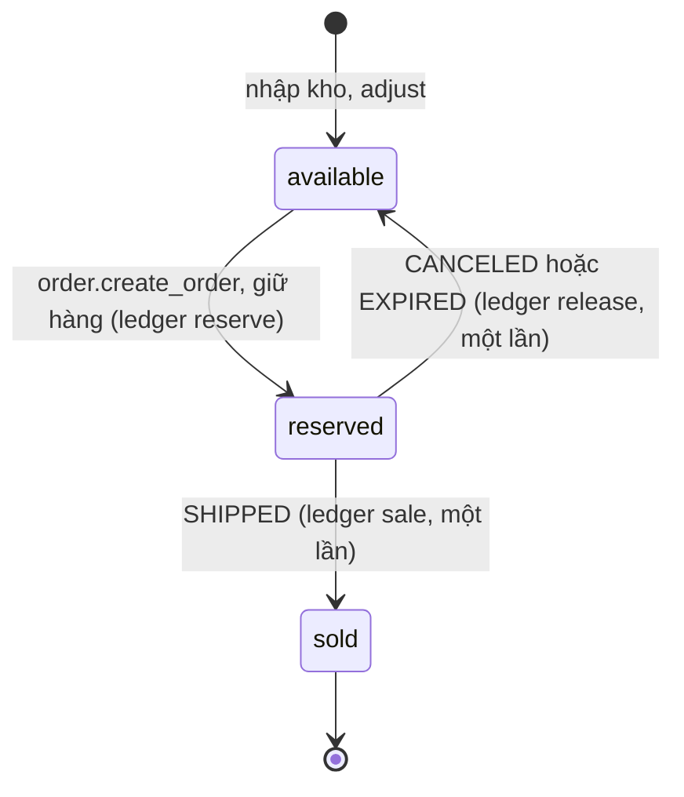
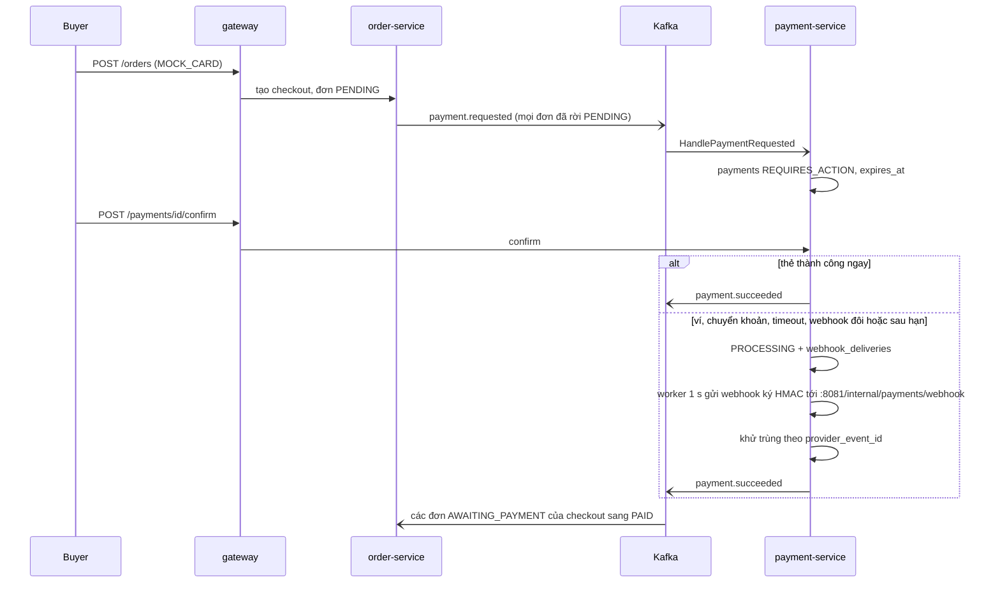
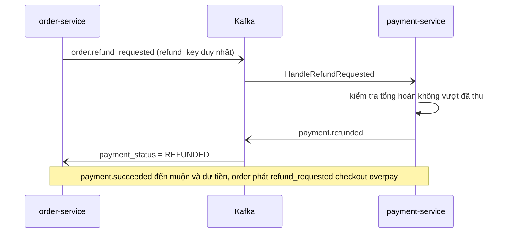
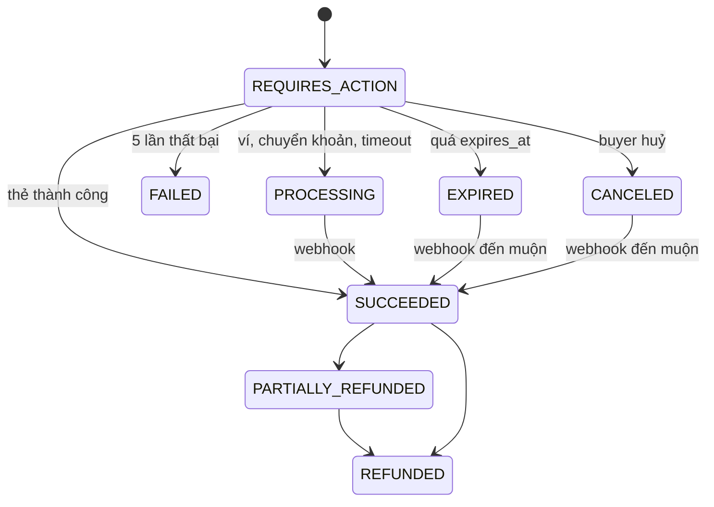

# 04 · Thanh toán mô phỏng, vòng đời đơn, tồn kho

> **Trạng thái: ✅ ĐÃ TRIỂN KHAI** (order-service, product-service, payment-service). Mô tả dưới đây khớp code; chỗ khác thiết kế ban đầu được nêu rõ. Mọi thứ thanh toán là **MÔ PHỎNG** (`PAYMENTS_MODE=mock` là giá trị duy nhất; mode khác thì payment-service từ chối chạy).

Mục tiêu: có dòng tiền/ trạng thái **giống thật** (bất đồng bộ, thất bại, hết hạn, hoàn tiền, webhook trễ/ trùng) để dashboard doanh thu có nghĩa và luyện vận hành, **không dùng cổng thật**.

## 1. Vòng đời đơn hàng

Sơ đồ khớp bảng `transitions` trong `order-service/internal/repository/statemachine.go`. COD thu tiền khi `DELIVERED` (`payment_status=PAID`).

- Mỗi **store một đơn** trong một checkout (`checkout_id`, ADR-15). `PENDING` = đang chờ product-service giữ hàng.
- **`SUCCESS` cũ** đã được migrate thành `CONFIRMED` (`order-service` `Migrate`).
- Terminal: `FAILED, EXPIRED, CANCELED, REFUNDED` (`DELIVERED` chỉ đi tiếp qua luồng trả hàng, một lần).
- Chuyển trạng thái chạy trong **một transaction có khoá hàng**: kiểm tra bảng `transitions`, cập nhật đơn, ghi `order_status_histories`, phát `order.status_changed` + event kéo theo. Bản giao trùng/ đến muộn → `ErrNotAllowed` → bỏ qua.

| Chuyển | Ai | Điều kiện / hệ quả |
|---|---|---|
| `PENDING → AWAITING_PAYMENT` | system (kết quả giữ hàng) | đơn online; `expires_at = now + ORDER_PAYMENT_TTL_MIN` (15) |
| `PENDING → CONFIRMED` | system | COD |
| `PENDING → FAILED` | system | hết hàng (`cancel_reason=out_of_stock`), không giữ gì nên không nhả kho |
| `AWAITING_PAYMENT → PAID` | payment (`payment.succeeded`) | ghi `paid_at`, `payment_status=PAID` |
| `AWAITING_PAYMENT → EXPIRED` | system (worker 30 s) | `expires_at < now`; lý do `payment_timeout`; nhả kho |
| `AWAITING_PAYMENT / CONFIRMED / PAID → CANCELED` | buyer, seller (kèm lý do), admin (kèm lý do) | nhả kho; nếu `PAID` online ⇒ `order.refund_requested` (`order:<id>:cancel`) |
| `CONFIRMED / PAID → SHIPPED` | **chỉ seller của đơn** | bắt buộc `carrier` (≤50), `tracking_code` (≤64); kho `reserved → sold` |
| `SHIPPED → DELIVERED` | seller, admin, buyer (`confirm-received`), system sau `AUTO_DELIVER_DAYS` (7, 0 = tắt) | COD ⇒ `payment_status=PAID` + `paid_at` (ghi nhận doanh thu) |
| `DELIVERED → REFUND_REQUESTED` | buyer | trong `RETURN_WINDOW_DAYS` (7) kể từ `delivered_at`, kèm lý do, **một lần** |
| `REFUND_REQUESTED → REFUNDED` | seller, admin | online ⇒ `order.refund_requested` (`order:<id>:return`, toàn bộ `total_price` gồm ship); `payment_status=REFUNDED` |
| `REFUND_REQUESTED → DELIVERED` | seller, admin (từ chối, kèm lý do) | đánh dấu `return_rejected`; không yêu cầu lại được |

Khác thiết kế: không có bước "seller xác nhận"; không có `canceled` bởi hệ thống ngoài `EXPIRED/FAILED`; khi `REFUNDED` hàng được nhập lại kho (ledger `return`, đúng một lần); COD khi duyệt trả hàng chỉ đổi nhãn `payment_status` (tiền mặt trả ngoài hệ thống). Địa chỉ giao hàng là snapshot JSON trong `orders.shipping_address` (bắt buộc `receiver_name, phone, line1, city`).

## 2. Tồn kho & giữ chỗ
Chi tiết ở [02_DATA_MODEL.md](../02_DATA_MODEL.md) §2 và ADR-21. Tóm tắt:

`available` = `products.inventory`; tồn vật lý = `available + reserved`. Đơn đã `SHIPPED` thì không nhả kho nữa; khi đơn `REFUNDED` (trả hàng được duyệt) hàng quay lại `available` (`sold` giảm, ledger `return`).

- `products.inventory` = **còn bán được**; `reserved` = đang giữ; `sold` = đã xuất kho. Tồn vật lý = `inventory + reserved`.
- Đặt hàng → `order.create_order` → **giữ hàng all-or-nothing** cho cả đơn (`inventory−q`, `reserved+q`, ledger `reserve`); `SHIPPED` → `reserved−q`, `sold+q` (ledger `sale`, đúng một lần); `CANCELED/EXPIRED` → `order.cancel_order` → `inventory+q`, `reserved−q` (ledger `release`, đúng một lần; bỏ qua nếu đã xuất kho).
- Mọi thay đổi ghi `inventory_ledgers` (chỉ thêm) + `inventory.changed` (analytics ghi `fact_inventory`).
- **Hết hạn giữ chỗ**: timers của order-service mỗi 30 s quét `status=AWAITING_PAYMENT AND expires_at < now()` (tối đa 100/lượt; mỗi đơn một transaction có khoá hàng nên an toàn đa replica) ⇒ `EXPIRED` + nhả kho. Cùng worker tự giao đơn `SHIPPED` quá `AUTO_DELIVER_DAYS`. Readiness `timers_worker` fail nếu không tick quá 90 s.
- Mức tồn: `stock_level` = `none` (0) / `low` (≤ `low_stock_threshold` hoặc 5) / `ok`. Danh sách tồn thấp cho seller: `GET /seller/inventory/low-stock` (Postgres) và báo cáo analytics `low-stock` (ClickHouse, thêm ước tính "ngày còn bán" theo tốc độ bán 14 ngày, cảnh báo nếu ≤ 7 ngày). **Không** gửi cảnh báo – chỉ là truy vấn.
- Shop điều chỉnh tồn: `POST /seller/products/:id/inventory/adjust {delta, reason}` (bắt buộc lý do; ledger `restock`/`adjust`); sửa `inventory` trong `PUT /products/:id` ghi ledger `update`.

## 3. `payment-service` (mô phỏng, gRPC :50057)
Một payment **cho cả checkout**, tạo **bất đồng bộ**: order-service phát `payment.requested` khi mọi đơn của checkout online đã rời `PENDING` (số tiền = tổng đơn đang `AWAITING_PAYMENT`, `expires_at` = hạn sớm nhất). `payments.checkout_id` UNIQUE ⇒ idempotent. COD **không** có payment.

### 3.1 Phương thức

| Method | Hành vi (`POST /payments/:id/confirm`) |
|---|---|
| `COD` | không có payment; tiền ghi nhận khi `DELIVERED` |
| `MOCK_CARD` | gửi `card_number/card_exp/card_cvc`; kết quả theo số thẻ (3.2); chỉ lưu 4 số cuối |
| `MOCK_WALLET` | `{approve:true}` → `PROCESSING`, webhook thành công sau `MOCK_WEBHOOK_DELAY_MS` (3 s); `approve:false` → lỗi `user_cancelled` |
| `MOCK_BANK_TRANSFER` | hiển thị `provider_ref` (`MM`+8 ký tự cuối của checkout id, nội dung chuyển khoản); `{approve:true}` = "đã chuyển" → `PROCESSING`, webhook sau `MOCK_TRANSFER_DELAY_MS` (8 s). Không tự khớp theo thời gian; quá hạn khi chưa xác nhận ⇒ payment `EXPIRED` (worker payment) và đơn tự `EXPIRED` (timers order-service, độc lập) |
Khác thiết kế: không có header `X-Mock-Scenario`; không có nút "admin giả lập đã nhận tiền" (dùng `POST /admin/dev/payments/:id/force` khi `ENV=dev`).

### 3.2 Thẻ test (cố định, `confirm.go`)

| Số thẻ | Kết quả |
|---|---|
| `4242 4242 4242 4242` | thành công ngay |
| `4000 0000 0000 0002` | `card_declined` |
| `4000 0000 0000 9995` | `insufficient_funds` |
| `4000 0000 0000 3220` | 3-D Secure: lần 1 trả `next_action:"otp"`; lần 2 `{"otp":"123456"}` → thành công (OTP sai → `otp_incorrect`) |
| `4000 0000 0000 0119` | `provider_error` (thử lại được) |
| `4000 0000 0000 0341` | "timeout": `PROCESSING`, webhook thành công sau `MOCK_TIMEOUT_DELAY_MS` (30 s) |
| `4000 0000 0000 0259` | thành công, webhook gửi **2 lần** (cùng `provider_event_id`) |
| `4000 0000 0000 0067` | thành công, webhook đến **sau hạn thanh toán** (sau `expires_at`, ≥ +2 s) |
| số khác (12–19 chữ số) | `do_not_honor` |
Mỗi thất bại phát `payment.failed` (`terminal=false`); đến lần **5** thì payment `FAILED` (`terminal=true`). Chỉ lưu `card_last4` và `attempts.scenario`; không số thẻ đầy đủ/CVV.

### 3.3 Luồng

Webhook thất bại được thử lại sau 2 s, 10 s, 30 s, 2 min, 10 min; sau 6 lần là `GAVE_UP`.

Hoàn tiền và tiền về muộn:

Trạng thái payment:

- **Idempotency**: `payments.checkout_id UNIQUE`; webhook trùng không đổi trạng thái hai lần; refund theo `refund_key UNIQUE`.
- **Số tiền**: payment dùng `amount_minor` từ `payment.requested`; order-service so với tổng đơn khi nhận `payment.succeeded` (khác thiết kế: không có metric `mm_payment_amount_mismatch_total`).
- **Chữ ký webhook**: `X-Signature: t=<unix>,v1=HMAC_SHA256(PAYMENT_WEBHOOK_SECRET, t + "." + body)`; lệch giờ > 5 phút ⇒ 401; sai chữ ký ⇒ 401. Secret < 16 ký tự ⇒ service không khởi động.
- **Hoàn tiền**: tự động khi huỷ đơn đã trả online / duyệt trả hàng / tiền về cho đơn không còn thanh toán được; thủ công `POST /admin/payments/:id/refund {amount_minor, reason}`. Hoàn một phần được (`PARTIALLY_REFUNDED`), tổng hoàn ≤ đã thu (`exceeds_paid_amount` ⇒ dòng refund `FAILED`). Hoàn tiền mô phỏng thành công ngay.
- **Trạng thái payment**: `REQUIRES_ACTION → PROCESSING → SUCCEEDED | FAILED | CANCELED | EXPIRED`; `SUCCEEDED → PARTIALLY_REFUNDED → REFUNDED`. `CANCELED` chỉ khi chưa gửi (`POST /payments/:id/cancel`); `EXPIRED` (worker 1 s) chỉ với `REQUIRES_ACTION` quá `expires_at`, **không phát event**; `PROCESSING` quá `expires_at` + 1 giờ (`ProcessingGrace`, provider không trả lời) cũng thành `EXPIRED`; webhook thành công về muộn vẫn được nhận (tiền là tiền) và order-service hoàn phần không đơn nào cần. Hoàn tiền thủ công của admin cho cả payment phát `payment.refunded` (`order_id=0`, `payment_status=REFUNDED`) ⇒ order-service đặt `payment_status=REFUNDED` cho các đơn `PAID` của checkout; hoàn một phần không quy được cho đơn nào.
- **Tiền về muộn**: webhook đến sau khi payment `EXPIRED/CANCELED` vẫn đặt `SUCCEEDED` (tiền là tiền) → order-service hoàn phần không còn đơn nào cần.
- **Mở rộng**: provider là code trong `service` (chưa có interface `Provider`); thêm provider thật = tách interface (`Charge/Refund/VerifyWebhook`).

### 3.4 Chủ động bất thường (luyện vận hành)
`POST /admin/dev/payments/:id/force {status: SUCCEEDED|FAILED|EXPIRED}` và `PAYMENT_CHAOS_RATE` (0–1, tỉ lệ thẻ ngẫu nhiên `provider_error`) – cả hai **chỉ khi `ENV=dev`**.

## 4. Phí vận chuyển
`shipping_fee` cho **mỗi đơn-store**: `SHIPPING_FLAT_FEE` (30000 VND), miễn phí khi `subtotal ≥ FREE_SHIP_OVER` (500000; 0 = không bao giờ miễn phí). Không theo cân nặng. Không có mã giảm giá/ coupon (đã loại khỏi phạm vi). Tổng đơn = `subtotal + shipping_fee`, tính bằng cent nguyên ở server. Doanh thu analytics **không** gồm phí ship.

## 5. Kiểm thử (đã có)
- order-service (Postgres thật): `flow_test.go` (online đến trả hàng, COD, hết hàng một phần, hết hạn, quy tắc huỷ/hoàn, cửa sổ trả hàng, tự giao, phạm vi đọc, đồng thời), `checkout_test.go`, `cart_test.go`, `statemachine_test.go`.
- payment-service: 20 test (thẻ test, 3DS, webhook đôi/trễ/sau hạn, chữ ký, retry/bỏ cuộc, 5 lần lỗi, hoàn tiền, xác nhận đồng thời chỉ trả một lần, không lưu dữ liệu thẻ).
- product-service: giữ hàng → reserved → sold, giữ hàng đồng thời/ không bán quá tồn, ledger.
- E2E trên Swarm cho từng thẻ test: **chưa có** (e2e hiện tại dùng API cũ – xem [04_TESTING.md](../../instruction/04_TESTING.md) §5).
