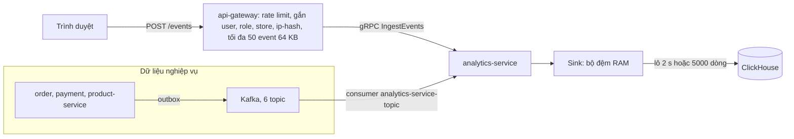
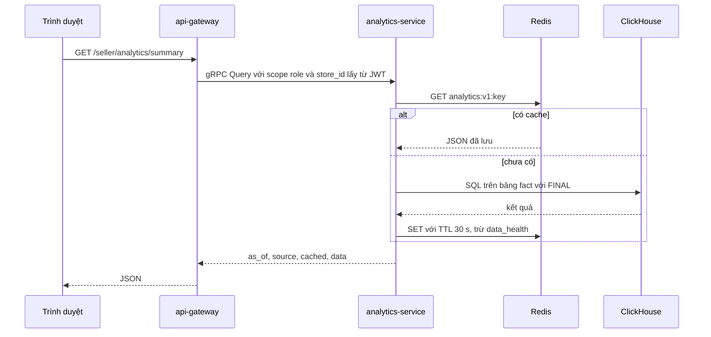
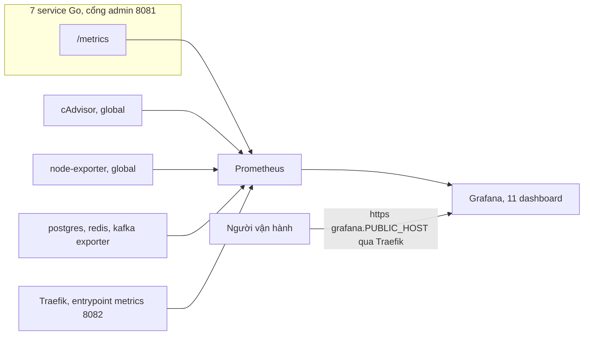
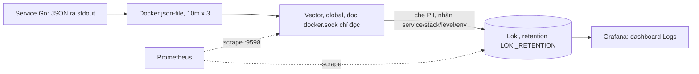

# 05 · Analytics và giám sát hệ thống (Grafana)

> **Trạng thái: ✅ analytics-service + ClickHouse ĐÃ TRIỂN KHAI; 🟡 Grafana 11 dashboard (đã viết, chưa xem trên Grafana thật); ❌ cảnh báo (cố ý chưa làm).** Docker/Swarm/ClickHouse *server*/Grafana chưa từng chạy trong sandbox: SQL được xác thực trên chDB 26.9 + unit test, ClickHouse 24.8 thật chỉ chạy trong CI (xem [09_ROADMAP_STATUS.md](09_ROADMAP_STATUS.md) "Giới hạn đã biết").

## 1. Analytics (analytics-service + ClickHouse)
### 1.1 Pipeline thực tế

Hai nguồn cùng đổ vào một bộ đệm: tracking đi gRPC rồi thành `events_raw`, còn dữ liệu đơn, thanh toán, sản phẩm đi Kafka rồi thành các bảng `fact_*` và `dim_products`.

Đường đọc báo cáo:

Scope không do client gửi nên seller không thể mở rộng sang store khác; Redis hỏng thì báo cáo vẫn chạy (chỉ tính lại).

- **Tracking đi gRPC, không qua Kafka** (`tracking.events` không tồn tại – ADR-13).
- Bộ đệm `Sink`: gom theo bảng, insert `JSONEachRow` mỗi `ANALYTICS_FLUSH_INTERVAL_MS` (2000) hoặc khi đủ `ANALYTICS_FLUSH_ROWS` (5000); lỗi thì giữ lại thử vòng sau; vượt `ANALYTICS_BUFFER_MAX_ROWS` (100000) thì **rớt dòng cũ nhất** và đếm. Dòng idempotent nên retry vô hại. Consumer Kafka commit khi dòng đã vào đệm.
- Consumer idempotent nhờ `ReplacingMergeTree` khoá theo id tự nhiên (ADR-14). Bảng: `events_raw`, `fact_order_status` (một dòng cho mỗi **(đơn, trạng thái)**), `fact_order_items`, `fact_payment_events`, `fact_refunds`, `dim_products`, `fact_inventory` ([02_DATA_MODEL.md](../02_DATA_MODEL.md) §3). **Không có materialized view**: mọi báo cáo gom bảng fact lúc truy vấn với `FINAL`.

### 1.2 Báo cáo (gateway: `/seller/analytics/*`, `/admin/analytics/*`; JSON: [04_API_REFERENCE.md](../04_API_REFERENCE.md) §9)

| Report | Seller (store) | Admin (platform) | Nội dung |
|---|---|---|---|
| `summary` | ✅ | ✅ | `current` & `previous` (kỳ liền trước cùng độ dài): `revenue, refunds, net_revenue, gmv, orders_placed, orders_recognized, aov, canceled, expired, refunded, cancel_rate` |
| `timeseries` | ✅ | ✅ | doanh thu/ hoàn tiền/ đơn ghi nhận/ đơn đặt theo `hour\|day\|week\|month` (giờ VN), điền bucket rỗng |
| `top-products` | ✅ | ✅ | xếp hạng `revenue\|units\|views\|conversion\|viewed_unsold`; kèm impressions/clicks/views/carts |
| `funnel` | ✅ (checkout = null) | ✅ (+ `by_device`) | `view → cart → checkout → paid`, đếm **session**; `paid` = đơn đã ghi nhận doanh thu |
| `low-stock` | ✅ | ✅ | tồn thấp/ hết, hoặc hết trong ≤ 7 ngày theo tốc độ bán 14 ngày |
| `traffic` | ❌ | ✅ | page view, session, visitor, mới/quay lại, series, top path/referrer/device/country |
| `payments` | ❌ | ✅ | thành công/ thất bại theo **lần thử**, theo method, top `failure_code`, hoàn tiền, đơn đang chờ thanh toán |
| `search_terms` | ❌ | ✅ | top truy vấn, truy vấn 0 kết quả (từ `props.q`/`props.result_count`) |
| `data_health` | ❌ | ✅ | số dòng, event cuối, độ trễ ingest 15 phút từng bảng; event 1 giờ qua theo loại; `reconciliation:"not_implemented"` |
Khác thiết kế: không có `stockout-forecast`/`payments-breakdown`/`export.csv`/`top-stores`/`top-categories`/`products/:id/funnel` riêng; "chuyển đổi" = units / product_view; `new_visitors` tính trên toàn bộ `events_raw` (không `FINAL`).
- **Phản hồi**: `{as_of, source:"clickhouse", cached, timezone:"Asia/Ho_Chi_Minh", data}`. Cache Redis `analytics:v1:*` **30 s** (`ANALYTICS_CACHE_TTL_SEC`; không cache `data_health`). Khoảng ≤ **400 ngày** (trừ `low_stock`, `data_health`), mặc định 30 ngày.
- **Múi giờ cố định `Asia/Ho_Chi_Minh` (UTC+7, không DST)**: dữ liệu UTC, nhóm/ nhãn theo giờ VN (`toTimeZone`), `from/to` dạng `YYYY-MM-DD` đọc theo giờ VN (`to` bao gồm); không có bộ chọn múi giờ (ADR-17).

### 1.3 Định nghĩa doanh thu (một nơi – `ordersCTE`)
- Đơn **được ghi nhận** khi từng có trạng thái `PAID` (phương thức online) hoặc `DELIVERED` (COD) trong `fact_order_status`; doanh thu = **`subtotal`** (tiền hàng, **không** gồm ship) tại thời điểm đó; số đơn ghi nhận = `orders_recognized`; `aov = revenue / orders_recognized`.
- **Hoàn tiền** (`fact_refunds`) trừ **theo thời điểm hoàn**; `net_revenue = revenue − refunds`. (Hoàn tiền không đưa doanh thu của kỳ gốc về lại.)
- **GMV** = `subtotal` của đơn đặt trong kỳ, trừ đơn `EXPIRED`, `FAILED`, và `CANCELED` chưa từng `PAID`. `cancel_rate = (canceled + expired) / orders_placed`.
- Seller chỉ thấy đơn/ sản phẩm của store mình: lọc `store_id` ở SQL (đơn) và `product_id IN dim_products(store)` (event sản phẩm); `refunds` lọc qua đơn của store.
- ClickHouse là nơi *phân tích*, **không** là nguồn sự thật tiền: dựng lại một phần từ Kafka (7 ngày); **backfill từ Postgres và đối soát đêm (`DataHealth`) CHƯA làm**.

### 1.4 Quyền & consent & PII
- Gateway điền `Scope{role, store_id}` từ JWT (`seller` + store của người gọi, hoặc `admin`); **không** nhận `store_id` từ client. analytics-service từ chối scope `seller` thiếu `store_id` (400), báo cáo chỉ-admin với seller (403), role khác (403). Có test chéo scope (handler gateway + `TestQueryAccessRules` + store test).
- **Consent**: `consent.analytics=false` ⇒ chỉ giữ `page_view`/`error_client`, **xoá** `anonymous_id`, `session_id`, `user_id`, `ip_hash`, `product_id`, `props`; loại khác bị từ chối `no_consent`. `identify` luôn tính là có consent (chỉ khi đã đăng nhập).
- **PII**: email/số điện thoại trong chuỗi `props` bị thay `[email]`/`[phone]`; `path` bỏ query/fragment; `referrer` giữ host+path; `props` ≤ 2 KB và phải là object JSON; `ts_client` chỉ tin trong ±24 h; `ip_hash` = HMAC(`IP_HASH_SECRET`, ngày UTC | IP) xoay mỗi ngày, IP thô không lưu. Server-only event (`order_placed`…) từ client bị loại (`unknown_or_server_only_type`).
- Retention `events_raw`: `EVENTS_RETENTION_MONTHS` (13) bằng TTL; bảng fact giữ vô hạn. **Chưa làm**: `DELETE /users/me/data` (quyền xoá), bảng `consents`, `identity_links`.

### 1.5 Quan sát pipeline
Metric (cổng :8081): `mm_ch_buffer_rows`, `mm_ch_insert_lag_seconds`, `mm_ch_rows_inserted_total`, `mm_ch_insert_failures_total`, `mm_ch_rows_dropped_total`, `mm_events_accepted_total`, `mm_events_rejected_total` (đăng ký dạng gauge nhưng giá trị là bộ đếm tăng dần – dùng `rate()/increase()`). Readiness: `clickhouse` critical; `insert_pipeline` non-critical (có hàng đợi mà > 1 phút không insert được). Dashboard **Analytics pipeline**.

## 2. Giám sát hệ thống (CPU, RAM…)

Prometheus kéo (scrape) chứ service không đẩy; với service Go dùng DNS service discovery `tasks.<service>:8081` nên thêm replica không cần sửa cấu hình. Grafana là điểm duy nhất ra ngoài, đăng nhập bằng tài khoản Grafana.

- Nguồn: cAdvisor (CPU/RAM/mạng theo container, nhãn swarm service), node-exporter (máy), metric ứng dụng (`mm_*`, [02 §8](02_HEALTH_READY_METRICS.md)), postgres/redis/kafka-exporter, Traefik. **Chưa có** exporter/metric riêng cho ClickHouse server, MinIO (chưa có).
- Trong app: `GET /admin/system/health` (bảng service × `ready/degraded/not_ready/unreachable` × version × uptime) ✅. `GET /admin/system/metrics`, `/admin/system/outbox`, requeue ❌ chưa làm.
- Giới hạn bộ nhớ (`resources.limits.memory`) đã đặt cho service Go (256–384 MB), ClickHouse (2 GB) và container giám sát ⇒ panel "Memory % of limit" có nghĩa.

### 2.1 Đã triển khai
- `deploy/observability.yml` (stack `marketplace-obs`): Prometheus v2.55.1 (retention `PROMETHEUS_RETENTION`, mặc định 15d), Grafana 11.3.0 (`https://grafana.$PUBLIC_HOST`, đăng nhập `GRAFANA_ADMIN_*`, không anonymous), cAdvisor + node-exporter (global), postgres/redis/kafka-exporter. **Không có Alertmanager.**
- `deploy/prometheus/prometheus.yml`: scrape `tasks.<service>:8081/metrics` cho **7** service Go bằng DNS service discovery của Swarm (thêm replica không cần sửa cấu hình), cAdvisor, node-exporter, 3 exporter, Traefik (`:8082`).
- Grafana provisioning bằng file (`deploy/grafana/provisioning`, dashboard JSON `deploy/grafana/dashboards`, `allowUiUpdates:false`), folder *Marketplace*, làm mới 15 s:

| Dashboard (uid) | Panel chính |
|---|---|
| **Overview** (`mm-overview`) | targets up/down, services not ready (`mm_ready`), gateway 5xx %/p95/RPS, bảng `mm_build_info`, CPU/RAM theo swarm service |
| **Services (RED)** (`mm-services`, biến `service`) | gateway theo route (req/s, 5xx, p95, status, 429/unmatched); gRPC server theo service/method (calls, lỗi theo `grpc_code`, p95, method chậm); CPU, RSS, goroutine; pool DB |
| **Containers & hosts** (`mm-containers`) | cAdvisor: CPU, RAM, RAM % limit, mạng, restart 1 h; node-exporter: CPU %, RAM %, disk %, load, mạng, I/O |
| **Kafka · Postgres · Redis · Traefik** (`mm-infra`) | lag theo group/topic, msg/s; connections, tps, cache hit; RAM/ops/clients Redis; req/s & 5xx Traefik |
| **Analytics pipeline** (`mm-analytics`) | hàng chờ, tuổi hàng cũ nhất, batch lỗi, hàng rớt, rows/s, event/s, lag group `analytics-service-*`, p95 `Query` |
- Sáu dashboard sau (*ClickHouse server*, *Outbox & Workers*, *Payments*, *Business*, *Kafka consumer lag*, *Logs*): `jq` hợp lệ, PromQL / LogQL chưa chạy thật trên Grafana.
- Cấu hình và PromQL được kiểm cú pháp bằng thư viện Prometheus (`config.LoadFile` + `promql/parser`); **chưa chạy thử trên Swarm thật** – lần deploy đầu cần kiểm Targets và từng dashboard.
- Chạy: `scripts/deploy.sh observability` (hoặc `all`). Cách đọc dashboard & xử lý sự cố: [03_RUNBOOK.md](../../instruction/03_RUNBOOK.md).

### 2.2 Metric nghiệp vụ (đã thêm, test đơn vị, chưa chạy stack thật)

| Service | Metric |
|---|---|
| order-service | `mm_checkouts_total{result}` (success, idempotent_replay, failed), `mm_orders_created_total`, `mm_order_status_transitions_total{to_status}`, `mm_orders_payment_expired_total`, `mm_orders_auto_delivered_total`, `mm_order_cart_merges_total` |
| payment-service | `mm_payments_created_total{method}`, `mm_payments_completed_total{method,result}` (succeeded, failed, expired, cancelled), `mm_payment_amount_minor_total{method}`, `mm_refunds_total{result}`, `mm_payment_webhooks_total{result}` (accepted, duplicate, late, invalid_signature, error), `mm_payment_processing_seconds` |
| product-service | `mm_inventory_reservations_total{result}` (reserved, insufficient, released, committed), `mm_inventory_adjustments_total{reason}`, `mm_products_changed_total{op}` (chưa đếm `SetProductStatus`; `delete` luôn 0) |
| api-gateway | `mm_rate_limited_total{group}`, `mm_grpc_client_requests_total{service,method,code}`, `mm_grpc_client_duration_seconds{service,method}` (nhãn `service` là service đích) |

Lag consumer Kafka dùng `kafka_consumergroup_lag` của kafka-exporter, không có metric `mm_kafka_consumer_lag` tự phát. Vẫn thiếu: tracing, deadline/retry gRPC.

Gateway còn có `mm_grpc_client_retries_total{service,method}` (số lần retry lệnh đọc, nhãn `service` là service đích). Giá trị nhãn `result` đã thống nhất với code: payment `succeeded|failed|expired|cancelled`, webhook `accepted|duplicate|late|invalid_signature|error`, refund `succeeded|failed|duplicate|ignored`, tồn kho `reserved|insufficient|released|committed`.

### 2.3 Log tập trung (Vector → Loki → Grafana)

- Dashboard **Marketplace · Logs** (`mm-logs`): biến `service`, `level`, ô `request_id`; panel tỉ lệ log lỗi theo service, số log theo level, log thô lọc `| json | request_id=~"..."`.
- `request_id` **không** là nhãn Loki (tránh bùng nổ chỉ mục); chỉ có `service`, `stack`, `level`, `env`.
- Vector che PII trước khi gửi (email, số điện thoại VN dạng liền, Bearer / JWT, trường `password|authorization|token`, số thẻ 13–16 chữ số). Không che số điện thoại có dấu chấm / khoảng trắng.
- Chạy thật Loki 3.2.1 + Vector 0.41.1 cục bộ; chưa thử trong Swarm. Chuẩn hoá log JSON trong từng service (đang trộn `zap` và `log.Printf`) là việc tiếp theo.

## 3. Cảnh báo: CHƯA LÀM (cố ý)
Quyết định (ADR-12): **không có cảnh báo.** Không `alert-service`, Alertmanager, bảng `alerts/notifications`, chuông, SSE, email. Chỉ có Grafana để người vận hành tự nhìn. Ngưỡng ở bảng dưới chỉ là gợi ý **tô màu** (một số đã có trên ô stat của dashboard); khi sau này muốn cảnh báo, thêm Alertmanager + rule trên đúng các metric này, không cần đổi code service.

### 3.1 Panel/ngưỡng tham khảo – trạng thái

| Dashboard thiết kế | Panel | Vàng / Đỏ | Trạng thái |
|---|---|---|---|
| Overview | service ready (`mm_ready`), replicas | ready=0 → đỏ | ✅ |
| Services (RED) | RPS, 5xx %, p95 | 5xx >1 % / >2 %; p95 >0,5 s / >1 s | ✅ (màu trên Overview) |
| Containers | CPU/RAM % limit, restart | RAM >80/90 % | ✅ (panel, chưa tô màu theo ngưỡng) |
| Nodes | CPU, RAM, disk, load | disk >80/90 % | ✅ (gộp vào *Containers & hosts*) |
| Kafka & Outbox | lag theo group/topic | lag >500/>1000 | 🟡 lag ✅ (cũng có dashboard *Kafka consumer lag* riêng, viết xong chưa xem thật); outbox ở *Outbox & Workers* (viết xong, chưa xem thật) |
| Postgres / Redis | connections, cache hit, pool | connections >70/85 % | ✅ |
| ClickHouse | insert lag, disk, merges | lag >60/>120 s | 🟡 insert lag ở *Analytics pipeline* (>60/>120 s); metric server ở dashboard *ClickHouse server* (viết xong, chưa xem thật) |
| Payments | `mm_payments_completed_total`, tỉ lệ thành công | thành công <90/<80 % | 🟡 dashboard *Payments* viết xong, chưa xem thật (ngưỡng chưa tô màu) |
| Business | checkout, đơn tạo/hết hạn/tự giao, chuyển trạng thái, tồn kho | – | 🟡 dashboard *Business* viết xong, chưa xem thật |
| Gateway | rate-limited, events nhận/loại, gRPC client | – | 🟡 `mm_rate_limited_total` và `mm_grpc_client_*` ở *Business*; 429 ở *Services*; `mm_events_*` ở *Analytics pipeline* |

### 3.2 "Cần chú ý" trong ứng dụng (không phải cảnh báo)
Là **truy vấn thường**, người dùng mở trang mới thấy: seller – `low-stock` (tồn thấp/ sắp hết), sản phẩm nhiều lượt xem 0 đơn (`top-products?sort=viewed_unsold`); admin – trạng thái service (`/admin/system/health`) và `data-health` (độ trễ pipeline; **đối soát chưa có**). Đơn đã thanh toán chưa giao > 24 h: chưa có báo cáo riêng.

### 3.3 Runbook
Đã viết: [03_RUNBOOK.md](../../instruction/03_RUNBOOK.md) (đọc dashboard, Kafka lag, outbox, ClickHouse down, payment thất bại cao, sao lưu).
