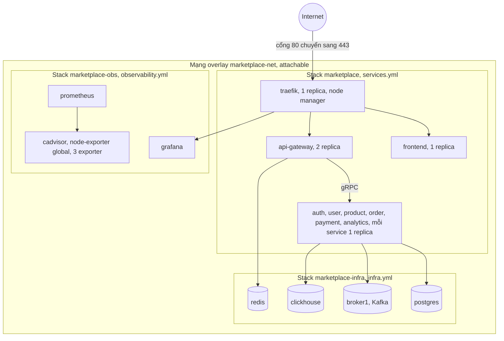
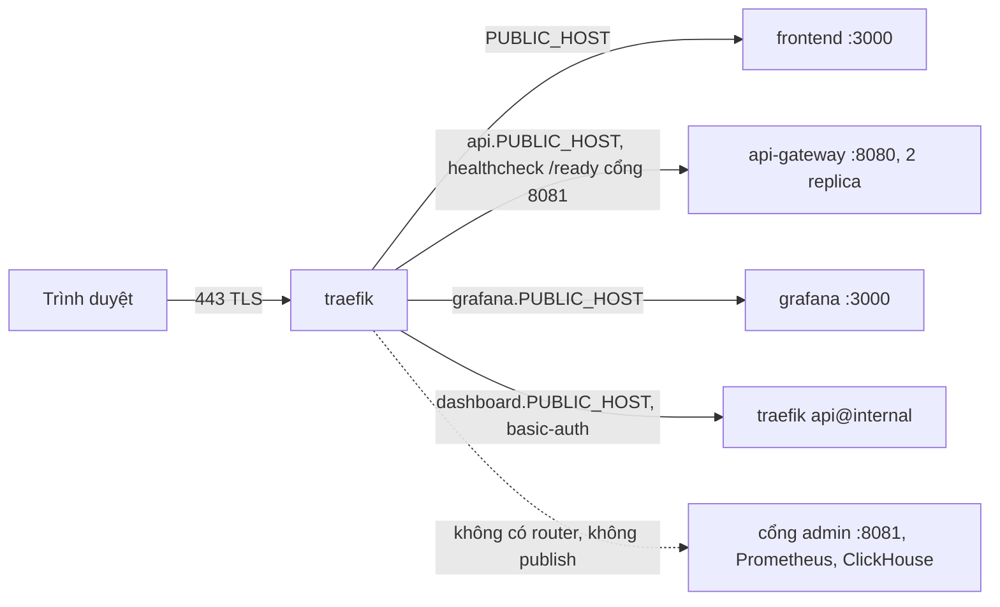

# 08 · Hạ tầng

> **Trạng thái: 🟡 phần lớn ĐÃ TRIỂN KHAI nhưng CHƯA chạy thật** (Docker/Swarm/Traefik/ClickHouse server/Grafana chưa từng chạy trên Swarm trong sandbox; các phần mới như `update_config`, `wait-ready.sh`, e2e, resilience, load test, CI push GHCR mới được viết và kiểm cú pháp, chưa chạy thật). Chi tiết vận hành: [02_DEPLOYMENT.md](../../instruction/02_DEPLOYMENT.md), [03_RUNBOOK.md](../../instruction/03_RUNBOOK.md). Secrets như cũ: giá trị thật ở `deploy/.env` (ignored), biến mới đã thêm vào `deploy/.env.example`.

## 1. Stack

### 1.1 Topology deploy

Chỉ Traefik publish cổng ra máy chủ (80 và 443, mode ingress); mọi thứ còn lại chỉ nói chuyện qua tên service trong `marketplace-net`. `scripts/deploy.sh` triển khai theo thứ tự infra, observability, services.

### 1.2 Ai publish cổng nào, định tuyến theo host

Cổng admin :8081 của mọi service Go, Prometheus và ClickHouse không có router Traefik và không publish nên chỉ truy cập được từ bên trong overlay.

### 1.3 Chi tiết file stack

> Log: mọi service có `logging: json-file` (`max-size 10m`, `max-file 3`, anchor `x-logging`) ở cả ba file; service ghi JSON ra stdout, **Vector** (global) gửi tới **Loki**, xem ở Grafana (dashboard *Logs*). Chi tiết: [05_ANALYTICS_MONITORING.md](05_ANALYTICS_MONITORING.md) §2.3, ADR-28. 🟡 chạy thật Loki + Vector cục bộ, chưa trên Swarm.

| File | Thiết kế | Thực tế |
|---|---|---|
| `deploy/infra.yml` | thêm `clickhouse`, `minio`; healthcheck mọi container | ✅ `clickhouse/clickhouse-server:24.8` (mật khẩu bắt buộc, `TZ=UTC`, limit 2 GB, volume `clickhouse-data`, healthcheck `/ping`, endpoint Prometheus built-in cổng 9363 qua `deploy/clickhouse/prometheus.xml` nạp bằng Swarm `configs` — 🟡 chạy thật ở Docker thường, chưa thử trong Swarm); ❌ **không có MinIO**; postgres/redis/kafka có healthcheck; Kafka `apache/kafka:3.9.0` retention 168 h, `NUM_PARTITIONS=3` |
| `deploy/observability.yml` | prometheus, grafana, cadvisor, node-exporter, 3 exporter | ✅ (`marketplace-obs`); healthcheck cho postgres-exporter và kafka-exporter (`wget`), **redis-exporter không làm được** (image scratch, không có shell/wget/curl); ClickHouse giám sát qua endpoint built-in thay vì exporter riêng; không có MinIO. 🟡 Profile `lite` chưa có cho file này |
| `deploy/services.yml` | thêm payment/analytics; HEALTHCHECK + `stop_grace_period 30s` + `update_config: start-first` + limits; Traefik healthcheck `/ready`; grafana sau basic-auth | ✅ payment-service, analytics-service, HEALTHCHECK, `stop_grace_period`, limits, Traefik healthcheck gateway `/ready` (port 8081), `--ping` + metrics; 🟡 `update_config` + `rollback_config` cho cả 9 service (`start-first` cho traefik/frontend/gateway/auth/user/product/order, `stop-first` cho payment/analytics; `failure_action: rollback`, `monitor 30s`) — đã viết, **chưa thử cập nhật/rollback trên Swarm thật**; 6 biến `*_SERVICE_ADDR` truyền qua `svc_env`; Grafana đăng nhập bằng tài khoản Grafana (không có thêm basic-auth Traefik) |
| `deploy/prometheus/prometheus.yml`, `deploy/grafana/{provisioning,dashboards}` | cấu hình bằng file | ✅ (11 dashboard JSON, gồm ClickHouse server, Outbox & Workers, Payments, Business, Kafka consumer lag, Logs; datasource Prometheus `uid: prometheus`; scrape job `clickhouse` → `clickhouse:9363`) |
| `scripts/deploy.sh` | infra → observability → services → `wait-ready.sh` | ✅ `all` = infra → observability → services; `deploy.sh infra\|observability\|services`; 🟡 `wait-ready.sh` đã viết (chờ `N/N` rồi probe `/ready` bằng container tạm; `--no-wait`/`SKIP_WAIT`), chưa chạy thật; chọn môi trường bằng `DEPLOY_ENV`/`ENV_FILE`, profile `lite` bằng `LITE=true` (`deploy/services.lite.yml`) |
| `scripts/build-images.sh` | truyền build-arg phiên bản | ✅ 7 service Go + frontend, `SERVICE_VERSION/GIT_COMMIT/BUILD_TIME` |

## 2. Container & tài nguyên (limit thực tế trong compose)

| Service | Image | Cổng nội bộ | Admin :8081 | RAM limit |
|---|---|---|---|---|
| clickhouse | `clickhouse/clickhouse-server:24.8` | 8123 (HTTP), 9000 | – | 2 GB |
| minio | – | – | – | ❌ chưa có |
| payment-service | build Go (alpine) | 50057 | ✔ (+ `POST /internal/payments/webhook`) | 256 MB |
| analytics-service | build Go (alpine) | 50055 | ✔ | 256 MB |
| api-gateway (×2) | build Go | 8080 | ✔ | 384 MB |
| auth/user/product/order-service | build Go | 50051/50054/50053/50052 | ✔ | 256 MB mỗi cái |
| prometheus | `prom/prometheus:v2.55.1` | 9090 | – | 768 MB |
| loki | `grafana/loki:3.2.1` (single binary, filesystem, retention `LOKI_RETENTION`) | 3100 (không publish) | – | 512 MB |
| vector | `timberio/vector:0.41.1-alpine` (global, mount `docker.sock:ro`) | 8686 healthcheck, 9598 metrics | – | 128 MB |
| grafana | `grafana/grafana:11.3.0` | 3000 | – | 384 MB |
| cadvisor / node-exporter | global | 8080 / 9100 | – | 256 MB / 128 MB |
| postgres/redis/kafka-exporter | | 9187 / 9121 / 9308 | – | 64 MB mỗi cái |
Profile `lite` cho máy yếu: ❌ chưa có.

## 3. Biến môi trường (thực tế)

| Biến | Dùng bởi | Trạng thái / ghi chú |
|---|---|---|
| `ADMIN_PORT` (8081), `PPROF_ENABLED`, `DRAIN_SECONDS` (10), `READY_CACHE_SECONDS` (3), `READY_CHECK_TIMEOUT_MS` (1000) | mọi service Go | ✅ |
| `SERVICE_VERSION`, `GIT_COMMIT`, `BUILD_TIME` | mọi service | ✅ build-arg |
| `ENV` (`prod`/`dev`) | payment | ✅ `dev` bật force payment + chaos |
| `ADMIN_BOOTSTRAP_USERNAME/PASSWORD` | auth | ✅ |
| `LOGIN_MAX_FAILURES`, `LOGIN_LOCK_MINUTES` | auth | ❌ chưa làm |
| `CLICKHOUSE_URL/USER/PASSWORD/DB` | analytics (+ infra) | ✅ (mật khẩu bắt buộc) |
| `ANALYTICS_CACHE_TTL_SEC`, `EVENTS_RETENTION_MONTHS`, `ANALYTICS_FLUSH_INTERVAL_MS`, `ANALYTICS_FLUSH_ROWS`, `ANALYTICS_BUFFER_MAX_ROWS` | analytics | ✅ (cái cuối chưa qua `services.yml`) |
| `AUTH_/ORDER_/PRODUCT_/USER_/ANALYTICS_/PAYMENT_SERVICE_ADDR` | gateway (đủ 6), order/auth/user/product (`AUTH_`, `PRODUCT_`) | ✅ đọc từ env, mặc định đúng giá trị cũ; có unit test, chưa deploy thử |
| `PAYMENTS_MODE=mock`, `PAYMENT_WEBHOOK_SECRET`, `PAYMENT_WEBHOOK_URL`, `PAYMENT_CHAOS_RATE`, `MOCK_WEBHOOK_DELAY_MS`, `MOCK_TRANSFER_DELAY_MS`, `MOCK_TIMEOUT_DELAY_MS` | payment | ✅ |
| `ORDER_PAYMENT_TTL_MIN` (15), `AUTO_DELIVER_DAYS` (7), `RETURN_WINDOW_DAYS` (7), `SHIPPING_FLAT_FEE` (30000), `FREE_SHIP_OVER` (500000) | order | ✅ |
| `PROMETHEUS_URL` | gateway | ❌ (không có proxy metrics) |
| `MINIO_*`, `MAX_UPLOAD_MB` | product, gateway | ❌ |
| `EVENTS_RATE_LIMIT_PER_MINUTE` (120), `MAX_BODY_BYTES`, `SYSTEM_HEALTH_TARGETS` | gateway | ✅; `EVENTS_MAX_BATCH` ❌ (cứng 50 event/64 KB) |
| `IP_HASH_SECRET` | gateway | ✅ (thiết kế gọi `IP_HASH_SALT`; xoay theo ngày UTC tự động, khoá rỗng ⇒ ngẫu nhiên mỗi process) |
| `SEED_DEMO_DATA`, `SEED_DEFAULT_CATEGORIES` | auth/product | ✅ seed 2 tài khoản + ~100 sản phẩm demo + 7 danh mục gốc; **không** có đơn lịch sử giả |
| `NEXT_PUBLIC_TRACKING_ENABLED` | frontend | do nhánh UI |

## 4. Mạng & định tuyến
- `marketplace-net` dùng chung. **Không publish** cổng admin :8081, ClickHouse, Prometheus; Grafana qua Traefik (`grafana.<PUBLIC_HOST>`, đăng nhập Grafana).
- Traefik: gateway healthcheck `/ready` (cổng 8081); `--ping`, `--metrics.prometheus` (entrypoint `metrics` :8082 nội bộ); dashboard có basic-auth.
- `TRUSTED_PROXIES` phải đúng (sai thì rate-limit và `ip_hash` sai).

## 5. Dữ liệu & sao lưu
Volume: `postgres-data`, `redis-data`, `kafka-data`, `clickhouse-data`, `prometheus-data`, `grafana-data`, `loki-data`, `vector-data` (buffer đĩa 256 MB) (❌ `minio-data` chưa có). `pg_dump` DB `postgres`. ClickHouse là dữ liệu **dẫn xuất**: dựng lại được tối đa ~7 ngày từ Kafka; **script `backfill` từ service ❌ chưa làm**. Hướng dẫn sao lưu/khôi phục: [03_RUNBOOK.md](../../instruction/03_RUNBOOK.md) §11.

## 6. CI/CD & kiểm thử

| Thiết kế | Thực tế |
|---|---|
| Job Go cho service mới (build, vet, test -race) | ✅ ma trận 7 service; gofmt + vet + build + `go test -race -count=1`; Postgres 16 và **ClickHouse 24.8** là service container (`TEST_POSTGRES_DSN`, `TEST_CLICKHOUSE_URL`) |
| Test chung `healthtest` kiểm đủ 4 endpoint | ❌ (có `pkg/ops/ops_test.go` ở mỗi service) |
| `proto drift` (generate lại + `git diff --exit-code`) | ❌ |
| Frontend `tsc`, build | ✅ (test SDK tracking/ định dạng tiền: do nhánh UI) |
| Job `docker` build 8 image | ✅ build; 🟡 job `push-images` đẩy lên GHCR khi push `main`/tag `v*` và job `compose-validate` (đã viết, chưa chạy trên GitHub) |
| E2E mới (events → ClickHouse, đặt hàng + thanh toán theo từng thẻ, hết hạn → trả kho, cô lập shop, `/ready` 503 khi dừng Postgres, Prometheus targets…) | 🟡 đã viết lại (11 kịch bản, `scripts/e2e/run.mjs`) nhưng **chưa chạy thật** trên stack (xem [04_TESTING.md](../../instruction/04_TESTING.md) §5); `scripts/load` cho load/soak cũng chưa chạy thật |
| `resilience.sh`: ClickHouse down, payment down, Redis down | 🟡 mở rộng thành A..I (thêm ClickHouse, Kafka, payment, Redis, Postgres, order, rolling restart); chưa chạy thật |
| Test SQL ClickHouse khi không có Docker | ✅ `scripts/dev/chdb_server.py` (ADR-20) |

## 7. Bảo mật hạ tầng
Prometheus/ClickHouse/admin :8081 không auth ⇒ chỉ trong overlay (không publish). Grafana có mật khẩu (`GRAFANA_ADMIN_PASSWORD`, không anonymous). cAdvisor/node-exporter mount host chỉ đọc. Webhook mô phỏng ký HMAC, secret không log. Admin bootstrap: đổi mật khẩu ngay rồi gỡ biến. Upload ảnh (MinIO) chưa có nên chưa có kiểm MIME/size. `audit_log` ❌ chưa làm.
