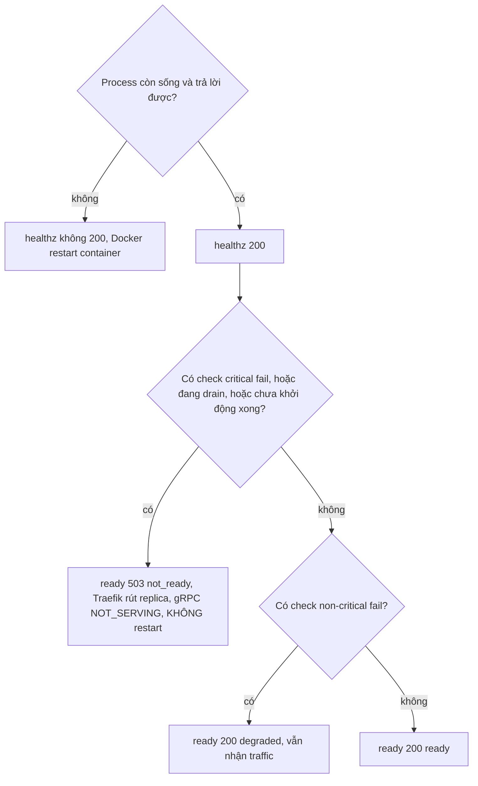
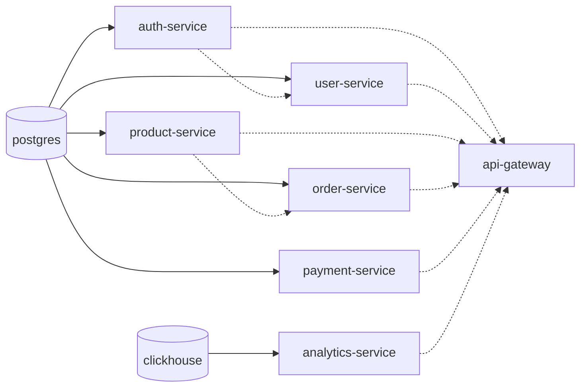
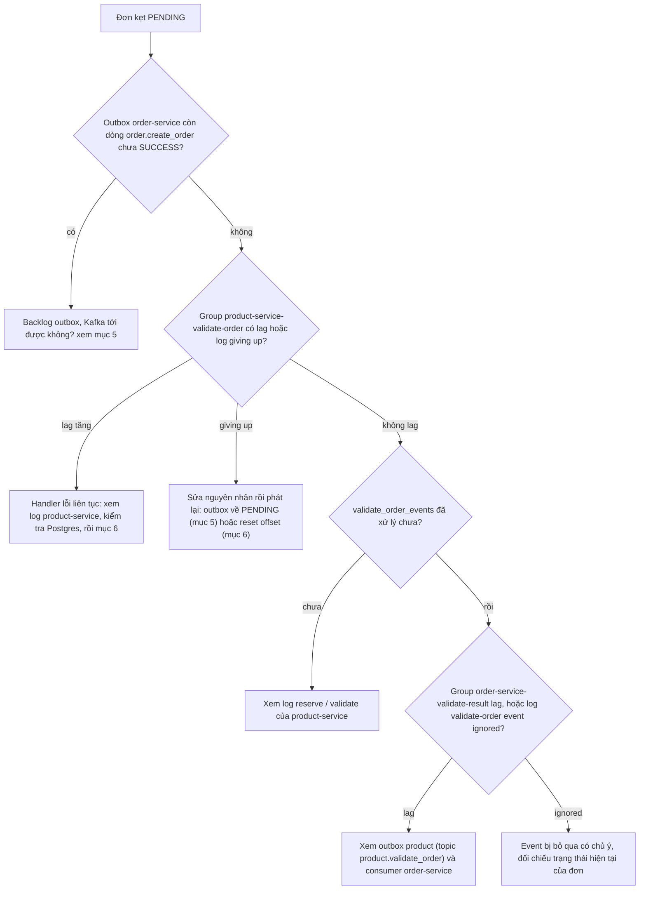
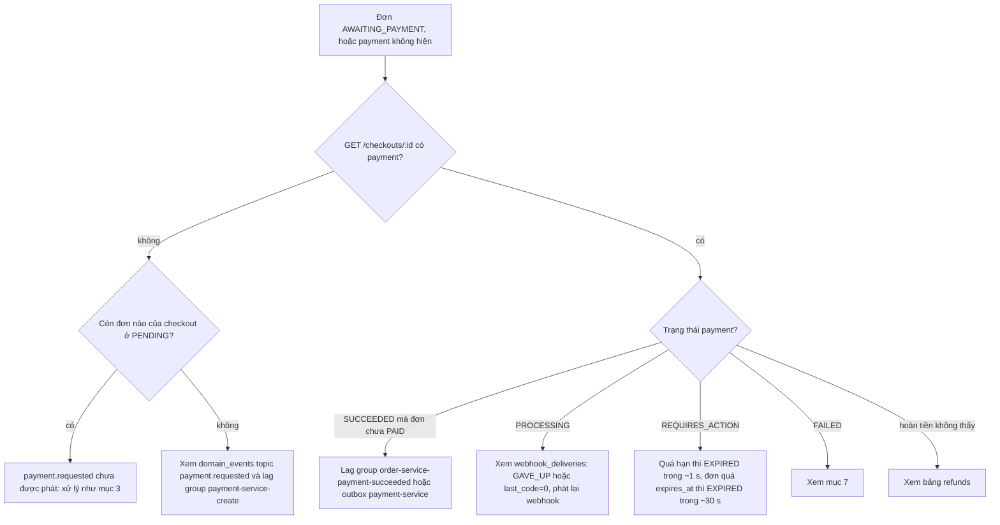
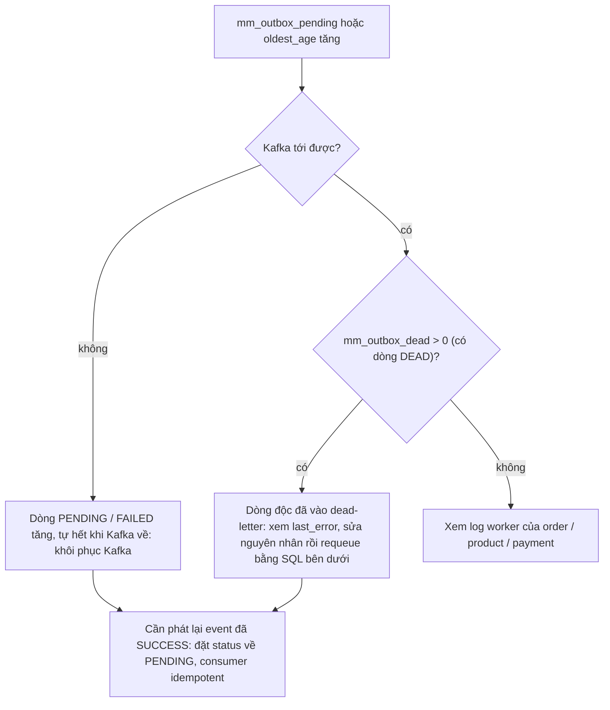
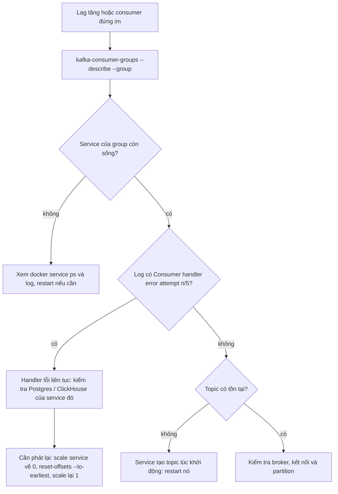
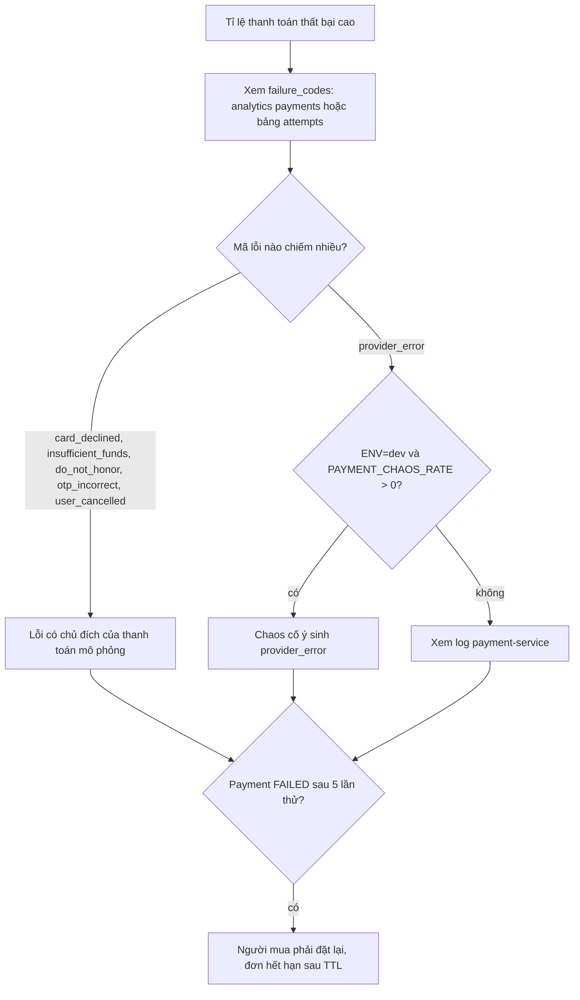
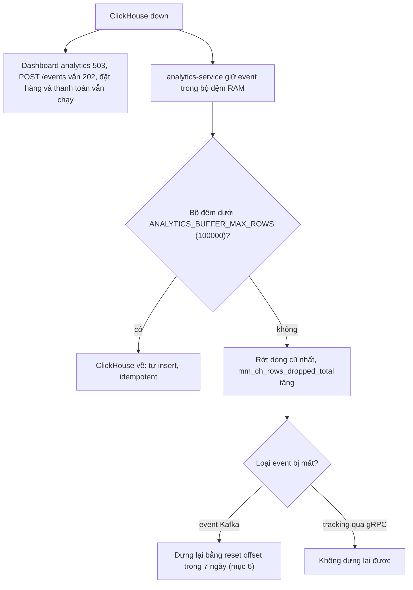

# Runbook

Quy ước lệnh (Swarm, tên container `<stack>_<service>.<n>.<id>`):

```bash
PG="docker exec -i $(docker ps -q -f name=marketplace-infra_postgres | head -1) psql -U postgres -d postgres"
KAFKA="docker exec $(docker ps -q -f name=marketplace-infra_broker1 | head -1) /opt/kafka/bin"
CH="docker exec -i $(docker ps -q -f name=marketplace-infra_clickhouse | head -1) clickhouse-client --password $CLICKHOUSE_PASSWORD -d marketplace"
docker service logs --tail 100 -f marketplace_<service>        # log một service
docker run --rm --network marketplace-net alpine wget -qO- http://<service>:8081/ready   # từ trong mạng
```

## 1. Readiness nghĩa là gì
`/healthz` luôn 200 nếu process còn sống (Docker dùng nó – **không bao giờ** phụ thuộc dependency). `/ready` mới nói "nhận được traffic chưa": 200 `ready`/`degraded` hoặc **503 `not_ready`** kèm JSON `checks` chỉ ra check nào hỏng. `/ready` 503 + `/healthz` 200 = "có dependency hỏng, **đừng restart**". Mỗi check có timeout 1 s, kết quả cache 3 s. Kiểm tra Kafka chỉ là **dial TCP** tới broker (không đo lag/consumer).

Cách `/healthz` và `/ready` quyết định kết quả:



Chỉ khi process chết/treo thì container mới bị restart; dependency hỏng chỉ làm `/ready` 503 hoặc `degraded`.

Dependency nào làm service nào 503 (nét liền = critical, nét đứt = non-critical, chỉ vẽ quan hệ giữa các service và Postgres/ClickHouse; **Kafka là non-critical với cả 7 service** (đổi 2026-10-26: trước đó critical nên Kafka sập làm Traefik bỏ cả gateway và `POST /orders` 503 dù outbox đủ sức nhận đơn; giờ `/ready` chỉ báo `degraded`), **Redis là non-critical với mọi service**):



Mũi tên đi từ dependency tới service bị ảnh hưởng: Postgres hỏng làm 5 service Go `not_ready`, ClickHouse hỏng làm analytics-service `not_ready`. **Service đồng cấp luôn là non-critical (ADR-35)**: một service chậm hoặc chết chỉ làm service gọi nó `degraded`, không lan lên gateway; request tới route liên quan thất bại theo deadline (503/504), các route khác vẫn chạy. Ngoài ra `order-service` còn critical theo `timers_worker`, `payment-service` theo `workers`.

| Service | Critical (hỏng ⇒ 503) | Non-critical (hỏng ⇒ `degraded`, vẫn 200) |
|---|---|---|
| api-gateway | (không có; chỉ `not_ready` khi chưa khởi động xong hoặc đang drain) | kafka, redis, mọi `*Client` (gRPC health của service đồng cấp) |
| auth-service | postgres | kafka, redis |
| user-service | postgres | kafka, redis, auth-service |
| product-service | postgres | kafka, redis |
| order-service | postgres, `timers_worker` (không tick quá 90 s) | kafka, redis, product-service |
| payment-service | postgres, `workers` (không tick quá 30 s) | kafka, redis |
| analytics-service | **clickhouse** | kafka, `insert_pipeline` (có hàng đợi mà >1 phút chưa insert được), redis (nếu có `REDIS_ADDR`) |

Traefik chỉ route vào replica gateway khi `/ready` = 200. Gateway `degraded` khi bất kỳ service đồng cấp nào down (vẫn trong pool Traefik; route liên quan trả lỗi, route khác chạy bình thường). `GET /admin/system/health` (admin) gom tất cả vào một bảng; `/version` cho biết bản đang chạy.

## 2. Đọc dashboard Grafana (`https://grafana.<PUBLIC_HOST>`, thư mục *Marketplace*, làm mới 15 s)
Chỉ xem, **không có cảnh báo/ thông báo** – người vận hành tự nhìn. Màu ô số chỉ là gợi ý.

| Dashboard | Xem gì | Dấu hiệu xấu |
|---|---|---|
| **Overview** | Targets up/down, "Services not ready" (`count(mm_ready==0)`), gateway 5xx %, p95, RPS, bảng phiên bản đang chạy (`mm_build_info`), CPU/RAM theo swarm service | "Targets down" ≥ 1 (đỏ), "Services not ready" ≥ 1 (đỏ), 5xx > 1 % vàng / > 2 % đỏ, p95 > 0,5 s vàng / > 1 s đỏ |
| **Services (RED)** | gateway theo `route`: req/s, 5xx %, p95, mã status, 429/`unmatched`; gRPC server theo `service`/`grpc_method` (biến `$service`): calls/s, lỗi non-OK theo `grpc_code`, p95, phương thức chậm nhất; CPU, RSS, goroutine; pool DB (in-use/open, thời gian chờ kết nối) | 5xx tăng ở một `route`; `grpc_code` = `Unavailable/Internal` tăng; "Time blocked waiting for a DB connection" > 0 kéo dài (hết pool) |
| **Containers & hosts** | cAdvisor theo swarm service: CPU cores, RAM working set, **RAM % so với limit**, mạng, số lần restart 1 giờ; node-exporter: CPU %, RAM %, disk %, load, mạng, I/O | RAM % sát 100 (OOM-kill, restart tăng); disk `/` > 80 % |
| **Kafka · Postgres · Redis · Traefik** | lag theo `consumergroup, topic` (kafka-exporter); msg/s; Postgres: connections vs max, tps, commit/rollback, cache hit; Redis: RAM, ops/s, clients; Traefik: req/s & 5xx theo service | lag tăng đều (consumer chết/chậm); cache hit thấp; connections gần `max_connections` |
| **ClickHouse server** | (endpoint Prometheus built-in `clickhouse:9363`) up, uptime, bộ nhớ, truy vấn đang chạy, số bảng, số part tối đa mỗi partition; query/s và lỗi; rows insert/s; insert bị delayed/rejected; kết nối, merge, đĩa | `up` = 0; số part tối đa tăng mãi (merge không theo kịp); insert bị delayed/rejected > 0 |
| **Outbox & Workers** | `mm_outbox_pending`, `mm_outbox_oldest_age_seconds`, `mm_outbox_dead`, `mm_outbox_publish_failures_total` (product/order/payment), `mm_worker_last_tick_timestamp_seconds` (order timers, payment workers), `mm_ready` | outbox tuổi cũ nhất tăng đều hoặc `mm_outbox_dead` > 0 (dòng độc / dead-letter, xem mục 5); worker không tick quá ngưỡng readiness |
| **Analytics pipeline** | `mm_ch_buffer_rows` (hàng chờ), `mm_ch_insert_lag_seconds` (tuổi hàng cũ nhất), batch lỗi 1 h, **hàng bị rớt 1 h**, rows inserted/s, tracking events/s (accepted/rejected), **lag của các group `analytics-service-*`**, p95 gRPC `Query` | buffer > 1000 vàng / > 20000 đỏ; lag insert > 60 s vàng / > 120 s đỏ; rớt hàng ≥ 1 đỏ |

Sáu dashboard *ClickHouse server*, *Outbox & Workers*, *Payments*, *Business*, *Kafka consumer lag*, *Logs* mới viết, chưa xem trên Grafana thật (tổng 11 dashboard). Metric nghiệp vụ: xem [05_ANALYTICS_MONITORING.md](../design/platform/05_ANALYTICS_MONITORING.md) §2.2; lag Kafka lấy từ `kafka_consumergroup_lag`. Redis-exporter không có healthcheck container (image scratch), xem `up{job="redis"}`. Prometheus cũng scrape job `clickhouse` (`clickhouse:9363`). Lần deploy đầu: Prometheus → Status → Targets (job `mm-services`, `cadvisor`, `node-exporter`, `postgres`, `redis`, `kafka`, `traefik`) phải `UP`.

### Tra log theo `request_id` (dashboard *Logs*, Loki)
1. Lấy `request_id` từ header `X-Request-ID` của response lỗi (hoặc field `request_id` trong body lỗi).
2. Grafana → *Marketplace · Logs* → dán vào ô `request_id`, chọn `service` = tất cả, khoảng thời gian quanh lúc lỗi. Truy vấn tương đương: `{service=~".+"} | json | request_id="<id>"` (không dùng `request_id` làm nhãn).
3. Đọc theo thứ tự thời gian qua gateway → các service để thấy service nào lỗi trước. Từ ADR-36 mọi dòng log (kể cả `log.Printf` cũ) là JSON; id còn đi qua outbox và header Kafka `x-request-id`, nên một id cho ra cả chuỗi gateway → order → product → payment (các event cũ trước ADR-36 không có id).
4. Không thấy log nào: kiểm Vector (`docker service logs marketplace-obs_vector`), Loki `/ready`, `up{job="loki"}` / `up{job="vector"}` ở Prometheus. Số điện thoại / thẻ dạng có dấu cách không bị che (xem [../design/05_SECURITY.md](../design/05_SECURITY.md)).

## 3. Đơn kẹt `PENDING`



Đi từ producer (outbox order) qua consumer (product) tới kết quả quay về (order): chỗ nào đứt đầu tiên là nguyên nhân. Lệnh cụ thể ở dưới.

**Lệnh và chi tiết**

1. Consumer có chạy không: `docker service logs marketplace_product-service | grep -i "reserve\|validate"`. Lag: `$KAFKA/kafka-consumer-groups.sh --bootstrap-server broker1:9092,broker2:9092,broker3:9092 --describe --group product-service-validate-order`.
2. Backlog outbox (§5): `order.create_order` nằm ở `domain_events` của order-service; kết quả nằm ở `validate_order_events` của product-service (`SELECT status, count(*) FROM validate_order_events WHERE processed GROUP BY 1`).
3. Đơn rời `PENDING` nhờ `product.validate_order` → group `order-service-validate-result` (xem log `validate-order event ignored`). Handler idempotent nên có thể phát lại.
4. Consumer thử 5 lần rồi bỏ message (`giving up on message … offset N`): sửa nguyên nhân rồi **phát lại** bằng cách đặt dòng outbox về `PENDING` (§5) hoặc reset offset group (§6). Bên product việc giữ hàng idempotent.

## 4. Đơn kẹt `AWAITING_PAYMENT`, payment không hiện, tiền không khớp



Payment được tạo bất đồng bộ, nên trước hết phải biết nó chưa được tạo hay đã tạo nhưng kẹt ở trạng thái nào. Lệnh SQL phát lại webhook và chi tiết từng nhánh ở dưới.

**Lệnh và chi tiết**

- Không có `payment` ở `GET /checkouts/:id`: payment được tạo **bất đồng bộ** bởi `payment.requested` – chỉ phát khi **mọi** đơn của checkout đã rời `PENDING`. Xem đơn còn `PENDING` không; `domain_events` của order (topic `payment.requested`) và group `payment-service-create`.
- Đơn quá `expires_at` (15 phút) sẽ `EXPIRED` sau tối đa ~30 s (timers) và nhả kho (`order.cancel_order`). Payment `REQUIRES_ACTION` quá hạn thì `EXPIRED` trong ~1 s (worker payment) – **không phát event**.
- Payment `SUCCEEDED` mà đơn chưa `PAID`: lag group `order-service-payment-succeeded` hoặc outbox của payment-service. Nếu đơn đã bị huỷ/hết hạn trong lúc chờ, order-service tự phát `order.refund_requested` (`checkout:<id>:overpay`) cho phần dư.
- Payment kẹt `PROCESSING` (ví/chuyển khoản/thẻ timeout): kết quả đến từ webhook giả. `SELECT status, count(*), max(attempts), max(last_code) FROM webhook_deliveries GROUP BY 1;` – `GAVE_UP` (6 lần) hay `last_code=0` (không gọi được `PAYMENT_WEBHOOK_URL`, thường do đổi `ADMIN_PORT`). Phát lại: `UPDATE webhook_deliveries SET status='PENDING', attempts=0, deliver_at=now() WHERE status='GAVE_UP' AND payment_id=<id>;`. Payment `PROCESSING` **không** tự hết hạn. Môi trường dev: `POST /admin/dev/payments/:id/force`.
- Hoàn tiền không thấy: `SELECT * FROM refunds WHERE payment_id=<id>;` (`status=FAILED, reason=exceeds_paid_amount` ⇒ vượt số đã thu; không có dòng ⇒ payment chưa `SUCCEEDED` hoặc yêu cầu bị bỏ qua – xem log "refund ignored"). Lưu ý: hoàn tiền thủ công của admin (`POST /admin/payments/:id/refund`) không gắn với đơn, nên `orders.payment_status` **không** tự đổi thành `REFUNDED`.

## 5. Outbox (`<service>_domain_events`) – backlog và phát lại



Worker gửi mỗi 2 s, lô 100. Lỗi được xử lý **theo từng dòng**: dòng lỗi được ghi `attempts+1`, `last_error` và hẹn `next_attempt_at` (backoff mũ 5 s, 10 s, 20 s … tối đa 15 phút); sau `OUTBOX_MAX_ATTEMPTS` lần (mặc định 10) dòng chuyển sang `DEAD` (dead-letter: giữ lại để điều tra, **không** tự thử lại). Dòng lỗi chỉ chặn các dòng **sau nó có cùng `key`** (cùng aggregate, giữ thứ tự) khi nó còn đang chờ thử lại; key khác vẫn đi. Dòng `DEAD` không chặn ai. Nếu cả một lô lỗi (từ 3 dòng, không dòng nào thành công) thì coi như Kafka sập: vẫn tăng `attempts` và backoff nhưng **không** chuyển `DEAD`, nên sự cố Kafka không làm chết event lành.

**Lệnh và chi tiết**

```sql
-- mỗi service một bảng (ADR-34): product_domain_events, order_domain_events, payment_domain_events
-- (thay <svc> bên dưới; bảng `domain_events` cũ không còn được ghi)
SELECT topic, status, count(*), min(created_at) FROM order_domain_events WHERE status <> 'SUCCESS' GROUP BY 1,2;
SELECT id, topic, key, attempts, next_attempt_at, last_error FROM order_domain_events WHERE status='FAILED' ORDER BY id LIMIT 5;
-- dead-letter (DEAD): xem trước khi requeue
SELECT id, topic, key, attempts, dead_at, left(last_error, 200) AS last_error FROM order_domain_events WHERE status='DEAD' ORDER BY id;
-- dòng còn sót ở bảng cũ (replica bản cũ ghi sau migration) phải được xử lý tay:
SELECT topic, status, count(*) FROM domain_events WHERE status <> 'SUCCESS' GROUP BY 1,2;
```

**Requeue dòng DEAD** (sau khi đã sửa nguyên nhân; consumer idempotent nên phát lại an toàn). Một dòng, hoặc cả một topic:

```sql
UPDATE order_domain_events SET status='PENDING', attempts=0, next_attempt_at=now(), dead_at=NULL
 WHERE status='DEAD' AND id = <id>;          -- hoặc: AND topic = '<topic>'
```

Không đặt `SUCCESS` để "bỏ qua" nếu chưa chắc: event đó sẽ mất vĩnh viễn. Cấu hình: `OUTBOX_MAX_ATTEMPTS` (10), `OUTBOX_BACKOFF_BASE` (5s), `OUTBOX_BACKOFF_MAX` (15m) trong `deploy/.env`.

Metric: gauge `mm_outbox_pending{table="<svc>_domain_events"}`, `mm_outbox_oldest_age_seconds`, `mm_outbox_dead` (số dòng `DEAD`, cần xử lý khi > 0) và counter `mm_outbox_published_total`, `mm_outbox_publish_failures_total`, `mm_outbox_dead_total` (từ lúc process khởi động) ở `:8081/metrics` của order/product/payment (mỗi service chỉ đếm bảng của chính nó). Hai nguyên nhân thường gặp: (a) Kafka không tới được → mọi dòng `FAILED`/`PENDING` tăng, tự hết khi Kafka về (không bị `DEAD`); (b) một dòng "độc" (publish luôn lỗi, vd. payload quá lớn) → thử lại theo backoff rồi vào `DEAD`; các dòng key khác không bị chặn, chỉ các dòng sau cùng key chờ.
Phát lại một event đã `SUCCESS`: `UPDATE <svc>_domain_events SET status='PENDING' WHERE id=<id>;` (consumer idempotent). Outbox **cũ** vẫn còn ở auth (`pwd_version_events`), user (`create_seller_events`), product (`validate_order_events`), order (`create_order_events`, `cancel_order_events`): đặt cột `status` về `'PENDING'` theo khoá chính của bảng đó.
**Requeue qua API nội bộ (ADR-36)** trên cổng admin `:8081` của order / product / payment (chạy trong mạng swarm, ví dụ từ container tạm; có `METRICS_TOKEN` thì thêm `-H "Authorization: Bearer $METRICS_TOKEN"`):

```bash
curl -s http://order-service:8081/internal/outbox/dead            # liệt kê DEAD (không kèm payload), có request_id để tra log
curl -s -X POST 'http://order-service:8081/internal/outbox/requeue?id=12&id=13'   # requeue đúng các id đó
curl -s -X POST 'http://order-service:8081/internal/outbox/requeue?limit=100'     # hoặc tất cả DEAD (tối đa limit)
```

Chỉ hàng `DEAD` bị chạm; sửa nguyên nhân (`last_error`) trước, nếu không hàng sẽ chết lại sau `OUTBOX_MAX_ATTEMPTS`. Cảnh báo `OutboxDeadRows` (mức `high`: cần người duyệt) báo khi `mm_outbox_dead > 0` quá 5 phút. Chưa có route qua gateway (`/admin/system/outbox*`); SQL ở trên vẫn dùng được.

## 6. Kafka lag / consumer đứng im



Đo lag theo từng group trước, rồi tìm nguyên nhân phía consumer; chỉ reset offset khi consumer idempotent (tất cả đều vậy) và message còn trong Kafka (7 ngày).

**Lệnh và chi tiết**

```bash
$KAFKA/kafka-consumer-groups.sh --bootstrap-server broker1:9092,broker2:9092,broker3:9092 --list
$KAFKA/kafka-consumer-groups.sh --bootstrap-server broker1:9092,broker2:9092,broker3:9092 --describe --group <group>      # LAG theo partition
$KAFKA/kafka-topics.sh --bootstrap-server broker1:9092,broker2:9092,broker3:9092 --list
```

Group: `product-service-validate-order|cancel-order|ship-order`, `order-service-validate-result|payment-succeeded|payment-refunded`, `payment-service-create|refund`, `analytics-service-<topic>`, `api-gateway-group-3`, `auth-service` ([03_EVENTS_KAFKA.md](../design/03_EVENTS_KAFKA.md)). Lag tăng + service sống: xem log `Consumer handler error … attempt n/5` (handler lỗi liên tục), kiểm tra Postgres/ClickHouse của service đó. Topic thiếu: service tạo lúc khởi động – restart nó. Công cụ ngoài container: listener quảng bá là `broker1:9092`.
**Phát lại từ đầu một group** (dừng service trước, `docker service scale marketplace_<svc>=0`):
`$KAFKA/kafka-consumer-groups.sh --bootstrap-server broker1:9092 --group <group> --topic <topic> --reset-offsets --to-earliest --execute` rồi scale lại 1. Chỉ làm với consumer **idempotent** (tất cả đều vậy; analytics ghi đè cùng dòng nhờ ReplacingMergeTree). Kafka chỉ giữ 7 ngày.

### Dead-letter queue (DLQ) của consumer Kafka

Consumer thử handler tối đa 5 lần (backoff tăng dần). Hết lượt, message gốc được publish sang topic **`<topic>.dlq`** (tự tạo lúc consumer khởi động, 3 partition) rồi mới commit offset. Nếu publish DLQ lỗi thì **không commit** và thử lại tới khi được (partition đó đứng im, log `Consumer DLQ publish failed`) nên không mất message. Mỗi message DLQ giữ nguyên key / value / header gốc, thêm header `dlq.error`, `dlq.attempts`, `dlq.source_topic`, `dlq.source_partition`, `dlq.source_offset`, `dlq.failed_at` (RFC3339 UTC). Metric: `mm_kafka_dlq_total{topic}` (tăng ở service có consumer; nên điều tra mọi giá trị > 0).

```bash
# danh sách topic DLQ và số message
docker exec $(docker ps -qf name=marketplace-infra_broker1) kafka-topics.sh --bootstrap-server localhost:9092 --list | grep '\.dlq$'
# đọc kèm header (đổi topic cho đúng)
docker exec $(docker ps -qf name=marketplace-infra_broker1) kafka-console-consumer.sh --bootstrap-server localhost:9092 \
  --topic <topic>.dlq --from-beginning --timeout-ms 5000 \
  --property print.key=true --property print.headers=true --property print.offset=true
```

Quy trình: (1) đọc `dlq.error` để biết nguyên nhân (log service theo `request_id` / thời điểm `dlq.failed_at`); (2) sửa lỗi hoặc triển khai bản vá; (3) phát lại: handler đều idempotent nên chỉ cần publish lại **value** (và key) của message vào topic gốc `dlq.source_topic`, ví dụ `kafka-console-producer.sh --topic <topic gốc> --property parse.key=true --property key.separator=:` với từng dòng `key:value` lấy từ lệnh consumer ở trên; (4) message không cứu được (dữ liệu sai thật) thì ghi nhận rồi bỏ qua. Topic DLQ dùng retention mặc định của broker (7 ngày), nên xử lý trước khi hết hạn. Chưa có công cụ replay tự động và chưa có cảnh báo (ADR-12).

## 7. Tỉ lệ thanh toán thất bại cao



Đây là thanh toán mô phỏng nên phần lớn lỗi là có chủ đích, không có nhà cung cấp thật để đổ lỗi.

**Lệnh và chi tiết**

1. Xem số liệu: admin `GET /admin/analytics/payments?from=…` (`success_rate`, `by_method`, `failure_codes`) hoặc Postgres: `SELECT failure_code, count(*) FROM attempts WHERE status='FAILED' AND at > now() - interval '1 hour' GROUP BY 1 ORDER BY 2 DESC;`.
2. Đây là **thanh toán mô phỏng**: phần lớn lỗi là có chủ đích – thẻ `…0002` (`card_declined`), `…9995` (`insufficient_funds`), `do_not_honor` (số lạ), `otp_incorrect`, `user_cancelled`. Kiểm tra `PAYMENT_CHAOS_RATE` (chỉ hiệu lực khi `ENV=dev`, sinh `provider_error`) và `ENV`.
3. `provider_error` tăng ngoài chaos ⇒ xem log payment-service; không có nhà cung cấp thật để đổ lỗi.
4. Payment `FAILED` sau 5 lần thử (`payments.failed_count`): người mua phải đặt lại (đơn hết hạn sau TTL). Số đơn đang chờ: `orders_awaiting_payment` trong báo cáo, hoặc `SELECT count(*) FROM orders WHERE status='AWAITING_PAYMENT';`.

## 8. ClickHouse / analytics-service



Cửa hàng không phụ thuộc ClickHouse; rủi ro duy nhất là mất số liệu phân tích khi down lâu hoặc service restart lúc còn đệm.

**Lệnh và chi tiết**

- **ClickHouse down ⇒ dashboard analytics 503, cửa hàng vẫn chạy.** `/admin/analytics/*` & `/seller/analytics/*` trả 503; `POST /events` vẫn 202; đặt hàng/thanh toán không bị ảnh hưởng. analytics-service `/ready` = 503 (check `clickhouse` critical) nhưng gateway chỉ coi `degraded`. Kiểm tra: `docker service ps marketplace-infra_clickhouse`, log, disk (`clickhouse-data`), RAM (limit 2 GB).
- **Spool bền** (`ANALYTICS_SPOOL_DIR`, mặc định `/var/spool/analytics` trên volume `analytics-spool`; để trống = tắt): dòng bị đẩy khỏi bộ đệm RAM (vượt `ANALYTICS_BUFFER_MAX_ROWS`) và dòng còn đệm khi nhận SIGTERM được ghi vào `spool.ndjson` (append-only, fsync, tối đa `ANALYTICS_SPOOL_MAX_MB` = 256; đầy thì rớt và tính vào `mm_ch_rows_dropped_total`). Khi khởi động, và mỗi lần flush thành công khi file còn dữ liệu, service replay file vào ClickHouse (idempotent) rồi xoá. Theo dõi `mm_ch_rows_spooled_total`, `mm_ch_rows_replayed_total`, `mm_ch_spool_bytes` (> 0 kéo dài = replay đang lỗi, xem log `analytics spool:`). Xem file: `docker run --rm -v marketplace_analytics-spool:/s alpine head -c 600 /s/spool.ndjson` (tên volume có thể khác, `docker volume ls`). Không bảo vệ được SIGKILL / OOM: phần còn trong RAM lúc đó vẫn mất.
- Khi không có spool, analytics-service **giữ** event trong bộ đệm RAM (`mm_ch_buffer_rows` tăng, `mm_ch_insert_failures_total` tăng); khi ClickHouse về sẽ tự insert (idempotent). Đệm tối đa `ANALYTICS_BUFFER_MAX_ROWS` (100000): vượt thì **rớt dòng cũ nhất** (`mm_ch_rows_dropped_total`, panel "Rows dropped" đỏ). Event Kafka vẫn được commit khi đã vào đệm ⇒ nếu bị rớt hoặc service restart lúc còn đệm, dữ liệu **mất** khỏi ClickHouse (chưa có backfill): có thể dựng lại bằng reset offset (§6) trong 7 ngày; event tracking (gRPC) thì không dựng lại được.
- Insert chậm (lag > 60 s): xem `mm_ch_insert_lag_seconds`, tải/ RAM ClickHouse, `ANALYTICS_FLUSH_ROWS`.
- Kiểm tra dữ liệu: admin `GET /admin/analytics/data-health` (số dòng, thời điểm cuối, độ trễ trung bình 15 phút từng bảng; `reconciliation` = `not_implemented` – **chưa có** đối soát Postgres↔ClickHouse). Truy vấn tay: `$CH -q "SELECT event_type, count() FROM events_raw FINAL WHERE ts_server > now() - INTERVAL 1 HOUR GROUP BY 1"`.
- Số liệu lệch với Postgres: nhớ định nghĩa doanh thu ([02_DATA_MODEL.md](../design/02_DATA_MODEL.md) §3) – chỉ đơn `PAID` (online)/`DELIVERED` (COD), tính `subtotal` (không ship), hoàn tiền trừ theo thời điểm hoàn; cache báo cáo 30 s.
- **Múi giờ**: dữ liệu lưu UTC, mọi nhóm/hiển thị theo **`Asia/Ho_Chi_Minh` (UTC+7, không DST)**; `from/to=YYYY-MM-DD` hiểu theo giờ VN (`to` bao gồm hết ngày); nhãn `bucket` là giờ VN. Không có bộ chọn múi giờ. Muốn đối chiếu bằng SQL tay: `toTimeZone(ts, 'Asia/Ho_Chi_Minh')`.

## 9. Tồn kho trông sai
`products.inventory` là **số còn bán được**; `reserved` là đang giữ; vật lý = tổng. Xem sổ cái: `SELECT * FROM inventory_ledgers WHERE product_id=<id> ORDER BY id DESC LIMIT 50;` (hoặc `GET /seller/products/:id/inventory/ledger`). Đối chiếu giữ chỗ theo đơn: `validate_order_events` (`success`, `restored`, `shipped`). Đơn hủy/hết hạn phải có `restored=true` sau khi `order.cancel_order` được tiêu thụ (không thì xem outbox `order.cancel_order` §5 và group `product-service-cancel-order`); đơn `SHIPPED` phải có `shipped=true` (group `product-service-ship-order`). Đơn `REFUNDED` không tự nhập kho – dùng `inventory/adjust`.

## 10. Khác
- **401 ngay sau đổi mật khẩu**: bình thường với token cũ. Nếu token *mới* cũng lỗi: kiểm tra Redis `<userId>:pwd_version` và consumer `auth.change_password` của gateway.
- **503 "cannot verify credentials right now" trên mọi API có đăng nhập**: gateway không xác minh được phiên bản mật khẩu vì Redis lẫn DB (auth-service `GetPwdVersion`) cùng lỗi, hoặc auth-service chạy bản cũ (`Unimplemented` trong log gateway; đặc biệt sau khi deploy: auth-service phải lên trước, `docker service update --force marketplace_auth-service`). Chỉ Redis lỗi thì **không** có lỗi: gateway tự hỏi DB (ADR-39). Sau khi Redis khởi động lại / bị xoá, ~6 phút mọi request có đăng nhập đi qua auth-service (bình thường).
- **429**: bộ đếm trong Redis `rate_limit:<scope>:<ip>` (`global`, `auth`, `events`). Sau Traefik phải đặt `TRUSTED_PROXIES`, nếu không mọi client chung một IP.
- **Migration Postgres lỗi lúc khởi động** (service restart liên tục, log `goose` / `migrate`): xem `docker service logs <service>`. Bảng version của service là `goose_db_version_<svc>` (`auth|user|product|order|payment`); `SELECT * FROM goose_db_version_order ORDER BY id;` cho biết file nào đã chạy. Khoá advisory được giữ bằng session nên tự nhả khi kết nối đóng; nếu một replica khác đang migrate, replica này chỉ chờ. Sửa bằng **file migration mới** (đánh số tiếp), không sửa file `00001` đã chạy. DB cũ do `AutoMigrate` tạo: baseline `IF NOT EXISTS` nên chạy được.
- **503 và 504 ở gateway**: `Unavailable` (service đích down / không kết nối được) → 503; `DeadlineExceeded` (vượt `GRPC_TIMEOUT_READ_MS` 3 s đọc / `GRPC_TIMEOUT_WRITE_MS` 10 s ghi) → 504. Lệnh đọc gặp `Unavailable` được retry tới `GRPC_RETRY_MAX_ATTEMPTS` (3) lần, số lần retry đếm ở `mm_grpc_client_retries_total{service,method}`; lệnh ghi không retry. Nhiều 504 ở một `service` đích ⇒ service đó chậm (xem dashboard *Business* panel p95 gRPC client và dashboard *Services*).
- **Xoay JWT secret**: đổi `JWT_SECRET` trong `deploy/.env`, deploy lại mọi stack; mọi người dùng phải đăng nhập lại.
- **Đổi `PAYMENT_WEBHOOK_SECRET`**: các webhook đang chờ vẫn được ký bằng secret lúc gửi (ký lúc phát, không lưu chữ ký) nên an toàn.
- **Tài khoản demo**: `SEED_DEMO_DATA=true` (`buyer1`, `seller1` / `password`; sản phẩm demo gán `seller_id=2`, tức store thứ hai tạo ra). Tắt ở production.
- Admin bootstrap: đặt `ADMIN_BOOTSTRAP_*`, đăng nhập với `role:"admin"`, đổi mật khẩu rồi gỡ biến.

## 11. Sao lưu / khôi phục

| Dữ liệu | Cách |
|---|---|
| Postgres (`postgres-data`) – **nguồn sự thật** (tài khoản, catalog, đơn, payment, outbox) | `scripts/backup-postgres.sh backup` (dump + kiểm tra + xoá bản quá `BACKUP_KEEP_DAYS`=7 ngày, lưu `~/mm-backups`), `scripts/backup-postgres.sh verify` (khôi phục bản mới nhất vào DB tạm `restore_check`, so số bảng/số dòng với DB thật, rồi xoá), `scripts/backup-postgres.sh cron-install` in dòng crontab mẫu (02:30 backup, 02:45 verify). Thủ công: `docker exec <postgres> pg_dump -U postgres -Fc postgres > mm-$(date +%F).dump`; khôi phục vào DB trống: `pg_restore -U postgres -d postgres --clean --if-exists mm.dump` khi **dừng** các service ghi. Hoặc snapshot volume khi Postgres đã dừng. Dùng cùng một dump cho mọi service (chung DB) |
| Redis (`redis-data`, AOF) | chỉ là cache/ bộ đếm/ `pwd_version`; mất thì tự dựng; gateway coi Redis mới/bị xoá là chưa đáng tin trong ~6 phút và hỏi DB nên không mất an toàn (ADR-39) – không cần sao lưu |
| Kafka (`kafka-data-1..3`) | không phải nguồn sự thật dài hạn (retention 7 ngày); outbox trong Postgres bảo vệ message chưa gửi; 3 broker nhân bản nhau (RF 3) nên mất 1 volume không mất dữ liệu |
| ClickHouse (`clickhouse-data`) | **dẫn xuất**: có thể mất mà shop vẫn đúng, nhưng chỉ dựng lại được ~7 ngày từ Kafka. Sao lưu: dừng analytics-service, `docker run --rm -v <volume>:/data -v $PWD:/out alpine tar czf /out/ch-$(date +%F).tgz -C /data .` (hoặc `BACKUP DATABASE marketplace TO Disk(…)` nếu cấu hình disk backup). Khôi phục: bung tar vào volume rỗng khi ClickHouse dừng, rồi khởi động; analytics-service chạy lại migration idempotent |
| Prometheus/Grafana | dashboard nằm trong repo (`deploy/grafana`), không cần sao lưu volume; số liệu lịch sử Prometheus (`prometheus-data`) tuỳ chọn |

Khôi phục Postgres từ bản cũ hơn Kafka/ClickHouse có thể tạo lệch (event đã phát cho ClickHouse nhưng đơn không còn): chấp nhận được với số liệu dẫn xuất; dọn bằng cách xoá dữ liệu ClickHouse và để consumer đọc lại.

## 12. Backfill / đối soát / xuất dữ liệu

Công cụ chạy tay (chưa có lịch). Thiết kế và giới hạn: [../design/07_DATA_PIPELINE.md](../design/07_DATA_PIPELINE.md). Cần truy cập Postgres (`POSTGRES_DSN`) và ClickHouse (`CLICKHOUSE_URL`, `CLICKHOUSE_DB`, `CLICKHOUSE_USER`, `CLICKHOUSE_PASSWORD`) từ trong overlay (chạy từ container tạm trong `marketplace-net` hoặc publish cổng tạm ở máy dev).

**Khi nào dùng**
- ClickHouse mất dữ liệu hoặc thiếu một khoảng (analytics-service down lâu, vượt bộ đệm, dựng lại ClickHouse) ⇒ `backfill`.
- Nghi số liệu analytics lệch Postgres, hoặc sau khi backfill ⇒ `reconcile`.
- Cần file huấn luyện / phân tích ngoài ⇒ `scripts/export/export.py`.

**Chạy** (từ `services/analytics-service`):

```bash
go run ./cmd/backfill reconcile --from 2026-10-01 --to 2026-10-25          # chỉ so, không ghi
go run ./cmd/backfill backfill  --from 2026-10-01 --to 2026-10-25          # --tables order_status,order_items,payments,refunds,products,inventory
go run ./cmd/backfill reconcile --from 2026-10-01 --to 2026-10-25 --json   # đối soát lại sau khi backfill
```

Ngày theo `YYYY-MM-DD`, múi giờ `Asia/Ho_Chi_Minh`, gồm cả hai đầu.

**Đọc kết quả `reconcile`**
- Bảng `METRIC / POSTGRES / CLICKHOUSE / DIFF / STATUS`: tổng cho cả khoảng; bảng `DAY METRIC …` chỉ liệt kê ngày lệch. Các chỉ số: số dòng và tiền của `order_status`, `order_items`, `payments_succeeded`, `payments_failed`, `refunds`, `products`, `inventory`, `revenue` (định nghĩa ADR-22) và `net_revenue` (trừ hoàn tiền theo ngày hoàn).
- Dòng cuối `MATCH: N checks, 0 over tolerance` hoặc báo lệch. `--tolerance` là tỉ lệ `|ch-pg| / max(|pg|,1)`; `0` = phải khớp tuyệt đối.
- **Exit code:** `0` khớp · `1` lệch quá ngưỡng · `2` lỗi (kết nối, tham số, ClickHouse chưa có DB).
- Lệch ở đúng một ngày và một bảng thường là thiếu event Kafka của ngày đó ⇒ `backfill` đúng khoảng đó rồi `reconcile` lại.

**Cẩn thận khi backfill**
- Chạy lại an toàn (idempotent) cho `order_status`, `order_items`, `refunds`, `products`.
- Với `payments` (loại failed) và `inventory`, backfill chồng lên khoảng Kafka đã điền có thể **nhân đôi dòng** (khoá có `at`, lệch vài mili giây): chỉ backfill vào khoảng trống / ClickHouse rỗng, hoặc dùng `--tables` để loại hai bảng này.
- `events_raw` (click, giỏ…) **không** dựng lại được từ Postgres.
- Số tiền / `payment_status` trong `order_status` backfill là giá trị hiện tại; `fact_inventory.reserved` ghi 0.

**Xuất file** (từ gốc repo, kết nối ClickHouse bằng env):

```bash
python3 scripts/export/export.py --from 2026-07-01 --to 2026-09-30 --profile otto --format csv \
  --out out/otto --split-by-time train=0.8,valid=0.1,test=0.1
```

Mỗi lần xuất có `manifest.json` (phiên bản, khoảng, số dòng, sha256, cột). Chạy lại cùng tham số cho file giống hệt từng byte.

## Kafka 3 broker: kiểm tra và xử lý
```bash
$KAFKA/kafka-topics.sh --bootstrap-server broker1:9092 --describe --under-replicated-partitions   # trống = đủ replica
$KAFKA/kafka-topics.sh --bootstrap-server broker1:9092 --describe --topic <topic>                   # Leader / Replicas / Isr
$KAFKA/kafka-metadata-quorum.sh --bootstrap-server broker1:9092 describe --status                   # leader controller + voter
```
- Mất 1 broker (`docker service scale marketplace-infra_broker3=0`): producer/consumer vẫn chạy (RF 3, min ISR 2); khi bật lại broker tự đồng bộ. Mất 2 broker: ghi bị từ chối (dưới min ISR) và quorum controller mất; đơn vẫn được nhận nhờ outbox và xử lý khi cụm trở lại. Kịch bản kiểm: `scripts/e2e/resilience.sh J` (1 broker) và `B` (cả 3).
- Topic do service tạo qua `EnsureTopicExist` có RF `min(3, số broker)`; kiểm bằng lệnh `--describe` ở trên (topic tạo trước khi đổi code có thể còn RF 1).
- Chế độ `LITE=true`: chỉ `broker1` chạy (RF 1).

## 13. Cảnh báo, mức hành động, trace và circuit breaker (ADR-36, ADR-37)

**Đọc cảnh báo đang bắn:** Prometheus `/alerts` hoặc `GET /api/v1/alerts` (trong mạng swarm: `http://prometheus:9090/api/v1/alerts`). Luật ở `deploy/prometheus/alerts.yml`; mỗi luật có annotation `runbook` (mục ở file này) và `action` = mức tác động của hành động xử lý đề xuất:

| `action` | Nghĩa | Ai được làm |
|---|---|---|
| `observe` | chỉ cần xem thêm (dashboard, log, trace) | agent / người, không cần duyệt |
| `low` | hành động ít rủi ro, đảo ngược được: chạy lại một lần kiểm tra, `docker service update --force` một service không trạng thái, scale lại | agent đề xuất, người bấm xác nhận (hoặc tự động nếu chủ hệ thống cho phép) |
| `high` | ghi lại / sửa dữ liệu hoặc mất thời gian dài: requeue outbox, `backfill`, hoàn tiền, restore backup | **luôn cần người duyệt**, ghi lý do |

| Cảnh báo | Nghĩa | Xem mục | `action` |
|---|---|---|---|
| `ServiceDown`, `ServiceMissing`, `ServiceNotReady` | không scrape được / không còn target (0 replica) / `/ready` 503 | §1, §10 | low |
| `CircuitBreakerOpen` | gateway đã mở mạch tới một service (request tới đó bị 503 ngay) | §1 + dưới đây | low |
| `OutboxDeadRows` | có hàng outbox DEAD | §5 | high |
| `OutboxBacklogOld` | event cũ nhất chờ > 5 phút | §5, §6 | low |
| `ConsumerDLQGrowing` | message vào DLQ của consumer | §6 | high |
| `ReconcileDrift`, `ReconcileStale` | ClickHouse lệch Postgres / đối soát không chạy | §8, §12 | high / low |
| `AnalyticsRowsDropped` | analytics mất dòng dữ liệu | §8 | low |
| `GatewayServerErrors` | > 5% request trả 5xx | §1, §2 | observe |
| `ContainerNearMemoryLimit` | container > 90% giới hạn bộ nhớ | §10 | low |

**Circuit breaker:** `mm_circuit_state{service}` = 1 nghĩa là gateway ngừng gọi service đó (503 `circuit open: <service>`) trong `CIRCUIT_COOLDOWN_MS` (10 s), rồi thử một lời gọi. Mở mạch là **triệu chứng**, không phải nguyên nhân: tìm vì sao service đó lỗi (`/ready` của nó, log, §1). Tự đóng lại khi service trả lời. Khẩn cấp có thể tắt bằng `CIRCUIT_FAILURE_THRESHOLD=0` (cần update gateway); không nên làm khi service đích đang hỏng.

**Trace (Tempo, Grafana → Explore → Tempo):** bật khi service có `OTEL_EXPORTER_OTLP_ENDPOINT` (mặc định trỏ `http://tempo:4318`). Lấy mẫu 10% (`OTEL_TRACES_SAMPLER_ARG`), nên request lỗi cụ thể có thể không có trace: dùng `request_id` + Loki (§2) trước, trace để xem đoạn nào chậm. Tìm theo thuộc tính `request_id` hoặc `service.name`. Tracing hỏng không ảnh hưởng nghiệp vụ (xuất span là bất đồng bộ, mất span thì bỏ).

**Đối soát Postgres / ClickHouse tự động:** `GET /admin/analytics/data-health` có khoá `reconcile` (nếu `RECONCILE_PG_DSN` được đặt, mặc định bật). `mismatches > 0` kéo dài sau khi pipeline đã hết lag nghĩa là lệch thật; chạy `backfill reconcile` (§12) để xem chi tiết, sửa bằng `backfill` là hành động `high`.

## 14. Sự cố tự ghi (`ops-service`, ADR-38)
`ops-service` đọc cảnh báo Prometheus mỗi 30 s và tạo bản ghi **sự cố**; admin xem qua `GET /admin/ops/incidents` (xem [04_API_REFERENCE.md](../design/04_API_REFERENCE.md)). Cần đặt `OPS_API_TOKEN` (cùng giá trị cho gateway và ops-service, sinh bằng `openssl rand -hex 24`, thêm vào `deploy/.env`, rồi `./scripts/deploy.sh services`); để trống thì API 503 nhưng poller vẫn ghi.
- **Không thấy sự cố dù cảnh báo đang bắn:** `up{job="mm-services",swarm_service="ops-service"}`, `mm_ops_poll_last_success_timestamp_seconds` (cũ hơn vài phút = poller không tới được Prometheus; xem `docker service logs marketplace_ops-service`), `mm_ops_poll_failures`.
- **Sự cố không tự đóng:** cảnh báo vẫn bắn, hoặc Prometheus không trả lời (poller không kết luận khi không đọc được). Sự cố đóng sau 2 chu kỳ kể từ lần cuối thấy cảnh báo.
- **Nhật ký** (`ops_audit_log`) chỉ thêm; UPDATE/DELETE/TRUNCATE bị từ chối. Đừng gỡ trigger `ops_audit_no_update` / `ops_audit_no_truncate`.
- `ServiceDown` (target còn nhưng `up == 0`) và `ServiceMissing` (target biến mất: service về 0 replica mà DNS trả NXDOMAIN) bổ sung cho nhau; cùng bắn là bình thường.

### Đề xuất (đợt 2): xem, duyệt, từ chối
- Liệt kê: `GET /admin/ops/proposals?state=pending`. Mỗi đề xuất ghi hành động, tham số, bằng chứng, mức rủi ro (do sổ hành động gán), người tạo, hạn.
- Duyệt gồm hai bước: `POST .../review` (xem và nhận `approval_token`, hiệu lực 5 phút), rồi `POST .../decision` kèm mã. Mã hết hạn thì xem lại để nhận mã mới. Hành động `high` (requeue outbox, backfill) bắt buộc ghi `reason`.
- Chấp nhận **chưa chạy gì**: ở đợt 2 `ACCEPTED` chỉ là ghi nhận; người tự thực hiện theo playbook. Việc thực thi có kiểm soát là đợt 3.
- Đề xuất chờ quá `OPS_PROPOSAL_TTL_MIN` (24 h) tự thành `EXPIRED`. Người tạo không tự duyệt được (403): agent cần tài khoản admin riêng.
- Kiểm chứng sau sự cố: `GET /admin/ops/audit?subject_type=proposal&subject_id=<id>`.

### Thực thi (đợt 3)
- **Mặc định tắt.** Bật: thêm `OPS_ACTIONS_ENABLED=true` vào `deploy/.env` rồi `./scripts/deploy.sh services`. Tắt khẩn cấp: đặt lại `false` và deploy (hoặc `docker service update --env-add OPS_ACTIONS_ENABLED=false marketplace_ops-service`).
- Chỉ `requeue_outbox` tự chạy (`POST .../execute`, người khác người tạo, trong 60 phút sau khi duyệt). Cần `METRICS_TOKEN` (ops-service dùng nó gọi cổng admin của service đích). Kết quả ở `exec_result` (`dead_before`, `requeued`, `dead_after`, `verified`).
- `restart_service` / `scale_service` / `run_backfill`: mở đề xuất đã duyệt, lấy `command`, chạy trên máy quản trị, rồi `POST .../executed {"outcome":"success","note":"..."}`.
- 429 = quá `OPS_MAX_EXEC_PER_HOUR` hoặc cooldown cùng hành động + service; 409 "quá hạn" = duyệt cũ hơn cửa sổ, tạo đề xuất mới. `FAILED` không tự chạy lại: đọc `exec_result` và audit trước khi tạo đề xuất khác. `EXECUTING` bỏ dở quá 10 phút tự thành `FAILED`.

### Truy vấn đọc, thông báo, cảnh báo của chính ops-service
- `GET /admin/ops/queries` liệt kê truy vấn có tên; `POST /admin/ops/queries/<tên>` chạy. Không có PromQL/LogQL tự do. Loki mặc định `http://loki:3100` (`LOKI_URL`).
- Thông báo: đặt `OPS_NOTIFY_WEBHOOK_URL` (Slack/Discord/Mattermost). Tin chỉ có tên cảnh báo, id, người tạo. Khởi động lại ops-service thì không gửi bù tin lúc ngừng.
- `OpsPollerStale` (poller không đọc được Prometheus > 5 phút) và `OpsProposalsWaiting` (đề xuất PENDING > 1 giờ): playbook `docs/playbooks/ops-service.yml`; dashboard *Marketplace · Ops*. Nếu **Prometheus chết** thì không cảnh báo nào bắn: đây là điểm mù, kiểm tay.


## 15. Ca ngoài sách: hạ tầng quan sát hỏng, chậm, rò rỉ, đầy đĩa, nhiều lỗi cùng lúc (ADR-40)
Các cảnh báo `InfraTargetDown`, `GatewayLatencyHigh`, `DBPoolWaiting`, `ContainerMemoryGrowing`, `DiskFillingUp` phủ những ca trước đây không có cảnh báo. Playbook: `docs/playbooks/{observability-down,slow-database,resource-trend,multiple-faults}.yml`.
- **`InfraTargetDown`** (`up == 0` cho loki, vector, cadvisor, node-exporter, postgres/redis/kafka/clickhouse exporter, traefik): exporter hỏng **không** có nghĩa dịch vụ hỏng; kiểm tra cả hai: `docker service ps marketplace-obs_<tên>` và `/ready` của service dùng nó. Loki/Vector hỏng ⇒ không còn log mới (ghi lại thời điểm để biết khoảng trống khi tra log); cửa hàng vẫn chạy. Cảnh báo này **không** phủ Tempo (không được scrape): xem `docker service ps marketplace-obs_tempo` khi trace biến mất. Khởi động lại thành phần quan sát là hành động `low` (không có trạng thái cần giữ ngoài volume).
- **`GatewayLatencyHigh` (p95 > 1 s)** và **`DBPoolWaiting`**: tìm điểm nghẽn từ trên xuống: `mm_grpc_client_duration_seconds` theo `service` (service đích nào chậm), rồi `mm_db_pool_wait_seconds_total` của service đó. Pool cạn + service chậm thường là Postgres bị khoá hoặc truy vấn nặng: `SELECT pid, state, wait_event_type, now()-xact_start AS age, left(query,80) FROM pg_stat_activity WHERE state <> 'idle' ORDER BY age DESC LIMIT 10;` và `SELECT * FROM pg_locks WHERE NOT granted;`. **Không** tự `pg_terminate_backend` hay restart Postgres: giao cho người (hành động `high`).
- **`ContainerMemoryGrowing`**: dự báo tuyến tính 1 giờ vượt giới hạn trong 4 giờ tới. Bộ nhớ tăng đều không theo tải = rò rỉ; restart service không trạng thái (`low`) chỉ xoá triệu chứng, cần báo dev kèm biểu đồ. Không áp dụng restart cho postgres/clickhouse/kafka.
- **`DiskFillingUp` (< 10% trống)**: xem phân bổ `docker system df`, volume lớn nhất (`clickhouse-data`, `kafka`, `loki`, `prometheus`). ClickHouse đầy đĩa ⇒ analytics-service giữ event trong đệm/spool (§8) rồi mất dần: ưu tiên giải phóng chỗ trước khi đệm đầy. Không tự xoá dữ liệu.
- **Nhiều cảnh báo cùng lúc**: tìm **nguyên nhân gốc trước, triệu chứng sau**. Thứ tự: (1) hạ tầng dùng chung (Postgres, Kafka, Redis, đĩa) rồi (2) service ở đầu chuỗi phụ thuộc (auth, product) rồi (3) service phía trên (order, gateway). `CircuitBreakerOpen`, `GatewayServerErrors`, `OutboxBacklogOld` thường là hệ quả của một nguyên nhân ở tầng dưới. Xem `docs/playbooks/multiple-faults.yml`.

## 16. Vai trò `dev`, token agent, cờ AI và luồng chat SSE (ADR-40)
- **Tạo tài khoản `dev`:** đặt `DEV_BOOTSTRAP_USERNAME/PASSWORD` (cùng quy tắc ký tự và độ dài như admin) trong `deploy/.env`, deploy `services`, rồi đăng nhập với `role:"dev"`. Hết cần thì gỡ biến (tài khoản vẫn còn trong DB). `dev` chạy được cả luồng ops (đọc, đề xuất, xem lại, duyệt, thực thi) và xem sức khoẻ hệ thống/pipeline, nhưng 403 ở báo cáo, doanh thu, đơn hàng, thanh toán. Người tạo đề xuất không tự duyệt hay thực thi.
- **Token cho agent/bộ điều phối:** `openssl rand -hex 32` đặt vào `OPS_AGENT_TOKEN` (khác `OPS_API_TOKEN`), deploy `services`. Dùng ở ops-service trực tiếp trong mạng overlay (`Authorization: Bearer <token>`): đọc, `/queries`, `/outbox/<svc>/dead`, `/incidents/{id}/investigate`, tạo `/proposals`. Duyệt/thực thi trả 403. Đổi token: đổi biến rồi deploy lại (không cần khởi động lại gateway).
- **Bật chat AI (khi dịch vụ agent đã có):** `FEATURE_AI_CHAT=true`, `AI_SERVICE_URL=http://<tên-dịch-vụ>:<cổng>` trong `deploy/.env`, rồi `./scripts/deploy.sh services` (gateway cuốn chiếu). Kiểm: `curl https://api.<host>/config/features`. **Tắt khẩn cấp** (không cần xoá code): `docker service update --env-add FEATURE_AI_CHAT=false marketplace_api-gateway`; UI nên đọc `/config/features` để ẩn lối vào.
- **Kiểm luồng SSE thật qua Traefik** (không gọi LLM): `scripts/e2e/sse.sh`. Script tạm bật cờ, chạy upstream giả, đo thời điểm từng khối (chứng minh không buffer), giữ luồng 70 s (vượt mốc 60 s hay gặp của proxy), kiểm ngắt giữa chừng huỷ upstream, rồi trả cấu hình và xoá stub. Đã đặt sẵn: gateway không có `WriteTimeout`, Traefik v3 không nén route `api`; nếu về sau thêm middleware `compress` hay nginx phía trước phải loại trừ `text/event-stream`.
- **Triệu chứng:** `POST /ai/chat` 404 = cờ tắt; 503 `ai service is not configured` = thiếu `AI_SERVICE_URL`; 503 `unavailable` = upstream chết (xem log gateway `AIHandler: upstream unavailable`); luồng đứng im rồi `event: error` = upstream treo hoặc vượt `AI_STREAM_TIMEOUT_SEC`; 429 = quá `AI_RATE_LIMIT_PER_MINUTE`.
- **Không gây báo giả:** `GatewayLatencyHigh` bỏ route `/ai/chat` (luồng dài là bình thường). Truy vấn `gateway_latency_p95` cũng bỏ route này.

