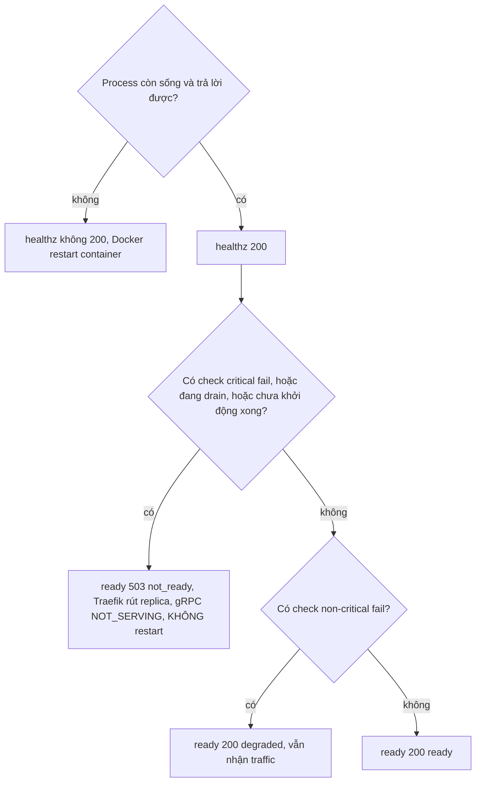
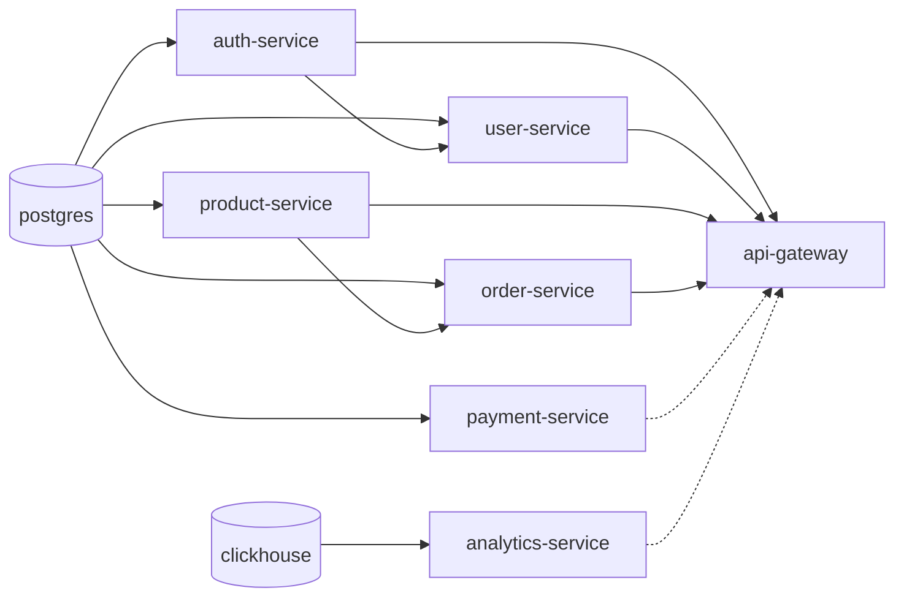
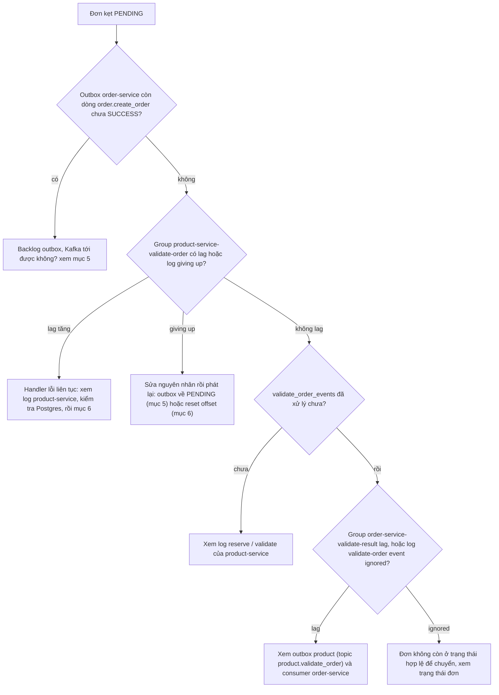
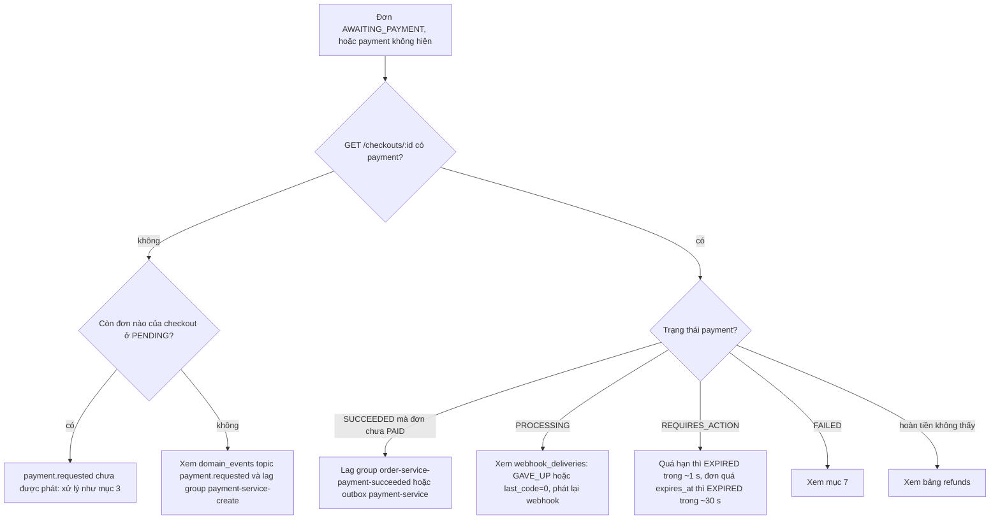
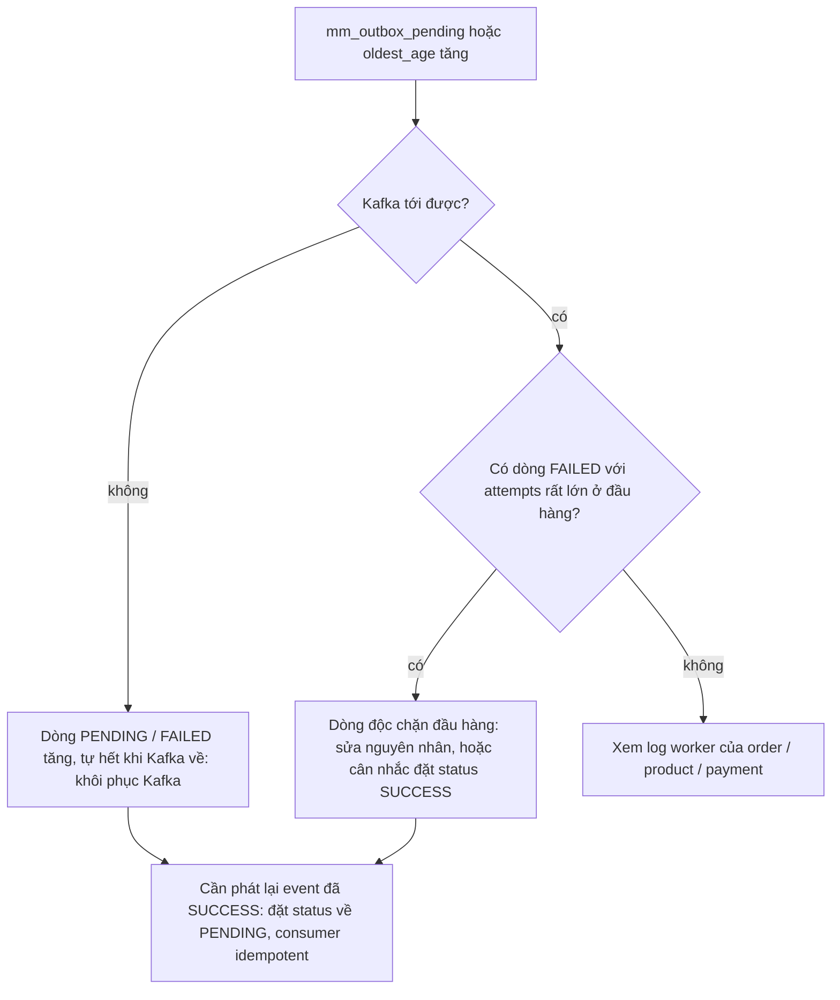
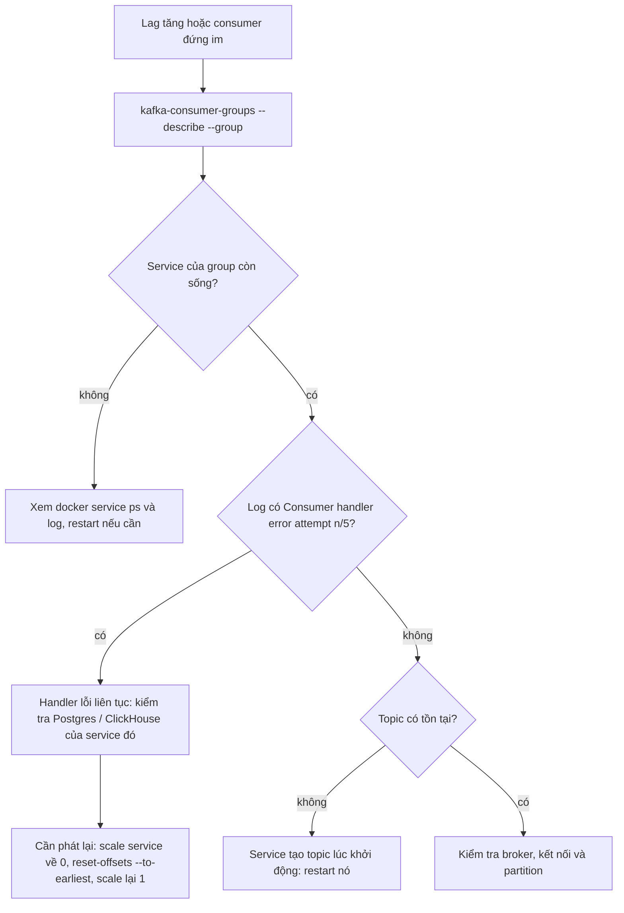
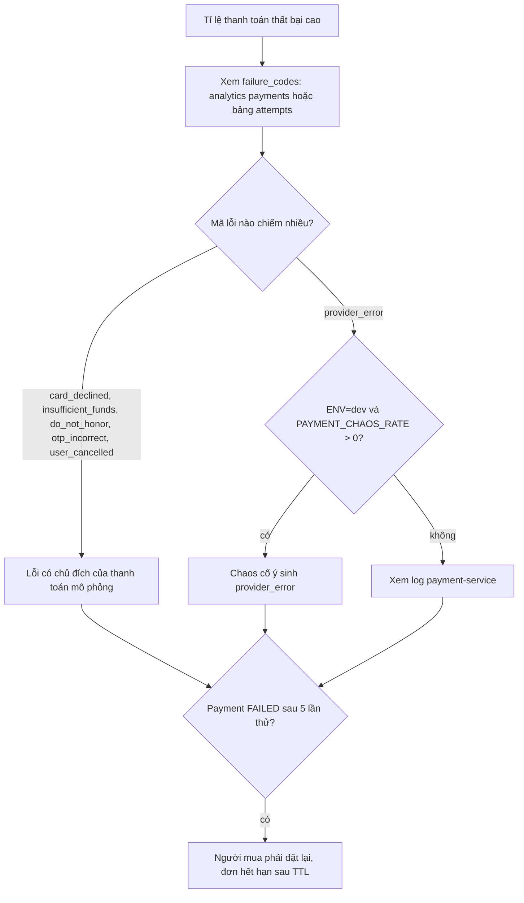
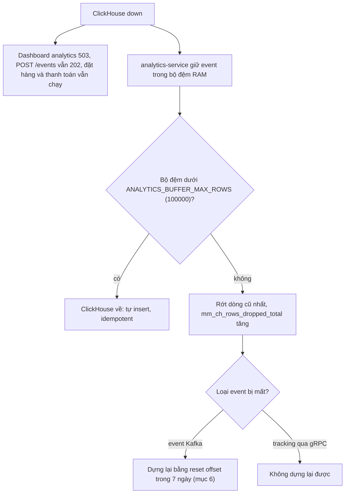

# Runbook

Quy ước lệnh (Swarm, tên container `<stack>_<service>.<n>.<id>`):

```bash
PG="docker exec -i $(docker ps -q -f name=marketplace-infra_postgres | head -1) psql -U postgres -d postgres"
KAFKA="docker exec $(docker ps -q -f name=marketplace-infra_broker1 | head -1) /opt/kafka/bin"
CH="docker exec -i $(docker ps -q -f name=marketplace-infra_clickhouse | head -1) clickhouse-client --password $CLICKHOUSE_PASSWORD -d marketplace"
docker service logs --tail 100 -f marketplace_<service>        # log một service
docker run --rm --network marketplace-net alpine wget -qO- http://<service>:8081/ready   # từ trong mạng
```

## 1. Readiness nghĩa là gì
`/healthz` luôn 200 nếu process còn sống (Docker dùng nó – **không bao giờ** phụ thuộc dependency). `/ready` mới nói "nhận được traffic chưa": 200 `ready`/`degraded` hoặc **503 `not_ready`** kèm JSON `checks` chỉ ra check nào hỏng. `/ready` 503 + `/healthz` 200 = "có dependency hỏng, **đừng restart**". Mỗi check có timeout 1 s, kết quả cache 3 s. Kiểm tra Kafka chỉ là **dial TCP** tới broker (không đo lag/consumer).

Cách `/healthz` và `/ready` quyết định kết quả:



Chỉ khi process chết/treo thì container mới bị restart; dependency hỏng chỉ làm `/ready` 503 hoặc `degraded`.

Dependency nào làm service nào 503 (nét liền = critical, nét đứt = non-critical, chỉ vẽ quan hệ giữa các service và Postgres/ClickHouse; **Kafka là critical với cả 7 service**, **Redis là non-critical với mọi service**):



Mũi tên đi từ dependency tới service bị ảnh hưởng: Postgres hỏng làm 5 service Go `not_ready`, ClickHouse hỏng làm analytics-service `not_ready` nhưng gateway chỉ `degraded`. Ngoài ra `order-service` còn critical theo `timers_worker`, `payment-service` theo `workers`.

| Service | Critical (hỏng ⇒ 503) | Non-critical (hỏng ⇒ `degraded`, vẫn 200) |
|---|---|---|
| api-gateway | kafka, `AuthClient`, `OrderClient`, `ProductClient`, `UserClient` (gRPC health) | redis, `PaymentClient`, `AnalyticsClient` |
| auth-service | postgres, kafka | redis |
| user-service | postgres, kafka, auth-service | redis |
| product-service | postgres, kafka | redis |
| order-service | postgres, kafka, product-service, `timers_worker` (không tick quá 90 s) | redis |
| payment-service | postgres, kafka, `workers` (không tick quá 30 s) | redis |
| analytics-service | **clickhouse**, kafka | `insert_pipeline` (có hàng đợi mà >1 phút chưa insert được), redis (nếu có `REDIS_ADDR`) |

Traefik chỉ route vào replica gateway khi `/ready` = 200. Gateway `degraded` khi payment/analytics down (cửa hàng vẫn chạy: COD, không dashboard). `GET /admin/system/health` (admin) gom tất cả vào một bảng; `/version` cho biết bản đang chạy.

## 2. Đọc dashboard Grafana (`https://grafana.<PUBLIC_HOST>`, thư mục *Marketplace*, làm mới 15 s)
Chỉ xem, **không có cảnh báo/ thông báo** – người vận hành tự nhìn. Màu ô số chỉ là gợi ý.

| Dashboard | Xem gì | Dấu hiệu xấu |
|---|---|---|
| **Overview** | Targets up/down, "Services not ready" (`count(mm_ready==0)`), gateway 5xx %, p95, RPS, bảng phiên bản đang chạy (`mm_build_info`), CPU/RAM theo swarm service | "Targets down" ≥ 1 (đỏ), "Services not ready" ≥ 1 (đỏ), 5xx > 1 % vàng / > 2 % đỏ, p95 > 0,5 s vàng / > 1 s đỏ |
| **Services (RED)** | gateway theo `route`: req/s, 5xx %, p95, mã status, 429/`unmatched`; gRPC server theo `service`/`grpc_method` (biến `$service`): calls/s, lỗi non-OK theo `grpc_code`, p95, phương thức chậm nhất; CPU, RSS, goroutine; pool DB (in-use/open, thời gian chờ kết nối) | 5xx tăng ở một `route`; `grpc_code` = `Unavailable/Internal` tăng; "Time blocked waiting for a DB connection" > 0 kéo dài (hết pool) |
| **Containers & hosts** | cAdvisor theo swarm service: CPU cores, RAM working set, **RAM % so với limit**, mạng, số lần restart 1 giờ; node-exporter: CPU %, RAM %, disk %, load, mạng, I/O | RAM % sát 100 (OOM-kill, restart tăng); disk `/` > 80 % |
| **Kafka · Postgres · Redis · Traefik** | lag theo `consumergroup, topic` (kafka-exporter); msg/s; Postgres: connections vs max, tps, commit/rollback, cache hit; Redis: RAM, ops/s, clients; Traefik: req/s & 5xx theo service | lag tăng đều (consumer chết/chậm); cache hit thấp; connections gần `max_connections` |
| **Analytics pipeline** | `mm_ch_buffer_rows` (hàng chờ), `mm_ch_insert_lag_seconds` (tuổi hàng cũ nhất), batch lỗi 1 h, **hàng bị rớt 1 h**, rows inserted/s, tracking events/s (accepted/rejected), **lag của các group `analytics-service-*`**, p95 gRPC `Query` | buffer > 1000 vàng / > 20000 đỏ; lag insert > 60 s vàng / > 120 s đỏ; rớt hàng ≥ 1 đỏ |

**Chưa có panel** cho outbox (`mm_outbox_pending`, `mm_outbox_oldest_age_seconds` – có sẵn trong Prometheus, xem bằng Explore/ `curl :8081/metrics`), payment (`mm_payments_*` chưa tồn tại), "Business", ClickHouse server. Lần deploy đầu: Prometheus → Status → Targets (job `mm-services`, `cadvisor`, `node-exporter`, `postgres`, `redis`, `kafka`, `traefik`) phải `UP`.

## 3. Đơn kẹt `PENDING`



Đi từ producer (outbox order) qua consumer (product) tới kết quả quay về (order): chỗ nào đứt đầu tiên là nguyên nhân. Lệnh cụ thể ở dưới.

**Lệnh và chi tiết**

1. Consumer có chạy không: `docker service logs marketplace_product-service | grep -i "reserve\|validate"`. Lag: `$KAFKA/kafka-consumer-groups.sh --bootstrap-server broker1:9092 --describe --group product-service-validate-order`.
2. Backlog outbox (§5): `order.create_order` nằm ở `domain_events` của order-service; kết quả nằm ở `validate_order_events` của product-service (`SELECT status, count(*) FROM validate_order_events WHERE processed GROUP BY 1`).
3. Đơn rời `PENDING` nhờ `product.validate_order` → group `order-service-validate-result` (xem log `validate-order event ignored`). Handler idempotent nên có thể phát lại.
4. Consumer thử 5 lần rồi bỏ message (`giving up on message … offset N`): sửa nguyên nhân rồi **phát lại** bằng cách đặt dòng outbox về `PENDING` (§5) hoặc reset offset group (§6). Bên product việc giữ hàng idempotent.

## 4. Đơn kẹt `AWAITING_PAYMENT`, payment không hiện, tiền không khớp



Payment được tạo bất đồng bộ, nên trước hết phải biết nó chưa được tạo hay đã tạo nhưng kẹt ở trạng thái nào. Lệnh SQL phát lại webhook và chi tiết từng nhánh ở dưới.

**Lệnh và chi tiết**

- Không có `payment` ở `GET /checkouts/:id`: payment được tạo **bất đồng bộ** bởi `payment.requested` – chỉ phát khi **mọi** đơn của checkout đã rời `PENDING`. Xem đơn còn `PENDING` không; `domain_events` của order (topic `payment.requested`) và group `payment-service-create`.
- Đơn quá `expires_at` (15 phút) sẽ `EXPIRED` sau tối đa ~30 s (timers) và nhả kho (`order.cancel_order`). Payment `REQUIRES_ACTION` quá hạn thì `EXPIRED` trong ~1 s (worker payment) – **không phát event**.
- Payment `SUCCEEDED` mà đơn chưa `PAID`: lag group `order-service-payment-succeeded` hoặc outbox của payment-service. Nếu đơn đã bị huỷ/hết hạn trong lúc chờ, order-service tự phát `order.refund_requested` (`checkout:<id>:overpay`) cho phần dư.
- Payment kẹt `PROCESSING` (ví/chuyển khoản/thẻ timeout): kết quả đến từ webhook giả. `SELECT status, count(*), max(attempts), max(last_code) FROM webhook_deliveries GROUP BY 1;` – `GAVE_UP` (6 lần) hay `last_code=0` (không gọi được `PAYMENT_WEBHOOK_URL`, thường do đổi `ADMIN_PORT`). Phát lại: `UPDATE webhook_deliveries SET status='PENDING', attempts=0, deliver_at=now() WHERE status='GAVE_UP' AND payment_id=<id>;`. Payment `PROCESSING` **không** tự hết hạn. Môi trường dev: `POST /admin/dev/payments/:id/force`.
- Hoàn tiền không thấy: `SELECT * FROM refunds WHERE payment_id=<id>;` (`status=FAILED, reason=exceeds_paid_amount` ⇒ vượt số đã thu; không có dòng ⇒ payment chưa `SUCCEEDED` hoặc yêu cầu bị bỏ qua – xem log "refund ignored"). Lưu ý: hoàn tiền thủ công của admin (`POST /admin/payments/:id/refund`) không gắn với đơn, nên `orders.payment_status` **không** tự đổi thành `REFUNDED`.

## 5. Outbox (`domain_events`) – backlog và phát lại



Worker gửi mỗi 2 s, lô 100, không bao giờ bỏ cuộc: lỗi đầu tiên dừng cả lô nên một dòng độc làm nghẽn mọi dòng sau.

**Lệnh và chi tiết**

```sql
-- bảng dùng chung của order/product/payment (một database Postgres, một bảng `domain_events`):
SELECT topic, status, count(*), min(created_at) FROM domain_events WHERE status <> 'SUCCESS' GROUP BY 1,2;
SELECT id, topic, key, attempts, created_at FROM domain_events WHERE status='FAILED' ORDER BY id LIMIT 5;
```

Gauge: `mm_outbox_pending{table="domain_events"}`, `mm_outbox_oldest_age_seconds` ở `:8081/metrics` của order/product/payment (cả ba cùng đếm **toàn bộ** bảng chung, nên giá trị gần như trùng nhau). Worker 2 s/lần, lô 100, **không có trạng thái "bỏ cuộc"**: dòng `FAILED` được thử lại mãi. Hai nguyên nhân thường gặp: (a) Kafka không tới được → mọi dòng `FAILED`/`PENDING` tăng, tự hết khi Kafka về; (b) một dòng "độc" (publish luôn lỗi, vd. payload quá lớn) → **chặn đầu hàng** vì lỗi đầu tiên dừng cả lô (các dòng sau không đi) – tìm bằng `attempts` lớn nhất, sửa nguyên nhân hoặc sau khi cân nhắc tác động đặt `status='SUCCESS'` cho dòng đó.
Phát lại một event đã `SUCCESS`: `UPDATE domain_events SET status='PENDING' WHERE id=<id>;` (consumer idempotent). Outbox **cũ** vẫn còn ở auth (`pwd_version_events`), user (`create_seller_events`), product (`validate_order_events`), order (`create_order_events`, `cancel_order_events`): đặt cột `status` về `'PENDING'` theo khoá chính của bảng đó.
Chưa có API requeue (`/admin/system/outbox*` chưa làm).

## 6. Kafka lag / consumer đứng im



Đo lag theo từng group trước, rồi tìm nguyên nhân phía consumer; chỉ reset offset khi consumer idempotent (tất cả đều vậy) và message còn trong Kafka (7 ngày).

**Lệnh và chi tiết**

```bash
$KAFKA/kafka-consumer-groups.sh --bootstrap-server broker1:9092 --list
$KAFKA/kafka-consumer-groups.sh --bootstrap-server broker1:9092 --describe --group <group>      # LAG theo partition
$KAFKA/kafka-topics.sh --bootstrap-server broker1:9092 --list
```

Group: `product-service-validate-order|cancel-order|ship-order`, `order-service-validate-result|payment-succeeded|payment-refunded`, `payment-service-create|refund`, `analytics-service-<topic>`, `api-gateway-group-3`, `auth-service` ([03_EVENTS_KAFKA.md](../design/03_EVENTS_KAFKA.md)). Lag tăng + service sống: xem log `Consumer handler error … attempt n/5` (handler lỗi liên tục), kiểm tra Postgres/ClickHouse của service đó. Topic thiếu: service tạo lúc khởi động – restart nó. Công cụ ngoài container: listener quảng bá là `broker1:9092`.
**Phát lại từ đầu một group** (dừng service trước, `docker service scale marketplace_<svc>=0`):
`$KAFKA/kafka-consumer-groups.sh --bootstrap-server broker1:9092 --group <group> --topic <topic> --reset-offsets --to-earliest --execute` rồi scale lại 1. Chỉ làm với consumer **idempotent** (tất cả đều vậy; analytics ghi đè cùng dòng nhờ ReplacingMergeTree). Kafka chỉ giữ 7 ngày.

## 7. Tỉ lệ thanh toán thất bại cao



Đây là thanh toán mô phỏng nên phần lớn lỗi là có chủ đích, không có nhà cung cấp thật để đổ lỗi.

**Lệnh và chi tiết**

1. Xem số liệu: admin `GET /admin/analytics/payments?from=…` (`success_rate`, `by_method`, `failure_codes`) hoặc Postgres: `SELECT failure_code, count(*) FROM attempts WHERE status='FAILED' AND at > now() - interval '1 hour' GROUP BY 1 ORDER BY 2 DESC;`.
2. Đây là **thanh toán mô phỏng**: phần lớn lỗi là có chủ đích – thẻ `…0002` (`card_declined`), `…9995` (`insufficient_funds`), `do_not_honor` (số lạ), `otp_incorrect`, `user_cancelled`. Kiểm tra `PAYMENT_CHAOS_RATE` (chỉ hiệu lực khi `ENV=dev`, sinh `provider_error`) và `ENV`.
3. `provider_error` tăng ngoài chaos ⇒ xem log payment-service; không có nhà cung cấp thật để đổ lỗi.
4. Payment `FAILED` sau 5 lần thử (`payments.failed_count`): người mua phải đặt lại (đơn hết hạn sau TTL). Số đơn đang chờ: `orders_awaiting_payment` trong báo cáo, hoặc `SELECT count(*) FROM orders WHERE status='AWAITING_PAYMENT';`.

## 8. ClickHouse / analytics-service



Cửa hàng không phụ thuộc ClickHouse; rủi ro duy nhất là mất số liệu phân tích khi down lâu hoặc service restart lúc còn đệm.

**Lệnh và chi tiết**

- **ClickHouse down ⇒ dashboard analytics 503, cửa hàng vẫn chạy.** `/admin/analytics/*` & `/seller/analytics/*` trả 503; `POST /events` vẫn 202; đặt hàng/thanh toán không bị ảnh hưởng. analytics-service `/ready` = 503 (check `clickhouse` critical) nhưng gateway chỉ coi `degraded`. Kiểm tra: `docker service ps marketplace-infra_clickhouse`, log, disk (`clickhouse-data`), RAM (limit 2 GB).
- Trong lúc down: analytics-service **giữ** event trong bộ đệm RAM (`mm_ch_buffer_rows` tăng, `mm_ch_insert_failures_total` tăng); khi ClickHouse về sẽ tự insert (idempotent). Đệm tối đa `ANALYTICS_BUFFER_MAX_ROWS` (100000): vượt thì **rớt dòng cũ nhất** (`mm_ch_rows_dropped_total`, panel "Rows dropped" đỏ). Event Kafka vẫn được commit khi đã vào đệm ⇒ nếu bị rớt hoặc service restart lúc còn đệm, dữ liệu **mất** khỏi ClickHouse (chưa có backfill): có thể dựng lại bằng reset offset (§6) trong 7 ngày; event tracking (gRPC) thì không dựng lại được.
- Insert chậm (lag > 60 s): xem `mm_ch_insert_lag_seconds`, tải/ RAM ClickHouse, `ANALYTICS_FLUSH_ROWS`.
- Kiểm tra dữ liệu: admin `GET /admin/analytics/data-health` (số dòng, thời điểm cuối, độ trễ trung bình 15 phút từng bảng; `reconciliation` = `not_implemented` – **chưa có** đối soát Postgres↔ClickHouse). Truy vấn tay: `$CH -q "SELECT event_type, count() FROM events_raw FINAL WHERE ts_server > now() - INTERVAL 1 HOUR GROUP BY 1"`.
- Số liệu lệch với Postgres: nhớ định nghĩa doanh thu ([02_DATA_MODEL.md](../design/02_DATA_MODEL.md) §3) – chỉ đơn `PAID` (online)/`DELIVERED` (COD), tính `subtotal` (không ship), hoàn tiền trừ theo thời điểm hoàn; cache báo cáo 30 s.
- **Múi giờ**: dữ liệu lưu UTC, mọi nhóm/hiển thị theo **`Asia/Ho_Chi_Minh` (UTC+7, không DST)**; `from/to=YYYY-MM-DD` hiểu theo giờ VN (`to` bao gồm hết ngày); nhãn `bucket` là giờ VN. Không có bộ chọn múi giờ. Muốn đối chiếu bằng SQL tay: `toTimeZone(ts, 'Asia/Ho_Chi_Minh')`.

## 9. Tồn kho trông sai
`products.inventory` là **số còn bán được**; `reserved` là đang giữ; vật lý = tổng. Xem sổ cái: `SELECT * FROM inventory_ledgers WHERE product_id=<id> ORDER BY id DESC LIMIT 50;` (hoặc `GET /seller/products/:id/inventory/ledger`). Đối chiếu giữ chỗ theo đơn: `validate_order_events` (`success`, `restored`, `shipped`). Đơn hủy/hết hạn phải có `restored=true` sau khi `order.cancel_order` được tiêu thụ (không thì xem outbox `order.cancel_order` §5 và group `product-service-cancel-order`); đơn `SHIPPED` phải có `shipped=true` (group `product-service-ship-order`). Đơn `REFUNDED` không tự nhập kho – dùng `inventory/adjust`.

## 10. Khác
- **401 ngay sau đổi mật khẩu**: bình thường với token cũ. Nếu token *mới* cũng lỗi: kiểm tra Redis `<userId>:pwd_version` và consumer `auth.change_password` của gateway.
- **429**: bộ đếm trong Redis `rate_limit:<scope>:<ip>` (`global`, `auth`, `events`). Sau Traefik phải đặt `TRUSTED_PROXIES`, nếu không mọi client chung một IP.
- **Xoay JWT secret**: đổi `JWT_SECRET` trong `deploy/.env`, deploy lại mọi stack; mọi người dùng phải đăng nhập lại.
- **Đổi `PAYMENT_WEBHOOK_SECRET`**: các webhook đang chờ vẫn được ký bằng secret lúc gửi (ký lúc phát, không lưu chữ ký) nên an toàn.
- **Tài khoản demo**: `SEED_DEMO_DATA=true` (`buyer1`, `seller1` / `password`; sản phẩm demo gán `seller_id=2`, tức store thứ hai tạo ra). Tắt ở production.
- Admin bootstrap: đặt `ADMIN_BOOTSTRAP_*`, đăng nhập với `role:"admin"`, đổi mật khẩu rồi gỡ biến.

## 11. Sao lưu / khôi phục

| Dữ liệu | Cách |
|---|---|
| Postgres (`postgres-data`) – **nguồn sự thật** (tài khoản, catalog, đơn, payment, outbox) | `docker exec <postgres> pg_dump -U postgres -Fc postgres > mm-$(date +%F).dump`; khôi phục vào DB trống: `pg_restore -U postgres -d postgres --clean --if-exists mm.dump` khi **dừng** các service ghi. Hoặc snapshot volume khi Postgres đã dừng. Dùng cùng một dump cho mọi service (chung DB) |
| Redis (`redis-data`, AOF) | chỉ là cache/ bộ đếm/ `pwd_version`; mất thì tự dựng (token cũ trước khi đổi mật khẩu có thể hợp lệ lại tới khi hết hạn ≤ 5 phút) – không cần sao lưu |
| Kafka (`kafka-data`) | không phải nguồn sự thật dài hạn (retention 7 ngày); outbox trong Postgres bảo vệ message chưa gửi |
| ClickHouse (`clickhouse-data`) | **dẫn xuất**: có thể mất mà shop vẫn đúng, nhưng chỉ dựng lại được ~7 ngày từ Kafka. Sao lưu: dừng analytics-service, `docker run --rm -v <volume>:/data -v $PWD:/out alpine tar czf /out/ch-$(date +%F).tgz -C /data .` (hoặc `BACKUP DATABASE marketplace TO Disk(…)` nếu cấu hình disk backup). Khôi phục: bung tar vào volume rỗng khi ClickHouse dừng, rồi khởi động; analytics-service chạy lại migration idempotent |
| Prometheus/Grafana | dashboard nằm trong repo (`deploy/grafana`), không cần sao lưu volume; số liệu lịch sử Prometheus (`prometheus-data`) tuỳ chọn |

Khôi phục Postgres từ bản cũ hơn Kafka/ClickHouse có thể tạo lệch (event đã phát cho ClickHouse nhưng đơn không còn): chấp nhận được với số liệu dẫn xuất; dọn bằng cách xoá dữ liệu ClickHouse và để consumer đọc lại.
