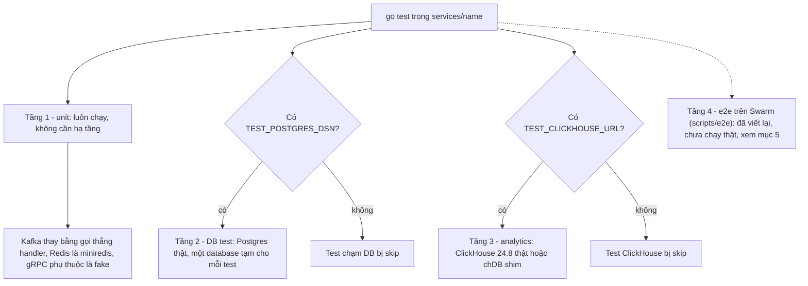
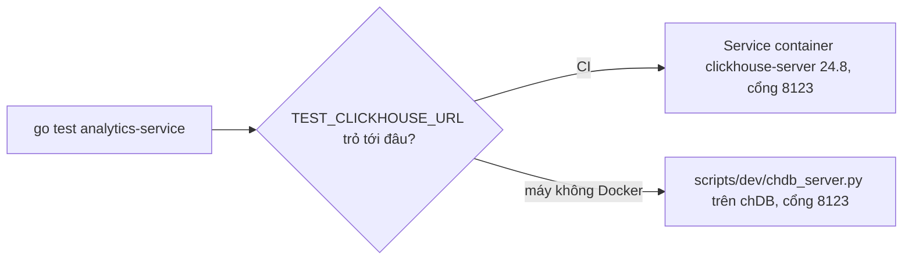
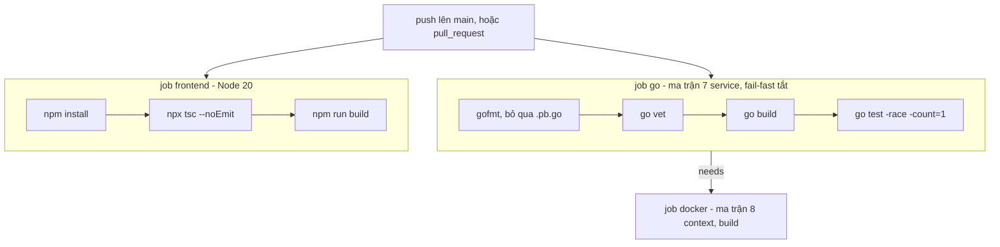

# Kiểm thử

## 1. Chạy test

Các tầng kiểm thử và điều kiện chạy:



Tầng 1 luôn chạy; tầng 2 và 3 tự bật khi có biến môi trường, nếu thiếu thì test **bị skip** chứ không fail. Tầng 4 cần cả hệ thống chạy trên Swarm và hiện không còn khớp API.

Mỗi service là một Go module riêng (Go 1.25): chạy từ `services/<name>`.

```bash
cd services/<name> && gofmt -l . && go vet ./... && go build ./... && go test -race -count=1 ./...
cd apps/frontend && npx tsc --noEmit && npm run build
```

**Máy không có Go**: chạy test trong container, ví dụ (kèm Postgres 16 tạm để test DB và migration):

```bash
docker run -d --name pgtest -p 55432:5432 -e POSTGRES_PASSWORD=postgres postgres:16-alpine
docker run --rm --network host -v "$PWD/services/order-service":/src -w /src -e GOTOOLCHAIN=auto \
  -e TEST_POSTGRES_DSN="host=127.0.0.1 port=55432 user=postgres password=postgres sslmode=disable" \
  golang:1.25-alpine sh -c 'gofmt -l . ; go build ./... && go vet ./... && go test -count=1 ./...'
docker rm -f pgtest
```

Test migration goose (`services/<svc>/internal/migrate/migrate_test.go`, 5 service Postgres) **cần `TEST_POSTGRES_DSN`** (không có thì skip): DB trống, chạy hai lần (idempotent), DB cũ do `AutoMigrate` tạo có sẵn dữ liệu. Khi sửa file trong `migrations/` hãy so thêm `pg_dump --schema-only` giữa DB cũ và DB do goose tạo.

Bảy service: `api-gateway`, `auth-service`, `user-service`, `product-service`, `order-service`, `payment-service`, `analytics-service` (CI chạy đủ bảy trong ma trận `.github/workflows/ci.yml`).

### Biến môi trường

| Biến | Dùng cho | Khi thiếu |
|---|---|---|
| `TEST_POSTGRES_DSN` | auth, user, product, order, payment (mọi test chạm DB) | test **bị skip** |
| `TEST_CLICKHOUSE_URL` | analytics-service (`internal/ch`, `internal/store`, `internal/service/service_ch_test.go`) | test **bị skip** |

```bash
export TEST_POSTGRES_DSN="host=localhost port=5432 user=postgres password=postgres sslmode=disable"
export TEST_CLICKHOUSE_URL="http://127.0.0.1:8123"
```

Test DB tạo một database tạm (`CREATE DATABASE …_test_<rand>`) cho **mỗi test** rồi xoá, nên role phải có quyền tạo database. Test ClickHouse tạo database riêng cho mỗi test (`store_test.go`). Không test nào cần Kafka/Redis thật: Kafka được thay bằng handler gọi trực tiếp, Redis bằng `miniredis`, gRPC phụ thuộc bằng fake nhúng interface client.

### Postgres cục bộ không cần Docker
`initdb`/`pg_ctl` từ `/usr/lib/postgresql/16/bin` dưới user OS `postgres` (thư mục dữ liệu ngoài `/tmp/claude-*`), rồi `export TEST_POSTGRES_DSN="host=localhost port=5433 user=postgres sslmode=disable"`.

### ClickHouse cho test: server thật hoặc chDB shim



Cả hai cùng giao diện HTTP nên lệnh test không đổi, chỉ khác `TEST_CLICKHOUSE_URL` trỏ vào đâu.

- **CI** chạy ClickHouse **24.8** thật (service container, `TEST_CLICKHOUSE_URL=http://localhost:8123`).
- **Máy không có Docker**: `scripts/dev/chdb_server.py` giả lập giao diện HTTP của ClickHouse (GET/POST `/ping`, `/?query=…&param_x=…`, phần thân nối vào câu lệnh cho `INSERT … FORMAT JSONEachRow`, tham số `database`) trên **chDB** (engine ClickHouse nhúng) để SQL thật của analytics-service chạy trên engine thật. Chỉ dùng cho TEST (bỏ qua auth, một session có khoá).

```bash
pip install chdb                         # SQL đã được xác thực trên chDB 26.9
python3 scripts/dev/chdb_server.py --port 8123 --path /var/tmp/chdb-data &
cd services/analytics-service && TEST_CLICKHOUSE_URL=http://127.0.0.1:8123 go test -race -count=1 ./...
```

Khác biệt chDB ↔ ClickHouse server có thể có ở chi tiết hiếm; bản 24.8 trong CI là phép thử cuối.
- Sinh traffic giả để xem dashboard (DEV): `python3 scripts/dev/gen_traffic.py --api https://api.marketplace.swarm.localhost --visitors 200 --products 1-60` (chỉ gửi loại event của client; đơn/thanh toán phải đặt thật qua UI/API).

### CI pipeline



`.github/workflows/ci.yml`: job `go` chạy kèm service container Postgres 16-alpine và ClickHouse 24.8 nên `TEST_POSTGRES_DSN` và `TEST_CLICKHOUSE_URL` đều được đặt. Job `docker` chờ job `go` (không chờ `frontend`), build 7 service Go cùng `apps/frontend` bằng buildx. Ngoài ra có job `compose-validate` (`docker compose config -q` cho 3 file stack với env giả, và shellcheck `scripts/*.sh`) và job `push-images`: chỉ chạy khi push lên `main` hoặc tag `v*` (không chạy cho PR), đẩy 8 image lên `ghcr.io/<owner>/<name>` bằng `GITHUB_TOKEN` (tag sha ngắn, `latest` trên nhánh mặc định, semver). Hai job mới **chưa chạy trên GitHub**; máy soạn code chưa có `actionlint`/`shellcheck` để lint.

## 2. Phạm vi từng bộ test

| Khu vực | File | Nội dung chính |
|---|---|---|
| Đơn: định giá & checkout | `order-service/internal/service/checkout_test.go` | `toMinor` làm tròn cent; tách đơn theo store; giá luôn từ catalog; idempotency theo (buyer, key); validate (key, method, địa chỉ, ghi chú); preview báo `issue` không lỗi; luật phí ship (flat / free-ship) |
| Đơn: vòng đời | `…/service/flow_test.go` | online happy path đến trả hàng; COD; hết hàng chỉ làm `FAILED` đúng đơn đó và payment chỉ phủ phần còn lại; đơn quá hạn `EXPIRED` + trả hàng; quy tắc huỷ & hoàn tiền; cửa sổ trả hàng & từ chối; tự giao hàng; đọc theo scope; migrate `SUCCESS→CONFIRMED`; `payment.refunded`; tuần tự hoá thao tác đồng thời |
| Đơn: giỏ | `…/service/cart_test.go` | vòng đời giỏ; vấn đề phát sinh sau khi thêm; merge giỏ khách; trần 50 sản phẩm; checkout từ giỏ chỉ xoá dòng đã đặt |
| Đơn: state machine | `…/repository/statemachine_test.go` | bảng `transitions` (ai được chuyển gì), terminal không có đường ra, `errors.Is(ErrNotAllowed)`, đơn vị nhỏ |
| Payment | `payment-service/internal/service/service_test.go` (20 test) | idempotent tạo payment; kết quả từng thẻ test; không lưu dữ liệu thẻ; validate thẻ; 5 lần lỗi ⇒ `FAILED`; 3-D Secure/OTP; thẻ timeout trả lời bằng webhook; webhook đôi chỉ trả một lần; webhook sau hạn vẫn `SUCCEEDED`; ví & chuyển khoản; chữ ký + idempotency webhook; retry/bỏ cuộc; payment thuộc đúng buyer; huỷ & hết hạn; hoàn tiền; admin refund/force; consumer; xác nhận đồng thời chỉ trả một lần; yêu cầu secret webhook |
| Kho & catalog | `product-service/internal/service/product_service_test.go`, `catalog_test.go` | giữ hàng all-or-nothing, giao trùng/đồng thời, không bán quá tồn, trả hàng đúng một lần, owner check, giá trị 0, phân trang; trường catalog + validate; tìm kiếm không dấu + bộ lọc; cây danh mục (đếm, quy tắc ≤3 cấp); quy tắc status (`banned` chỉ admin); reserved → sold; adjust & ledger (quyền xem); danh sách tồn thấp; `domain_events` được phát & xuất bản; `slugify` |
| Auth | `auth-service/internal/service/auth_service_test.go`, `admin_test.go` | whitelist role, bcrypt, lỗi login thống nhất, loại token, đổi mật khẩu vô hiệu token cũ, chỉ tạo employee; bootstrap admin (idempotent, không đè mật khẩu, admin không đăng ký được) |
| User | `user-service/internal/service/address_service_test.go` | địa chỉ đầu là mặc định & chỉ một mặc định; cô lập theo user; giới hạn 10 + validate |
| Analytics | `analytics-service/internal/store/store_test.go` (ClickHouse) | migrate idempotent; **định nghĩa doanh thu**; giao lại idempotent; bucket theo giờ VN; top sản phẩm/funnel/scope store; payments/traffic/search/health; low-stock; validate scope & range |
| | `internal/ingest/ingest_test.go`, `internal/store/sink_test.go`, `internal/service/service_test.go`, `internal/server/server_test.go`, `internal/service/service_ch_test.go`, `internal/ch/client_test.go` | whitelist event, giới hạn/che PII, đồng hồ client ±24 h, consent; map event Kafka → hàng; sink gom lô/retry/rớt khi đầy buffer; luật truy cập báo cáo; đếm accepted/rejected; map gRPC; cache; client HTTP |
| Gateway: handler | `api-gateway/internal/handler/*_test.go` | quyền sở hữu order/buyer/store/product; trường do client điều khiển bị bỏ qua; ánh xạ lỗi; search không lộ hàng ẩn & che tồn; endpoint seller dùng store từ token; checkout cần `Idempotency-Key`; actor từ token; payment nhãn MÔ PHỎNG, **không echo body có dữ liệu thẻ**, checkout kèm payment; analytics: scope lấy từ token, lỗi → HTTP; tracking: gắn danh tính phía server, best-effort, giới hạn, `identify`, ip-hash xoay theo ngày |
| Gateway: middleware & route | `internal/middleware`, `internal/router/router_test.go` | JWT loại/hạn/alg, thu hồi theo `pwd_version`, kiểm role, rate limit nguyên tử, body limit 413, CORS allow-list, **bảng truy cập route** (§3), `/admin/system/health` |
| `pkg/ops` | `services/*/pkg/ops/ops_test.go` | liveness không đụng dependency; ready/degraded/not-ready; lỗi đã làm sạch; timeout; cache; draining; nhãn metric; test socket thật cho cổng admin + gRPC health. **Bảy bản phải giống hệt**: `md5sum services/*/pkg/ops/ops.go` (cũng `pkg/events/events.go` ở product/order/payment và `kafkaimpl/*`) |

### Bảng kiểm tra truy cập trong `router_test.go`
Test dạng bảng, mỗi dòng là `{method, path, wrongRole}` (`TestCatalogRouteAccessRules`, `TestOrderRouteAccessRules`):
- **không token ⇒ 401** và **token đúng cú pháp nhưng sai role ⇒ 403** – cả hai bị middleware chặn trước khi chạm handler/gRPC (nên không cần fake service);
- `TestPublicRoutesNeedNoToken`: các route công khai (`/search`, `/categories`, `/products*`, `/payments/methods`, `/health`…) không bao giờ 401/403, còn `/users/buyers/1`, `/users/sellers/1` vẫn 401;
- token công khai nhưng **sai** (`Bearer not-a-jwt`) ⇒ 401 chứ không bị coi là ẩn danh;
- `TestEventsRoutes` là **test hồi quy** cho lỗi dùng `router.Use(authenticated)` toàn cục làm mọi route công khai trả 401 (ADR-19): `/events` rỗng ⇒ 400 (không phải 401), `/events/identify` ẩn danh ⇒ 401;
- `TestOrderUpdateEndpointIsNotExposed`: `PUT /orders/:id` phải 404.
**Thêm route mới** ⇒ thêm một dòng vào bảng (role *sai* điển hình) và, nếu route công khai, vào `TestPublicRoutesNeedNoToken`.

## 3. Thẻ test thanh toán (MÔ PHỎNG)
Danh sách đầy đủ + hành vi: [04_API_REFERENCE.md §7](../design/04_API_REFERENCE.md). Tóm tắt: `4242 4242 4242 4242` thành công · `4000 0000 0000 0002` declined · `…9995` thiếu tiền · `…3220` 3-D Secure (OTP `123456`) · `…0119` provider_error · `…0341` timeout (webhook sau 30 s) · `…0259` webhook đôi · `…0067` webhook sau hạn. Hằng số nằm ở `payment-service/internal/service/confirm.go`; thẻ khác ⇒ `do_not_honor`. Với test nhanh đặt `MOCK_WEBHOOK_DELAY_MS`, `MOCK_TRANSFER_DELAY_MS`, `MOCK_TIMEOUT_DELAY_MS` nhỏ; `ENV=dev` mở `POST /admin/dev/payments/:id/force`.

## 4. Viết test
- Giả một gRPC dependency bằng struct nhúng interface client được sinh ra, chỉ ghi đè method cần (`fakeProductClient`, `fakeOrderClient`, …).
- Test gateway dựng engine gin với middleware giả set `userID`/`userRole`; Redis là `miniredis`.
- Ưu tiên test tầng service với Postgres thật (khoá hàng, `UPDATE` có điều kiện, `NUMERIC` khác hẳn mock) và ClickHouse thật/chDB cho SQL báo cáo.
- Mỗi thay đổi hành vi phải kèm test (CLAUDE.md). Hành vi bất đồng bộ qua Kafka được test bằng cách gọi trực tiếp handler consumer (`UpdateOrderStatusByKafka`, `HandlePaymentSucceeded`, …) và `events.PublishBatch`.

## 5. Kiểm thử trên hạ tầng thật (Docker Swarm) – đã viết lại, **chưa chạy thật**

> **Trạng thái 🟡**: bộ e2e, `resilience.sh` và load test dưới đây đã được viết lại theo API hiện tại (checkout theo store, `Idempotency-Key`, thanh toán mô phỏng), nhưng **chưa từng chạy trên stack thật** (không có Swarm/gateway trong môi trường soạn code). Mới kiểm `node --check`, `bash -n`, `run.mjs --list`, và `load.mjs` chạy với mock HTTP. Mã HTTP và trường JSON suy từ `docs/design/04_API_REFERENCE.md` cùng handler/proto nên lần chạy đầu có thể lệch ở vài chỗ nhỏ.

```bash
./scripts/deploy.sh                                   # sau build-images.sh
scripts/e2e/run-in-swarm.sh                           # chạy run.mjs từ container tạm trong mạng marketplace-net
scripts/e2e/run-in-swarm.sh --only 03,04              # chỉ chạy vài kịch bản (hoặc --skip 09)
RATE_LIMIT_TEST=1 scripts/e2e/run-in-swarm.sh         # thêm kịch bản rate limit 429
scripts/e2e/resilience.sh                             # tiêm lỗi, chạy cả bộ A..I
scripts/e2e/resilience.sh A F                         # hoặc chọn từng chữ
```

Chạy trực tiếp ngoài Swarm: `API_URL=https://api.<host> node scripts/e2e/run.mjs [--list] [--only 03,04] [--skip 09]`. Thoát `0` nếu đạt, `1` nếu có lỗi. Kịch bản `00` (setup) luôn chạy và là nền: hỏng thì dừng cả bộ.

### 5.1 Kịch bản e2e (`scripts/e2e/scenarios/`)

| # | Nội dung |
|---|---|
| 00 | setup: 2 shop, 2 buyer, admin, địa chỉ |
| 01 | auth / RBAC: sai mật khẩu, refresh, đổi mật khẩu thu hồi token |
| 02 | catalog: tìm kiếm, che tồn ở mức 20, quyền sở hữu, điều chỉnh tồn + sổ cái |
| 03 | giỏ, preview, checkout: kiểm `Idempotency-Key` (gửi lại cùng key trả `replayed:true`, tồn chỉ giữ một lần), tách đơn theo store |
| 04 | thanh toán: thẻ 4242/0002/9995, 3DS, 0259, ví, chuyển khoản, COD, huỷ payment, webhook ký HMAC |
| 05 | vòng đời đơn: huỷ và trả kho, huỷ đơn đã PAID thì hoàn tiền |
| 06 | trả hàng / hoàn tiền: duyệt, từ chối, trả lần hai, admin hoàn tiền |
| 07 | cô lập chéo shop / buyer; bỏ qua trường giả mạo trong body |
| 08 | `/events` → chờ flush → báo cáo seller/admin, cô lập analytics giữa 2 shop, `/admin/system/health` |
| 09 | hết hạn giữ hàng và force payment (tuỳ chọn) |
| 10 | rate limit 429 (tuỳ chọn) |

Mã nguồn: `lib/` (`config`, `client` tự chờ và thử lại khi 429, `testkit`, `fixtures`), `run.mjs`, `resilience.mjs` (từng bước in một dòng JSON, do `resilience.sh` gọi), `run-in-swarm.sh`.

Biến môi trường:

| Biến | Ý nghĩa |
|---|---|
| `API_URL` | địa chỉ gateway |
| `ADMIN_USERNAME` / `ADMIN_PASSWORD` | mặc định lấy từ `ADMIN_BOOTSTRAP_*`; không có thì bỏ qua các bước admin |
| `PAYMENT_WEBHOOK_URL` + `PAYMENT_WEBHOOK_SECRET` | bật bước webhook |
| `E2E_DEV_MODE=1` | kiểm force payment (stack phải chạy `ENV=dev`) |
| `E2E_EXPIRY_TTL_MIN=<n>` | kiểm hết hạn giữ hàng; cần `ORDER_PAYMENT_TTL_MIN` nhỏ và khớp `n` |
| `RATE_LIMIT_TEST=1` | bật kịch bản 10 |
| `E2E_ANALYTICS_WAIT_MS` | thời gian chờ flush analytics |

Lưu ý khi chạy thật:

- `/auth/*` mặc định giới hạn 20 lượt/phút/IP mà bộ e2e dùng khoảng 20 lượt. Client tự chờ khi gặp 429 nhưng sẽ chậm; nên nâng `AUTH_RATE_LIMIT_PER_MINUTE` và `RATE_LIMIT_PER_MINUTE` (vd. 1000) khi chạy.
- Các chỗ chưa chắc về hành vi, test đã nới điều kiện hoặc chấp nhận nhiều mã: mã trả về của identify (200 hoặc 202); mã khi giỏ vượt 99 hoặc sản phẩm không tồn tại (400/422/404); tên trường `failure_code` sau khi thẻ bị từ chối; cách webhook xử lý khi payment đang `REQUIRES_ACTION`.
- Hai giả định docs chưa nói rõ: (1) kịch bản seller dùng `GET /seller/products` trả 200 làm dấu hiệu store đã có `store_id`; (2) kịch bản 08 giả định seller B chưa có đơn PAID/DELIVERED nên doanh thu bằng 0. Nếu 05/06/07 đụng tới shop B thì cần chỉnh lại.

### 5.2 Tiêm lỗi (`resilience.sh`)

| Chữ | Tình huống | Kỳ vọng |
|---|---|---|
| A | ClickHouse down | analytics 503, nhưng đặt hàng và `POST /events` vẫn OK |
| B | Kafka down | hệ thống phục hồi khi Kafka về |
| C | payment-service down | các luồng không cần payment vẫn chạy |
| D | product-service down | đặt hàng 503 |
| E | Redis down | xem kết quả trong script |
| F | Postgres down | các service `/ready` 503, `/healthz` vẫn 200, tự hồi phục |
| G | order-service down sau khi nhận đơn | đơn được xử lý khi service về |
| H | rolling restart mọi service | không mất dữ liệu |
| I | Postgres restart | tự hồi phục |

Dừng/bật bằng `docker service scale` kèm chờ ổn định; probe `/ready` gọi thẳng `http://<service>:8081` từ container trong mạng `marketplace-net`. Cũng **chưa chạy thật**.

### 5.3 Load / soak test (`scripts/load/`)

`scripts/load/load.mjs` (README tiếng Việt cùng thư mục) phát request theo RPS cố định: browse, search, order (COD, có `Idempotency-Key`), events. Tham số: `RPS`, `DURATION`, `RAMP`, `MIX`, `BUYERS`, `PRODUCTS`, `MAX_INFLIGHT`, `MAX_ERR_PCT`, `P95_MS`. Tự refresh token để soak dài vẫn chạy; in bảng p50/p95/p99; thoát `1` nếu vượt ngưỡng. Mới thử với mock HTTP, chưa chạy vào stack thật.

### 5.4 Công cụ dữ liệu (datagen / backfill / export)

Cả ba chạy test với Postgres / ClickHouse thật trong Docker (máy không có Go thì chạy Go trong `golang:1.25-alpine`). Chưa chạy trên Swarm.

| Công cụ | Lệnh | Biến môi trường |
|---|---|---|
| datagen | `python3 -m unittest discover -s scripts/datagen/tests -t scripts/datagen -v` | tích hợp cần `DATAGEN_TEST_PSQL` (ví dụ `"docker exec -i dg-pg psql -U postgres"`) và `DATAGEN_TEST_CH_URL`; thiếu thì tự bỏ qua. Test dựng DB bằng đúng các file `services/<svc>/migrations/*.sql` (phần goose Up) và DDL `events_raw` lấy từ `schema.go`, nên lệch schema thì test hỏng |
| backfill / reconcile | `go test ./internal/backfill ./cmd/backfill` (trong `services/analytics-service`) | `TEST_POSTGRES_DSN`, `TEST_CLICKHOUSE_URL` (tuỳ chọn `TEST_CLICKHOUSE_USER` / `TEST_CLICKHOUSE_PASSWORD`) và `SERVICES_DIR` (thư mục `services/` để đọc migration của order / payment / product; trong Docker mount `-v $PWD/services:/services:ro -e SERVICES_DIR=/services`). Docker có thể cần `-e GOFLAGS=-mod=mod`. Thiếu biến hoặc file migration thì skip |
| export | `scripts/export/tests/run_tests.sh` | tự dựng ClickHouse 24.8 (cổng 18125) rồi dọn; có `pyarrow` thì nhánh Parquet cũng chạy |

Lưu ý: các test ClickHouse **cũ** của analytics-service gửi không có mật khẩu, nên với ClickHouse có mật khẩu chúng fail (không phải lỗi mới); để chạy cả module dùng ClickHouse không mật khẩu (`-e CLICKHOUSE_SKIP_USER_SETUP=1`).

## 6. Chưa được kiểm thử
- Docker/Swarm/Traefik/ClickHouse server **chưa từng chạy** trong sandbox soạn tài liệu: deploy, healthcheck Docker, nhãn Traefik, dashboard Grafana là chưa chạy thật (CI build image và chạy ClickHouse 24.8 cho test; e2e, resilience, load và `wait-ready.sh` đã viết nhưng chưa chạy trên stack thật).
- Browser-level frontend test; gRPC server adapter; `DataHealth` đối soát (chưa nối; CLI `reconcile` đã có, xem mục 5.4).
