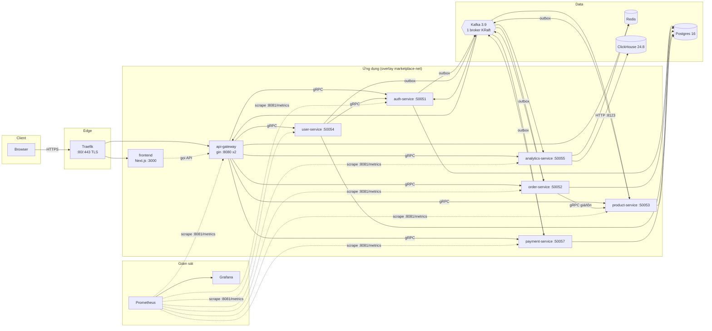

# Tổng quan hệ thống

> Mini Marketplace là sàn thương mại điện tử mô hình **microservices hướng sự kiện**: người mua duyệt hàng, đặt đơn, thanh toán (mô phỏng); người bán quản lý cửa hàng; admin giám sát cả sàn. Đây cũng là **nền hạ tầng** để sau này gắn các chức năng AI (xem [../ai/README.md](../ai/README.md)).
> Số liệu replica / giới hạn RAM / cổng dưới đây lấy từ `deploy/*.yml` (sự thật nằm ở code; nếu khác thì code đúng).

## 1. Sơ đồ tổng thể

Quy tắc xuyên suốt: trình duyệt **chỉ nói chuyện với gateway**; service nội bộ nói chuyện nhau bằng **gRPC** (đồng bộ) và **Kafka** (bất đồng bộ, qua *transactional outbox*). Mọi service Go có thêm cổng quản trị nội bộ `:8081` (`/health /healthz /ready /readyz /metrics /version`), không publish ra ngoài.

## 2. Service ứng dụng: nhiệm vụ, replica, tài nguyên

| Service | Cổng nghiệp vụ | Replica | RAM tối đa | Nhiệm vụ | Dữ liệu sở hữu |
|---|---|---|---|---|---|
| `traefik` (v3.6) | 80 / 443 (publish) | 1 (chỉ trên node manager) | – | Kết thúc TLS, định tuyến theo host, dashboard (basic auth), healthcheck replica gateway qua `/ready` | – |
| `frontend` | 3000 | 1 | – | Giao diện Next.js 14 (buyer / seller / admin); chỉ gọi gateway | – |
| `api-gateway` | 8080 (REST) | **2** | 384 MB | REST → gRPC, JWT, RBAC, kiểm sở hữu, CORS, rate limit (Redis), giới hạn body, `POST /events` tracking, proxy báo cáo analytics, `/admin/system/health` | Redis (rate limit, `pwd_version`) |
| `auth-service` | 50051 (gRPC) | 1 | 256 MB | Đăng ký / đăng nhập / refresh / đổi mật khẩu, role (`buyer`, `seller_admin`, `seller_employee`, `admin`), phát JWT, bootstrap admin | Postgres `accounts…` |
| `user-service` | 50054 (gRPC) | 1 | 256 MB | Hồ sơ buyer, store (seller), **địa chỉ giao hàng** | Postgres |
| `product-service` | 50053 (gRPC) | 1 | 256 MB | Catalog, danh mục, tìm kiếm full-text không dấu, **tồn kho** (available / reserved / sold + sổ cái), giữ / trả / xuất kho theo Kafka | Postgres, outbox |
| `order-service` | 50052 (gRPC) | 1 | 256 MB | **Giỏ hàng**, checkout tách đơn theo store (idempotent), định giá phía server, máy trạng thái đơn, worker hết hạn / tự giao hàng | Postgres, outbox |
| `payment-service` | 50057 (gRPC) | 1 | 256 MB | Thanh toán **MÔ PHỎNG** (`mockpay`: thẻ test, ví, chuyển khoản), webhook ký HMAC, hoàn tiền | Postgres, outbox |
| `analytics-service` | 50055 (gRPC) | 1 | 256 MB | Nhận tracking (gRPC từ gateway) + event Kafka → ClickHouse; trả báo cáo theo phạm vi platform / store; cache Redis | ClickHouse |

Ghi chú:
- Chỉ **gateway chạy 2 replica** (có Redis dùng chung nên scale ngang được). Các service còn lại 1 replica: đủ cho demo. Worker outbox dùng `FOR UPDATE SKIP LOCKED` nên về lý thuyết chạy được nhiều replica, nhưng chưa có kiểm chứng chạy nhiều replica cho các service này (xem [../planning/01_OPEN_ISSUES.md](../planning/01_OPEN_ISSUES.md)).
- `payment-service` và `analytics-service` là **non-critical** với gateway: chúng chết thì cửa hàng vẫn chạy (COD, không có dashboard); xem ma trận readiness ở [../instruction/03_RUNBOOK.md](../instruction/03_RUNBOOK.md).
- Địa chỉ gRPC giữa các service được **hard-code** (`internal/config/grpc_config.go`), không có biến `*_SERVICE_ADDR`.

## 3. Hạ tầng dùng chung

| Thành phần | Image / stack | Replica | Vai trò |
|---|---|---|---|
| Postgres | `postgres:16-alpine` (`marketplace-infra`) | 1 | Một database chung, mỗi service sở hữu bảng riêng (không join chéo); bảng outbox `domain_events` dùng chung |
| Redis | `redis:8.2.1-alpine` (AOF) | 1 | Rate limit, `pwd_version`, cache báo cáo `analytics:v1:*` |
| Kafka | `apache/kafka:3.9.0`, KRaft, 1 broker (`broker1`) | 1 | Bus sự kiện; 3 partition / topic, retention 7 ngày |
| ClickHouse | `clickhouse/clickhouse-server:24.8` | 1 (RAM 2 GB) | Kho phân tích (dẫn xuất): `events_raw`, bảng `fact_*`, `dim_products` |
| Prometheus | `prom/prometheus:v2.55.1` (`marketplace-obs`) | 1 (768 MB) | Thu metric `:8081/metrics` của mọi service + exporter |
| Grafana | `grafana/grafana:11.3.0` | 1 | 5 dashboard (chỉ xem, **không cảnh báo**) |
| cAdvisor, node-exporter | – | **global** (mỗi node) | Metric container / host |
| postgres / redis / kafka-exporter | – | 1 | Metric hạ tầng |

Mạng overlay dùng chung tên cố định **`marketplace-net`**. Ba stack Swarm: `marketplace-infra`, `marketplace-obs`, `marketplace`.

## 4. Vai trò người dùng

| Vai trò | Làm được gì | Không làm được |
|---|---|---|
| Khách (chưa đăng nhập) | Xem catalog, tìm kiếm, gửi tracking ẩn danh | Giỏ hàng, đặt đơn |
| `buyer` | Giỏ hàng, địa chỉ, checkout, thanh toán (mô phỏng), hủy / trả hàng, xem đơn của mình | Xem đơn người khác |
| `seller_admin` / `seller_employee` | Quản lý store: sản phẩm, tồn kho, đơn của store (ship / deliver / duyệt trả hàng), analytics của store | Dữ liệu store khác |
| `admin` | Toàn sàn: analytics nền tảng, thanh toán, danh mục, trạng thái hệ thống | Không tự đăng ký (chỉ bootstrap qua biến môi trường) |

## 5. Dữ liệu và nguyên tắc

- **Định danh chỉ lấy từ JWT**; giá, tổng tiền, trạng thái không bao giờ tin từ body request.
- **Tiền**: `NUMERIC(18,2)` trong Postgres, `float64` (VND) trên REST / gRPC, số nguyên trong phép tính, `*_minor` (1/100 VND) trong event Kafka. Múi giờ nền tảng cố định `Asia/Ho_Chi_Minh`.
- **Doanh thu analytics** = tổng đơn `PAID` (online) hoặc `DELIVERED` (COD) trừ hoàn tiền.
- **Thanh toán chỉ là mô phỏng**; không lưu số thẻ.
- Chi tiết: [../design/02_DATA_MODEL.md](../design/02_DATA_MODEL.md), [../design/03_EVENTS_KAFKA.md](../design/03_EVENTS_KAFKA.md), [../decisions/01_ADR_LOG.md](../decisions/01_ADR_LOG.md).

## 6. Đọc tiếp

- Một request đi như thế nào, có sơ đồ: [02_REQUEST_FLOWS.md](02_REQUEST_FLOWS.md)
- Chạy hệ thống, địa chỉ các giao diện: [../instruction/01_QUICKSTART.md](../instruction/01_QUICKSTART.md)
- Đã làm được gì: [../process/01_IMPLEMENTATION_STATUS.md](../process/01_IMPLEMENTATION_STATUS.md)
