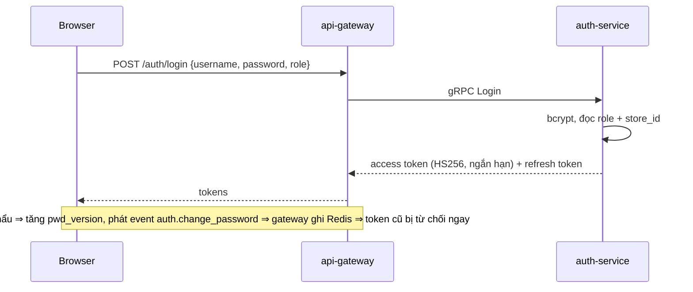
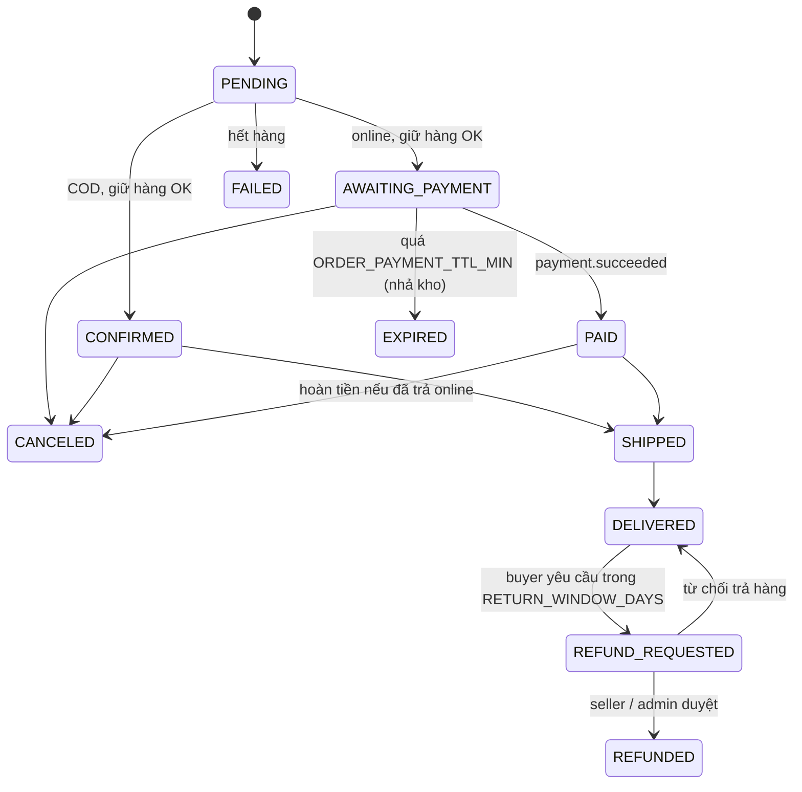
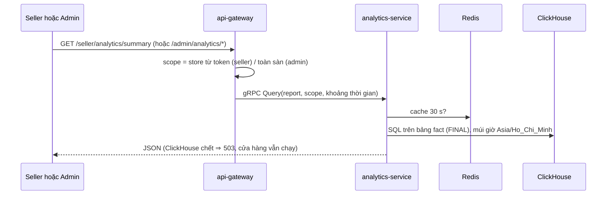

# Một request đi như thế nào

> Các sơ đồ dưới đây mô tả luồng **đang có trong code**. Chi tiết từng route: [../design/04_API_REFERENCE.md](../design/04_API_REFERENCE.md); chi tiết event: [../design/03_EVENTS_KAFKA.md](../design/03_EVENTS_KAFKA.md). Sơ đồ dùng Mermaid (GitHub tự vẽ).

## 1. Mọi request REST đi qua gateway

```mermaid
sequenceDiagram
  autonumber
  participant B as Browser
  participant T as Traefik
  participant G as api-gateway
  participant R as Redis
  participant S as Service gRPC
  B->>T: HTTPS api.<host>/orders (Bearer JWT)
  T->>G: chọn replica có /ready = 200
  G->>G: CORS → giới hạn body → log → rate limit toàn cục
  G->>R: đếm request theo IP (Lua; Redis chết thì cho qua)
  G->>G: AuthMiddleware (gắn theo route): kiểm JWT type=access, pwd_version
  G->>G: AuthorizationMiddleware: role có được vào nhóm route không
  G->>S: gRPC (userID / storeID lấy từ token, không từ body)
  S-->>G: kết quả hoặc status.Error(codes.X)
  G-->>B: JSON (gRPC code → HTTP status ở handler/helpers.go)
```

Điểm cần nhớ: auth gắn **theo từng route / nhóm**, không `router.Use` toàn cục; kiểm sở hữu (đơn của ai, store của ai) làm ở handler; bảng route → quyền nằm ở `services/api-gateway/internal/router/router_test.go`.

## 2. Đăng nhập



## 3. Duyệt hàng và tracking (không đăng nhập vẫn được)

```mermaid
sequenceDiagram
  participant B as Browser (SDK tracking)
  participant G as api-gateway
  participant P as product-service
  participant AN as analytics-service
  participant CH as ClickHouse
  B->>G: GET /search?q=… hoặc /products/:id
  G->>P: gRPC (full-text không dấu, chỉ sản phẩm active)
  P-->>B: danh sách / chi tiết (tồn kho hiển thị dạng mức, ví dụ "20+")
  B->>G: POST /events [≤50 event, ≤64 KB] (page_view, product_click, add_to_cart…)
  G->>G: gắn user/role/store/hash IP từ JWT & request; rate limit riêng
  G->>AN: gRPC IngestEvents
  AN->>AN: whitelist loại event, consent, che PII
  AN->>CH: insert theo lô (2 s hoặc 5000 dòng) vào events_raw
  G-->>B: 202 (kể cả khi ClickHouse đang chết)
```

Tracking **không đi qua Kafka** (ADR-13). Analytics down ⇒ mất event đang đệm; ClickHouse down quá 100.000 dòng đệm ⇒ rớt dòng cũ nhất.

## 4. Đặt hàng → thanh toán → giao hàng (luồng chính)

```mermaid
sequenceDiagram
  autonumber
  participant B as Buyer
  participant G as api-gateway
  participant O as order-service
  participant P as product-service
  participant K as Kafka
  participant PAY as payment-service
  participant AN as analytics-service
  B->>G: POST /orders (Idempotency-Key)
  G->>O: gRPC CreateOrders (+ snapshot địa chỉ)
  O->>P: gRPC lấy giá & tồn (giá luôn từ catalog)
  O->>O: 1 transaction: checkouts + orders PENDING (mỗi store 1 đơn) + outbox
  O-->>K: order.create_order, order.status_changed (qua outbox worker)
  K-->>P: giữ hàng (available−, reserved+, ledger)
  P-->>K: product.validate_order
  K-->>O: PENDING → AWAITING_PAYMENT (online) / CONFIRMED (COD) / FAILED (hết hàng)
  O-->>K: payment.requested (khi mọi đơn của checkout rời PENDING)
  K-->>PAY: tạo payment REQUIRES_ACTION
  B->>G: POST /payments/:id/confirm (thẻ test / ví / chuyển khoản)
  G->>PAY: gRPC
  PAY-->>K: payment.succeeded (thẻ: ngay; ví/chuyển khoản: sau webhook giả có ký HMAC)
  K-->>O: đơn → PAID
  Note over O: Seller ship ⇒ SHIPPED (kho reserved→sold) ⇒ DELIVERED<br/>(seller / buyer xác nhận / tự giao sau AUTO_DELIVER_DAYS)
  K-->>AN: order.status_changed, payment.*, product.changed → fact_* ở ClickHouse
```

Trạng thái đơn và các nhánh phụ:



`FAILED`, `EXPIRED`, `CANCELED`, `REFUNDED` là trạng thái cuối. Ai được chuyển trạng thái nào nằm ở bảng `transitions` trong `services/order-service/internal/repository/statemachine.go`.

Đơn `PENDING` không huỷ được (kết quả giữ hàng đang bay). Đơn chưa trả tiền tự hết hạn sau `ORDER_PAYMENT_TTL_MIN` (mặc định 15 phút). Chi tiết: [../design/platform/04_ORDERS_PAYMENTS.md](../design/platform/04_ORDERS_PAYMENTS.md).

## 5. Báo cáo cho seller / admin



## 6. Sức khoẻ hệ thống (admin)

`GET /admin/system/health` → gateway gọi HTTP `:8081/ready` của cả 7 service rồi gom thành một bảng. Prometheus scrape `:8081/metrics` (qua DNS `tasks.<service>`), Grafana hiển thị. Cách đọc: [../instruction/03_RUNBOOK.md](../instruction/03_RUNBOOK.md).

## 7. Chỗ AI sẽ cắm vào (dự kiến, chưa có code)

Agent LLM **không** đọc DB trực tiếp: nó gọi lại REST của gateway bằng JWT của chính người dùng, nên RBAC / ownership / rate limit hiện có áp dụng nguyên vẹn. Tracking (mục 3) và fact (mục 4) là nguồn dữ liệu cho gợi ý; báo cáo (mục 5) là "semantic layer" cho trợ lý hỏi đáp số liệu. Xem [../ai/01_AI_SCOPES_OVERVIEW.md](../ai/01_AI_SCOPES_OVERVIEW.md).
