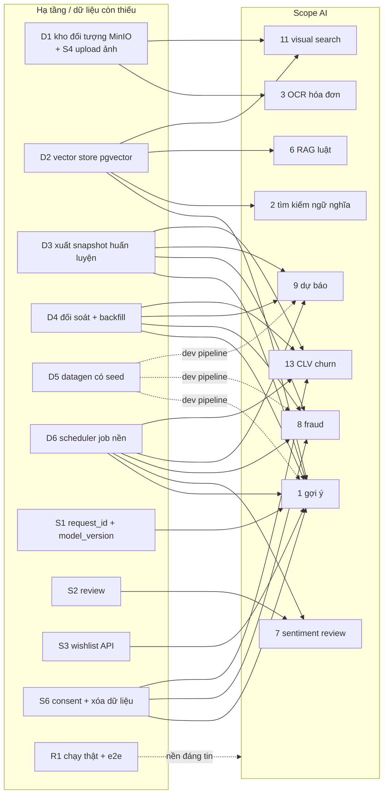
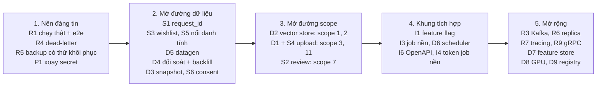

# Hạ tầng còn thiếu để triển khai một dự án lớn (AI) trên nền này

> Phạm vi: **chỉ phần hạ tầng / dữ liệu / vận hành**. Tầng LLM (`ai-service`, agent, prompt, quan sát LLM, eval agent) do chủ dự án tự xây sau nên **không** liệt kê ở đây. Nguồn: đối chiếu code, `deploy/*.yml`, CI và tài liệu hiện có; các vấn đề nhỏ hơn nằm ở [01_OPEN_ISSUES.md](01_OPEN_ISSUES.md).
> Cột "Cỡ": S = vài ngày, M = 1–3 tuần, L = hơn một tháng (ước lượng thô, không phải cam kết). "Chặn scope" dùng số thứ tự trong [../ai/01_AI_SCOPES_OVERVIEW.md](../ai/01_AI_SCOPES_OVERVIEW.md).

## Sơ đồ: thiếu gì chặn scope nào

Đọc sơ đồ: mũi tên là "phải có thì scope mới làm được". Mũi tên đứt nét là "giúp phát triển và tin cậy hơn".

## Khái niệm dùng trong tài liệu này
- **Dữ liệu tín hiệu** = những dấu vết hành vi / phản hồi mà mô hình học từ đó: người dùng xem gì, bấm gì, bỏ giỏ gì, mua gì, đánh giá mấy sao, trả hàng vì sao. Không có tín hiệu thì chưa có gì để học hay đo.
- **E2E (end-to-end)** = kịch bản kiểm thử chạy trên hệ thống đã deploy thật, đi qua toàn bộ chuỗi trình duyệt → Traefik → gateway → các service → Postgres / Kafka. Khác test đơn vị (chạy từng hàm, giả lập phụ thuộc).

## 1. Dữ liệu cho ML (thiếu nhiều nhất)

| # | Thiếu | Vì sao quan trọng | Hiện trạng | Hướng | Cỡ | Chặn scope |
|---|---|---|---|---|---|---|
| D1 | **Kho lưu đối tượng** (ảnh, hóa đơn, file dataset, model) | OCR, visual search, kiểm duyệt ảnh, lưu bộ dữ liệu / artifact mô hình đều cần | Không có MinIO / S3; ảnh sản phẩm chỉ là URL | MinIO thêm vào `infra.yml`, kiểm MIME / kích thước, presigned URL | M | 3, 11, 12 |
| D2 | **Vector store** | tìm kiếm ngữ nghĩa, gợi ý content-based, RAG | Postgres là `postgres:16-alpine` thuần, không có pgvector | đổi image có pgvector hoặc thêm Qdrant; quy trình index khi nhận `product.changed` | S–M | 1, 2, 6, 10, 11 |
| D3 | **Xuất dữ liệu huấn luyện có phiên bản** (snapshot theo ngày) | huấn luyện lặp lại được, chia train / valid / test theo thời gian | ✅ một phần: `scripts/export` (CSV / Parquet, profile `otto` / `rees46` / `orders` / `raw`, `manifest.json`, chia theo thời gian) đã chạy thật cục bộ; còn thiếu scheduler (D6) và kho đối tượng (D1); ClickHouse chỉ dựng lại ≤ 7 ngày từ Kafka, `events_raw` TTL 13 tháng | gắn lịch + đẩy ra kho đối tượng ([../design/07_DATA_PIPELINE.md](../design/07_DATA_PIPELINE.md)) | S–M | 1, 8, 9, 13 |
| D4 | **Backfill + đối soát Postgres ↔ ClickHouse** | số liệu làm nhãn / feature phải đúng | 🟡 CLI `backfill` / `reconcile` (analytics-service `cmd/backfill`) đã chạy thật cục bộ (MATCH, idempotent); còn thiếu: lịch đêm (D6), nối `data-health` (hiện vẫn `reconciliation: "not_implemented"`) và metric `mm_reconcile_diff_ratio`; `events_raw` không backfill được từ Postgres | nối `data-health` + lịch đêm | S–M | 1, 8, 9, 13 |
| D5 | **Bộ sinh dữ liệu giả có seed** (người dùng, phiên, đơn, review) | dev pipeline khi chưa có traffic thật; test hồi quy | ✅ `scripts/datagen` (synthetic + RetailRocket, `--seed`, `--reset`) sinh tài khoản, catalog, đơn, thanh toán, hoàn tiền, tồn kho, `events_raw`; đã kiểm tất định và nghiệp vụ trên DB thật; chưa thử bộ RetailRocket thật (chỉ fixture) | thêm bộ nguồn khác khi cần | S | tất cả (dev) |
| D6 | **Điều phối job nền / lịch** (huấn luyện, xuất dữ liệu, tính feature) | mọi mô hình batch cần chạy định kỳ | Không có scheduler; chỉ có worker nhúng trong từng service Go | cron trong Swarm hoặc Airflow / Dagster / Prefect; job có retry + log | M | 1, 7, 8, 9, 13 |
| D7 | **Feature store / kho đặc trưng** (offline + online cùng định nghĩa) | tránh lệch giữa huấn luyện và phục vụ | Không có; Redis chỉ dùng rate limit và cache báo cáo | bảng `features_*` ở ClickHouse + khóa Redis; định nghĩa một chỗ (YAML) | L | 1, 8, 13 |
| D8 | **Tài nguyên tính toán / GPU** | huấn luyện embedding, OCR, ASR… | service ứng dụng giới hạn 256–384 MB (ClickHouse 2 GB, Prometheus 768 MB), không có node GPU, không có kế hoạch tách tải | quyết định: thuê dịch vụ ngoài hay thêm node tính toán; tách khỏi node chạy shop | M | 3, 11, 1 (nặng) |
| D9 | **Registry mô hình + theo dõi thí nghiệm** | biết mô hình nào đang chạy, so sánh phiên bản | Không có | MLflow hoặc tương đương; lưu `model_version` | M | 1, 8, 9, 13 |

## 2. Tín hiệu và sự kiện chưa có

| # | Thiếu | Vì sao quan trọng | Hiện trạng | Cỡ | Chặn scope |
|---|---|---|---|---|---|
| S1 | **`request_id` + `model_version` trong tracking** | nối "gợi ý → hiển thị → bấm → mua" để đo CTR / CVR và học position bias | envelope hiện không có hai trường này (`impression` có `position`, `surface`) | S–M (đổi whitelist, migration ClickHouse, frontend) | 1, A/B |
| S2 | **Review / rating** | sentiment, tóm tắt review, tín hiệu chất lượng sản phẩm, review giả | không có API, bảng, UI | M | 7, một phần 1 |
| S3 | **Wishlist API** | tín hiệu quan tâm mạnh | chỉ có event `wishlist_add/remove` được whitelist | S | 1 |
| S4 | **Upload ảnh** | xem D1 | URL ≤ 8 ảnh / sản phẩm | M (cùng D1) | 3, 11 |
| S5 | **Nối danh tính ẩn danh → tài khoản** | gộp hành vi trước / sau đăng nhập | `identify` chỉ lưu thành event; chưa có bảng `identity_links` | S | 1 |
| S6 | **Consent có lưu + xóa dữ liệu người dùng** | huấn luyện chỉ trên dữ liệu được phép; quyền xóa | consent chỉ đi kèm từng event; chưa có `consents`, `DELETE /users/me/data` | M | tất cả dùng hành vi |
| S7 | **Lý do trả hàng / hủy**, tín hiệu "không quan tâm" | nhãn âm cho gợi ý và fraud | chưa thu thập lý do có cấu trúc | S | 1, 8 |
| S8 | **Thông tin giao hàng thực tế** (thời gian giao, hãng, tuyến) | ETA, logistics | giao hàng chỉ là đổi trạng thái; không có dữ liệu vận chuyển | M | 9 |
| S9 | **Dữ liệu thanh toán thật** | fraud thật | thanh toán chỉ mô phỏng (ADR-16) nên mô hình fraud học trên dữ liệu giả; cần bộ công khai ([../dataset/08_FRAUD_ANOMALY_RISK.md](../dataset/08_FRAUD_ANOMALY_RISK.md)) | – | 8 |

## 3. Độ tin cậy và khả năng mở rộng của nền

| # | Thiếu | Vì sao quan trọng khi tải tăng | Hiện trạng | Cỡ |
|---|---|---|---|---|
| R1 | **Chưa chạy thật** (e2e mới đã viết, chưa chạy) | không biết nền có đứng vững không | Swarm / Traefik / ClickHouse / Grafana chưa từng chạy thật; `scripts/e2e` đã viết lại cho API hiện tại (11 kịch bản) cùng `resilience.sh` A..I và `scripts/load`, chưa chạy lần nào (xem §7) | S–M |
| R2 | **Kiểm thử tải** (load / soak) | biết giới hạn trước khi thêm tải AI | 🟡 `scripts/load/load.mjs` đã viết (RPS cố định, p50/p95/p99), mới thử với mock HTTP, chưa chạy vào stack thật | S |
| R3 | **Kafka 1 broker, RF 1, không DLQ, không schema registry** | mất broker là mất bus; message độc bị bỏ sau 5 lần thử | `infra.yml`: một node KRaft | M |
| R4 | **Outbox dùng chung một bảng, dòng độc chặn đầu hàng** | event cho ML đứng im | ADR-23; chưa có dead-letter | M |
| R5 | **Postgres / ClickHouse / Redis đơn node, backup thủ công** | mất dữ liệu nguồn sự thật | runbook chỉ có hướng dẫn `pg_dump` tay; chưa có lịch / kiểm thử khôi phục | M |
| R6 | **Mỗi service Go 1 replica**, chưa kiểm chứng chạy nhiều replica | điểm nghẽn đơn; cập nhật gây gián đoạn | chỉ gateway 2 replica; 🟡 `update_config: start-first` / rollback đã viết, chưa thử trên Swarm thật; chưa kiểm chứng nhiều replica | M |
| R7 | **Thiếu tracing / request-id / metric nghiệp vụ** | gỡ lỗi nhiều tầng khi thêm dịch vụ mới | đã có metric RED + hạ tầng + metric nghiệp vụ (`mm_orders_*`, `mm_payments_*`, `mm_inventory_*`, `mm_grpc_client_*`; chưa chạy stack thật) và lag consumer qua kafka-exporter; đã có request-id xuyên service (🟡, chưa vào Kafka) và log tập trung Loki (🟡); chưa có tracing | M |
| R8 | **Không có hệ thống cảnh báo** | sự cố không ai biết | cố ý (ADR-12), chỉ Grafana xem tay | S–M |
| R9 | **gRPC: deadline / retry / circuit breaker** | một service chậm kéo sập chuỗi | 🟡 gateway đã có deadline (3 s đọc / 10 s ghi) + retry lệnh đọc (`Unavailable`, 3 lần); chưa retry lệnh ghi, chưa circuit breaker | M |
| R10 | **Migration Postgres có phiên bản** | thêm bảng cho AI / feature có kiểm soát | ✅ goose v3.26.0 cho 5 service (`services/<svc>/migrations`, chạy lúc khởi động, advisory lock); chưa chạy trên Swarm | M |

## 4. Điểm tích hợp để cắm dịch vụ mới

| # | Thiếu | Vì sao quan trọng | Hiện trạng | Cỡ |
|---|---|---|---|---|
| I1 | **Feature flag** (`GET /config/features`) | bật / tắt, canary từng tính năng | chưa có | S |
| I2 | **Gán nhóm A/B ổn định** + ghi nhóm lên mọi event | đo hiệu quả thật | chưa có | M |
| I3 | **Hàng đợi tác vụ dài** (OCR, huấn luyện, nhúng hàng loạt) | không chặn request đồng bộ | chỉ có Kafka outbox cho event nghiệp vụ; chưa có mẫu job + trạng thái + retry | M |
| I4 | **Định danh dịch vụ nội bộ & token giới hạn quyền cho job nền** | job chỉ-đọc không nên dùng JWT người dùng | gRPC plaintext, không mTLS; chưa có service token scope hẹp | M |
| I5 | **Route streaming qua gateway/Traefik** (SSE) | trả kết quả từng phần | chưa có route streaming, chưa thử `X-Accel-Buffering` / nén | S–M |
| I6 | **OpenAPI hiện hành** | sinh schema tool từ API, tài liệu cho client | Swagger `services/api-gateway/docs` **đã cũ** | S–M |
| I7 | **Shared Go module** (proto, kafkaimpl, ops, events) | thêm service mới không sao chép 7 lần | ADR-8: bản sao giống hệt ở 7 service | M |
| I8 | **Rate limit + quota theo tính năng / người dùng** cho dịch vụ đắt | chặn lạm dụng | rate limit theo IP, theo nhóm route; chưa theo người dùng / tính năng | S |

## 5. Bảo mật, quyền riêng tư, quy trình

| # | Thiếu | Hiện trạng | Cỡ |
|---|---|---|---|
| P1 | Xoay các bí mật từng nằm trong lịch sử git | còn nguyên trong lịch sử | S |
| P2 | `audit_log`, khóa tài khoản, xác thực email, đặt lại mật khẩu, logout | chưa có | M |
| P3 | Token trong cookie httpOnly thay `localStorage` | chưa | S–M |
| P4 | TLS cho gRPC / Postgres nội bộ | plaintext | M |
| P5 | Quản lý bí mật tập trung (Docker secrets / vault) | biến môi trường qua `.env` | S–M |
| P6 | Phân tách dữ liệu nhạy cảm cho huấn luyện (PII, thanh toán) | chưa có chính sách / công cụ | M |

## 6. Quy trình phát triển

| # | Thiếu | Hiện trạng | Cỡ |
|---|---|---|---|
| C1 | CI chạy e2e / smoke trên stack thật | CI build + vet + test đơn vị (7 service Go + frontend), kiểm `docker compose config` và shellcheck, không deploy | M |
| C2 | Registry image + môi trường staging | 🟡 CI đẩy image lên GHCR khi push `main`/tag `v*` (`REGISTRY`/`IMAGE_TAG`, `push-images.sh`), chưa chạy trên GitHub; có mẫu `deploy/env/{dev,staging,prod}.env.example`, nhưng chưa có môi trường staging thật | S–M |
| C3 | CI cho dịch vụ Python mới (lint, test, build image) | CI chỉ có ma trận Go + frontend | S |
| C4 | Môi trường tách dev / staging / prod, cấu hình theo môi trường | 🟡 `DEPLOY_ENV` / `ENV_FILE` + `deploy/env/*.env.example` (file thật đặt `deploy/env/.env.<env>`); chưa dùng thử | S |

## 7. Trạng thái e2e

Bản e2e cũ (`e2e.mjs`, `resilience.mjs`) viết cho API **trước** khi có giỏ hàng / checkout theo store nên đã bị thay: bản mới (`scripts/e2e/run.mjs` + 11 kịch bản) phủ cart, checkout idempotent, thanh toán mô phỏng, vòng đời đơn, trả hàng / hoàn tiền, cô lập chéo shop và analytics; `resilience.sh` có các kịch bản A..I. **Tất cả chưa từng chạy trên stack thật** (không có Swarm trong môi trường soạn code), nên mã HTTP / trường JSON suy từ tài liệu và handler có thể lệch. Chi tiết: [../instruction/04_TESTING.md](../instruction/04_TESTING.md) §5.

## 8. Thứ tự đề xuất (chỉ hạ tầng)

Làm tuần tự từ trái sang phải; bước 5 chỉ khi tải và số mô hình tăng.
