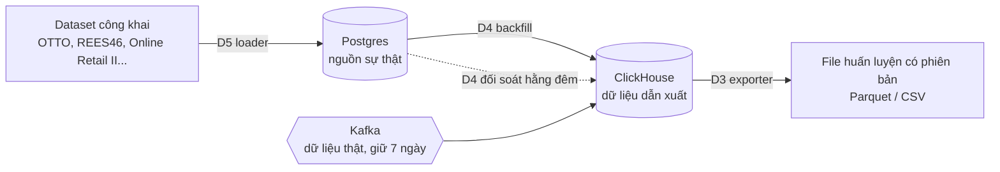

# Ghi chú: loader, exporter, backfill và dữ liệu mock từ dataset

> Ghi chú giải thích. **Cả ba công cụ đã có code và đã chạy vòng đầy đủ cục bộ** (README: [../../scripts/datagen/README.md](../../scripts/datagen/README.md), [../../scripts/export/README.md](../../scripts/export/README.md); backfill / reconcile: `services/analytics-service/cmd/backfill`; lệnh và giới hạn thật: [../design/07_DATA_PIPELINE.md](../design/07_DATA_PIPELINE.md)). Ba hạng mục D3, D4, D5 lấy từ [03_INFRA_GAPS_FOR_LARGE_PROJECT.md](03_INFRA_GAPS_FOR_LARGE_PROJECT.md) §1. Đây là dự án cá nhân nên **bỏ qua vấn đề license** của các bộ dữ liệu (nếu sau này công khai sản phẩm thì kiểm lại).

## 1. Ba công cụ và quan hệ giữa chúng

Luồng thật chảy qua Kafka. Luồng mock chảy qua loader, rồi backfill. Cả hai cùng đổ vào ClickHouse, và exporter đọc ra từ đó.

### D5. Loader (bộ nạp dữ liệu giả có seed)
- Script (ví dụ `scripts/datagen`) tạo và nạp danh mục sản phẩm, người dùng, store, đơn, thanh toán, click, giỏ hàng.
- "Có seed": chạy lại cùng số seed thì ra cùng dữ liệu, nên test và so sánh mô hình lặp lại được.
- Hiện có: `SEED_DEMO_DATA` (chỉ ~100 sản phẩm, không có đơn / hành vi) và `scripts/dev/gen_traffic.py` (chỉ event click phía trình duyệt).
- Loader nguồn dataset: đọc OTTO / REES46 / Online Retail II rồi ánh xạ vào bảng của hệ thống.

### D3. Exporter (xuất snapshot huấn luyện có phiên bản)
- Job hằng ngày truy vấn ClickHouse, xuất file đúng định dạng mô hình cần (ví dụ dạng OTTO: `session, aid, ts, type`), gắn nhãn phiên bản (vd. `snapshot-2026-10-25`).
- Cần vì ClickHouse chỉ dựng lại được ≤ 7 ngày từ Kafka và `events_raw` bị xoá sau 13 tháng; huấn luyện lặp lại được cần ảnh chụp cố định, chia train / valid / test theo thời gian.
- Nơi lưu: lúc đầu thư mục trên đĩa, sau này MinIO (D1).

### D4. Backfill + đối soát
- Backfill: sao chép Postgres → ClickHouse cho giai đoạn ClickHouse thiếu (hiện không có cách làm).
- Đối soát: job đêm so Postgres với ClickHouse (số đơn, doanh thu), báo lệch. `data-health` hiện trả `reconciliation: "not_implemented"`.
- Loader nên ghi dữ liệu lịch sử vào **Postgres trước**, rồi dùng backfill đẩy sang ClickHouse: hai bên luôn khớp, một công cụ dùng cho cả dữ liệu thật lẫn mock.

## 2. Dữ liệu mock trong DB lấy từ dataset

- **Catalog, người dùng, store:** nạp thẳng vào Postgres (quy đổi giá sang VND, ánh xạ vào cây `categories` ≤ 3 cấp).
- **Hành vi và đơn:** không nạp thẳng vào ClickHouse (lệch với Postgres, đối soát báo sai). Tracking đi qua gateway nên thời gian có thể bị đặt lại thành "bây giờ" (chưa kiểm có nhận timestamp cũ không); đơn tạo qua API luôn mang thời gian hiện tại. Vì vậy cần loader + backfill như trên.
- **Lưu ý (đã kiểm code):** click và giỏ chỉ có ở ClickHouse (Postgres không lưu) và gateway chỉ nhận `ts` trong ±24 giờ, nên loader ghi thẳng `events_raw`; backfill chỉ phục hồi các bảng dẫn xuất từ nghiệp vụ (đơn, thanh toán, hoàn tiền, tồn kho, sản phẩm). Thiết kế chi tiết: [../design/07_DATA_PIPELINE.md](../design/07_DATA_PIPELINE.md).
- Dữ liệu replay từ dataset kiểm chứng **đường ống và phương pháp**, không chứng minh chất lượng mô hình trên người dùng thật ([../ai/04_AI_DATA_READINESS.md](../ai/04_AI_DATA_READINESS.md) §3).

## 3. Hệ thống có xuất được đúng định dạng dataset không (gợi ý theo click / giỏ / mua)

| Dataset | Trường | Hệ thống |
|---|---|---|
| OTTO | `session, aid, ts, type` (clicks, carts, orders) | `session_id`, `product_id`, `ts`, `event_type`: click = `product_click`, giỏ = `add_to_cart`, mua lấy từ `fact_order_items` |
| REES46 | `event_time, event_type, product_id, category_code, brand, price, user_id, user_session` | ghép `events_raw` với `dim_products` (có `brand`, `price_minor`) |
| RetailRocket | `view, addtocart, transaction` | tương đương |

Ghép được vì `events_raw` có `session_id`, `product_id`, `position`, `surface` (còn có `impression`, mà OTTO / REES46 không có). Cần thêm một bước chuyển đổi (exporter D3), và còn bốn thiếu sót ảnh hưởng chất lượng dữ liệu:

1. **Chưa có exporter** (D3).
2. **Consent:** không đồng ý thì chỉ lưu `page_view` / `error_client`; click và giỏ của họ không tồn tại ⇒ dữ liệu huấn luyện mỏng hơn dataset công khai.
3. **Chưa nối danh tính ẩn danh ↔ tài khoản** (S5, `identity_links`): hành vi trước / sau đăng nhập bị tách thành hai người.
4. **Chưa có `request_id` + `model_version`** (S1): chưa đo được gợi ý nào sinh ra lượt click nào ⇒ chưa tính được CTR, chỉ huấn luyện từ lịch sử.

Ngoài ra giỏ hàng phía server (`cart_items`) chỉ nằm trong Postgres, không có bảng fact ở ClickHouse; tín hiệu giỏ lấy qua event `add_to_cart` / `remove_from_cart` của trình duyệt.

## 4. Các scope AI khác: hệ thống mô phỏng được không

| Scope | Mô phỏng được | Ghi chú |
|---|---|---|
| 1 Gợi ý | Được | Cần exporter + 4 thiếu sót trên |
| 2 Tìm kiếm | Được | Nạp sản phẩm của ESCI / WANDS làm catalog; nhãn relevance là dữ liệu ngoài |
| 4 Hỏi đáp số liệu | Một phần | BIRD khác schema, chỉ mượn cách đánh giá; bộ vàng tự dựng trên schema ClickHouse |
| 5 Trợ lý mua sắm | Một phần | τ-bench có công cụ / DB riêng; viết lại tác vụ cho API của mình |
| 8 Gian lận | Yếu | IEEE-CIS cần thẻ, thiết bị, email domain; hệ thống không lưu (thanh toán mô phỏng) ⇒ chỉ mượn phương pháp |
| 9 Dự báo nhu cầu | Được về dạng dữ liệu | `fact_order_items` là chuỗi doanh số theo ngày như M5 / Online Retail II; cần lịch sử dài ⇒ dữ liệu nhân tạo |
| 3 OCR, 11 Tìm bằng ảnh, 7 Review | Chưa | Cần upload ảnh (MinIO) hoặc tính năng review |
| 13 CLV, churn | Một phần | Từ Online Retail II; không có mã giảm giá nên không làm uplift |
| 14 AIOps | Một phần | RCAEval cần metric + log + trace; mình có metric, log tập trung, `request_id`, `resilience.sh` để gây lỗi; chưa có trace |
| 15 NLP truy vấn tiếng Việt | Được | Dùng `search` / `search_term` hiện có |

Thứ tự hợp lý khi bắt đầu AI: loader (D5), exporter (D3), backfill (D4) trước, vì chúng phục vụ nhiều scope cùng lúc.
