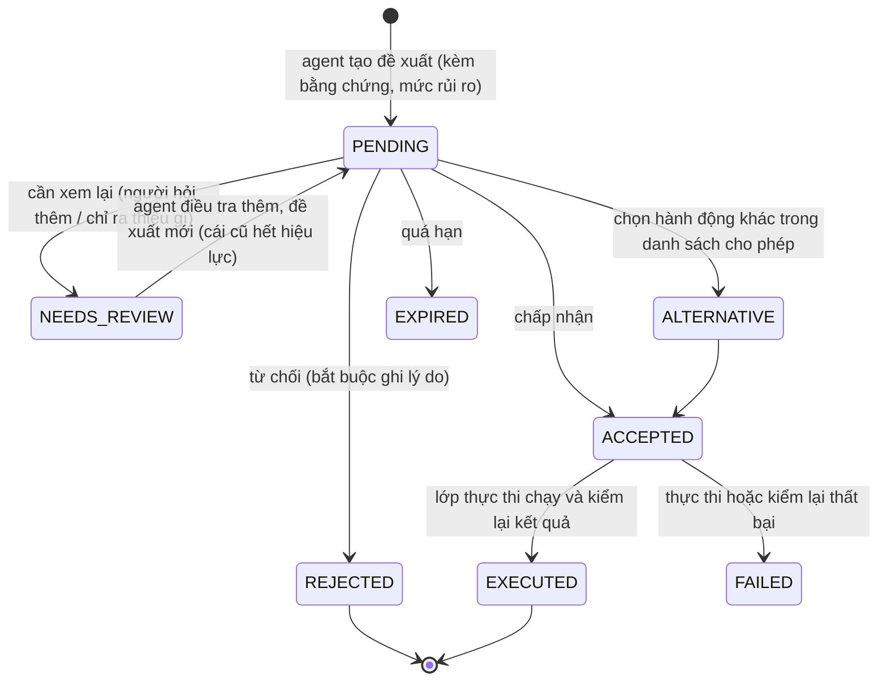
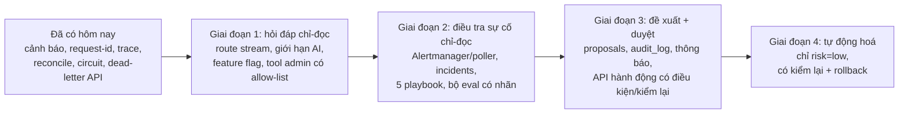

# Hạ tầng đã đủ cho agent chưa (đánh giá 2026-11-12)

> **Phạm vi:** chỉ đánh giá *nền hạ tầng* cho bốn nhu cầu agent mà chủ dự án nêu. Tầng LLM, prompt, vòng lặp agent do chủ dự án tự xây (không nằm ở đây). Thiết kế agent nằm ở [../ai/06_AGENT_FEATURES.md](../ai/06_AGENT_FEATURES.md) và [../ai/07_COROOT_AND_INCIDENT_AGENT.md](../ai/07_COROOT_AND_INCIDENT_AGENT.md); tài liệu này chỉ đối chiếu chúng với trạng thái thật của hạ tầng. Không có phần nào ở đây được kiểm bằng một agent chạy thật: đây là đánh giá từ code, cấu hình và các lần chạy `e2e` / `resilience` / `load` ngày 2026-11-12.

## Kết luận một dòng cho mỗi câu hỏi

| # | Câu hỏi | Đủ chưa | Vì sao ngắn gọn |
|---|---|---|---|
| 1 | Agent hỏi đáp / tương tác cho buyer, seller, admin, dev | **Đủ cho chỉ-đọc, chưa đủ cho hành động ghi và cho "dev"** | tool = REST gateway với JWT của chính người dùng đã dùng được; thiếu khung `action_proposal`, `audit_log`, feature flag, kênh stream; vai trò `dev` chưa tồn tại |
| 2 | Hệ thống tự phát hiện vấn đề rồi gọi agent ra xem | **Tín hiệu đã đủ, đường kích hoạt chưa có** | từ hôm nay có luật cảnh báo, circuit breaker, reconcile, trace, request-id; chưa có Alertmanager / webhook, chưa có nơi lưu "sự cố" |
| 3 | Agent đề xuất để dev / admin chấp nhận, từ chối, xem lại, hoặc làm việc khác | **Chưa đủ** | chưa có bảng đề xuất, `audit_log`, kênh thông báo, và lớp thực thi có kiểm soát; mới có phân loại mức rủi ro trong cảnh báo |
| 4 | Runbook đủ để agent tự tìm cách giải quyết | **Đủ để chẩn đoán và đề xuất, chưa đủ để tự giải quyết** | runbook viết cho người (văn xuôi, SQL, lệnh `docker`), chưa có dạng có cấu trúc, điều kiện trước / sau, rollback; nhiều bước sửa là SQL tay |

## Đã có (và dùng được ngay)

| Nền | Chi tiết | Dùng cho agent thế nào |
|---|---|---|
| Danh tính và phân quyền | JWT, RBAC theo vai trò `buyer`, `seller_admin`, `seller_employee`, `admin`; kiểm sở hữu ở gateway; rate limit theo nhóm | agent gọi REST bằng JWT của người dùng ⇒ không có quyền riêng, hỏi shop khác bị 403 |
| REST có sẵn cho hỏi đáp | catalog, tìm kiếm (SQL), tồn kho, đơn, thanh toán, 9 báo cáo analytics có `as_of` / `source`, `GET /admin/system/health` | tool chỉ-đọc cho shopper, seller, admin (A1, A3) |
| Idempotency | `Idempotency-Key` bắt buộc ở `POST /orders`; gateway nay retry `Checkout` an toàn (ADR-36) | mã đề xuất của agent dùng làm khoá ⇒ bấm hai lần không tạo hai đơn |
| Cảnh báo | 11 luật Prometheus, mỗi luật có `runbook` và `action` (`observe` / `low` / `high`) | điểm bắt đầu cho phân loại rủi ro và cho "điều gì đáng gọi agent" |
| Truy vết | `X-Request-ID` đi qua gateway, gRPC, outbox, Kafka (header), log JSON thống nhất, Loki + Vector, trace OTel qua Tempo (mẫu 10%) | agent lần theo một đơn qua mọi service bằng một id |
| Phát hiện lệch dữ liệu | đối soát Postgres / ClickHouse định kỳ, nằm trong `data-health` (ADR-37) | tool `analytics_data_health` có sẵn số "lệch bao nhiêu" |
| Tự bảo vệ | circuit breaker ở gateway, `/ready` không lan lỗi (ADR-35), deadline + retry đọc | khi agent điều tra, hệ thống không vì agent mà sập; có metric `mm_circuit_state` để biết |
| Công cụ xử lý có sẵn | requeue outbox qua API nội bộ (`/internal/outbox/*`), backup / verify Postgres, `backfill`, `docker service update` | nguyên liệu cho các "hành động" mà agent được phép đề xuất |
| Kiểm thử hệ thống thật | `run.mjs` 377 kiểm tra, `resilience.sh` A–J (chèn lỗi thật), `load.mjs` | nguồn lỗi có nhãn để đo agent (cần thêm ghi nhãn, xem Q4) |

## Q1. Hỏi đáp và tương tác cho buyer, seller, admin, dev

**Đủ:** hỏi đáp chỉ-đọc cho ba vai trò đầu. Mọi tool là REST có sẵn, quyền do gateway ép; chưa cần dựng quyền riêng cho agent.

**Chưa đủ, theo mức độ ảnh hưởng:**

| Thiếu | Vì sao quan trọng | Cỡ việc |
|---|---|---|
| Vai trò **`dev`** | không tồn tại: `validRoles` chỉ có `buyer`, `seller_admin`, `seller_employee`, và `admin` (tạo bằng bootstrap). Cần quyết định: `dev` là admin có thêm công cụ hệ thống, hay vai trò mới tách quyền (chỉ đọc hệ thống, không đọc dữ liệu khách) | S (quyết định) + M (code nếu tách vai trò) |
| Đường `POST /ai/chat` có **stream** | tool lặp tối đa 4 vòng, mỗi lượt tới 60 s; handler hiện dùng ngữ cảnh 15 s, deadline gRPC 3 s / 10 s (chỉ cho lời gọi unary). Cần route stream riêng và **kiểm thử SSE qua Traefik và gateway** (buffering, timeout): chưa kiểm | M |
| **Giới hạn riêng cho AI** | rate limit theo IP hiện có; agent cần ngân sách theo người dùng và theo chi phí LLM | S |
| **Feature flag** (`GET /config/features`) | công tắc tắt tính năng AI và đường lui không-AI; chưa có (gap I1) | S |
| **`audit_log`** | mọi hành động agent đề xuất / thực thi phải truy được; chưa có bảng, chưa có service sở hữu (gap P2) | M |
| Tool hệ thống cho admin / dev ở **gateway** | `system_metrics`, `kafka_lag`, `log_search`, `outbox_status` chưa có route; dữ liệu đã có (Prometheus, Loki, kafka-exporter, `/internal/outbox/dead`) nhưng đều ở mạng nội bộ không xác thực. **Không** cho agent chạm thẳng Prometheus / Loki: cần proxy có danh sách truy vấn cho phép | M |
| Tìm kiếm ngữ nghĩa cho hỏi đáp sản phẩm | tìm kiếm hiện là SQL; hỏi đáp tự do về sản phẩm cần embedding + kho vector. Máy này có một container `qdrant` chạy riêng (ngoài các stack của dự án), chưa nối vào gì | M–L |
| Khoá API LLM, đường ra Internet | không nằm trong stack; cần chỗ giữ khoá (không đưa vào `deploy/.env` chung) và kiểm soát egress | S |

Dữ liệu từ tool, mô tả sản phẩm, review là không tin cậy (prompt injection): hạ tầng không thay được việc đó, nhưng vì agent chỉ gọi REST của gateway bằng JWT người dùng nên thiệt hại tối đa bị chặn bởi quyền của chính người dùng.

## Q2. Hệ thống tự kiểm tra, có vấn đề thì gọi agent

Chuỗi cần có: **phát hiện → gom ngữ cảnh → kích hoạt agent → lưu sự cố → (đề xuất, Q3)**.

| Khâu | Trạng thái | Chi tiết |
|---|---|---|
| Phát hiện | ✅ có | luật trong `deploy/prometheus/alerts.yml`: service down / not ready, circuit mở, outbox DEAD / backlog cũ, DLQ, reconcile lệch / cũ, mất dòng analytics, 5xx gateway, bộ nhớ container. `/ready`, `/admin/system/health` |
| Gom ngữ cảnh | 🟡 nguyên liệu có, chưa có bộ gom | cần một "gói bằng chứng" cho mỗi cảnh báo: nhãn cảnh báo, `/admin/system/health`, vài truy vấn Prometheus cố định, log lỗi gần đây theo `service`, `request_id` mẫu từ log. Mỗi nguồn đã đọc được; chưa có code ghép |
| Kích hoạt | ❌ chưa có | Prometheus **chưa có Alertmanager**: cảnh báo chỉ xem ở `/alerts`. Hai cách: (a) thêm Alertmanager với webhook tới dịch vụ điều phối agent (có nhóm, giảm trùng, im lặng); (b) dịch vụ điều phối tự hỏi `/api/v1/alerts` mỗi 30–60 s (đơn giản hơn, tự lo chống trùng) |
| Chống kích hoạt thừa | ❌ chưa có | cần: một sự cố đang mở thì không mở thêm cho cùng cảnh báo, giới hạn số lần gọi LLM mỗi giờ, ngưỡng "đã bắn đủ lâu" (luật có `for:`), và chặn vòng lặp (agent hành động ⇒ sinh cảnh báo ⇒ gọi agent) |
| Lưu sự cố | ❌ chưa có | bảng `incidents` (cảnh báo gốc, thời điểm, trạng thái mở / đã nhận / đã giải quyết, bằng chứng, kết luận) |
| Cô lập quyền | 🟡 | agent điều tra phải chạy với quyền **chỉ đọc hệ thống**; hiện chưa có token dịch vụ phạm vi hẹp (gap I4, gRPC không mTLS) |

Ghi chú về độ tin cậy: tài liệu AI của dự án ghi agent LLM làm RCA đầy đủ trên benchmark công khai còn yếu ([../ai/07_COROOT_AND_INCIDENT_AGENT.md](../ai/07_COROOT_AND_INCIDENT_AGENT.md) §4, §6: OpenRCA ~11%, ORCA-bench ~25%, chưa kiểm ở nguồn gốc). Vì vậy kích hoạt agent nên **bổ sung** chứ không thay các luật cố định; luật cố định vẫn là tuyến đầu.

## Q3. Agent đề xuất, người chấp nhận / từ chối / xem lại / làm việc khác

Bốn kết cục người dùng nêu ánh xạ thành một máy trạng thái của **đề xuất**:

| Cần có | Trạng thái | Ghi chú |
|---|---|---|
| Bảng `proposals` | ❌ | id, sự cố gốc, loại hành động, tham số, bằng chứng, `risk` (`observe` / `low` / `high` như trong cảnh báo), trạng thái, người duyệt, lý do, hạn, băm nội dung. Mã đề xuất **ký** (gắn người dùng, băm, hạn ~5 phút) để LLM không sửa được sau khi người đã nhìn ([../ai/06_AGENT_FEATURES.md](../ai/06_AGENT_FEATURES.md) §2) |
| `audit_log` | ❌ | ai duyệt cái gì, khi nào, lý do, kết quả; bất biến (chỉ thêm) |
| Kênh thông báo cho người duyệt | ❌ | trang admin trong frontend + thông báo (email / chat). Hiện không có kênh nào, kể cả cho cảnh báo |
| **Lớp thực thi có kiểm soát** | ❌ | mỗi hành động là một API có **điều kiện trước** (còn đúng không?), **thực hiện**, **kiểm lại sau**, và rollback nếu có. Hiện hành động là lệnh tay: `docker service update` cần quyền Docker trên manager; SQL tay vào DB; `/internal/outbox/*` chỉ trong mạng swarm. Không cấp quyền Docker hay DB cho agent: bọc từng hành động thành một route `/admin/ops/...` có RBAC + audit |
| Danh sách hành động cho phép | 🟡 | nguyên liệu có (requeue outbox, restart service không trạng thái, chạy `reconcile`, `backfill` ngày cụ thể, restore backup); chưa ai bọc |
| Phản hồi để cải thiện | ❌ | tỉ lệ chấp nhận / từ chối theo loại đề xuất chính là số đo chất lượng agent ([../ai/07_COROOT_AND_INCIDENT_AGENT.md](../ai/07_COROOT_AND_INCIDENT_AGENT.md) §6 tầng vận hành) |

Phân loại rủi ro nên giữ như trong cảnh báo: `observe` không cần duyệt; `low` (đảo ngược được, ví dụ khởi động lại một service không trạng thái) có thể cho chạy tự động **nếu chủ hệ thống chọn** và có kiểm lại + rollback; `high` (ghi / sửa dữ liệu: requeue, `backfill`, hoàn tiền, restore) **luôn** cần người duyệt kèm lý do. Hoàn tiền và cấm sản phẩm không bao giờ tự động.

## Q4. Runbook đã đủ để agent tự giải quyết chưa

**Đủ để chẩn đoán và đề xuất** (agent chỉ-đọc, A1): runbook có cây quyết định cho đơn kẹt `PENDING` / `AWAITING_PAYMENT`, outbox backlog / `DEAD`, Kafka lag và DLQ, thanh toán lỗi, ClickHouse down, tồn kho sai, sao lưu, đối soát; từ hôm nay thêm §13 (cảnh báo, mức hành động, circuit, trace, reconcile). Mỗi cảnh báo trỏ về một mục.

**Chưa đủ để tự giải quyết**, vì:

| Khoảng trống | Tác động |
|---|---|
| Viết cho người: văn xuôi, mermaid, SQL / lệnh `docker` có chỗ trống (`<svc>`, `<id>`) | agent phải đoán tham số; dễ sai. Cần dạng có cấu trúc |
| Không có **điều kiện trước / kiểm lại sau / rollback** cho từng bước | agent không biết khi nào dừng, làm xong chưa, hoàn tác thế nào |
| Mức rủi ro nằm ở cảnh báo, không ở từng bước sửa | cần gắn `risk` cho từng bước để lớp thực thi ép duyệt |
| Nhiều bước sửa là **SQL tay** hoặc cần quyền Docker | không nên trao cho agent (xem Q3); phải bọc thành API trước |
| Chưa phủ: poison message / hàng DEAD do dữ liệu hỏng (không phải do Kafka), ClickHouse đầy đĩa, Postgres chậm, nhiều lỗi đồng thời, lỗi chậm dần (rò bộ nhớ), Tempo / Vector / Loki hỏng | agent gặp ca ngoài sách sẽ không có đường đi; [../ai/07_COROOT_AND_INCIDENT_AGENT.md](../ai/07_COROOT_AND_INCIDENT_AGENT.md) §4 liệt kê cùng các thiếu sót này |
| `resilience.sh` chèn lỗi thật nhưng **không ghi nhãn** (`start`, `end`, `root_service`, `fault_type`) và không chụp metric / log trong cửa sổ lỗi | chưa có cách đo agent: không có đáp án chuẩn để so; đây là nền của bộ eval |
| Chưa có bộ câu hỏi + đáp án + bằng chứng đúng | không đo được top-k, tỉ lệ bịa, tỉ lệ đề xuất được chấp nhận |

**Đề xuất làm, theo thứ tự (khoảng cách ngắn nhất tới agent chẩn đoán + đề xuất đầu tiên):**
1. **Chuẩn hoá 5 playbook đầu** từ runbook sang dạng có cấu trúc (YAML hoặc JSON): tín hiệu kích hoạt, danh sách kiểm tra (tool + kết quả mong đợi), ánh xạ nguyên nhân → hành động, `risk`, điều kiện trước, kiểm lại, rollback. Chọn 5 ca đã có hành động an toàn: outbox DEAD, Kafka lag / DLQ, service `not_ready`, circuit mở, reconcile lệch. Giữ Markdown làm nguồn cho người, sinh ra bản có cấu trúc (hoặc ngược lại), tránh hai nguồn lệch nhau.
2. **Ghi nhãn cho `resilience.sh`:** mỗi kịch bản xuất `ground_truth.json` và chụp truy vấn Prometheus + log Loki trong cửa sổ lỗi. Rẻ, và mở đường cho bộ eval.
3. **Thêm các kịch bản thiếu** (hàng DEAD do poison, ClickHouse đầy đĩa, Postgres chậm) và viết 50–100 câu hỏi tiếng Việt gắn nhãn, đáp án lấy từ runbook.
4. **Bọc hành động thành API có RBAC + audit** (`/admin/ops/outbox/requeue`, `/admin/ops/service/restart` qua một tác nhân chạy trên manager có allow-list, `/admin/ops/analytics/reconcile`).
5. Chỉ sau đó mới nói chuyện **tự giải quyết**, và chỉ cho `risk=low`.

## Đường đi đề xuất (tóm tắt)

Mỗi giai đoạn dùng được độc lập; dừng ở giai đoạn 2 đã có agent điều tra hữu ích mà không cần cấp bất kỳ quyền ghi nào.
