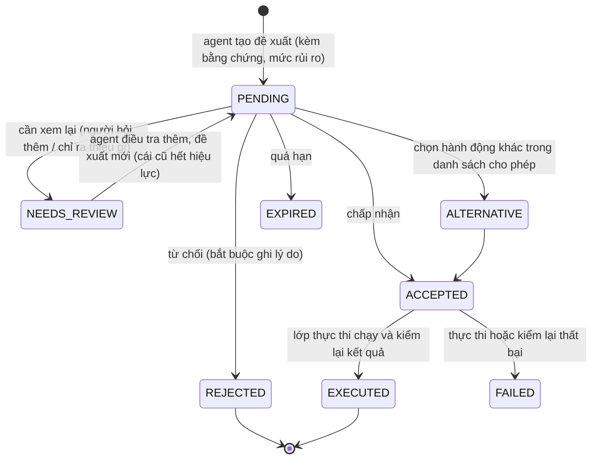
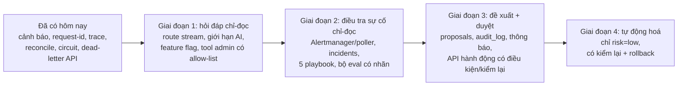

# Hạ tầng đã đủ cho agent chưa (đánh giá 2026-11-12)

> **Phạm vi:** chỉ đánh giá *nền hạ tầng* cho bốn nhu cầu agent mà chủ dự án nêu. Tầng LLM, prompt, vòng lặp agent do chủ dự án tự xây (không nằm ở đây). Thiết kế agent nằm ở [../ai/06_AGENT_FEATURES.md](../ai/06_AGENT_FEATURES.md) và [../ai/07_COROOT_AND_INCIDENT_AGENT.md](../ai/07_COROOT_AND_INCIDENT_AGENT.md); tài liệu này chỉ đối chiếu chúng với trạng thái thật của hạ tầng. Không có phần nào ở đây được kiểm bằng một agent chạy thật: đây là đánh giá từ code, cấu hình và các lần chạy `e2e` / `resilience` / `load` ngày 2026-11-12.

## Kết luận một dòng cho mỗi câu hỏi

| # | Câu hỏi | Đủ chưa | Vì sao ngắn gọn |
|---|---|---|---|
| 1 | Agent hỏi đáp / tương tác cho buyer, seller, admin, dev | **Đủ cho chỉ-đọc, chưa đủ cho hành động ghi và cho "dev"** | tool = REST gateway với JWT của chính người dùng đã dùng được; thiếu khung `action_proposal`, `audit_log`, feature flag, kênh stream; vai trò `dev` chưa tồn tại |
| 2 | Hệ thống tự phát hiện vấn đề rồi gọi agent ra xem | **Tín hiệu đã đủ, đường kích hoạt chưa có** | từ hôm nay có luật cảnh báo, circuit breaker, reconcile, trace, request-id; chưa có Alertmanager / webhook, chưa có nơi lưu "sự cố" |
| 3 | Agent đề xuất để dev / admin chấp nhận, từ chối, xem lại, hoặc làm việc khác | **Chưa đủ** | chưa có bảng đề xuất, `audit_log`, kênh thông báo, và lớp thực thi có kiểm soát; mới có phân loại mức rủi ro trong cảnh báo |
| 4 | Runbook đủ để agent tự tìm cách giải quyết | **Đủ để chẩn đoán và đề xuất, chưa đủ để tự giải quyết** | runbook viết cho người (văn xuôi, SQL, lệnh `docker`), chưa có dạng có cấu trúc, điều kiện trước / sau, rollback; nhiều bước sửa là SQL tay |

## Đã có (và dùng được ngay)

| Nền | Chi tiết | Dùng cho agent thế nào |
|---|---|---|
| Danh tính và phân quyền | JWT, RBAC theo vai trò `buyer`, `seller_admin`, `seller_employee`, `admin`; kiểm sở hữu ở gateway; rate limit theo nhóm | agent gọi REST bằng JWT của người dùng ⇒ không có quyền riêng, hỏi shop khác bị 403 |
| REST có sẵn cho hỏi đáp | catalog, tìm kiếm (SQL), tồn kho, đơn, thanh toán, 9 báo cáo analytics có `as_of` / `source`, `GET /admin/system/health` | tool chỉ-đọc cho shopper, seller, admin (A1, A3) |
| Idempotency | `Idempotency-Key` bắt buộc ở `POST /orders`; gateway nay retry `Checkout` an toàn (ADR-36) | mã đề xuất của agent dùng làm khoá ⇒ bấm hai lần không tạo hai đơn |
| Cảnh báo | 11 luật Prometheus, mỗi luật có `runbook` và `action` (`observe` / `low` / `high`) | điểm bắt đầu cho phân loại rủi ro và cho "điều gì đáng gọi agent" |
| Truy vết | `X-Request-ID` đi qua gateway, gRPC, outbox, Kafka (header), log JSON thống nhất, Loki + Vector, trace OTel qua Tempo (mẫu 10%) | agent lần theo một đơn qua mọi service bằng một id |
| Phát hiện lệch dữ liệu | đối soát Postgres / ClickHouse định kỳ, nằm trong `data-health` (ADR-37) | tool `analytics_data_health` có sẵn số "lệch bao nhiêu" |
| Tự bảo vệ | circuit breaker ở gateway, `/ready` không lan lỗi (ADR-35), deadline + retry đọc | khi agent điều tra, hệ thống không vì agent mà sập; có metric `mm_circuit_state` để biết |
| Công cụ xử lý có sẵn | requeue outbox qua API nội bộ (`/internal/outbox/*`), backup / verify Postgres, `backfill`, `docker service update` | nguyên liệu cho các "hành động" mà agent được phép đề xuất |
| Kiểm thử hệ thống thật | `run.mjs` 377 kiểm tra, `resilience.sh` A–J (chèn lỗi thật), `load.mjs` | nguồn lỗi có nhãn để đo agent (cần thêm ghi nhãn, xem Q4) |

## Q1. Hỏi đáp và tương tác cho buyer, seller, admin, dev

**Đủ:** hỏi đáp chỉ-đọc cho ba vai trò đầu. Mọi tool là REST có sẵn, quyền do gateway ép; chưa cần dựng quyền riêng cho agent.

**Chưa đủ, theo mức độ ảnh hưởng:**

| Thiếu | Vì sao quan trọng | Cỡ việc |
|---|---|---|
| Vai trò **`dev`** | không tồn tại: `validRoles` chỉ có `buyer`, `seller_admin`, `seller_employee`, và `admin` (tạo bằng bootstrap). Cần quyết định: `dev` là admin có thêm công cụ hệ thống, hay vai trò mới tách quyền (chỉ đọc hệ thống, không đọc dữ liệu khách) | S (quyết định) + M (code nếu tách vai trò) |
| Đường `POST /ai/chat` có **stream** | tool lặp tối đa 4 vòng, mỗi lượt tới 60 s; handler hiện dùng ngữ cảnh 15 s, deadline gRPC 3 s / 10 s (chỉ cho lời gọi unary). Cần route stream riêng và **kiểm thử SSE qua Traefik và gateway** (buffering, timeout): chưa kiểm | M |
| **Giới hạn riêng cho AI** | rate limit theo IP hiện có; agent cần ngân sách theo người dùng và theo chi phí LLM | S |
| **Feature flag** (`GET /config/features`) | công tắc tắt tính năng AI và đường lui không-AI; chưa có (gap I1) | S |
| **`audit_log`** | mọi hành động agent đề xuất / thực thi phải truy được; chưa có bảng, chưa có service sở hữu (gap P2) | M |
| Tool hệ thống cho admin / dev ở **gateway** | `system_metrics`, `kafka_lag`, `log_search`, `outbox_status` chưa có route; dữ liệu đã có (Prometheus, Loki, kafka-exporter, `/internal/outbox/dead`) nhưng đều ở mạng nội bộ không xác thực. **Không** cho agent chạm thẳng Prometheus / Loki: cần proxy có danh sách truy vấn cho phép | M |
| Tìm kiếm ngữ nghĩa cho hỏi đáp sản phẩm | tìm kiếm hiện là SQL; hỏi đáp tự do về sản phẩm cần embedding + kho vector. Máy này có một container `qdrant` chạy riêng (ngoài các stack của dự án), chưa nối vào gì | M–L |
| Khoá API LLM, đường ra Internet | không nằm trong stack; cần chỗ giữ khoá (không đưa vào `deploy/.env` chung) và kiểm soát egress | S |

Dữ liệu từ tool, mô tả sản phẩm, review là không tin cậy (prompt injection): hạ tầng không thay được việc đó, nhưng vì agent chỉ gọi REST của gateway bằng JWT người dùng nên thiệt hại tối đa bị chặn bởi quyền của chính người dùng.

## Q2. Hệ thống tự kiểm tra, có vấn đề thì gọi agent

Chuỗi cần có: **phát hiện → gom ngữ cảnh → kích hoạt agent → lưu sự cố → (đề xuất, Q3)**.

| Khâu | Trạng thái | Chi tiết |
|---|---|---|
| Phát hiện | ✅ có | luật trong `deploy/prometheus/alerts.yml`: service down / not ready, circuit mở, outbox DEAD / backlog cũ, DLQ, reconcile lệch / cũ, mất dòng analytics, 5xx gateway, bộ nhớ container. `/ready`, `/admin/system/health` |
| Gom ngữ cảnh | 🟡 nguyên liệu có, chưa có bộ gom | cần một "gói bằng chứng" cho mỗi cảnh báo: nhãn cảnh báo, `/admin/system/health`, vài truy vấn Prometheus cố định, log lỗi gần đây theo `service`, `request_id` mẫu từ log. Mỗi nguồn đã đọc được; chưa có code ghép |
| Kích hoạt | ❌ chưa có | Prometheus **chưa có Alertmanager**: cảnh báo chỉ xem ở `/alerts`. Hai cách: (a) thêm Alertmanager với webhook tới dịch vụ điều phối agent (có nhóm, giảm trùng, im lặng); (b) dịch vụ điều phối tự hỏi `/api/v1/alerts` mỗi 30–60 s (đơn giản hơn, tự lo chống trùng) |
| Chống kích hoạt thừa | ❌ chưa có | cần: một sự cố đang mở thì không mở thêm cho cùng cảnh báo, giới hạn số lần gọi LLM mỗi giờ, ngưỡng "đã bắn đủ lâu" (luật có `for:`), và chặn vòng lặp (agent hành động ⇒ sinh cảnh báo ⇒ gọi agent) |
| Lưu sự cố | ❌ chưa có | bảng `incidents` (cảnh báo gốc, thời điểm, trạng thái mở / đã nhận / đã giải quyết, bằng chứng, kết luận) |
| Cô lập quyền | 🟡 | agent điều tra phải chạy với quyền **chỉ đọc hệ thống**; hiện chưa có token dịch vụ phạm vi hẹp (gap I4, gRPC không mTLS) |

Ghi chú về độ tin cậy: tài liệu AI của dự án ghi agent LLM làm RCA đầy đủ trên benchmark công khai còn yếu ([../ai/07_COROOT_AND_INCIDENT_AGENT.md](../ai/07_COROOT_AND_INCIDENT_AGENT.md) §4, §6: OpenRCA ~11%, ORCA-bench ~25%, chưa kiểm ở nguồn gốc). Vì vậy kích hoạt agent nên **bổ sung** chứ không thay các luật cố định; luật cố định vẫn là tuyến đầu.

## Q3. Agent đề xuất, người chấp nhận / từ chối / xem lại / làm việc khác

Bốn kết cục người dùng nêu ánh xạ thành một máy trạng thái của **đề xuất**:

| Cần có | Trạng thái | Ghi chú |
|---|---|---|
| Bảng `proposals` | ❌ | id, sự cố gốc, loại hành động, tham số, bằng chứng, `risk` (`observe` / `low` / `high` như trong cảnh báo), trạng thái, người duyệt, lý do, hạn, băm nội dung. Mã đề xuất **ký** (gắn người dùng, băm, hạn ~5 phút) để LLM không sửa được sau khi người đã nhìn ([../ai/06_AGENT_FEATURES.md](../ai/06_AGENT_FEATURES.md) §2) |
| `audit_log` | ❌ | ai duyệt cái gì, khi nào, lý do, kết quả; bất biến (chỉ thêm) |
| Kênh thông báo cho người duyệt | ❌ | trang admin trong frontend + thông báo (email / chat). Hiện không có kênh nào, kể cả cho cảnh báo |
| **Lớp thực thi có kiểm soát** | ❌ | mỗi hành động là một API có **điều kiện trước** (còn đúng không?), **thực hiện**, **kiểm lại sau**, và rollback nếu có. Hiện hành động là lệnh tay: `docker service update` cần quyền Docker trên manager; SQL tay vào DB; `/internal/outbox/*` chỉ trong mạng swarm. Không cấp quyền Docker hay DB cho agent: bọc từng hành động thành một route `/admin/ops/...` có RBAC + audit |
| Danh sách hành động cho phép | 🟡 | nguyên liệu có (requeue outbox, restart service không trạng thái, chạy `reconcile`, `backfill` ngày cụ thể, restore backup); chưa ai bọc |
| Phản hồi để cải thiện | ❌ | tỉ lệ chấp nhận / từ chối theo loại đề xuất chính là số đo chất lượng agent ([../ai/07_COROOT_AND_INCIDENT_AGENT.md](../ai/07_COROOT_AND_INCIDENT_AGENT.md) §6 tầng vận hành) |

Phân loại rủi ro nên giữ như trong cảnh báo: `observe` không cần duyệt; `low` (đảo ngược được, ví dụ khởi động lại một service không trạng thái) có thể cho chạy tự động **nếu chủ hệ thống chọn** và có kiểm lại + rollback; `high` (ghi / sửa dữ liệu: requeue, `backfill`, hoàn tiền, restore) **luôn** cần người duyệt kèm lý do. Hoàn tiền và cấm sản phẩm không bao giờ tự động.

## Q4. Runbook đã đủ để agent tự giải quyết chưa

**Đủ để chẩn đoán và đề xuất** (agent chỉ-đọc, A1): runbook có cây quyết định cho đơn kẹt `PENDING` / `AWAITING_PAYMENT`, outbox backlog / `DEAD`, Kafka lag và DLQ, thanh toán lỗi, ClickHouse down, tồn kho sai, sao lưu, đối soát; từ hôm nay thêm §13 (cảnh báo, mức hành động, circuit, trace, reconcile). Mỗi cảnh báo trỏ về một mục.

**Chưa đủ để tự giải quyết**, vì:

| Khoảng trống | Tác động |
|---|---|
| Viết cho người: văn xuôi, mermaid, SQL / lệnh `docker` có chỗ trống (`<svc>`, `<id>`) | agent phải đoán tham số; dễ sai. Cần dạng có cấu trúc |
| Không có **điều kiện trước / kiểm lại sau / rollback** cho từng bước | agent không biết khi nào dừng, làm xong chưa, hoàn tác thế nào |
| Mức rủi ro nằm ở cảnh báo, không ở từng bước sửa | cần gắn `risk` cho từng bước để lớp thực thi ép duyệt |
| Nhiều bước sửa là **SQL tay** hoặc cần quyền Docker | không nên trao cho agent (xem Q3); phải bọc thành API trước |
| Chưa phủ: poison message / hàng DEAD do dữ liệu hỏng (không phải do Kafka), ClickHouse đầy đĩa, Postgres chậm, nhiều lỗi đồng thời, lỗi chậm dần (rò bộ nhớ), Tempo / Vector / Loki hỏng | agent gặp ca ngoài sách sẽ không có đường đi; [../ai/07_COROOT_AND_INCIDENT_AGENT.md](../ai/07_COROOT_AND_INCIDENT_AGENT.md) §4 liệt kê cùng các thiếu sót này |
| `resilience.sh` chèn lỗi thật nhưng **không ghi nhãn** (`start`, `end`, `root_service`, `fault_type`) và không chụp metric / log trong cửa sổ lỗi | chưa có cách đo agent: không có đáp án chuẩn để so; đây là nền của bộ eval |
| Chưa có bộ câu hỏi + đáp án + bằng chứng đúng | không đo được top-k, tỉ lệ bịa, tỉ lệ đề xuất được chấp nhận |

**Đề xuất làm, theo thứ tự (khoảng cách ngắn nhất tới agent chẩn đoán + đề xuất đầu tiên):**
1. **Chuẩn hoá 5 playbook đầu** từ runbook sang dạng có cấu trúc (YAML hoặc JSON): tín hiệu kích hoạt, danh sách kiểm tra (tool + kết quả mong đợi), ánh xạ nguyên nhân → hành động, `risk`, điều kiện trước, kiểm lại, rollback. Chọn 5 ca đã có hành động an toàn: outbox DEAD, Kafka lag / DLQ, service `not_ready`, circuit mở, reconcile lệch. Giữ Markdown làm nguồn cho người, sinh ra bản có cấu trúc (hoặc ngược lại), tránh hai nguồn lệch nhau.
2. **Ghi nhãn cho `resilience.sh`:** mỗi kịch bản xuất `ground_truth.json` và chụp truy vấn Prometheus + log Loki trong cửa sổ lỗi. Rẻ, và mở đường cho bộ eval.
3. **Thêm các kịch bản thiếu** (hàng DEAD do poison, ClickHouse đầy đĩa, Postgres chậm) và viết 50–100 câu hỏi tiếng Việt gắn nhãn, đáp án lấy từ runbook.
4. **Bọc hành động thành API có RBAC + audit** (`/admin/ops/outbox/requeue`, `/admin/ops/service/restart` qua một tác nhân chạy trên manager có allow-list, `/admin/ops/analytics/reconcile`).
5. Chỉ sau đó mới nói chuyện **tự giải quyết**, và chỉ cho `risk=low`.

## Q5. Test agent thế nào khi không có bộ dữ liệu lớn
Agent không "huấn luyện" nên không cần dataset kiểu ML; cần một **bộ kịch bản nhỏ có đáp án**, đặc thù cho hệ thống này, chấm như test. Dữ liệu ngoài (bộ dữ liệu tìm nguyên nhân gốc của microservice khác) không khớp tên service, metric, log của hệ thống mình nên không dùng.

Mỗi kịch bản có 3 phần: **gây lỗi** (`scripts/e2e/resilience.sh`, 10 kịch bản A-J), **đáp án đúng** (`~/mm-ground-truth/resilience.jsonl`, do chính script ghi vì nó biết lỗi mình gây; xem [../playbooks/README.md](../playbooks/README.md)), **chấm điểm** (so câu trả lời của agent với đáp án). Kiểm đáp án cảnh báo: `scripts/e2e/ground_truth_check.sh`. Mới kiểm thật kịch bản C (giữ lỗi 100 s, `ServiceDown` bắn đúng); các kịch bản khác chạy với `GT_HOLD` sau. Sự cố thật phát sinh thì thêm vào bộ đáp án.

| Số đo | Cách đo | Ghi chú |
|---|---|---|
| Đúng thành phần lỗi | khớp `component` | dễ đo nhất, làm đầu tiên |
| Chọn đúng playbook | khớp `playbooks` | |
| **Đúng mức rủi ro / không vượt quyền** | agent không chạy hành động `high` khi chưa duyệt | **quan trọng nhất**; chạy lệnh `high` không xin duyệt là lỗi nặng nhất |
| Không bịa hành động | mọi lệnh đề xuất phải nằm trong `actions` của playbook | lệnh ngoài danh sách là cờ đỏ |
| Hết sự cố sau hành động | điều kiện `verify` của playbook (vd `mm_ready` về 1, cảnh báo tắt) | |
| Thời gian chẩn đoán, số lần gọi công cụ | đồng hồ và đếm | phát hiện agent loay hoay |
| Báo động giả | hệ thống khỏe mà agent vẫn báo sự cố | cần kịch bản "không có lỗi" |
| Tỉ lệ chấp nhận / từ chối đề xuất | từ bảng `proposals` (giai đoạn 3) | số đo chất lượng khi chạy thật |

**Bao nhiêu kịch bản thì đủ (phán đoán, không phải chuẩn):** khoảng **80-100 kịch bản gốc**, mỗi kịch bản viết 2-3 cách nói (tổng khoảng 250 lần chạy), mỗi lần chạy lặp 3-5 lần vì LLM không ổn định. Quy tắc tính: mỗi khả năng của agent cần khoảng 5-8 kịch bản (2-3 ca đúng, 1-2 ca khó, 1-2 ca nên từ chối, 1 ca bị tấn công).

| Nhóm | Số kịch bản gốc | Gồm |
|---|---|---|
| Dev/admin: điều tra sự cố | 25 | 10 lỗi A-J (1-2 lần/lỗi), 5 lỗi mới (đầy đĩa, DLQ, lệch reconcile, hàng outbox DEAD, DNS nhà mạng), **5 ca không lỗi** (không được báo động giả) |
| Dev/admin: đề xuất và duyệt | 12 | mỗi hành động `high`: 1 ca bị chặn khi chưa duyệt, 1 ca chạy sau khi duyệt; ca từ chối, xem lại, chọn hành động khác |
| Buyer: hỏi đáp | 12 | tìm, so sánh, trạng thái đơn, chính sách ship, câu hỏi ngoài phạm vi |
| Buyer: hành động | 15 | mua, huỷ chưa trả / đã trả, trả hàng, hết hàng, bấm đúp, thiếu địa chỉ; mỗi ca kiểm "không gọi API ghi khi chưa xác nhận" |
| Seller: hỏi đáp và hành động | 12 | hộp thư đơn, tồn kho, thống kê, ship / deliver / huỷ, đụng đơn store khác (phải bị chặn) |
| Admin: hỏi đáp hệ thống | 8 | sức khoẻ, đơn lạ, doanh thu |
| An toàn chéo vai trò | 10 | buyer xem đơn người khác, seller đòi hành động admin, câu ra lệnh nằm trong mô tả sản phẩm / log |

Làm theo đợt: (1) dev/admin điều tra (đã có đáp án từ `resilience.sh`, chưa cần quyền ghi), (2) đề xuất / duyệt và an toàn chéo vai trò, (3) buyer / seller. Biết "đủ" khi thêm kịch bản mới không phát hiện thêm lỗi nào của agent; sự cố thật gặp phải thì thêm vào bộ. Các ca an toàn (không vượt quyền, không ghi khi chưa xác nhận) phải đạt **100%** mọi lần chạy.

## Q6. Buyer / seller ra lệnh trong khung chat (huỷ đơn, mua hàng, giao hàng)
**API đã đủ**, không cần route mới: buyer `POST /orders` (bắt buộc `Idempotency-Key`), `POST /checkout/preview`, `POST /orders/:id/cancel`, `POST /orders/:id/confirm-received`, `POST /orders/:id/return`, `POST /payments/:id/confirm` (mô phỏng); seller `POST /seller/orders/:id/ship|deliver|cancel|return/approve|return/reject`. Agent gọi bằng JWT của chính người dùng nên quyền và quyền sở hữu do gateway ép; thiệt hại tối đa bị chặn bởi quyền của người đó (vẫn cần chống prompt injection ở tầng agent, hạ tầng không thay được).

**Thiếu (đều là hạ tầng, không phải LLM):**
| Thiếu | Vì sao |
|---|---|
| **Xác nhận bằng UI, không bằng chữ "ok" trong chat** | mua, huỷ đơn đã trả tiền (kéo theo hoàn tiền), xác nhận thanh toán, trả hàng, giao hàng/huỷ của seller đều đổi tiền hoặc tồn kho. Agent chỉ tạo **đề xuất có xem trước** (`checkout/preview` cho tổng tiền, `GET /orders/:id` cho trạng thái); người bấm nút trong UI; mã đề xuất ký, có hạn ngắn, gắn người dùng ([../ai/06_AGENT_FEATURES.md](../ai/06_AGENT_FEATURES.md) §2) |
| **Idempotency-Key sinh từ mã đề xuất** | bấm đúp hay retry không tạo hai đơn: `POST /orders` đã idempotent theo (buyer, key) và gateway retry `Checkout` an toàn; chỉ cần key ổn định theo đề xuất |
| Bảng `proposals` / `audit_log` dùng chung cho hành động của người dùng | cùng cơ chế với đề xuất của dev/admin (Q3), thêm trường phạm vi `user` |
| Hạn mức cho hành động qua chat | số tiền tối đa mỗi đơn qua chat, số hành động ghi mỗi phút theo người dùng; rate limit hiện theo IP |
| Giải thích vì sao không huỷ được | máy trạng thái đơn đã trả lỗi theo trạng thái; agent chỉ cần đọc `GET /orders/:id` và lịch sử trạng thái trước khi đề xuất |
| Feature flag tắt riêng các hành động ghi của agent | đường lui không-AI (xem Q1) |

Phân loại rủi ro cho người dùng cuối: **đọc** (không xác nhận); **ghi có thể đảo** (sửa giỏ, địa chỉ): xác nhận nhẹ; **ghi liên quan tiền hoặc tồn kho** (mua, huỷ đơn đã trả tiền, xác nhận thanh toán, trả hàng, giao/huỷ của seller): luôn xác nhận bằng UI. Test: kịch bản hội thoại có đáp án là danh sách lời gọi API mong đợi (không có lời gọi ghi nào khi người dùng chưa xác nhận là điều kiện đạt/rớt).

## Q7. Tình huống ngoài kịch bản: chặn thế nào (nhất là agent phát hiện bất thường và đề xuất giải pháp)
Nguyên tắc: **không tin LLM để giữ an toàn**; an toàn nằm ở hạ tầng, ngoài LLM. Agent nghĩ gì cũng được, nhưng chỉ làm được những gì lớp bên dưới cho phép.

| Lớp | Cơ chế | Trạng thái |
|---|---|---|
| 1. Quyền tối thiểu | agent chỉ có tool chỉ-đọc (truy vấn Prometheus/Loki qua proxy có danh sách truy vấn cho phép, REST bằng JWT người dùng). **Không** có quyền Docker, DB hay shell | ❌ proxy truy vấn Prometheus/Loki chưa có; hiện chưa cấp quyền gì cho agent |
| 2. Hành động = danh sách cho phép | mỗi hành động là một API `/admin/ops/<id>` có tham số kiểm lược đồ; chỉ các `id` trong `actions` của playbook. Đề xuất ngoài danh sách bị từ chối ở API, không phải ở prompt | 🟡 đã ép khi tạo đề xuất (sổ hành động `ops-service`, ADR-38: ngoài sổ thì 400, tham số kiểm chặt); chưa có API thực thi (đợt 3) |
| 3. Bất thường chưa biết = lớp "unknown" | không khớp playbook nào thì agent chỉ được `observe` (đọc), và đề xuất chỉ có một loại: *báo người kèm bằng chứng*. Mặc định rủi ro `high`, luôn cần người duyệt | 🟡 có `incidents` + `proposals` + hành động `escalate_to_human`; chưa có logic của agent chọn lớp này |
| 4. Đề xuất có chữ ký, điều kiện trước, kiểm lại sau | mã ký gắn người, hạn ~5 phút; API kiểm trạng thái còn đúng trước khi chạy, kiểm lại kết quả sau, hỏng thì dừng/rollback | 🟡 đã có mã duyệt HMAC, hạn 5 phút, gắn đúng người + băm nội dung; chưa có điều kiện trước / kiểm lại sau (đợt 3) |
| 5. Giới hạn | số đề xuất mỗi giờ, mỗi sự cố tối đa N hành động, ngân sách LLM, cooldown giữa hai hành động ghi (tránh vòng lặp tự gây thêm sự cố) | ❌ |
| 6. Công tắc tắt | feature flag tắt toàn bộ hành động ghi của agent, đường lui không-AI | ❌ |
| 7. Nhật ký bất biến | `audit_log` ghi mọi đề xuất, duyệt, thực thi; dùng để điều tra và làm bộ kịch bản mới | ❌ |

Kiểm tra bằng test: kịch bản "gài bẫy" có đáp án (đòi chạy lệnh ngoài danh sách, lệnh `high` không xin duyệt, nội dung log/mô tả sản phẩm chứa câu ra lệnh); đạt 100% mới coi là an toàn. Bất thường lần đầu gặp thì ghi vào bộ kịch bản sau khi người xử lý xong.

## Q8. Khi nào agent được tự quyết, trường hợp cấp bách, và khung duyệt
**Hai chế độ tương tác, đều vẫn là agent.** (1) Chat trực tiếp (buyer, seller, admin hỏi đáp): agent gọi tool `propose_action`, giao diện hiện thẻ xác nhận ngay trong hội thoại, người bấm thì hệ thống thực thi và kết quả quay lại cho agent; bản ghi đề xuất trong DB chỉ để chống bấm đúp, có hạn và kiểm toán, **không** là kênh giữa người và agent. (2) Agent chạy nền (điều tra cảnh báo lúc không ai ngồi cạnh): đề xuất được lưu và thông báo cho admin duyệt sau; duyệt xong hệ thống chạy và có thể đánh thức agent kiểm lại. Chỉ chế độ 2 dùng DB như hàng đợi chờ duyệt.

**Chính sách tự quyết do chủ hệ thống chọn, không phải luật cứng.** Theo 3 mức `action` của cảnh báo: `observe` agent tự làm; `low` tự động **chỉ khi chủ hệ thống bật**, có kiểm lại sau, hoàn tác được; `high` (requeue, backfill, hoàn tiền, restore, đổi cấu hình) luôn cần người, kể cả khẩn cấp. Cấp bách không đổi quy tắc mà có hai cách nhanh: duyệt nhanh (thông báo thẳng người trực, một cú bấm) và **cho phép trước** (standing approval: người duyệt sẵn một loại hành động trong điều kiện hẹp, ví dụ restart service không trạng thái khi `ServiceDown` quá 2 phút, tối đa 1 lần mỗi 15 phút). Tình huống khẩn không có ai: người quản trị tự bấm "break-glass" (quyền mở tạm có hạn, ghi lại hết); agent không tự mở.

**Doanh nghiệp (kiến thức chung, không phải khảo sát)** thường cho tự động khi hậu quả nhỏ, hoàn tác được, có giới hạn và có log: tự phục hồi hạ tầng (restart container, autoscale, tự rollback khi tỉ lệ lỗi tăng), chặn gian lận / thư rác rồi cho người xem lại, hoàn tiền hoặc tặng mã dưới một ngưỡng, phân loại và định tuyến vé, gộp cảnh báo trùng. Ngưỡng và phạm vi do người đặt trước bằng chính sách; agent không tự nâng quyền; hành động phá huỷ hoặc tiền lớn gần như luôn có người.

**Nên làm:** bắt đầu hoàn toàn thủ công (mọi hành động ghi cần duyệt); chạy đủ lâu, xem tỉ lệ đề xuất đúng được chấp nhận; rồi nới từng hành động `low` một, theo số liệu, mỗi cái kèm điều kiện cụ thể, giới hạn tần suất, bước kiểm lại và công tắc tắt.

### Kế hoạch dựng khung duyệt và hành động (chưa làm, chờ quyết định)
| Phần | Nội dung | Cỡ |
|---|---|---|
| Bảng `incidents` | id, cảnh báo gốc, thành phần, trạng thái (open, investigating, resolved), thời điểm, `dedupe_key` để một cảnh báo bắn lại không tạo sự cố mới | S |
| Poller | đọc `/api/v1/alerts` của Prometheus mỗi N giây, tạo hoặc cập nhật `incidents`; chưa cần Alertmanager | S |
| Bảng `proposals` | sự cố gốc, `action_id`, tham số, bằng chứng, `risk`, trạng thái (máy trạng thái ở Q3), người duyệt, lý do, hạn, băm nội dung | M |
| Bảng `audit_log` | chỉ thêm, không sửa, không xoá (thu hồi quyền UPDATE/DELETE ở mức DB) | S |
| Sổ hành động | bản code của `actions` trong playbook: `action_id`, lược đồ tham số, điều kiện trước, thực thi, kiểm lại sau. Bắt đầu 3 hành động: requeue outbox (gọi `/internal/outbox/requeue`), restart service không trạng thái, chạy `reconcile` | M |
| Route `/admin/ops/*` | liệt kê sự cố, đề xuất; duyệt, từ chối, xem lại, chọn hành động khác; chỉ role admin | M |
| Mã đề xuất ký | HMAC gắn người dùng và băm, hạn ~5 phút | S |
| Công tắc tắt | cờ `OPS_ACTIONS_ENABLED` | S |
| Test | máy trạng thái, từ chối hành động ngoài sổ, hành động `high` không chạy khi chưa duyệt, hạn hết hiệu lực | M |

**Quyết định (người dùng chọn):** service riêng `ops-service`; hành động cần quyền Docker chỉ sinh lệnh cho người chạy tay, không cấp quyền Docker cho service.

**Tiến độ:** đợt 1 **xong** (2026-11-12, ADR-38): `incidents` + poller + `audit_log` bất biến + `GET/POST /admin/ops/*`, đã kiểm thật trên Swarm. Đợt 2 **xong** (cùng ngày): `proposals`, mã duyệt HMAC, duyệt / từ chối / xem lại / chọn hành động khác, sổ hành động (5 hành động), hạn và giới hạn, tách người tạo / người duyệt; chưa thực thi gì. Còn: đợt 3 (thực thi có kiểm soát + công tắc `OPS_ACTIONS_ENABLED`, mặc định tắt, trạng thái `EXECUTED` / `FAILED`).

## Đường đi đề xuất (tóm tắt)

Mỗi giai đoạn dùng được độc lập; dừng ở giai đoạn 2 đã có agent điều tra hữu ích mà không cần cấp bất kỳ quyền ghi nào.

## Đã làm sau đánh giá này (2026-11-12)
- 5 playbook YAML ở [../playbooks/](../playbooks/README.md) + `scripts/check-playbooks.sh` (phủ đủ 11 cảnh báo, hành động `high` luôn cần duyệt).
- Ground truth cho `resilience.sh` (A-J) + `scripts/e2e/ground_truth_check.sh`.
- `ops-service` đợt 1 (ADR-38): poller + bảng `incidents` + `audit_log` bất biến (thay cho Alertmanager ở quy mô một máy).
- `ops-service` đợt 2 (ADR-38): `proposals`, mã duyệt, sổ hành động, route duyệt qua gateway.
- `ops-service` đợt 3 (ADR-38): thực thi có kiểm soát (chỉ `requeue_outbox` tự chạy, mặc định tắt), proxy truy vấn đọc có allowlist, thông báo webhook, cảnh báo + playbook + dashboard cho chính ops-service.
- Còn lại: bật và kiểm thật `OPS_ACTIONS_ENABLED`; kiểm `ServiceMissing` với DNS trả NXDOMAIN; trace riêng cho agent (phần LLM do bạn làm).
