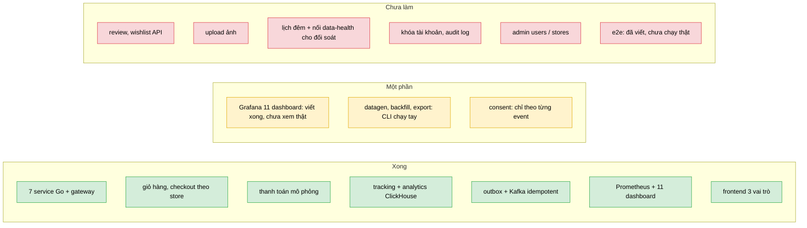
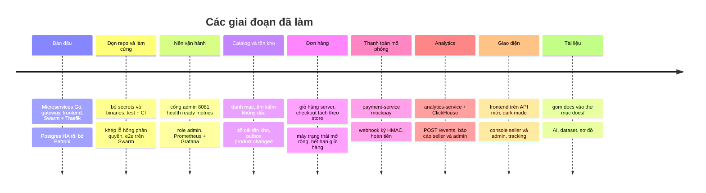

# Đã làm được gì (trạng thái triển khai)

> Bản tóm tắt để đọc nhanh. Bảng chi tiết từng hạng mục (có ghi chú code) nằm ở [../design/platform/09_ROADMAP_STATUS.md](../design/platform/09_ROADMAP_STATUS.md). Khi tài liệu và code khác nhau, **code đúng**.
> Chú thích: ✅ xong · 🟡 một phần · ❌ chưa làm.

## 0. Nhìn nhanh

## 1. Dòng thời gian (theo lịch sử git)

Mã commit tương ứng: bản đầu `2a4dd77`…`56a0da2`; dọn repo `c01ace5`, `67de823`, `d92bfd8`, `21fb766`; nền vận hành `17197a0`, `48c5ce0`; catalog `36e166e`; đơn hàng `fdc4234`; thanh toán `cf89e52`; analytics `f72866a`, `934245d`; giao diện `f73facf`, `6a389cb`; tài liệu `075b489`, `09104fb`.

## 2. Tính năng theo vai trò

### Buyer
✅ đăng ký / đăng nhập / refresh / đổi mật khẩu · ✅ xem & tìm kiếm catalog (không dấu), lọc danh mục · ✅ giỏ hàng (gộp khi đăng nhập), xem trước checkout · ✅ địa chỉ giao hàng · ✅ đặt hàng idempotent, tách đơn theo store · ✅ thanh toán mô phỏng (thẻ / ví / chuyển khoản / COD) · ✅ hủy đơn, xác nhận đã nhận, yêu cầu trả hàng, theo dõi timeline · ❌ review, wishlist · ❌ upload ảnh (ảnh chỉ là URL)

### Seller
✅ tạo store, CRUD sản phẩm, trạng thái sản phẩm, điều chỉnh tồn kho + sổ cái · ✅ hộp thư đơn: ship / deliver / duyệt-từ chối trả hàng · ✅ analytics của store: summary, timeseries, top products, funnel, low-stock

### Admin
✅ bootstrap qua biến môi trường · ✅ analytics toàn sàn (+ traffic, payments, search terms, data-health) · ✅ quản lý danh mục · ✅ xem thanh toán, hoàn tiền thủ công · ✅ `/ops/system/health` · ❌ `/admin/users`, `/admin/stores` (duyệt / khóa), audit log, proxy metrics

### Nền tảng
✅ 7 service Go + gateway 2 replica · ✅ outbox giao dịch + consumer idempotent (✅ R2: lỗi theo từng dòng, backoff, dead-letter `DEAD`, requeue bằng SQL) · ✅ health / ready / metrics mọi service · ✅ Prometheus + 11 dashboard Grafana (🟡 6 cái mới chưa xem trên Grafana thật) · ✅ tracking clickstream có consent, che PII, hash IP xoay ngày · ✅ CI (build, vet, test 7 service, ClickHouse 24.8 thật) · ✅ migration Postgres có version (goose, 5 service; ADR-26) · ✅ R5–R10 (2026-10-26): `accounts` UNIQUE (username, role), `payment.refunded` → `payment_status` đơn, nhập lại kho khi đơn `REFUNDED`, payment `PROCESSING` hết hạn sau 1 giờ, doanh thu COD không dịch khi trả hàng bị từ chối, store demo cho seller1, bỏ bảng thừa user-service · 🟡 DLQ Kafka `<topic>.dlq` sau 5 lần thử (R3, `mm_kafka_dlq_total`; chưa chạy trên Swarm) · 🟡 spool bền cho tracking analytics (R1, `ANALYTICS_SPOOL_DIR`; chưa chạy trên Swarm) · 🟡 request-id xuyên service (chưa vào Kafka; ADR-27) · 🟡 deadline / retry gRPC ở gateway (retry chỉ lệnh đọc; chưa circuit breaker) · 🟡 log tập trung Vector → Loki → Grafana (ADR-28, chạy thật cục bộ, chưa trên Swarm) · 🟡 metric nghiệp vụ (order / payment / product / gateway) · ❌ cảnh báo (cố ý, ADR-12) · 🟡 đối soát Postgres ↔ ClickHouse và backfill ClickHouse: CLI `reconcile` / `backfill` đã chạy thật cục bộ, chưa có lịch đêm / `data-health` · ✅ `scripts/datagen` (dữ liệu giả có seed) · 🟡 `scripts/export` (xuất snapshot CSV / Parquet; chưa có scheduler, kho đối tượng) · ❌ materialized view (cố ý, ADR-14)

## 3. Kiểm thử
Mỗi service là module Go riêng, có test đơn vị / tích hợp (tích hợp DB bị skip nếu không đặt `TEST_POSTGRES_DSN` / `TEST_CLICKHOUSE_URL`). Phạm vi test từng khu vực: [../instruction/04_TESTING.md](../instruction/04_TESTING.md) §2.

## 4. Chưa từng được kiểm chứng
Docker, Swarm, Traefik, ClickHouse server, Prometheus, Grafana **chưa từng chạy trong môi trường soạn code / tài liệu** (chỉ kiểm cú pháp; SQL ClickHouse được thử trên chDB, ClickHouse 24.8 thật chỉ chạy ở CI). E2E `scripts/e2e` đã viết lại cho API mới, `resilience.sh` (A..I), `scripts/load`, `wait-ready.sh` và `update_config` cũng đã viết nhưng chưa chạy trên stack thật. Danh sách đầy đủ: [../planning/01_OPEN_ISSUES.md](../planning/01_OPEN_ISSUES.md).

## 5. AI
Tài liệu: [../ai/README.md](../ai/README.md), [../dataset/README.md](../dataset/README.md); kế hoạch và trạng thái tầng agent: [../ai/08_AGENT_BUILD_ROADMAP.md](../ai/08_AGENT_BUILD_ROADMAP.md) (§16).

| Phần | Trạng thái |
|---|---|
| Gateway cho agent: token agent (khoá xoay), gói đề xuất ký (8 route), cột `agent_run_id` ở order/payment/product, bảng route đọc cho buyer và seller + `GET /ai/tools`, rate limit AI theo người dùng (fail-closed), không chuyển JWT người dùng sang agent | ✅ có test (2026-11-14) |
| `services/ai-agent` (config yaml, LLM profile/role/factory, persona buyer + seller, tool từ gateway, `POST /chat` SSE, giới hạn vòng/thời gian/token, kho trong bộ nhớ, Dockerfile, mục trong `deploy/services.yml`) | 🟡 45 test đạt trên Python 3.12 (có `create_agent` thật + FastAPI) và một lượt thật với OpenCode (buyer, seller; gateway giả; stream từng token). Đã có tool đề xuất (huỷ đơn, trả hàng, tồn kho) + thẻ xác nhận ở UI và kho chat Postgres (64 test, Postgres 16 thật). **Chưa thử trên Swarm/trình duyệt**. Xem roadmap §16.5-16.7, ADR-43 |
| Kho Postgres của agent, `/metrics`, tool đề xuất hành động, bộ câu hỏi vàng (`evals/`), chính sách buyer, RCA | ❌ |

## 6. Phiên 2026-10-25
Chi tiết đã đổi gì, kiểm chứng gì và việc tiếp theo: [02_SESSION_LOG_2026-10-25.md](02_SESSION_LOG_2026-10-25.md).

- Persona admin/operator (chỉ đọc: đơn/thanh toán/báo cáo toàn sàn cho admin; sự cố, audit, outbox, health, đề xuất vận hành, số liệu Prometheus/Loki có tên cho cả hai), chính sách buyer/seller trong `personas/*/policy.md`: đã code và test, chưa chạy thử thật trên Swarm (docs/ai/08 §16.8).
- Phiên 2026-11-14 (agent): vai trò `dev` đổi thành `operator` (ADR-44, migration auth `00004`); bộ lọc/sắp xếp phía server cho danh sách đơn, thanh toán, sản phẩm của seller, top sản phẩm (§16.13-16.14); hạn mức token mỗi ngày mỗi người dùng (§16.16); không lộ route/tên tool cho buyer/seller (§16.12); popup chat không đóng khi bấm ra ngoài, dữ liệu tra cứu gấp lại (§16.15, 16.17); `scripts/smoke-ai.sh`; env conda `base_python_3.12` cho test ai-agent. Mới chạy test đơn vị và Postgres thật; **chưa deploy/chạy lại** bản này trên Swarm. Chưa làm: RCA (bước 4 và 6), golden eval, trang admin xem lịch sử chat, mở lại hội thoại cũ, dashboard Grafana cho agent.
- Phiên 2026-11-14 (tiếp): `ai-agent` có `/metrics` và job Prometheus riêng, bản đồ hệ thống có node ai-agent và số liệu frontend lấy từ Traefik; bộ eval 402 câu viết tay + chấm tĩnh (chưa chạy `--live`); ops-service phục vụ playbook cho RCA bước 4 (`ops_list_playbooks`, `ops_get_playbook`). Chi tiết §16.18 của `docs/ai/08_AGENT_BUILD_ROADMAP.md`. Đã deploy lên Swarm tối 2026-11-14 (migration auth chạy, playbook nạp, Prometheus cào ai-agent, bản đồ có node ai-agent kèm replica). Sau đó (đã được đồng ý gọi LLM): smoke buyer và admin đạt trên Swarm (sửa trần token một lượt riêng cho admin/operator), seller và operator chưa chạy vì thiếu mật khẩu; eval `--live` đã chạy, mốc sau sửa 304/402 (76%, lần đầu 264/402), chi tiết và các việc kế tiếp ở §16.20. RCA mới là dữ liệu + tool + prompt, chưa có thành phần điều phối.
- Phiên 2026-11-14 (cuối): cảnh báo `AIAgentDown` + playbook `ai-agent` + runbook §19, dashboard Grafana `ai-agent.json`, mở lại cuộc chat cũ (nút "Lịch sử") và trang `/admin/ai-chats` cho admin; đã deploy ai-agent, gateway, frontend, ops-service. Chi tiết §16.19 của roadmap. Chưa làm: RCA bước 6, thử RCA bằng sự cố giả lập.
- Phiên 2026-11-15: rà soát mô tả tool (analytics trả sai kỳ vì `from` bỏ trống = 30 ngày; 22/45 tool thiếu mô tả tham số) đã sửa và deploy; bảng trạng thái lỗi eval (đã sửa / chưa làm / chưa xác định) ở §16.22 của `docs/ai/08_AGENT_BUILD_ROADMAP.md`. Chưa chạy lại eval sau các sửa này.
- Phiên 2026-11-15 (tiếp): làm nốt các mục eval đã đề xuất (prompt không hỏi lại khi đủ điều kiện lọc, trần token riêng buyer/seller, stub đúng dạng sản phẩm, sửa regex và case chặt, dung sai ngày `~N`); ai-agent đã deploy, chưa chạy lại eval. Xem §16.22.
- Phiên 2026-11-15 (cuối): tìm ra lỗi thật `from` bị LangChain bỏ khỏi schema mô hình (sửa `from_`, roadmap §16.23), `from` bắt buộc ở tool analytics, stub chấp nhận id chuỗi, `run_evals.py --only-failed/--ids`; chạy lại các câu sai, ước tính 401/402 (chưa chạy lại đủ); gateway + ai-agent đã deploy; `CLAUDE.md` thêm rule hỏi trước khi gọi LLM.
- Phiên 2026-11-15 (chạy đủ): 386/402 (96%) sau các bản sửa (264 → 324 → 386), roadmap §16.24; nâng `max` cho 11 câu dao động, thêm rule buyer (đếm, quy định từ công cụ). Chưa chạy lại sau rule mới.
- Phiên 2026-11-15 (cuối): trần token buyer 25000 → 32000 (prompt dài hơn làm cắt lượt sau khi đã đề xuất trả hàng); chạy lại 7 câu buyer; ai-agent đã deploy.
- Phiên 2026-11-15 (RCA): ADR-45 đường đề xuất vận hành cho operator (`ops_action` = POST /ops/proposals qua ký + xác nhận ở UI), tool `ops_list_actions`, body lồng `params`; admin vẫn chỉ đọc; eval 406 câu; việc RCA còn lại ở roadmap §16.25.
