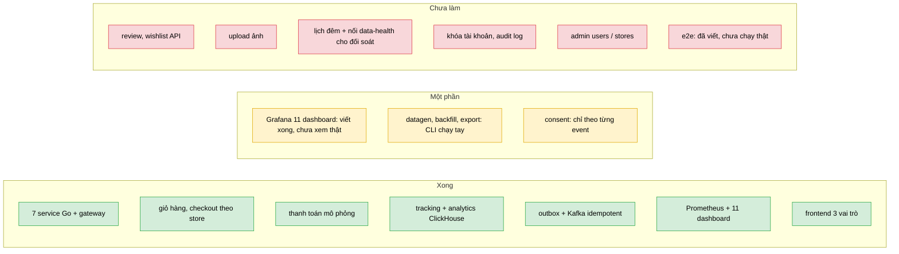
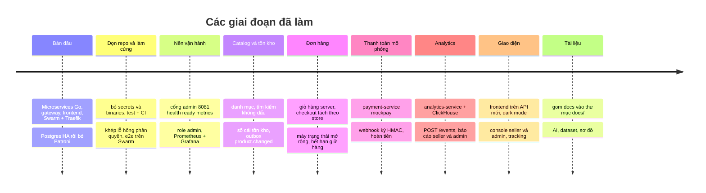

# Đã làm được gì (trạng thái triển khai)

> Bản tóm tắt để đọc nhanh. Bảng chi tiết từng hạng mục (có ghi chú code) nằm ở [../design/platform/09_ROADMAP_STATUS.md](../design/platform/09_ROADMAP_STATUS.md). Khi tài liệu và code khác nhau, **code đúng**.
> Chú thích: ✅ xong · 🟡 một phần · ❌ chưa làm.

## 0. Nhìn nhanh

## 1. Dòng thời gian (theo lịch sử git)

Mã commit tương ứng: bản đầu `2a4dd77`…`56a0da2`; dọn repo `c01ace5`, `67de823`, `d92bfd8`, `21fb766`; nền vận hành `17197a0`, `48c5ce0`; catalog `36e166e`; đơn hàng `fdc4234`; thanh toán `cf89e52`; analytics `f72866a`, `934245d`; giao diện `f73facf`, `6a389cb`; tài liệu `075b489`, `09104fb`.

## 2. Tính năng theo vai trò

### Buyer
✅ đăng ký / đăng nhập / refresh / đổi mật khẩu · ✅ xem & tìm kiếm catalog (không dấu), lọc danh mục · ✅ giỏ hàng (gộp khi đăng nhập), xem trước checkout · ✅ địa chỉ giao hàng · ✅ đặt hàng idempotent, tách đơn theo store · ✅ thanh toán mô phỏng (thẻ / ví / chuyển khoản / COD) · ✅ hủy đơn, xác nhận đã nhận, yêu cầu trả hàng, theo dõi timeline · ❌ review, wishlist · ❌ upload ảnh (ảnh chỉ là URL)

### Seller
✅ tạo store, CRUD sản phẩm, trạng thái sản phẩm, điều chỉnh tồn kho + sổ cái · ✅ hộp thư đơn: ship / deliver / duyệt-từ chối trả hàng · ✅ analytics của store: summary, timeseries, top products, funnel, low-stock

### Admin
✅ bootstrap qua biến môi trường · ✅ analytics toàn sàn (+ traffic, payments, search terms, data-health) · ✅ quản lý danh mục · ✅ xem thanh toán, hoàn tiền thủ công · ✅ `/admin/system/health` · ❌ `/admin/users`, `/admin/stores` (duyệt / khóa), audit log, proxy metrics

### Nền tảng
✅ 7 service Go + gateway 2 replica · ✅ outbox giao dịch + consumer idempotent · ✅ health / ready / metrics mọi service · ✅ Prometheus + 11 dashboard Grafana (🟡 6 cái mới chưa xem trên Grafana thật) · ✅ tracking clickstream có consent, che PII, hash IP xoay ngày · ✅ CI (build, vet, test 7 service, ClickHouse 24.8 thật) · ✅ migration Postgres có version (goose, 5 service; ADR-26) · 🟡 request-id xuyên service (chưa vào Kafka; ADR-27) · 🟡 deadline / retry gRPC ở gateway (retry chỉ lệnh đọc; chưa circuit breaker) · 🟡 log tập trung Vector → Loki → Grafana (ADR-28, chạy thật cục bộ, chưa trên Swarm) · 🟡 metric nghiệp vụ (order / payment / product / gateway) · ❌ cảnh báo (cố ý, ADR-12) · 🟡 đối soát Postgres ↔ ClickHouse và backfill ClickHouse: CLI `reconcile` / `backfill` đã chạy thật cục bộ, chưa có lịch đêm / `data-health` · ✅ `scripts/datagen` (dữ liệu giả có seed) · 🟡 `scripts/export` (xuất snapshot CSV / Parquet; chưa có scheduler, kho đối tượng) · ❌ materialized view (cố ý, ADR-14)

## 3. Kiểm thử
Mỗi service là module Go riêng, có test đơn vị / tích hợp (tích hợp DB bị skip nếu không đặt `TEST_POSTGRES_DSN` / `TEST_CLICKHOUSE_URL`). Phạm vi test từng khu vực: [../instruction/04_TESTING.md](../instruction/04_TESTING.md) §2.

## 4. Chưa từng được kiểm chứng
Docker, Swarm, Traefik, ClickHouse server, Prometheus, Grafana **chưa từng chạy trong môi trường soạn code / tài liệu** (chỉ kiểm cú pháp; SQL ClickHouse được thử trên chDB, ClickHouse 24.8 thật chỉ chạy ở CI). E2E `scripts/e2e` đã viết lại cho API mới, `resilience.sh` (A..I), `scripts/load`, `wait-ready.sh` và `update_config` cũng đã viết nhưng chưa chạy trên stack thật. Danh sách đầy đủ: [../planning/01_OPEN_ISSUES.md](../planning/01_OPEN_ISSUES.md).

## 5. AI
Chưa có `ai-service` hay endpoint AI nào. Mới có tài liệu nghiên cứu: [../ai/README.md](../ai/README.md) và [../dataset/README.md](../dataset/README.md).

## 6. Phiên 2026-10-25
Chi tiết đã đổi gì, kiểm chứng gì và việc tiếp theo: [02_SESSION_LOG_2026-10-25.md](02_SESSION_LOG_2026-10-25.md).
