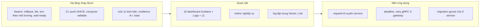

# Nhật ký phiên làm việc 2026-10-25

> Ghi lại những gì đã làm trong một phiên: hoàn thiện phần hạ tầng (deploy, CI, e2e, quan sát), thêm request-id, deadline/retry gRPC ở gateway, migration Postgres có version (goose) và log tập trung. Phần AI **chưa động tới**. Toàn bộ thay đổi **chưa commit** (người dùng tự commit). Khi tài liệu và code khác nhau, **code đúng**.
> Chú thích: ✅ đã kiểm chứng bằng chạy thật (cục bộ) · 🟡 đã viết, mới kiểm cú pháp hoặc test đơn vị, chưa chạy trên stack thật · ❌ chưa làm.

## 1. Triển khai và Swarm 🟡

| Việc | Chi tiết |
|---|---|
| Cập nhật không gián đoạn | `deploy/services.yml` có `update_config` + `rollback_config` (anchor `x-update-start-first`, `x-update-stop-first`, `x-rollback`: parallelism 1, delay 10 s, `failure_action: rollback`, monitor 30 s). start-first cho traefik, frontend, gateway, auth, user, product, order; **stop-first** cho payment và analytics để không có hai worker / consumer chạy cùng lúc |
| Profile `lite` | `deploy/services.lite.yml` (gateway 1 replica, hạ memory limit); bật bằng `LITE=true`. `observability.yml` chưa có bản lite |
| Môi trường | `deploy/env/{dev,staging,prod}.env.example`; `scripts/deploy.sh` chọn file theo `ENV_FILE`, rồi `DEPLOY_ENV=dev\|staging\|prod` (đọc `deploy/env/.env.<môi trường>`), rồi `deploy/.env` như cũ. File thật phải đặt tên `.env.<môi trường>` để `.gitignore` chặn |
| `scripts/wait-ready.sh` | chờ các stack đạt N/N rồi gọi `/ready` của 7 service Go bằng container tạm trong `marketplace-net`; gọi từ `deploy.sh`, bỏ qua bằng `--no-wait` / `SKIP_WAIT=1`; biến `WAIT_TIMEOUT`, `WAIT_INTERVAL`, `WAIT_PROBE_IMAGE`, `WAIT_SKIP_READY`, `WAIT_TARGET` |
| Địa chỉ gRPC | hết cứng trong code: `AUTH_SERVICE_ADDR`, `ORDER_SERVICE_ADDR`, `PRODUCT_SERVICE_ADDR`, `USER_SERVICE_ADDR`, `ANALYTICS_SERVICE_ADDR`, `PAYMENT_SERVICE_ADDR` (mặc định đúng giá trị cũ; gateway, order, auth, user, product đọc biến) |
| `.env.example` | thêm `cmd/.env.example` cho payment-service và analytics-service; biến `ANALYTICS_*` có trong `deploy/.env.example` và `services.yml` |

## 2. CI 🟡

- `.github/workflows/ci.yml`: thêm job `compose-validate` (`docker compose config -q` cho 3 file với env giả, kèm shellcheck) và job `push-images` đẩy 8 image lên GHCR (`ghcr.io/<owner>/...`) **chỉ** khi push `main` hoặc tag `v*`, tag sha ngắn + `latest` + semver; quyền riêng `packages: write`.
- `scripts/build-images.sh`: hỗ trợ `REGISTRY` và `IMAGE_TAG` (mặc định git short sha); không đặt thì giữ hành vi cũ. `scripts/push-images.sh` mới (`EXTRA_TAGS`).
- CI **không deploy** (không có bước ssh). Chưa chạy workflow trên GitHub.

## 3. Kiểm thử trên hạ tầng thật 🟡

- `scripts/e2e/` viết lại: `run.mjs` (`--list`, `--only`, `--skip`), 11 kịch bản (auth/RBAC, catalog, giỏ + checkout idempotent, thanh toán đủ phương thức + webhook, vòng đời đơn, trả hàng/hoàn tiền, cô lập chéo shop, analytics, hết hạn giữ hàng, rate limit), thư viện `lib/`.
- `resilience.sh` A–I: ClickHouse, Kafka, payment, product, Redis, Postgres down; order-service down; rolling restart; Postgres restart.
- `scripts/load/load.mjs` + README: tải cố định theo RPS (browse, search, order COD, events), báo p50/p95/p99.
- **Chưa chạy lần nào trên stack thật** (chỉ `node --check`, `bash -n`, và `load.mjs` với mock HTTP).

## 4. Quan sát

| Việc | Trạng thái |
|---|---|
| ClickHouse server expose `/metrics` cổng 9363 (`deploy/clickhouse/prometheus.xml`, `configs:` trong `infra.yml`), scrape job `clickhouse` | ✅ chạy thật ClickHouse 24.8 cục bộ (`/metrics` trả metric `ClickHouse*`); 🟡 `configs:` trong Swarm |
| Dashboard mới: ClickHouse server, Outbox & Workers, Payments, Business, Kafka consumer lag | 🟡 `jq` hợp lệ, PromQL chưa chạy trên Prometheus thật |
| Metric nghiệp vụ order | `mm_checkouts_total{result}`, `mm_orders_created_total`, `mm_order_status_transitions_total{to_status}`, `mm_orders_payment_expired_total`, `mm_orders_auto_delivered_total`, `mm_order_cart_merges_total` |
| Metric nghiệp vụ payment | `mm_payments_created_total{method}`, `mm_payments_completed_total{method,result}`, `mm_payment_amount_minor_total{method}`, `mm_refunds_total{result}`, `mm_payment_webhooks_total{result}`, `mm_payment_processing_seconds` |
| Metric nghiệp vụ product | `mm_inventory_reservations_total{result}`, `mm_inventory_adjustments_total{reason}`, `mm_products_changed_total{op}` (chưa đếm `SetProductStatus`; `delete` luôn 0) |
| Metric gateway | `mm_rate_limited_total{group}`, `mm_grpc_client_requests_total{service,method,code}`, `mm_grpc_client_duration_seconds{service,method}`, `mm_grpc_client_retries_total{service,method}` (nhãn `service` = service đích) |
| Lag consumer Kafka | dùng `kafka_consumergroup_lag` của kafka-exporter, **không** có `mm_kafka_consumer_lag` tự phát |
| Healthcheck container exporter | postgres-exporter, kafka-exporter có (`wget`); **redis-exporter không khả thi** (image scratch, không shell / wget) → xem `up{job="redis"}` |

## 5. Request-id, deadline và retry 🟡

**Request-id** (nhận diện một request xuyên 7 service):
- HTTP: header `X-Request-ID` (gateway nhận nếu khớp `^[A-Za-z0-9._-]{8,64}$`, không thì tạo UUID v4); luôn trả lại trong response; CORS cho phép / expose header này.
- gRPC: metadata `x-request-id`. Mỗi service Go có package `internal/requestid` (`FromContext`, `NewContext`, `UnaryServerInterceptor`, `UnaryClientInterceptor`, `Logger`); server interceptor đứng trước interceptor metrics, client interceptor gắn ở nơi tạo `grpc.NewClient`.
- Gateway: middleware gin đứng đầu chuỗi, access log có `request_id`, body lỗi có field `request_id` (thêm field, không phá contract); `authclient` / `userclient` nhận `ctx` từ handler nên request-id đi tiếp sang auth / user-service. payment-service đọc `X-Request-ID` ở webhook.
- ❌ Chưa đưa request-id vào event Kafka / outbox (cần thêm cột). `productclient` của gateway vẫn dùng `context.Background()`.

**Deadline / retry gRPC ở gateway** (`internal/client/interceptors.go`; chuỗi: requestid → deadline → retry → metrics):

| Biến | Mặc định | Ý nghĩa |
|---|---|---|
| `GRPC_TIMEOUT_READ_MS` | 3000 | deadline cho lệnh đọc |
| `GRPC_TIMEOUT_WRITE_MS` | 10000 | deadline cho lệnh ghi |
| `GRPC_RETRY_MAX_ATTEMPTS` | 3 | tổng số lần gọi, tính cả lần đầu |

- Giữ deadline của ctx nếu nó nhỏ hơn mặc định.
- `IsReadMethod`: đọc nếu tên bắt đầu `Get`, `List`, `Search`, `Preview`, `Query`, `Count`, `Validate`; mọi tên khác mặc định là **ghi**; ngoại lệ `GetAndDecreaseInventoryByID` coi là ghi.
- Retry **chỉ lệnh đọc**, **chỉ** mã `Unavailable`, backoff 100 ms rồi 200 ms có jitter, dừng khi ctx cha hết hạn; `DeadlineExceeded` không retry. Lệnh ghi không retry (kể cả `POST /orders` có `Idempotency-Key`, để dành đợt sau).
- `DeadlineExceeded` → HTTP **504**; `Unavailable` giữ **503**.
- ❌ Circuit breaker chưa làm.

## 6. Migration Postgres có version (goose) ✅/🟡

- Thay `AutoMigrate` bằng `github.com/pressly/goose/v3` **v3.26.0** (Provider API) cho auth, user, product, order, payment. analytics dùng ClickHouse migration có version sẵn.
- Mỗi service: `services/<svc>/migrations/00001_baseline.sql` + `embed.go` (`go:embed *.sql`), `internal/migrate/migrate.go` (`Run`), bảng version riêng `goose_db_version_<svc>`, khoá `lock.NewPostgresSessionLocker()` (advisory lock: chỉ một replica chạy migration). Chạy lúc service khởi động; AutoMigrate cũ đã xoá.
- Baseline idempotent (`IF NOT EXISTS`) nên DB cũ do AutoMigrate tạo vẫn lên được. `domain_events` là bảng vật lý **chung** của product / order / payment (ADR-23): cả ba baseline dùng `IF NOT EXISTS`, cấu trúc giống hệt `pkg/events`.
- Baseline sinh từ AutoMigrate cũ + `pg_dump` (user, product, order, payment); baseline auth viết tay lúc đầu **sai** (thiếu sequence cho `pwd_version_events.user_id`), đã sửa thành `BIGSERIAL` và đối chiếu: schema do goose tạo **khớp hoàn toàn** schema do AutoMigrate tạo.
- Ghim goose v3.26.0 vì v3.29 đòi Go 1.26 và kéo grpc 1.84 trong khi Dockerfile dùng `golang:1.25`. `go.mod` mỗi service thêm goose, uuid (và vài thư viện gián tiếp nâng nhẹ).
- Test migration (`internal/migrate/migrate_test.go`, cần `TEST_POSTGRES_DSN`): DB trống, chạy hai lần, DB cũ có dữ liệu.

## 7. Log tập trung (Vector → Loki → Grafana) ✅/🟡

- Thiết kế: service ghi JSON ra **stdout**; **Vector** (global service, mỗi node một bản, đọc `docker.sock` chỉ đọc) gửi tới **Loki** (single binary, filesystem, retention theo `LOKI_RETENTION`); xem bằng Grafana. Service **không** tự đẩy log.
- Phiên bản: Loki 3.2.1, Vector 0.41.1-alpine. Cấu hình: `deploy/loki/loki.yml`, `deploy/vector/vector.yaml`. Volume `loki-data`, `vector-data` (buffer đĩa 256 MB). RAM limit Loki 512 MB, Vector 128 MB. Không publish cổng.
- Nhãn Loki **chỉ** `service`, `stack`, `level`, `env`. **`request_id` không là nhãn** (nằm trong nội dung dòng log, lọc bằng `| json | request_id=~"..."`) để tránh bùng nổ chỉ mục.
- Che PII ở Vector trước khi vào kho: email, số điện thoại VN, Bearer / JWT, trường `password` / `authorization` / `token`, số thẻ. **Giới hạn đã biết**: số điện thoại chỉ che dạng liền (`+84...`, `84...`, `0[35789]...`); số thẻ chỉ che dạng 13–16 chữ số liền hoặc 4 nhóm cách bằng space / gạch.
- Mọi service có `logging: json-file` với `max-size: 10m`, `max-file: 3` (anchor `x-logging`), tránh đầy đĩa node.
- Grafana: datasource Loki (uid `loki`), dashboard **Marketplace · Logs** (uid `mm-logs`, biến `service`, `level`, ô `request_id`) → tổng **11 dashboard**. Prometheus scrape thêm `loki` và `vector`.
- `LOKI_RETENTION`: 168h mặc định; dev 72h, staging 120h, prod 336h.
- ✅ Chạy thật Loki + Vector cục bộ bằng Docker (log vào Loki, PII bị che, nhãn đúng, lọc `request_id` hoạt động). 🟡 Chưa thử trong Swarm (`deploy.mode: global`, `configs:`, DNS `tasks.vector`), chưa nạp dashboard vào Grafana thật.

## 8. Việt hoá tài liệu ✅

`05_SECURITY.md`, `06_PROTOBUF.md`, ADR-1…12, nhãn mermaid trong `02_HEALTH_READY_METRICS.md` đã dịch; các file còn lại vốn tiếng Việt. Không đụng `docs/ai`, `docs/dataset`.

## 8b. Đường ống dữ liệu D5 / D4 / D3 ✅/🟡

Thiết kế: [../design/07_DATA_PIPELINE.md](../design/07_DATA_PIPELINE.md), ADR-29; giải thích dễ hiểu: [../planning/04_DATA_PIPELINE_NOTES.md](../planning/04_DATA_PIPELINE_NOTES.md).

- **D5 `scripts/datagen`** (Python, chỉ thư viện chuẩn): `synthetic` và `retailrocket` (có fixture tí hon cùng định dạng), `--seed`, `--reset`. Ghi SQL trực tiếp vào Postgres (accounts, buyers / sellers / addresses, categories / products / inventory_ledgers, checkouts / orders / order_items / order_status_histories, payments / attempts / refunds) và `events_raw` vào ClickHouse; test dựng DB bằng chính migration goose.
- **D4 `services/analytics-service/cmd/backfill`** (Go): `backfill` dựng lại bảng fact / dim từ Postgres qua đúng handler consumer Kafka; `reconcile` so theo ngày số dòng và tiền, doanh thu theo ADR-22. Thêm `pgx/v5 v5.7.5` vào analytics-service.
- **D3 `scripts/export`** (Python): profile `otto`, `rees46`, `orders`, `raw`; CSV (Parquet nếu có `pyarrow`); `manifest.json`; chia train / valid / test theo thời gian, chỉ event có consent, không PII.
- ✅ **Đã chạy vòng đầy đủ** trên Postgres 16 + ClickHouse 24.8 (Docker cục bộ, đã dọn): datagen 9.572 dòng Postgres + 315.762 `events_raw` (5,5 giây) → backfill (`fact_order_status` 3.593, `fact_order_items` 860, `fact_payment_events` 493, `fact_refunds` 50, `dim_products` 113, `fact_inventory` 1.715) → reconcile `MATCH` 1.219 phép so, 0 lệch → export `otto` 26.049 clicks / 5.234 carts / 464 orders.
- Test: datagen 13 test, export 19 test (ClickHouse 24.8 thật), backfill unit + tích hợp (xoá `fact_refunds` → reconcile báo lệch đúng ngày; chạy lại backfill thì tự sửa).
- 🟡 **Chưa**: scheduler (D6), kho đối tượng (D1), nối `data-health` + metric `mm_reconcile_diff_ratio`, bộ RetailRocket thật (chỉ fixture), chạy trên Swarm. Backfill chồng lên khoảng Kafka đã điền có thể nhân đôi `fact_payment_events` (failed) và `fact_inventory`; `events_raw` không dựng lại được từ Postgres; export gắn đơn vào phiên cuối trong 24 giờ nên `otto` có ít đơn hơn doanh thu.

## 9. Đã kiểm chứng và chưa kiểm chứng

**Đã kiểm chứng (cục bộ)**
- Vòng datagen → backfill → reconcile → export trên Postgres 16 + ClickHouse 24.8 (mục 8b);
- Test đơn vị + test DB cho auth, user, product, order, payment trên Postgres 16 trong Docker (máy không có Go: chạy trong `golang:1.24/1.25-alpine`); gateway build / vet / test qua.
- Loki 3.2.1 + Vector 0.41.1 chạy thật; ClickHouse 24.8 `/metrics` chạy thật; `docker compose config -q` cho 3 file; `promtool check config`; `jq -e .` cho dashboard; `bash -n`, `node --check`.

**Chưa kiểm chứng**
- Mọi thứ trên **Swarm thật**: `update_config` / rollback, `wait-ready.sh`, `configs:` (ClickHouse, Loki, Vector), Vector global, profile lite.
- PromQL / dashboard trên Prometheus + Grafana thật; metric nghiệp vụ mới chỉ có test đơn vị.
- e2e, `resilience.sh`, load test; workflow CI trên GitHub (push GHCR).
- Chạy nhiều replica cho service ngoài gateway.

## 10. Việc tiếp theo

1. Deploy Swarm lần đầu (sau khi code xong), chạy `run-in-swarm.sh`, sửa chỗ lệch, cập nhật lại tài liệu.
2. Chuẩn hoá log JSON trong service (đang trộn `zap` và `log.Printf`).
3. Request-id vào event Kafka / outbox (thêm cột bằng migration goose mới).
4. Retry cho lệnh ghi có `Idempotency-Key`; circuit breaker.
5. Dead-letter cho outbox, backup Postgres có lịch + thử khôi phục, xoay secret trong lịch sử git.
6. Tracing OpenTelemetry (dùng lại request-id làm trace-id); thử Loki / Vector trên Swarm.
