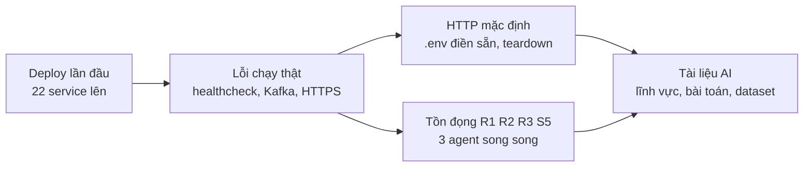

# Nhật ký phiên làm việc 2026-10-26

> Phiên đầu tiên **chạy thật** trên Docker Swarm (trước đó mọi thứ mới kiểm cú pháp / test đơn vị): deploy, sửa các lỗi chỉ lộ ra khi chạy thật, chuyển mặc định sang HTTP, làm các mục tồn đọng R1 / R2 / R3 / S5, viết công cụ dọn dẹp và tài liệu AI.
> Chú thích: ✅ đã kiểm chứng bằng chạy thật · 🟡 đã viết + test đơn vị / DB tạm, chưa chạy trên stack thật · ❌ chưa làm.

## 1. Lần chạy thật đầu tiên ✅ (một phần)

| Việc | Kết quả |
|---|---|
| `docker swarm init`, `build-images.sh`, `deploy.sh` | ✅ 3 stack, 22 service lên (gateway 2 replica) |
| Website, REST API qua Traefik | ✅ `/` và `/products` trả 200, CORS đúng với origin của frontend |
| Prometheus / Grafana | ✅ 18 target `up`, datasource Loki và Prometheus kết nối được, 11 dashboard được provision |
| `scripts/e2e/resilience.sh A` | ✅ đạt sau khi sửa lỗi Kafka (mục 2). Kịch bản B..I **chưa chạy** |
| Bộ e2e chính (`run.mjs`, 11 kịch bản) | ❌ chưa chạy |
| Giao diện Grafana (PromQL từng panel) | ❌ chưa ai xem từng panel |

## 2. Lỗi chỉ lộ ra khi chạy thật, và cách sửa

| # | Triệu chứng | Nguyên nhân | Sửa |
|---|---|---|---|
| 1 | `deploy.sh` chờ mãi, `frontend` kẹt 0/1 | healthcheck gọi `wget http://localhost:3000`; trong alpine `localhost` ra `::1` (IPv6) còn Next nghe IPv4 ⇒ luôn unhealthy ⇒ bị tắt, thoát mã 0 nên `on-failure` không khởi động lại | `deploy/services.yml`: dùng `127.0.0.1` ✅ |
| 2 | Đăng ký seller xong vẫn "Create a store first"; e2e `setup` báo `ok:false` | consumer Kafka của auth-service được chia **0 partition** (xem ADR-31). Event `user.create_seller` không tới auth-service nên `store_id` không bao giờ được ghi | sửa `EnsureTopicExist` ở 7 bản `kafka_client.go` + test `TestTopicReady`; gỡ tạm bằng `docker service update --force marketplace_auth-service` ✅ gỡ tạm, 🟡 bản sửa gốc chưa chạy trên Kafka rỗng |
| 3 | Trình duyệt: "Failed to fetch" khi gọi API | cert tự ký + gateway gửi HSTS `includeSubDomains` ⇒ Chrome không cho bỏ qua cảnh báo ở `api.*` ⇒ fetch bị chặn trước khi tới gateway | mặc định HTTP, HTTPS tùy chọn (ADR-30) ✅ |

Ghi chú về lần sửa Kafka đầu tiên: thêm `WatchPartitionChanges` **không** giải quyết được lỗi (watcher của `kafka-go` lấy mốc số partition lúc bắt đầu watch, sau khi đã join). Cờ vẫn để lại vì có ích khi partition được thêm sau này, nhưng comment đã sửa để không gây hiểu nhầm.

## 3. Làm cho chạy local nhanh gọn

| Việc | Chi tiết |
|---|---|
| `deploy/.env.example` điền sẵn giá trị local | Postgres / Grafana / ClickHouse / webhook secret / Traefik basic auth (`admin`/`admin`, hash htpasswd sẵn) / admin bootstrap, `SEED_DEMO_DATA=true`. Copy là chạy; lên prod phải đổi hết |
| `PUBLIC_SCHEME` (mặc định `http`) | `deploy.sh` gộp `services.https.yml` / `observability.https.yml` khi `https` (ADR-30); `build-images.sh` và các script e2e theo scheme |
| `scripts/teardown.sh` | gỡ stack, `--volumes` xóa dữ liệu, `--images`, `--leave-swarm`, `-y` |
| `scripts/build-images.sh <service...>` | build riêng từng service thay vì tất cả |
| Quickstart §6 "Restart và triển khai lại nhanh" | bảng lệnh theo tình huống, kiểm tra sau restart, cách chẩn đoán lỗi consumer Kafka |

## 4. Tồn đọng đã làm (3 agent song song)

| Mục | Kết quả | Mức |
|---|---|---|
| **R2** outbox `domain_events` | xử lý theo từng dòng, `attempts` + backoff mũ (`next_attempt_at`), quá `OUTBOX_MAX_ATTEMPTS` (10) ⇒ `DEAD`, key lỗi chỉ chặn các dòng sau cùng key, cả lô lỗi (Kafka sập) không sinh `DEAD`; migration `00002` ở product / order / payment; metric `mm_outbox_dead` và counter; 2 panel Grafana; SQL requeue trong runbook | 🟡 test Postgres tạm đạt, migration chưa chạy trên DB có dữ liệu |
| **R3** consumer Kafka | sau 5 lần thử thất bại ghi message sang `<topic>.dlq` (kèm lỗi, offset, số lần thử) rồi mới commit; ghi DLQ lỗi thì không commit; metric `mm_kafka_dlq_total{topic}` | 🟡 chỉ test với fake, chưa thử broker thật |
| **R1** analytics mất event | spool append-only xuống đĩa (`ANALYTICS_SPOOL_DIR`, volume `analytics-spool`, giới hạn `ANALYTICS_SPOOL_MAX_MB`), replay lúc khởi động; sửa lỗi có sẵn: analytics không flush khi nhận SIGTERM | 🟡 SIGKILL / OOM vẫn mất dữ liệu trong RAM |
| **S5** xác thực nội bộ | `METRICS_TOKEN` khóa `/metrics`, `/version`, pprof ở `:8081` (7 service, health / ready vẫn mở); Prometheus gửi bearer token; ClickHouse user `default` chỉ nhận loopback + dải private; **Prometheus web auth không bật** (cần hash bcrypt + mật khẩu thô cho Grafana; không publish cổng nên chỉ Grafana gọi được) | 🟡 chưa chạy trên Swarm |

Bài học quy trình: worktree của agent được tách từ `main` cũ (thiếu `docs/`, `deploy/`, payment-service). Hai agent tự `merge --ff-only` / `reset --hard` vào nhánh làm việc, một agent dừng và báo lại. Kết quả đưa về checkout chính bằng `git diff` + `git apply`, riêng các file đang bị sửa song song (`deploy/services.yml`, `.env.example`, `02_DEPLOYMENT.md`) phải ghép tay. Lần sau: giao việc agent trực tiếp trong checkout chính khi cần code mới nhất chưa commit.

## 5. Tài liệu AI

- `docs/ai/01_AI_SCOPES_OVERVIEW.md`: thêm §5 lĩnh vực + cột "làm riêng thành đề tài được không", §5.1 từng scope như một bài toán (dữ liệu, phương pháp so sánh, metric), §5.2 đề xuất gộp kèm logic, §6 cách tích hợp. Bỏ cách phân lớn / vừa / nhỏ.
- `01_AI_SCOPES_OVERVIEW.md` §6: bộ dữ liệu nên chọn cho từng scope (lớn nhất, hiệu quả nhất, vướng mắc tích hợp) và 5 cụm bộ dữ liệu tích hợp chung tốt nhất; rút từ việc 4 agent đọc song song 16 file `docs/dataset/` đối chiếu với data model thật. Cột "hiệu quả nhất" là suy luận, không có số đo.
- `07_COROOT_AND_INCIDENT_AGENT.md` (mới): Coroot là gì, khoanh vùng sự cố ra sao, kịch bản / dataset / test case cho agent điều tra sự cố (đã có, còn thiếu). Chưa cài thử Coroot.
- Sửa lỗi thời: `06_AGENT_FEATURES.md` ghi `log_search` "chưa có kho log" trong khi Loki + Vector đã chạy.

## 6. Chưa kiểm chứng (đầu việc tiếp theo)

- `resilience.sh B..I`, bộ e2e chính `run.mjs`, `scripts/load`.
- Bản sửa Kafka gốc trên **Kafka rỗng** (cần `teardown --volumes` rồi deploy lại).
- Migration `00002` outbox trên DB có dữ liệu; DLQ với broker thật; spool với ClickHouse thật; Prometheus scrape bằng `METRICS_TOKEN` trên Swarm.
- 11 dashboard Grafana: xem từng panel có dữ liệu không.
- Chưa có gì được commit trong phiên này.
